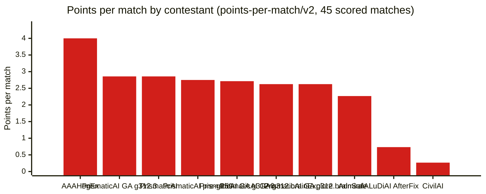
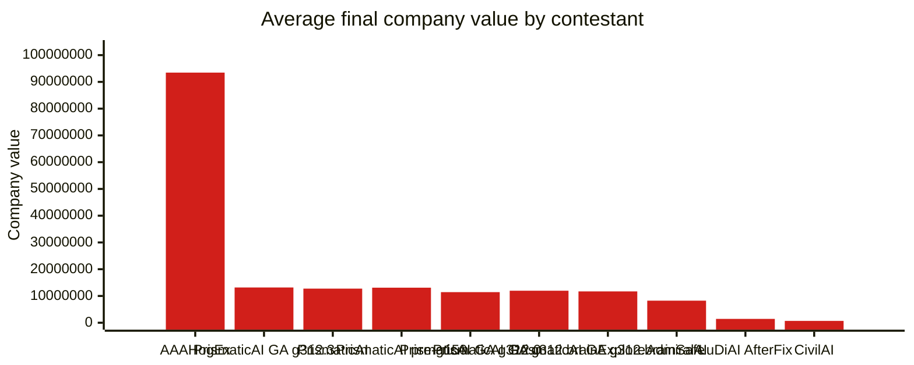
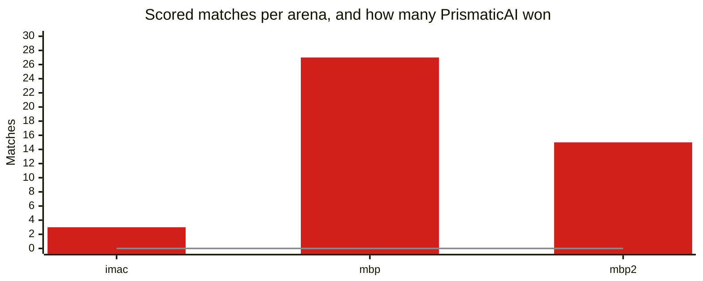

# battle-20261121T215623-0ccb796a

Derived from `battle-20261121T215623-0ccb796a.json` by `tools/research/ai-battle/battle.py report`; do not edit.

- Edition `0ccb796accc21c32`: PrismaticAI and referee at `531922be7d7544c6f7d5beecd51ca7906763f532`, base set `opengfx-8.0.tar`
- 20-year free-for-all from 1960, map 256x256 temperate, breakdowns 1
- 45 scored match(es) on `imac` (20261119-master-gdf1e05e7d8), `mbp` (20261120-master-m17653b726e), `mbp2` (20261119-master-gdf1e05e7d8)
- Replays: 0 of 0 identical to their original on another arena

| # | Contestant | Played | Wins | Points | Points/match | Avg rank | Avg final value | Squirrel errors | Matches with anomalies |
|---|---|---|---|---|---|---|---|---|---|
| 1 | AAAHogEx | 45 | 45 | 180 | 4.0 | 1.0 | 93.5 M | 0 | 0 |
| 2 | PrismaticAI GA g312.3 | 7 | 0 | 20 | 2.857 | 2.14 | 13.2 M | 0 | 0 |
| 3 | PrismaticAI | 7 | 0 | 20 | 2.857 | 2.14 | 12.7 M | 0 | 0 |
| 4 | PrismaticAI pre-g150 | 8 | 0 | 22 | 2.75 | 2.25 | 13.1 M | 0 | 0 |
| 5 | PrismaticAI GA g312.0 | 7 | 0 | 19 | 2.714 | 2.29 | 11.4 M | 0 | 0 |
| 6 | PrismaticAI GA g312.brainExplore | 8 | 0 | 21 | 2.625 | 2.38 | 12.0 M | 0 | 0 |
| 7 | PrismaticAI GA g312.brainSafe | 8 | 0 | 21 | 2.625 | 2.38 | 11.7 M | 0 | 0 |
| 8 | AdmiralAI | 45 | 0 | 102 | 2.267 | 2.73 | 8.2 M | 0 | 4 |
| 9 | LuDiAI AfterFix | 45 | 0 | 33 | 0.733 | 4.27 | 1.4 M | 0 | 1 |
| 10 | CivilAI | 45 | 0 | 12 | 0.267 | 4.73 | 676.8 k | 3690 | 13 |

```mermaid
---
config:
  xyChart:
    width: 900
    height: 360
  themeVariables:
    xyChart:
      plotColorPalette: "#d11f1a, #8a8a8a, #0b0b0b, #ece4d6"
---
xychart-beta
    title "Final company value per scored match: winner vs best PrismaticAI"
    x-axis ["m-0001", "m-0002", "m-0003", "m-0004", "m-0005", "m-0006", "m-0007", "m-0008", "m-0009", "m-0010", "m-0011", "m-0012", "m-0013", "m-0015", "m-0016", "m-0017", "m-0018", "m-0019", "m-0020", "m-0021", "m-0022", "m-0023", "m-0024", "m-0025", "m-0026", "m-0027", "m-0028", "m-0036", "m-0037", "m-0038", "m-0039", "m-0040", "m-0041", "m-0042", "m-0043", "m-0044", "m-0045", "m-0046", "m-0047", "m-0048", "m-0049", "m-0050", "m-0051", "m-0052", "m-0053"]
    %% series: Winner | Best PrismaticAI
    %% links: battle-20261121T215623-0ccb796a.md?col=Match&filter=m-0001 | battle-20261121T215623-0ccb796a.md?col=Match&filter=m-0002 | battle-20261121T215623-0ccb796a.md?col=Match&filter=m-0003 | battle-20261121T215623-0ccb796a.md?col=Match&filter=m-0004 | battle-20261121T215623-0ccb796a.md?col=Match&filter=m-0005 | battle-20261121T215623-0ccb796a.md?col=Match&filter=m-0006 | battle-20261121T215623-0ccb796a.md?col=Match&filter=m-0007 | battle-20261121T215623-0ccb796a.md?col=Match&filter=m-0008 | battle-20261121T215623-0ccb796a.md?col=Match&filter=m-0009 | battle-20261121T215623-0ccb796a.md?col=Match&filter=m-0010 | battle-20261121T215623-0ccb796a.md?col=Match&filter=m-0011 | battle-20261121T215623-0ccb796a.md?col=Match&filter=m-0012 | battle-20261121T215623-0ccb796a.md?col=Match&filter=m-0013 | battle-20261121T215623-0ccb796a.md?col=Match&filter=m-0015 | battle-20261121T215623-0ccb796a.md?col=Match&filter=m-0016 | battle-20261121T215623-0ccb796a.md?col=Match&filter=m-0017 | battle-20261121T215623-0ccb796a.md?col=Match&filter=m-0018 | battle-20261121T215623-0ccb796a.md?col=Match&filter=m-0019 | battle-20261121T215623-0ccb796a.md?col=Match&filter=m-0020 | battle-20261121T215623-0ccb796a.md?col=Match&filter=m-0021 | battle-20261121T215623-0ccb796a.md?col=Match&filter=m-0022 | battle-20261121T215623-0ccb796a.md?col=Match&filter=m-0023 | battle-20261121T215623-0ccb796a.md?col=Match&filter=m-0024 | battle-20261121T215623-0ccb796a.md?col=Match&filter=m-0025 | battle-20261121T215623-0ccb796a.md?col=Match&filter=m-0026 | battle-20261121T215623-0ccb796a.md?col=Match&filter=m-0027 | battle-20261121T215623-0ccb796a.md?col=Match&filter=m-0028 | battle-20261121T215623-0ccb796a.md?col=Match&filter=m-0036 | battle-20261121T215623-0ccb796a.md?col=Match&filter=m-0037 | battle-20261121T215623-0ccb796a.md?col=Match&filter=m-0038 | battle-20261121T215623-0ccb796a.md?col=Match&filter=m-0039 | battle-20261121T215623-0ccb796a.md?col=Match&filter=m-0040 | battle-20261121T215623-0ccb796a.md?col=Match&filter=m-0041 | battle-20261121T215623-0ccb796a.md?col=Match&filter=m-0042 | battle-20261121T215623-0ccb796a.md?col=Match&filter=m-0043 | battle-20261121T215623-0ccb796a.md?col=Match&filter=m-0044 | battle-20261121T215623-0ccb796a.md?col=Match&filter=m-0045 | battle-20261121T215623-0ccb796a.md?col=Match&filter=m-0046 | battle-20261121T215623-0ccb796a.md?col=Match&filter=m-0047 | battle-20261121T215623-0ccb796a.md?col=Match&filter=m-0048 | battle-20261121T215623-0ccb796a.md?col=Match&filter=m-0049 | battle-20261121T215623-0ccb796a.md?col=Match&filter=m-0050 | battle-20261121T215623-0ccb796a.md?col=Match&filter=m-0051 | battle-20261121T215623-0ccb796a.md?col=Match&filter=m-0052 | battle-20261121T215623-0ccb796a.md?col=Match&filter=m-0053
    y-axis "Company value" 0 --> 143000000
    bar [83805663, 89322881, 84662789, 84812204, 72420821, 107070093, 116357575, 114783070, 95494690, 108190343, 101377734, 91859296, 106859663, 88162443, 88162443, 88206334, 97496267, 107944917, 99891260, 96985006, 96985006, 112326147, 108312317, 104803630, 130059933, 94131981, 94131981, 76139732, 95804184, 89635796, 94148253, 77418348, 106224388, 86369288, 84293087, 78673606, 61696128, 75722300, 78794622, 83749407, 94727287, 73510110, 92441048, 100386745, 91710896]
    line [18053578, 14097837, 10287927, 7306809, 20068826, 8408860, 15253234, 18772046, 14661839, 14581422, 13381815, 20322307, 22706133, 16367501, 16367501, 20251763, 15882477, 9367335, 5758776, 10686102, 10686102, 6122332, 13578331, 6509087, 11810717, 8555305, 8555305, 5873015, 6209457, 13939377, 10320201, 9900719, 9754996, 8927336, 6584628, 2807303, 10556730, 11282578, 10407596, 16203255, 20076377, 12818425, 12186929, 16985879, 12209845]
```

<!-- battle-charts:begin -->
<!-- derived from battle-20261121T215623-0ccb796a.json by `battle.py render`; `battle.py check` fails when it is stale -->

<!-- battle-charts:end -->

| Match | Arena | Seed | Winner | Value | Last | Anomalies |
|---|---|---|---|---|---|---|
| m-0001 | mbp | 522174931 | AAAHogEx | 83.8 M | CivilAI | - |
| m-0002 | mbp | 522174931 | AAAHogEx | 89.3 M | CivilAI | - |
| m-0003 | mbp | 522174931 | AAAHogEx | 84.7 M | CivilAI | - |
| m-0004 | mbp | 522174931 | AAAHogEx | 84.8 M | CivilAI | - |
| m-0005 | mbp | 522174931 | AAAHogEx | 72.4 M | CivilAI | AdmiralAI: fleet_drop:404->259 |
| m-0006 | mbp | 226340425 | AAAHogEx | 107.1 M | CivilAI | - |
| m-0007 | mbp | 226340425 | AAAHogEx | 116.4 M | CivilAI | - |
| m-0008 | mbp | 226340425 | AAAHogEx | 114.8 M | LuDiAI AfterFix | - |
| m-0009 | mbp | 226340425 | AAAHogEx | 95.5 M | CivilAI | CivilAI: fleet_drop:52->35 |
| m-0010 | imac | 226340425 | AAAHogEx | 108.2 M | CivilAI | AdmiralAI: fleet_drop:169->99 |
| m-0011 | imac | 226340425 | AAAHogEx | 101.4 M | CivilAI | - |
| m-0012 | imac | 320561411 | AAAHogEx | 91.9 M | CivilAI | - |
| m-0013 | mbp2 | 320561411 | AAAHogEx | 106.9 M | CivilAI | - |
| m-0015 | mbp2 | 320561411 | AAAHogEx | 88.2 M | CivilAI | - |
| m-0016 | mbp2 | 320561411 | AAAHogEx | 88.2 M | CivilAI | - |
| m-0017 | mbp2 | 320561411 | AAAHogEx | 88.2 M | CivilAI | AdmiralAI: fleet_drop:307->184; CivilAI: fleet_drop:84->46 |
| m-0018 | mbp2 | 1864973726 | AAAHogEx | 97.5 M | CivilAI | - |
| m-0019 | mbp2 | 1864973726 | AAAHogEx | 107.9 M | CivilAI | - |
| m-0020 | mbp2 | 1864973726 | AAAHogEx | 99.9 M | LuDiAI AfterFix | - |
| m-0021 | mbp2 | 1864973726 | AAAHogEx | 97.0 M | LuDiAI AfterFix | - |
| m-0022 | mbp2 | 1864973726 | AAAHogEx | 97.0 M | LuDiAI AfterFix | - |
| m-0023 | mbp2 | 1864973726 | AAAHogEx | 112.3 M | LuDiAI AfterFix | CivilAI: fleet_drop:157->109 |
| m-0024 | mbp2 | 596410380 | AAAHogEx | 108.3 M | CivilAI | CivilAI: fleet_drop:41->21 |
| m-0025 | mbp2 | 596410380 | AAAHogEx | 104.8 M | CivilAI | AdmiralAI: fleet_drop:246->172 |
| m-0026 | mbp2 | 596410380 | AAAHogEx | 130.1 M | CivilAI | CivilAI: fleet_drop:73->6 |
| m-0027 | mbp2 | 596410380 | AAAHogEx | 94.1 M | CivilAI | CivilAI: fleet_drop:50->16 |
| m-0028 | mbp2 | 596410380 | AAAHogEx | 94.1 M | CivilAI | CivilAI: fleet_drop:50->16 |
| m-0036 | mbp | 1370791920 | AAAHogEx | 76.1 M | CivilAI | CivilAI: no_vehicles |
| m-0037 | mbp | 1370791920 | AAAHogEx | 95.8 M | CivilAI | CivilAI: no_vehicles |
| m-0038 | mbp | 1370791920 | AAAHogEx | 89.6 M | LuDiAI AfterFix | CivilAI: fleet_drop:57->22 |
| m-0039 | mbp | 1370791920 | AAAHogEx | 94.1 M | LuDiAI AfterFix | - |
| m-0040 | mbp | 1370791920 | AAAHogEx | 77.4 M | LuDiAI AfterFix | - |
| m-0041 | mbp | 1370791920 | AAAHogEx | 106.2 M | LuDiAI AfterFix | - |
| m-0042 | mbp | 1378979525 | AAAHogEx | 86.4 M | CivilAI | - |
| m-0043 | mbp | 1378979525 | AAAHogEx | 84.3 M | CivilAI | LuDiAI AfterFix: fleet_drop:129->42; CivilAI: squirrel_errors:3690 |
| m-0044 | mbp | 1378979525 | AAAHogEx | 78.7 M | LuDiAI AfterFix | - |
| m-0045 | mbp | 1378979525 | AAAHogEx | 61.7 M | CivilAI | - |
| m-0046 | mbp | 1378979525 | AAAHogEx | 75.7 M | CivilAI | - |
| m-0047 | mbp | 1378979525 | AAAHogEx | 78.8 M | CivilAI | - |
| m-0048 | mbp | 511552185 | AAAHogEx | 83.7 M | CivilAI | - |
| m-0049 | mbp | 511552185 | AAAHogEx | 94.7 M | LuDiAI AfterFix | - |
| m-0050 | mbp | 511552185 | AAAHogEx | 73.5 M | CivilAI | CivilAI: fleet_drop:13->9 |
| m-0051 | mbp | 511552185 | AAAHogEx | 92.4 M | CivilAI | CivilAI: fleet_drop:35->20 |
| m-0052 | mbp | 511552185 | AAAHogEx | 100.4 M | CivilAI | - |
| m-0053 | mbp | 511552185 | AAAHogEx | 91.7 M | LuDiAI AfterFix | - |
