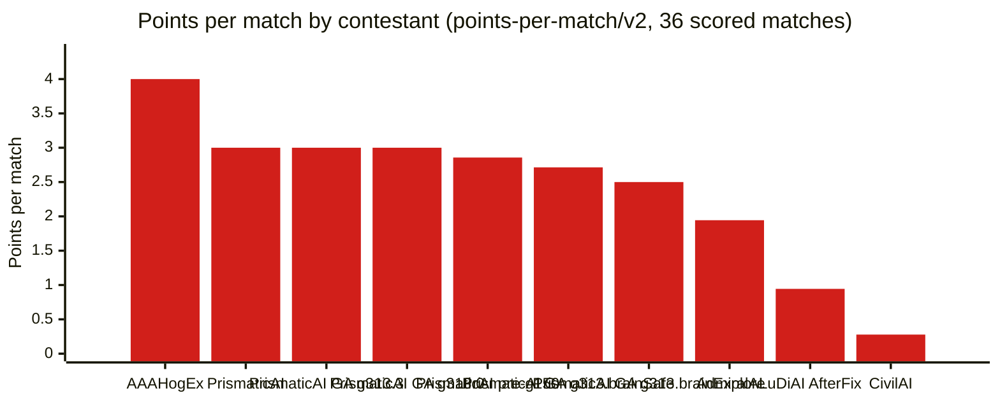
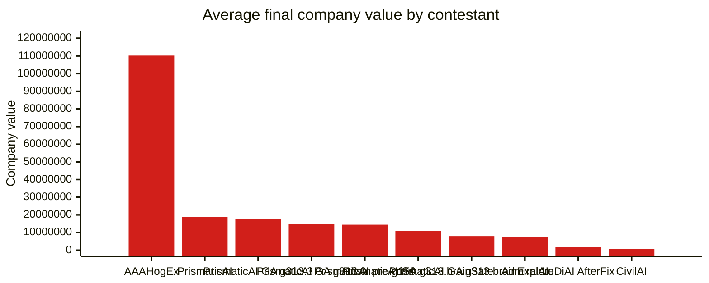
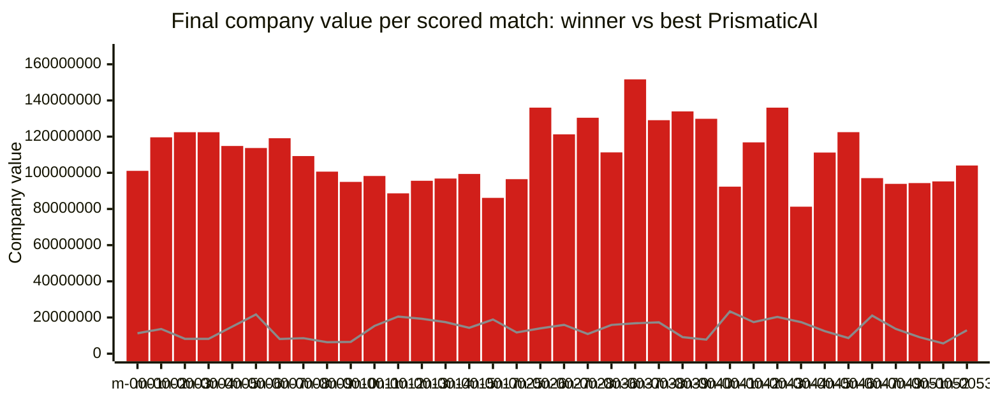
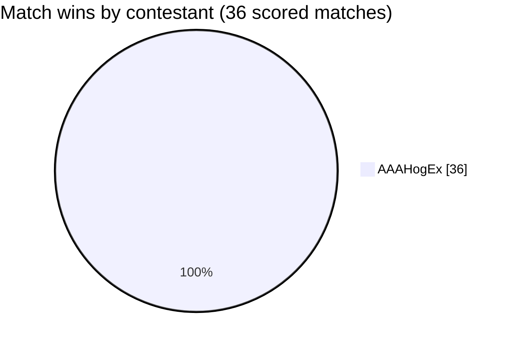
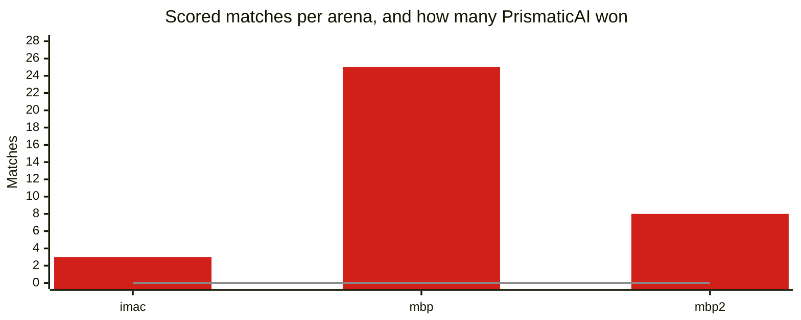

# battle-20261121T220656-b6828652

Derived from `battle-20261121T220656-b6828652.json` by `tools/research/ai-battle/battle.py report`; do not edit.

- Edition `b6828652092087d2`: PrismaticAI and referee at `531922be7d7544c6f7d5beecd51ca7906763f532`, base set `opengfx-8.0.tar`
- 20-year free-for-all from 1960, map 256x256 temperate, breakdowns 1
- 36 scored match(es) on `imac` (20261119-master-gdf1e05e7d8), `mbp` (20261120-master-m17653b726e), `mbp2` (20261119-master-gdf1e05e7d8)
- Replays: 0 of 0 identical to their original on another arena

| # | Contestant | Played | Wins | Points | Points/match | Avg rank | Avg final value | Squirrel errors | Matches with anomalies |
|---|---|---|---|---|---|---|---|---|---|
| 1 | AAAHogEx | 36 | 36 | 144 | 4.0 | 1.0 | 110.2 M | 0 | 0 |
| 2 | PrismaticAI | 4 | 0 | 12 | 3.0 | 2.0 | 18.9 M | 0 | 0 |
| 3 | PrismaticAI GA g313.3 | 6 | 0 | 18 | 3.0 | 2.0 | 17.8 M | 0 | 0 |
| 4 | PrismaticAI GA g313.0 | 6 | 0 | 18 | 3.0 | 2.0 | 14.7 M | 0 | 0 |
| 5 | PrismaticAI pre-g150 | 7 | 0 | 20 | 2.857 | 2.14 | 14.5 M | 0 | 0 |
| 6 | PrismaticAI GA g313.brainSafe | 7 | 0 | 19 | 2.714 | 2.29 | 10.8 M | 0 | 0 |
| 7 | PrismaticAI GA g313.brainExplore | 6 | 0 | 15 | 2.5 | 2.5 | 7.9 M | 0 | 0 |
| 8 | AdmiralAI | 36 | 0 | 70 | 1.944 | 3.06 | 7.3 M | 0 | 0 |
| 9 | LuDiAI AfterFix | 36 | 0 | 34 | 0.944 | 4.06 | 1.8 M | 0 | 0 |
| 10 | CivilAI | 36 | 0 | 10 | 0.278 | 4.72 | 720.2 k | 0 | 6 |

<!-- battle-charts:begin -->
<!-- derived from battle-20261121T220656-b6828652.json by `battle.py render`; `battle.py check` fails when it is stale -->

<!-- battle-charts:end -->

| Match | Arena | Seed | Winner | Value | Last | Anomalies |
|---|---|---|---|---|---|---|
| m-0001 | mbp | 61415318 | AAAHogEx | 101.1 M | CivilAI | CivilAI: fleet_drop:65->41 |
| m-0002 | mbp | 61415318 | AAAHogEx | 119.6 M | LuDiAI AfterFix | - |
| m-0003 | mbp | 61415318 | AAAHogEx | 122.4 M | AdmiralAI | - |
| m-0004 | mbp | 61415318 | AAAHogEx | 122.4 M | AdmiralAI | - |
| m-0005 | mbp | 61415318 | AAAHogEx | 114.8 M | LuDiAI AfterFix | - |
| m-0006 | mbp | 1392595746 | AAAHogEx | 113.7 M | CivilAI | - |
| m-0007 | mbp | 1392595746 | AAAHogEx | 119.1 M | CivilAI | - |
| m-0008 | mbp | 1392595746 | AAAHogEx | 109.3 M | CivilAI | - |
| m-0009 | mbp | 1392595746 | AAAHogEx | 100.6 M | CivilAI | CivilAI: fleet_drop:60->38 |
| m-0010 | imac | 1392595746 | AAAHogEx | 95.0 M | CivilAI | - |
| m-0011 | imac | 1392595746 | AAAHogEx | 98.2 M | CivilAI | - |
| m-0012 | imac | 102191380 | AAAHogEx | 88.6 M | CivilAI | - |
| m-0013 | mbp2 | 102191380 | AAAHogEx | 95.6 M | CivilAI | - |
| m-0014 | mbp2 | 102191380 | AAAHogEx | 96.8 M | CivilAI | - |
| m-0015 | mbp2 | 102191380 | AAAHogEx | 99.4 M | CivilAI | - |
| m-0017 | mbp2 | 102191380 | AAAHogEx | 86.1 M | CivilAI | - |
| m-0025 | mbp2 | 1587754008 | AAAHogEx | 96.5 M | CivilAI | - |
| m-0026 | mbp2 | 1587754008 | AAAHogEx | 136.0 M | LuDiAI AfterFix | - |
| m-0027 | mbp2 | 1587754008 | AAAHogEx | 121.3 M | CivilAI | - |
| m-0028 | mbp2 | 1587754008 | AAAHogEx | 130.4 M | AdmiralAI | - |
| m-0036 | mbp | 1889576170 | AAAHogEx | 111.3 M | CivilAI | - |
| m-0037 | mbp | 1889576170 | AAAHogEx | 151.7 M | CivilAI | - |
| m-0038 | mbp | 1889576170 | AAAHogEx | 129.1 M | CivilAI | - |
| m-0039 | mbp | 1889576170 | AAAHogEx | 133.9 M | CivilAI | - |
| m-0040 | mbp | 1889576170 | AAAHogEx | 129.9 M | CivilAI | - |
| m-0041 | mbp | 1889576170 | AAAHogEx | 92.3 M | CivilAI | - |
| m-0042 | mbp | 1309620700 | AAAHogEx | 116.8 M | CivilAI | - |
| m-0043 | mbp | 1309620700 | AAAHogEx | 136.0 M | CivilAI | CivilAI: fleet_drop:33->7 |
| m-0044 | mbp | 1309620700 | AAAHogEx | 81.3 M | CivilAI | - |
| m-0045 | mbp | 1309620700 | AAAHogEx | 111.2 M | CivilAI | - |
| m-0046 | mbp | 1309620700 | AAAHogEx | 122.5 M | CivilAI | - |
| m-0047 | mbp | 1309620700 | AAAHogEx | 97.1 M | CivilAI | - |
| m-0049 | mbp | 182818546 | AAAHogEx | 93.9 M | LuDiAI AfterFix | - |
| m-0051 | mbp | 182818546 | AAAHogEx | 94.3 M | LuDiAI AfterFix | CivilAI: fleet_drop:23->8 |
| m-0052 | mbp | 182818546 | AAAHogEx | 95.2 M | LuDiAI AfterFix | CivilAI: fleet_drop:23->12 |
| m-0053 | mbp | 182818546 | AAAHogEx | 104.0 M | CivilAI | CivilAI: fleet_drop:12->7 |
