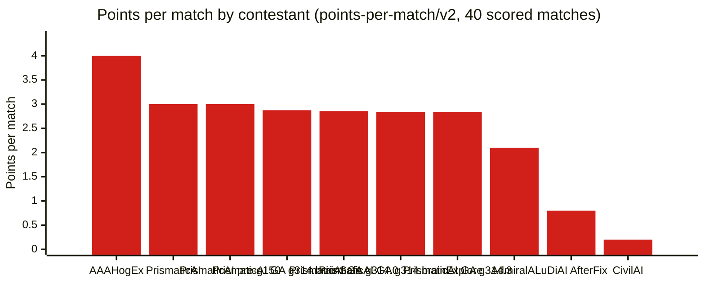
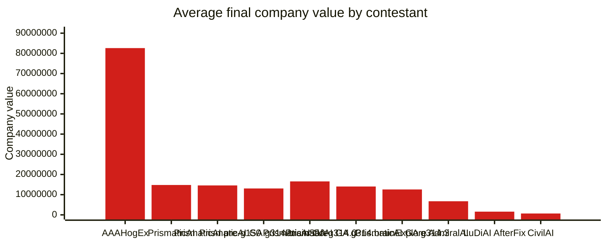
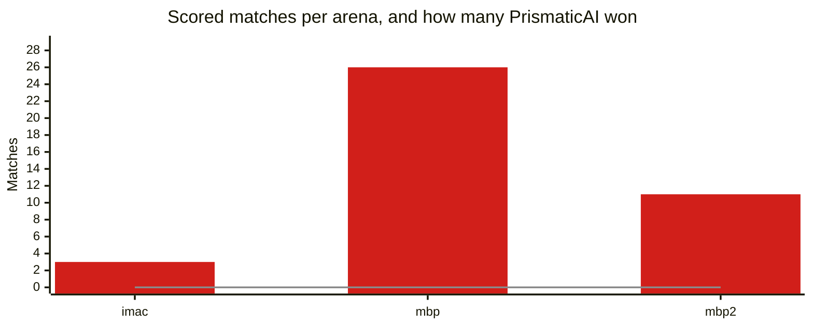

# battle-20261121T221911-20aef493

Derived from `battle-20261121T221911-20aef493.json` by `tools/research/ai-battle/battle.py report`; do not edit.

- Edition `20aef49320e354ca`: PrismaticAI and referee at `531922be7d7544c6f7d5beecd51ca7906763f532`, base set `opengfx-8.0.tar`
- 20-year free-for-all from 1960, map 256x256 temperate, breakdowns 1
- 40 scored match(es) on `imac` (20261119-master-gdf1e05e7d8), `mbp` (20261120-master-m17653b726e), `mbp2` (20261119-master-gdf1e05e7d8)
- Replays: 0 of 1 identical to their original on another arena

| # | Contestant | Played | Wins | Points | Points/match | Avg rank | Avg final value | Squirrel errors | Matches with anomalies |
|---|---|---|---|---|---|---|---|---|---|
| 1 | AAAHogEx | 40 | 40 | 160 | 4.0 | 1.0 | 82.6 M | 0 | 0 |
| 2 | PrismaticAI | 6 | 0 | 18 | 3.0 | 2.0 | 14.8 M | 0 | 0 |
| 3 | PrismaticAI pre-g150 | 7 | 0 | 21 | 3.0 | 2.0 | 14.6 M | 0 | 0 |
| 4 | PrismaticAI GA g314.brainSafe | 8 | 0 | 23 | 2.875 | 2.12 | 13.1 M | 0 | 0 |
| 5 | PrismaticAI GA g314.0 | 7 | 0 | 20 | 2.857 | 2.14 | 16.6 M | 0 | 0 |
| 6 | PrismaticAI GA g314.brainExplore | 6 | 0 | 17 | 2.833 | 2.17 | 14.0 M | 0 | 0 |
| 7 | PrismaticAI GA g314.3 | 6 | 0 | 17 | 2.833 | 2.17 | 12.6 M | 0 | 0 |
| 8 | AdmiralAI | 40 | 0 | 84 | 2.1 | 2.9 | 6.7 M | 57 | 2 |
| 9 | LuDiAI AfterFix | 40 | 0 | 32 | 0.8 | 4.2 | 1.6 M | 0 | 2 |
| 10 | CivilAI | 40 | 0 | 8 | 0.2 | 4.8 | 673.4 k | 0 | 6 |

```mermaid
---
config:
  xyChart:
    width: 900
    height: 360
  themeVariables:
    xyChart:
      plotColorPalette: "#d11f1a, #8a8a8a, #0b0b0b, #ece4d6"
---
xychart-beta
    title "Final company value per scored match: winner vs best PrismaticAI"
    x-axis ["m-0001", "m-0002", "m-0003", "m-0004", "m-0005", "m-0006", "m-0007", "m-0008", "m-0009", "m-0010", "m-0011", "m-0012", "m-0013", "m-0014", "m-0015", "m-0016", "m-0017", "m-0018", "m-0020", "m-0021", "m-0024", "m-0025", "m-0027", "m-0036", "m-0037", "m-0038", "m-0039", "m-0040", "m-0041", "m-0042", "m-0043", "m-0044", "m-0045", "m-0046", "m-0047", "m-0049", "m-0050", "m-0051", "m-0052", "m-0053"]
    %% series: Winner | Best PrismaticAI
    %% links: battle-20261121T221911-20aef493.md?col=Match&filter=m-0001 | battle-20261121T221911-20aef493.md?col=Match&filter=m-0002 | battle-20261121T221911-20aef493.md?col=Match&filter=m-0003 | battle-20261121T221911-20aef493.md?col=Match&filter=m-0004 | battle-20261121T221911-20aef493.md?col=Match&filter=m-0005 | battle-20261121T221911-20aef493.md?col=Match&filter=m-0006 | battle-20261121T221911-20aef493.md?col=Match&filter=m-0007 | battle-20261121T221911-20aef493.md?col=Match&filter=m-0008 | battle-20261121T221911-20aef493.md?col=Match&filter=m-0009 | battle-20261121T221911-20aef493.md?col=Match&filter=m-0010 | battle-20261121T221911-20aef493.md?col=Match&filter=m-0011 | battle-20261121T221911-20aef493.md?col=Match&filter=m-0012 | battle-20261121T221911-20aef493.md?col=Match&filter=m-0013 | battle-20261121T221911-20aef493.md?col=Match&filter=m-0014 | battle-20261121T221911-20aef493.md?col=Match&filter=m-0015 | battle-20261121T221911-20aef493.md?col=Match&filter=m-0016 | battle-20261121T221911-20aef493.md?col=Match&filter=m-0017 | battle-20261121T221911-20aef493.md?col=Match&filter=m-0018 | battle-20261121T221911-20aef493.md?col=Match&filter=m-0020 | battle-20261121T221911-20aef493.md?col=Match&filter=m-0021 | battle-20261121T221911-20aef493.md?col=Match&filter=m-0024 | battle-20261121T221911-20aef493.md?col=Match&filter=m-0025 | battle-20261121T221911-20aef493.md?col=Match&filter=m-0027 | battle-20261121T221911-20aef493.md?col=Match&filter=m-0036 | battle-20261121T221911-20aef493.md?col=Match&filter=m-0037 | battle-20261121T221911-20aef493.md?col=Match&filter=m-0038 | battle-20261121T221911-20aef493.md?col=Match&filter=m-0039 | battle-20261121T221911-20aef493.md?col=Match&filter=m-0040 | battle-20261121T221911-20aef493.md?col=Match&filter=m-0041 | battle-20261121T221911-20aef493.md?col=Match&filter=m-0042 | battle-20261121T221911-20aef493.md?col=Match&filter=m-0043 | battle-20261121T221911-20aef493.md?col=Match&filter=m-0044 | battle-20261121T221911-20aef493.md?col=Match&filter=m-0045 | battle-20261121T221911-20aef493.md?col=Match&filter=m-0046 | battle-20261121T221911-20aef493.md?col=Match&filter=m-0047 | battle-20261121T221911-20aef493.md?col=Match&filter=m-0049 | battle-20261121T221911-20aef493.md?col=Match&filter=m-0050 | battle-20261121T221911-20aef493.md?col=Match&filter=m-0051 | battle-20261121T221911-20aef493.md?col=Match&filter=m-0052 | battle-20261121T221911-20aef493.md?col=Match&filter=m-0053
    y-axis "Company value" 0 --> 144000000
    bar [61448468, 93376337, 73983808, 63276200, 80550188, 72428282, 77005209, 75870201, 71579304, 83044263, 67729864, 58961411, 64043120, 40110465, 64421076, 48814099, 55887190, 130850249, 99179332, 110295613, 107143051, 102399575, 89632593, 77373346, 80976038, 79850683, 81793518, 73133193, 84533768, 96482472, 116771802, 96678131, 89585159, 91656144, 120158557, 79709995, 94979244, 108194668, 70679682, 69774082]
    line [13882410, 16312764, 16431424, 19062349, 13501322, 9661842, 10882743, 9866036, 12566714, 14427941, 12400699, 15996441, 14250618, 17763936, 12467995, 15009094, 10312404, 17520614, 25338379, 14143141, 14494395, 17228054, 18043235, 8959754, 10134852, 7886509, 5737904, 5497501, 7265820, 22144361, 23111994, 21926853, 15711909, 16203482, 19901043, 12513789, 16895065, 9433175, 14049777, 12112999]
```

<!-- battle-charts:begin -->
<!-- derived from battle-20261121T221911-20aef493.json by `battle.py render`; `battle.py check` fails when it is stale -->

<!-- battle-charts:end -->

| Seed | Original | Replay | Arenas | Identical |
|---|---|---|---|---|
| 1237493813 | m-0011 | m-0048 | imac / mbp | NO |

| Match | Arena | Seed | Winner | Value | Last | Anomalies |
|---|---|---|---|---|---|---|
| m-0001 | mbp | 659112480 | AAAHogEx | 61.4 M | CivilAI | - |
| m-0002 | mbp | 659112480 | AAAHogEx | 93.4 M | LuDiAI AfterFix | AdmiralAI: squirrel_errors:57 |
| m-0003 | mbp | 659112480 | AAAHogEx | 74.0 M | LuDiAI AfterFix | - |
| m-0004 | mbp | 659112480 | AAAHogEx | 63.3 M | CivilAI | - |
| m-0005 | mbp | 659112480 | AAAHogEx | 80.6 M | LuDiAI AfterFix | - |
| m-0006 | mbp | 1237493813 | AAAHogEx | 72.4 M | CivilAI | - |
| m-0007 | mbp | 1237493813 | AAAHogEx | 77.0 M | CivilAI | AdmiralAI: fleet_drop:245->166; CivilAI: fleet_drop:26->13 |
| m-0008 | mbp | 1237493813 | AAAHogEx | 75.9 M | CivilAI | CivilAI: fleet_drop:22->10 |
| m-0009 | mbp | 1237493813 | AAAHogEx | 71.6 M | CivilAI | - |
| m-0010 | imac | 1237493813 | AAAHogEx | 83.0 M | CivilAI | - |
| m-0011 | imac | 1237493813 | AAAHogEx | 67.7 M | CivilAI | - |
| m-0012 | imac | 916096567 | AAAHogEx | 59.0 M | CivilAI | - |
| m-0013 | mbp2 | 916096567 | AAAHogEx | 64.0 M | LuDiAI AfterFix | CivilAI: fleet_drop:65->34 |
| m-0014 | mbp2 | 916096567 | AAAHogEx | 40.1 M | CivilAI | - |
| m-0015 | mbp2 | 916096567 | AAAHogEx | 64.4 M | CivilAI | - |
| m-0016 | mbp2 | 916096567 | AAAHogEx | 48.8 M | CivilAI | - |
| m-0017 | mbp2 | 916096567 | AAAHogEx | 55.9 M | CivilAI | CivilAI: fleet_drop:28->13 |
| m-0018 | mbp2 | 1933589800 | AAAHogEx | 130.9 M | CivilAI | - |
| m-0020 | mbp2 | 1933589800 | AAAHogEx | 99.2 M | CivilAI | - |
| m-0021 | mbp2 | 1933589800 | AAAHogEx | 110.3 M | LuDiAI AfterFix | - |
| m-0024 | mbp2 | 1154972111 | AAAHogEx | 107.1 M | CivilAI | - |
| m-0025 | mbp2 | 1154972111 | AAAHogEx | 102.4 M | CivilAI | - |
| m-0027 | mbp2 | 1154972111 | AAAHogEx | 89.6 M | CivilAI | - |
| m-0036 | mbp | 3532044 | AAAHogEx | 77.4 M | CivilAI | CivilAI: fleet_drop:69->45 |
| m-0037 | mbp | 3532044 | AAAHogEx | 81.0 M | LuDiAI AfterFix | LuDiAI AfterFix: fleet_drop:39->26 |
| m-0038 | mbp | 3532044 | AAAHogEx | 79.9 M | CivilAI | - |
| m-0039 | mbp | 3532044 | AAAHogEx | 81.8 M | CivilAI | - |
| m-0040 | mbp | 3532044 | AAAHogEx | 73.1 M | CivilAI | - |
| m-0041 | mbp | 3532044 | AAAHogEx | 84.5 M | CivilAI | - |
| m-0042 | mbp | 111758732 | AAAHogEx | 96.5 M | CivilAI | LuDiAI AfterFix: fleet_drop:17->11 |
| m-0043 | mbp | 111758732 | AAAHogEx | 116.8 M | CivilAI | - |
| m-0044 | mbp | 111758732 | AAAHogEx | 96.7 M | LuDiAI AfterFix | - |
| m-0045 | mbp | 111758732 | AAAHogEx | 89.6 M | CivilAI | - |
| m-0046 | mbp | 111758732 | AAAHogEx | 91.7 M | CivilAI | - |
| m-0047 | mbp | 111758732 | AAAHogEx | 120.2 M | CivilAI | - |
| m-0048 (replay) | mbp | 1237493813 | AAAHogEx | 69.6 M | CivilAI | - |
| m-0049 | mbp | 1341492463 | AAAHogEx | 79.7 M | LuDiAI AfterFix | - |
| m-0050 | mbp | 1341492463 | AAAHogEx | 95.0 M | CivilAI | - |
| m-0051 | mbp | 1341492463 | AAAHogEx | 108.2 M | CivilAI | - |
| m-0052 | mbp | 1341492463 | AAAHogEx | 70.7 M | CivilAI | CivilAI: fleet_drop:65->28 |
| m-0053 | mbp | 1341492463 | AAAHogEx | 69.8 M | CivilAI | - |
