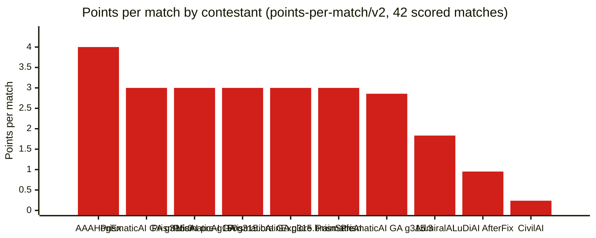
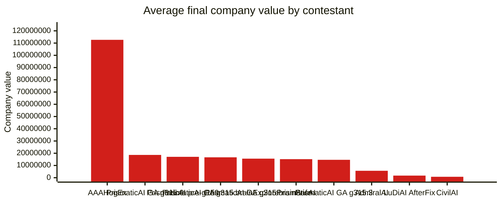
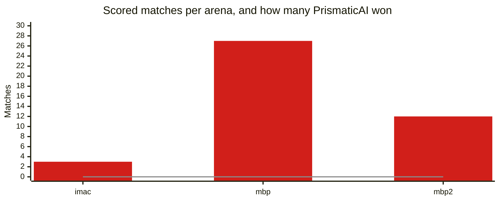

# battle-20261121T223549-ee8e6884

Derived from `battle-20261121T223549-ee8e6884.json` by `tools/research/ai-battle/battle.py report`; do not edit.

- Edition `ee8e6884c81ebd19`: PrismaticAI and referee at `8c8d025388e85261a60027d9983d8588d720a2e9`, base set `opengfx-8.0.tar`
- 20-year free-for-all from 1960, map 256x256 temperate, breakdowns 1
- 42 scored match(es) on `imac` (20261119-master-gdf1e05e7d8), `mbp` (20261120-master-m17653b726e), `mbp2` (20261119-master-gdf1e05e7d8)
- Replays: 0 of 1 identical to their original on another arena

| # | Contestant | Played | Wins | Points | Points/match | Avg rank | Avg final value | Squirrel errors | Matches with anomalies |
|---|---|---|---|---|---|---|---|---|---|
| 1 | AAAHogEx | 42 | 42 | 168 | 4.0 | 1.0 | 112.6 M | 0 | 0 |
| 2 | PrismaticAI GA g315.0 | 7 | 0 | 21 | 3.0 | 2.0 | 18.6 M | 0 | 0 |
| 3 | PrismaticAI pre-g150 | 8 | 0 | 24 | 3.0 | 2.0 | 17.1 M | 0 | 0 |
| 4 | PrismaticAI GA g315.brainExplore | 6 | 0 | 18 | 3.0 | 2.0 | 16.7 M | 0 | 0 |
| 5 | PrismaticAI GA g315.brainSafe | 7 | 0 | 21 | 3.0 | 2.0 | 15.6 M | 0 | 0 |
| 6 | PrismaticAI | 7 | 0 | 21 | 3.0 | 2.0 | 15.2 M | 0 | 0 |
| 7 | PrismaticAI GA g315.3 | 7 | 0 | 20 | 2.857 | 2.14 | 14.6 M | 0 | 0 |
| 8 | AdmiralAI | 42 | 0 | 77 | 1.833 | 3.17 | 5.7 M | 72 | 1 |
| 9 | LuDiAI AfterFix | 42 | 0 | 40 | 0.952 | 4.05 | 1.7 M | 0 | 4 |
| 10 | CivilAI | 42 | 0 | 10 | 0.238 | 4.76 | 759.4 k | 3805 | 16 |

```mermaid
---
config:
  xyChart:
    width: 900
    height: 360
  themeVariables:
    xyChart:
      plotColorPalette: "#d11f1a, #8a8a8a, #0b0b0b, #ece4d6"
---
xychart-beta
    title "Final company value per scored match: winner vs best PrismaticAI"
    x-axis ["m-0001", "m-0002", "m-0003", "m-0004", "m-0005", "m-0006", "m-0007", "m-0008", "m-0009", "m-0010", "m-0011", "m-0012", "m-0013", "m-0014", "m-0015", "m-0016", "m-0017", "m-0018", "m-0019", "m-0021", "m-0023", "m-0024", "m-0025", "m-0026", "m-0036", "m-0037", "m-0038", "m-0039", "m-0040", "m-0041", "m-0042", "m-0043", "m-0044", "m-0045", "m-0046", "m-0047", "m-0048", "m-0049", "m-0050", "m-0051", "m-0052", "m-0053"]
    %% series: Winner | Best PrismaticAI
    %% links: battle-20261121T223549-ee8e6884.md?col=Match&filter=m-0001 | battle-20261121T223549-ee8e6884.md?col=Match&filter=m-0002 | battle-20261121T223549-ee8e6884.md?col=Match&filter=m-0003 | battle-20261121T223549-ee8e6884.md?col=Match&filter=m-0004 | battle-20261121T223549-ee8e6884.md?col=Match&filter=m-0005 | battle-20261121T223549-ee8e6884.md?col=Match&filter=m-0006 | battle-20261121T223549-ee8e6884.md?col=Match&filter=m-0007 | battle-20261121T223549-ee8e6884.md?col=Match&filter=m-0008 | battle-20261121T223549-ee8e6884.md?col=Match&filter=m-0009 | battle-20261121T223549-ee8e6884.md?col=Match&filter=m-0010 | battle-20261121T223549-ee8e6884.md?col=Match&filter=m-0011 | battle-20261121T223549-ee8e6884.md?col=Match&filter=m-0012 | battle-20261121T223549-ee8e6884.md?col=Match&filter=m-0013 | battle-20261121T223549-ee8e6884.md?col=Match&filter=m-0014 | battle-20261121T223549-ee8e6884.md?col=Match&filter=m-0015 | battle-20261121T223549-ee8e6884.md?col=Match&filter=m-0016 | battle-20261121T223549-ee8e6884.md?col=Match&filter=m-0017 | battle-20261121T223549-ee8e6884.md?col=Match&filter=m-0018 | battle-20261121T223549-ee8e6884.md?col=Match&filter=m-0019 | battle-20261121T223549-ee8e6884.md?col=Match&filter=m-0021 | battle-20261121T223549-ee8e6884.md?col=Match&filter=m-0023 | battle-20261121T223549-ee8e6884.md?col=Match&filter=m-0024 | battle-20261121T223549-ee8e6884.md?col=Match&filter=m-0025 | battle-20261121T223549-ee8e6884.md?col=Match&filter=m-0026 | battle-20261121T223549-ee8e6884.md?col=Match&filter=m-0036 | battle-20261121T223549-ee8e6884.md?col=Match&filter=m-0037 | battle-20261121T223549-ee8e6884.md?col=Match&filter=m-0038 | battle-20261121T223549-ee8e6884.md?col=Match&filter=m-0039 | battle-20261121T223549-ee8e6884.md?col=Match&filter=m-0040 | battle-20261121T223549-ee8e6884.md?col=Match&filter=m-0041 | battle-20261121T223549-ee8e6884.md?col=Match&filter=m-0042 | battle-20261121T223549-ee8e6884.md?col=Match&filter=m-0043 | battle-20261121T223549-ee8e6884.md?col=Match&filter=m-0044 | battle-20261121T223549-ee8e6884.md?col=Match&filter=m-0045 | battle-20261121T223549-ee8e6884.md?col=Match&filter=m-0046 | battle-20261121T223549-ee8e6884.md?col=Match&filter=m-0047 | battle-20261121T223549-ee8e6884.md?col=Match&filter=m-0048 | battle-20261121T223549-ee8e6884.md?col=Match&filter=m-0049 | battle-20261121T223549-ee8e6884.md?col=Match&filter=m-0050 | battle-20261121T223549-ee8e6884.md?col=Match&filter=m-0051 | battle-20261121T223549-ee8e6884.md?col=Match&filter=m-0052 | battle-20261121T223549-ee8e6884.md?col=Match&filter=m-0053
    y-axis "Company value" 0 --> 188000000
    bar [170738242, 152007254, 150037063, 155984717, 118752720, 128872086, 124195483, 100654797, 102050842, 96751706, 110026770, 123937623, 148851057, 136384159, 137694905, 127887677, 131581180, 81553261, 68565118, 82417583, 74803428, 80928550, 94254523, 118175082, 88933470, 92815652, 85224949, 101373739, 70744717, 81024276, 106517125, 123486603, 118749342, 111970081, 107443309, 117843053, 109677292, 113024388, 120252660, 106469137, 130589399, 128004438]
    line [17570432, 20728624, 23564844, 22238758, 26722236, 17535102, 20762110, 22204899, 15488376, 14931156, 13801910, 27736016, 23448761, 27662249, 18873649, 20294805, 19384167, 8403307, 10121867, 9166358, 6688946, 9496461, 18010604, 19699912, 16221092, 12134868, 10627508, 11761416, 13158556, 10277706, 8847535, 9458648, 7216907, 10802621, 8462433, 6263827, 17932828, 25031573, 22210514, 19365995, 20907184, 19242668]
```

<!-- battle-charts:begin -->
<!-- derived from battle-20261121T223549-ee8e6884.json by `battle.py render`; `battle.py check` fails when it is stale -->

<!-- battle-charts:end -->

| Seed | Original | Replay | Arenas | Identical |
|---|---|---|---|---|
| 415872172 | m-0010 | m-0056 | imac / mbp | NO |

| Match | Arena | Seed | Winner | Value | Last | Anomalies |
|---|---|---|---|---|---|---|
| m-0001 | mbp | 962752867 | AAAHogEx | 170.7 M | LuDiAI AfterFix | - |
| m-0002 | mbp | 962752867 | AAAHogEx | 152.0 M | CivilAI | LuDiAI AfterFix: fleet_drop:58->29; CivilAI: fleet_drop:35->21 |
| m-0003 | mbp | 962752867 | AAAHogEx | 150.0 M | CivilAI | CivilAI: fleet_drop:29->18 |
| m-0004 | mbp | 962752867 | AAAHogEx | 156.0 M | CivilAI | - |
| m-0005 | mbp | 962752867 | AAAHogEx | 118.8 M | CivilAI | CivilAI: fleet_drop:36->9 |
| m-0006 | mbp | 415872172 | AAAHogEx | 128.9 M | CivilAI | CivilAI: no_vehicles |
| m-0007 | mbp | 415872172 | AAAHogEx | 124.2 M | CivilAI | AdmiralAI: squirrel_errors:72 |
| m-0008 | mbp | 415872172 | AAAHogEx | 100.7 M | LuDiAI AfterFix | - |
| m-0009 | mbp | 415872172 | AAAHogEx | 102.1 M | CivilAI | CivilAI: fleet_drop:45->24 |
| m-0010 | imac | 415872172 | AAAHogEx | 96.8 M | LuDiAI AfterFix | - |
| m-0011 | imac | 415872172 | AAAHogEx | 110.0 M | CivilAI | - |
| m-0012 | imac | 1417181091 | AAAHogEx | 123.9 M | CivilAI | - |
| m-0013 | mbp2 | 1417181091 | AAAHogEx | 148.9 M | CivilAI | LuDiAI AfterFix: fleet_drop:102->59 |
| m-0014 | mbp2 | 1417181091 | AAAHogEx | 136.4 M | CivilAI | - |
| m-0015 | mbp2 | 1417181091 | AAAHogEx | 137.7 M | CivilAI | - |
| m-0016 | mbp2 | 1417181091 | AAAHogEx | 127.9 M | CivilAI | - |
| m-0017 | mbp2 | 1417181091 | AAAHogEx | 131.6 M | CivilAI | - |
| m-0018 | mbp2 | 1251065620 | AAAHogEx | 81.6 M | CivilAI | CivilAI: fleet_drop:39->25 |
| m-0019 | mbp2 | 1251065620 | AAAHogEx | 68.6 M | CivilAI | CivilAI: fleet_drop:23->10 |
| m-0021 | mbp2 | 1251065620 | AAAHogEx | 82.4 M | LuDiAI AfterFix | CivilAI: fleet_drop:64->40; LuDiAI AfterFix: fleet_drop:83->49 |
| m-0023 | mbp2 | 1251065620 | AAAHogEx | 74.8 M | CivilAI | LuDiAI AfterFix: fleet_drop:86->36 |
| m-0024 | mbp2 | 729441956 | AAAHogEx | 80.9 M | CivilAI | CivilAI: fleet_drop:41->21 |
| m-0025 | mbp2 | 729441956 | AAAHogEx | 94.3 M | CivilAI | - |
| m-0026 | mbp2 | 729441956 | AAAHogEx | 118.2 M | CivilAI | CivilAI: fleet_drop:48->26 |
| m-0036 | mbp | 1638515142 | AAAHogEx | 88.9 M | CivilAI | CivilAI: fleet_drop:55->32 |
| m-0037 | mbp | 1638515142 | AAAHogEx | 92.8 M | CivilAI | CivilAI: squirrel_errors:3805 |
| m-0038 | mbp | 1638515142 | AAAHogEx | 85.2 M | CivilAI | - |
| m-0039 | mbp | 1638515142 | AAAHogEx | 101.4 M | CivilAI | CivilAI: fleet_drop:70->46 |
| m-0040 | mbp | 1638515142 | AAAHogEx | 70.7 M | CivilAI | - |
| m-0041 | mbp | 1638515142 | AAAHogEx | 81.0 M | CivilAI | CivilAI: fleet_drop:49->34 |
| m-0042 | mbp | 1632302558 | AAAHogEx | 106.5 M | CivilAI | - |
| m-0043 | mbp | 1632302558 | AAAHogEx | 123.5 M | CivilAI | CivilAI: fleet_drop:79->46 |
| m-0044 | mbp | 1632302558 | AAAHogEx | 118.7 M | AdmiralAI | - |
| m-0045 | mbp | 1632302558 | AAAHogEx | 112.0 M | AdmiralAI | - |
| m-0046 | mbp | 1632302558 | AAAHogEx | 107.4 M | AdmiralAI | - |
| m-0047 | mbp | 1632302558 | AAAHogEx | 117.8 M | AdmiralAI | - |
| m-0048 | mbp | 264476669 | AAAHogEx | 109.7 M | CivilAI | - |
| m-0049 | mbp | 264476669 | AAAHogEx | 113.0 M | LuDiAI AfterFix | CivilAI: fleet_drop:42->27 |
| m-0050 | mbp | 264476669 | AAAHogEx | 120.3 M | CivilAI | - |
| m-0051 | mbp | 264476669 | AAAHogEx | 106.5 M | CivilAI | - |
| m-0052 | mbp | 264476669 | AAAHogEx | 130.6 M | CivilAI | - |
| m-0053 | mbp | 264476669 | AAAHogEx | 128.0 M | CivilAI | - |
| m-0056 (replay) | mbp | 415872172 | AAAHogEx | 96.1 M | CivilAI | - |
