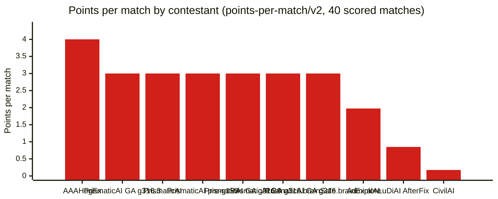
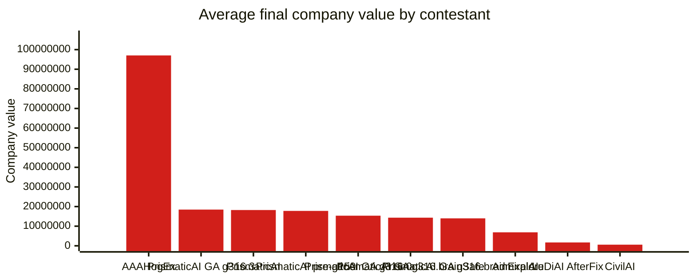
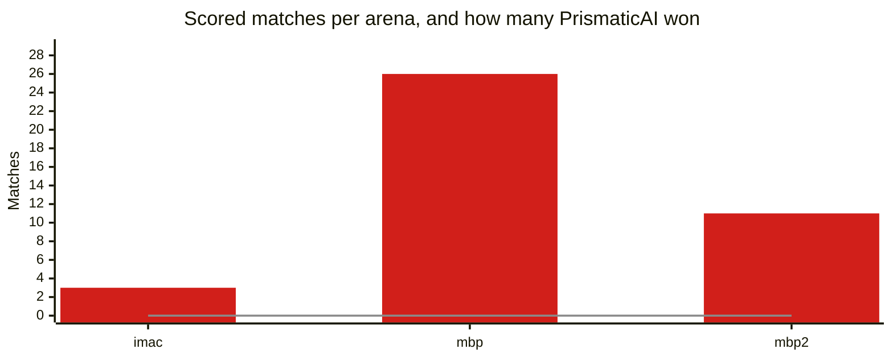

# battle-20261121T224650-65757977

Derived from `battle-20261121T224650-65757977.json` by `tools/research/ai-battle/battle.py report`; do not edit.

- Edition `6575797713ecc233`: PrismaticAI and referee at `8c8d025388e85261a60027d9983d8588d720a2e9`, base set `opengfx-8.0.tar`
- 20-year free-for-all from 1960, map 256x256 temperate, breakdowns 1
- 40 scored match(es) on `imac` (20261119-master-gdf1e05e7d8), `mbp` (20261120-master-m17653b726e), `mbp2` (20261119-master-gdf1e05e7d8)
- Replays: 0 of 1 identical to their original on another arena

| # | Contestant | Played | Wins | Points | Points/match | Avg rank | Avg final value | Squirrel errors | Matches with anomalies |
|---|---|---|---|---|---|---|---|---|---|
| 1 | AAAHogEx | 40 | 40 | 160 | 4.0 | 1.0 | 97.0 M | 0 | 0 |
| 2 | PrismaticAI GA g316.3 | 6 | 0 | 18 | 3.0 | 2.0 | 18.5 M | 0 | 0 |
| 3 | PrismaticAI | 6 | 0 | 18 | 3.0 | 2.0 | 18.2 M | 0 | 0 |
| 4 | PrismaticAI pre-g150 | 7 | 0 | 21 | 3.0 | 2.0 | 17.8 M | 0 | 0 |
| 5 | PrismaticAI GA g316.0 | 7 | 0 | 21 | 3.0 | 2.0 | 15.3 M | 0 | 0 |
| 6 | PrismaticAI GA g316.brainSafe | 7 | 0 | 21 | 3.0 | 2.0 | 14.3 M | 0 | 0 |
| 7 | PrismaticAI GA g316.brainExplore | 7 | 0 | 21 | 3.0 | 2.0 | 14.0 M | 0 | 0 |
| 8 | AdmiralAI | 40 | 0 | 79 | 1.975 | 3.02 | 6.9 M | 0 | 3 |
| 9 | LuDiAI AfterFix | 40 | 0 | 34 | 0.85 | 4.15 | 1.7 M | 0 | 2 |
| 10 | CivilAI | 40 | 0 | 7 | 0.175 | 4.83 | 574.1 k | 0 | 9 |

```mermaid
---
config:
  xyChart:
    width: 900
    height: 360
  themeVariables:
    xyChart:
      plotColorPalette: "#d11f1a, #8a8a8a, #0b0b0b, #ece4d6"
---
xychart-beta
    title "Final company value per scored match: winner vs best PrismaticAI"
    x-axis ["m-0001", "m-0002", "m-0003", "m-0004", "m-0005", "m-0006", "m-0007", "m-0008", "m-0009", "m-0010", "m-0011", "m-0012", "m-0013", "m-0014", "m-0015", "m-0016", "m-0017", "m-0018", "m-0019", "m-0020", "m-0021", "m-0022", "m-0023", "m-0036", "m-0037", "m-0038", "m-0039", "m-0040", "m-0041", "m-0042", "m-0043", "m-0044", "m-0045", "m-0046", "m-0047", "m-0049", "m-0050", "m-0051", "m-0052", "m-0054"]
    %% series: Winner | Best PrismaticAI
    %% links: battle-20261121T224650-65757977.md?col=Match&filter=m-0001 | battle-20261121T224650-65757977.md?col=Match&filter=m-0002 | battle-20261121T224650-65757977.md?col=Match&filter=m-0003 | battle-20261121T224650-65757977.md?col=Match&filter=m-0004 | battle-20261121T224650-65757977.md?col=Match&filter=m-0005 | battle-20261121T224650-65757977.md?col=Match&filter=m-0006 | battle-20261121T224650-65757977.md?col=Match&filter=m-0007 | battle-20261121T224650-65757977.md?col=Match&filter=m-0008 | battle-20261121T224650-65757977.md?col=Match&filter=m-0009 | battle-20261121T224650-65757977.md?col=Match&filter=m-0010 | battle-20261121T224650-65757977.md?col=Match&filter=m-0011 | battle-20261121T224650-65757977.md?col=Match&filter=m-0012 | battle-20261121T224650-65757977.md?col=Match&filter=m-0013 | battle-20261121T224650-65757977.md?col=Match&filter=m-0014 | battle-20261121T224650-65757977.md?col=Match&filter=m-0015 | battle-20261121T224650-65757977.md?col=Match&filter=m-0016 | battle-20261121T224650-65757977.md?col=Match&filter=m-0017 | battle-20261121T224650-65757977.md?col=Match&filter=m-0018 | battle-20261121T224650-65757977.md?col=Match&filter=m-0019 | battle-20261121T224650-65757977.md?col=Match&filter=m-0020 | battle-20261121T224650-65757977.md?col=Match&filter=m-0021 | battle-20261121T224650-65757977.md?col=Match&filter=m-0022 | battle-20261121T224650-65757977.md?col=Match&filter=m-0023 | battle-20261121T224650-65757977.md?col=Match&filter=m-0036 | battle-20261121T224650-65757977.md?col=Match&filter=m-0037 | battle-20261121T224650-65757977.md?col=Match&filter=m-0038 | battle-20261121T224650-65757977.md?col=Match&filter=m-0039 | battle-20261121T224650-65757977.md?col=Match&filter=m-0040 | battle-20261121T224650-65757977.md?col=Match&filter=m-0041 | battle-20261121T224650-65757977.md?col=Match&filter=m-0042 | battle-20261121T224650-65757977.md?col=Match&filter=m-0043 | battle-20261121T224650-65757977.md?col=Match&filter=m-0044 | battle-20261121T224650-65757977.md?col=Match&filter=m-0045 | battle-20261121T224650-65757977.md?col=Match&filter=m-0046 | battle-20261121T224650-65757977.md?col=Match&filter=m-0047 | battle-20261121T224650-65757977.md?col=Match&filter=m-0049 | battle-20261121T224650-65757977.md?col=Match&filter=m-0050 | battle-20261121T224650-65757977.md?col=Match&filter=m-0051 | battle-20261121T224650-65757977.md?col=Match&filter=m-0052 | battle-20261121T224650-65757977.md?col=Match&filter=m-0054
    y-axis "Company value" 0 --> 153000000
    bar [92381035, 76306127, 86172013, 76135370, 90909515, 66064625, 92629969, 79942096, 74742806, 88768062, 74314570, 79141329, 92721423, 91587410, 87522212, 92183044, 99840074, 104001466, 99386609, 105591489, 91745563, 99059229, 101956463, 135141668, 127837024, 103984694, 83874037, 95521265, 98759165, 112779400, 113683130, 126304466, 109870035, 124543098, 138939277, 75739104, 91882821, 92978957, 105439588, 100742971]
    line [20364023, 16652309, 15736106, 14428456, 20162640, 13955276, 16007667, 15328872, 15619630, 15880554, 19049187, 19994530, 14880940, 16279469, 14497672, 8620375, 17668856, 20244819, 21320399, 9744449, 10406787, 17437076, 21834550, 21136274, 15936113, 23732230, 17710509, 18959077, 18980565, 17791155, 17154080, 13286453, 12240984, 11683828, 13034174, 18818120, 12394419, 14121216, 10869366, 16259851]
```

<!-- battle-charts:begin -->
<!-- derived from battle-20261121T224650-65757977.json by `battle.py render`; `battle.py check` fails when it is stale -->

<!-- battle-charts:end -->

| Seed | Original | Replay | Arenas | Identical |
|---|---|---|---|---|
| 796117458 | m-0010 | m-0048 | imac / mbp | NO |

| Match | Arena | Seed | Winner | Value | Last | Anomalies |
|---|---|---|---|---|---|---|
| m-0001 | mbp | 572270274 | AAAHogEx | 92.4 M | CivilAI | - |
| m-0002 | mbp | 572270274 | AAAHogEx | 76.3 M | LuDiAI AfterFix | - |
| m-0003 | mbp | 572270274 | AAAHogEx | 86.2 M | LuDiAI AfterFix | - |
| m-0004 | mbp | 572270274 | AAAHogEx | 76.1 M | LuDiAI AfterFix | - |
| m-0005 | mbp | 572270274 | AAAHogEx | 90.9 M | LuDiAI AfterFix | - |
| m-0006 | mbp | 796117458 | AAAHogEx | 66.1 M | CivilAI | - |
| m-0007 | mbp | 796117458 | AAAHogEx | 92.6 M | CivilAI | - |
| m-0008 | mbp | 796117458 | AAAHogEx | 79.9 M | CivilAI | LuDiAI AfterFix: fleet_drop:69->31; CivilAI: fleet_drop:46->17 |
| m-0009 | mbp | 796117458 | AAAHogEx | 74.7 M | CivilAI | CivilAI: fleet_drop:46->12 |
| m-0010 | imac | 796117458 | AAAHogEx | 88.8 M | LuDiAI AfterFix | - |
| m-0011 | imac | 796117458 | AAAHogEx | 74.3 M | CivilAI | AdmiralAI: fleet_drop:267->165 |
| m-0012 | imac | 603536889 | AAAHogEx | 79.1 M | CivilAI | CivilAI: fleet_drop:34->23 |
| m-0013 | mbp2 | 603536889 | AAAHogEx | 92.7 M | CivilAI | - |
| m-0014 | mbp2 | 603536889 | AAAHogEx | 91.6 M | CivilAI | - |
| m-0015 | mbp2 | 603536889 | AAAHogEx | 87.5 M | CivilAI | - |
| m-0016 | mbp2 | 603536889 | AAAHogEx | 92.2 M | CivilAI | - |
| m-0017 | mbp2 | 603536889 | AAAHogEx | 99.8 M | CivilAI | - |
| m-0018 | mbp2 | 1776895935 | AAAHogEx | 104.0 M | CivilAI | CivilAI: fleet_drop:39->24 |
| m-0019 | mbp2 | 1776895935 | AAAHogEx | 99.4 M | CivilAI | CivilAI: fleet_drop:30->15 |
| m-0020 | mbp2 | 1776895935 | AAAHogEx | 105.6 M | CivilAI | - |
| m-0021 | mbp2 | 1776895935 | AAAHogEx | 91.7 M | CivilAI | CivilAI: fleet_drop:71->37 |
| m-0022 | mbp2 | 1776895935 | AAAHogEx | 99.1 M | CivilAI | - |
| m-0023 | mbp2 | 1776895935 | AAAHogEx | 102.0 M | CivilAI | CivilAI: fleet_drop:78->43 |
| m-0036 | mbp | 70988050 | AAAHogEx | 135.1 M | LuDiAI AfterFix | - |
| m-0037 | mbp | 70988050 | AAAHogEx | 127.8 M | LuDiAI AfterFix | - |
| m-0038 | mbp | 70988050 | AAAHogEx | 104.0 M | CivilAI | - |
| m-0039 | mbp | 70988050 | AAAHogEx | 83.9 M | CivilAI | - |
| m-0040 | mbp | 70988050 | AAAHogEx | 95.5 M | CivilAI | - |
| m-0041 | mbp | 70988050 | AAAHogEx | 98.8 M | CivilAI | - |
| m-0042 | mbp | 1480880630 | AAAHogEx | 112.8 M | CivilAI | CivilAI: fleet_drop:104->69 |
| m-0043 | mbp | 1480880630 | AAAHogEx | 113.7 M | CivilAI | AdmiralAI: fleet_drop:308->206 |
| m-0044 | mbp | 1480880630 | AAAHogEx | 126.3 M | CivilAI | - |
| m-0045 | mbp | 1480880630 | AAAHogEx | 109.9 M | CivilAI | - |
| m-0046 | mbp | 1480880630 | AAAHogEx | 124.5 M | CivilAI | - |
| m-0047 | mbp | 1480880630 | AAAHogEx | 138.9 M | CivilAI | AdmiralAI: fleet_drop:261->153 |
| m-0048 (replay) | mbp | 796117458 | AAAHogEx | 78.9 M | CivilAI | - |
| m-0049 | mbp | 844147102 | AAAHogEx | 75.7 M | CivilAI | CivilAI: fleet_drop:30->11 |
| m-0050 | mbp | 844147102 | AAAHogEx | 91.9 M | CivilAI | LuDiAI AfterFix: fleet_drop:136->69 |
| m-0051 | mbp | 844147102 | AAAHogEx | 93.0 M | CivilAI | - |
| m-0052 | mbp | 844147102 | AAAHogEx | 105.4 M | CivilAI | - |
| m-0054 | mbp | 587070544 | AAAHogEx | 100.7 M | CivilAI | - |
