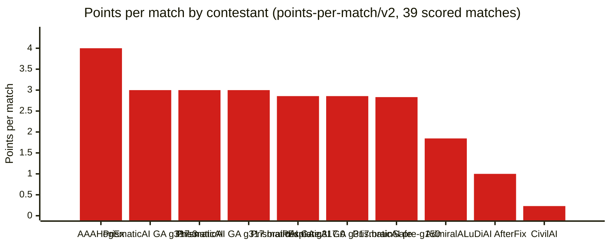
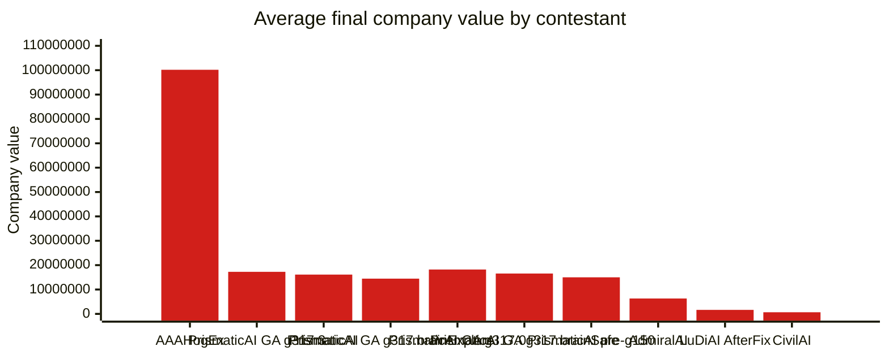
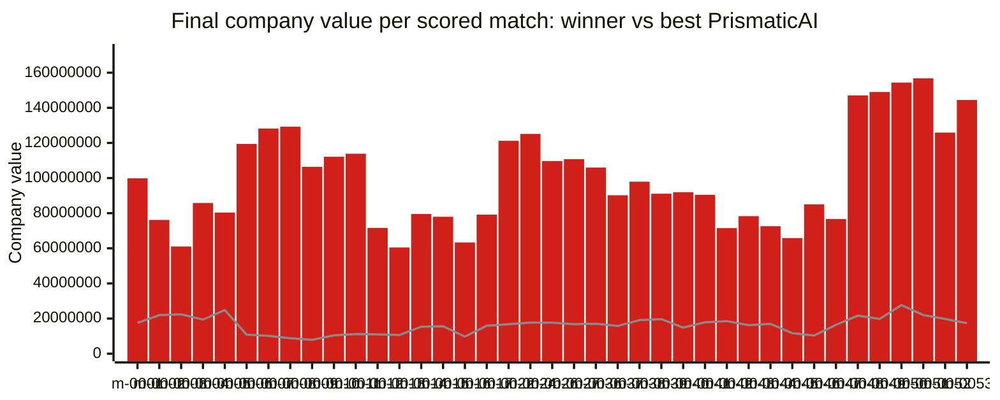
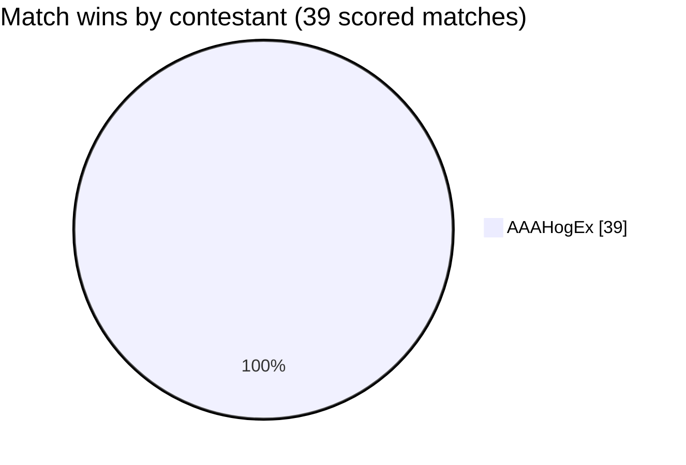
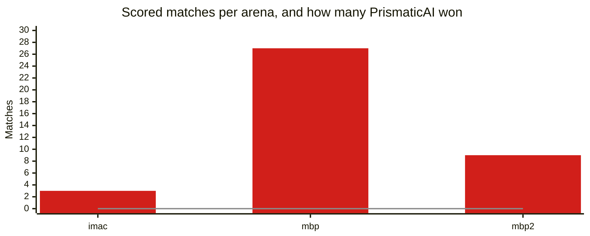

# battle-20261121T225729-c55320eb

Derived from `battle-20261121T225729-c55320eb.json` by `tools/research/ai-battle/battle.py report`; do not edit.

- Edition `c55320eb6dc07592`: PrismaticAI and referee at `8c8d025388e85261a60027d9983d8588d720a2e9`, base set `opengfx-8.0.tar`
- 20-year free-for-all from 1960, map 256x256 temperate, breakdowns 1
- 39 scored match(es) on `imac` (20261119-master-gdf1e05e7d8), `mbp` (20261120-master-m17653b726e), `mbp2` (20261119-master-gdf1e05e7d8)
- Replays: 0 of 0 identical to their original on another arena

| # | Contestant | Played | Wins | Points | Points/match | Avg rank | Avg final value | Squirrel errors | Matches with anomalies |
|---|---|---|---|---|---|---|---|---|---|
| 1 | AAAHogEx | 39 | 39 | 156 | 4.0 | 1.0 | 100.2 M | 0 | 0 |
| 2 | PrismaticAI GA g317.3 | 6 | 0 | 18 | 3.0 | 2.0 | 17.3 M | 0 | 0 |
| 3 | PrismaticAI | 6 | 0 | 18 | 3.0 | 2.0 | 16.1 M | 0 | 0 |
| 4 | PrismaticAI GA g317.brainExplore | 7 | 0 | 21 | 3.0 | 2.0 | 14.5 M | 0 | 0 |
| 5 | PrismaticAI GA g317.0 | 7 | 0 | 20 | 2.857 | 2.14 | 18.2 M | 0 | 0 |
| 6 | PrismaticAI GA g317.brainSafe | 7 | 0 | 20 | 2.857 | 2.14 | 16.6 M | 0 | 0 |
| 7 | PrismaticAI pre-g150 | 6 | 0 | 17 | 2.833 | 2.17 | 15.0 M | 0 | 0 |
| 8 | AdmiralAI | 39 | 0 | 72 | 1.846 | 3.15 | 6.3 M | 44 | 2 |
| 9 | LuDiAI AfterFix | 39 | 0 | 39 | 1.0 | 4.0 | 1.6 M | 0 | 0 |
| 10 | CivilAI | 39 | 0 | 9 | 0.231 | 4.77 | 668.0 k | 3895 | 8 |

<!-- battle-charts:begin -->
<!-- derived from battle-20261121T225729-c55320eb.json by `battle.py render`; `battle.py check` fails when it is stale -->

<!-- battle-charts:end -->

| Match | Arena | Seed | Winner | Value | Last | Anomalies |
|---|---|---|---|---|---|---|
| m-0001 | mbp | 319631466 | AAAHogEx | 99.9 M | CivilAI | - |
| m-0002 | mbp | 319631466 | AAAHogEx | 76.1 M | CivilAI | CivilAI: fleet_drop:38->22 |
| m-0003 | mbp | 319631466 | AAAHogEx | 61.0 M | CivilAI | - |
| m-0004 | mbp | 319631466 | AAAHogEx | 85.8 M | LuDiAI AfterFix | - |
| m-0005 | mbp | 319631466 | AAAHogEx | 80.4 M | CivilAI | - |
| m-0006 | mbp | 125821619 | AAAHogEx | 119.4 M | CivilAI | - |
| m-0007 | mbp | 125821619 | AAAHogEx | 128.2 M | CivilAI | - |
| m-0008 | mbp | 125821619 | AAAHogEx | 129.2 M | CivilAI | - |
| m-0009 | mbp | 125821619 | AAAHogEx | 106.4 M | CivilAI | - |
| m-0010 | imac | 125821619 | AAAHogEx | 112.1 M | CivilAI | CivilAI: fleet_drop:14->8 |
| m-0011 | imac | 125821619 | AAAHogEx | 113.8 M | CivilAI | CivilAI: fleet_drop:16->6 |
| m-0012 | imac | 922644531 | AAAHogEx | 71.6 M | LuDiAI AfterFix | CivilAI: squirrel_errors:3895 |
| m-0013 | mbp2 | 922644531 | AAAHogEx | 60.5 M | LuDiAI AfterFix | - |
| m-0014 | mbp2 | 922644531 | AAAHogEx | 79.6 M | CivilAI | - |
| m-0015 | mbp2 | 922644531 | AAAHogEx | 78.0 M | CivilAI | - |
| m-0016 | mbp2 | 922644531 | AAAHogEx | 63.3 M | CivilAI | AdmiralAI: squirrel_errors:44 |
| m-0017 | mbp2 | 922644531 | AAAHogEx | 79.2 M | CivilAI | - |
| m-0022 | mbp2 | 839527298 | AAAHogEx | 121.2 M | CivilAI | - |
| m-0024 | mbp2 | 1752827146 | AAAHogEx | 125.1 M | LuDiAI AfterFix | - |
| m-0026 | mbp2 | 1752827146 | AAAHogEx | 109.7 M | CivilAI | - |
| m-0027 | mbp2 | 1752827146 | AAAHogEx | 110.8 M | LuDiAI AfterFix | - |
| m-0036 | mbp | 769849692 | AAAHogEx | 106.0 M | CivilAI | - |
| m-0037 | mbp | 769849692 | AAAHogEx | 90.2 M | CivilAI | - |
| m-0038 | mbp | 769849692 | AAAHogEx | 97.9 M | CivilAI | - |
| m-0039 | mbp | 769849692 | AAAHogEx | 91.1 M | CivilAI | CivilAI: fleet_drop:28->13 |
| m-0040 | mbp | 769849692 | AAAHogEx | 92.0 M | CivilAI | CivilAI: fleet_drop:52->29 |
| m-0041 | mbp | 769849692 | AAAHogEx | 90.5 M | CivilAI | - |
| m-0042 | mbp | 1190139216 | AAAHogEx | 71.5 M | AdmiralAI | - |
| m-0043 | mbp | 1190139216 | AAAHogEx | 78.3 M | CivilAI | - |
| m-0044 | mbp | 1190139216 | AAAHogEx | 72.6 M | AdmiralAI | CivilAI: fleet_drop:19->13 |
| m-0045 | mbp | 1190139216 | AAAHogEx | 65.8 M | CivilAI | CivilAI: fleet_drop:71->44 |
| m-0046 | mbp | 1190139216 | AAAHogEx | 85.0 M | CivilAI | - |
| m-0047 | mbp | 1190139216 | AAAHogEx | 76.7 M | AdmiralAI | - |
| m-0048 | mbp | 304978209 | AAAHogEx | 147.1 M | CivilAI | - |
| m-0049 | mbp | 304978209 | AAAHogEx | 149.0 M | LuDiAI AfterFix | - |
| m-0050 | mbp | 304978209 | AAAHogEx | 154.4 M | CivilAI | - |
| m-0051 | mbp | 304978209 | AAAHogEx | 156.8 M | CivilAI | AdmiralAI: fleet_drop:233->134 |
| m-0052 | mbp | 304978209 | AAAHogEx | 125.9 M | CivilAI | - |
| m-0053 | mbp | 304978209 | AAAHogEx | 144.4 M | CivilAI | - |
