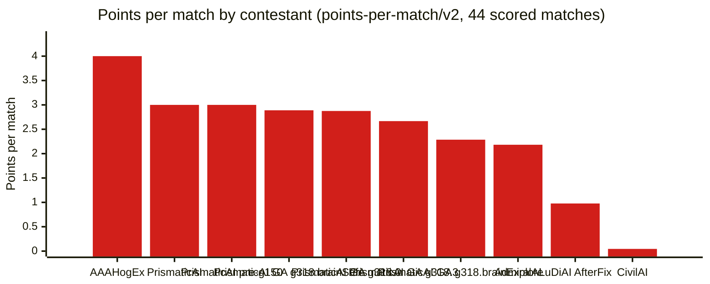
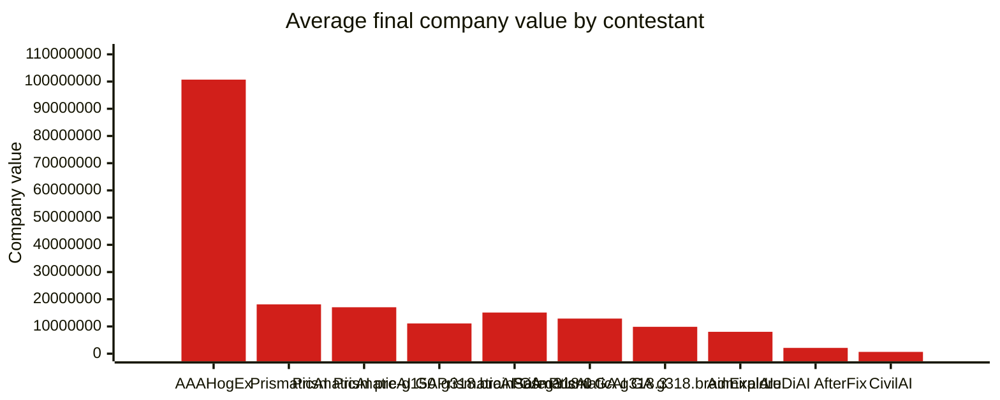
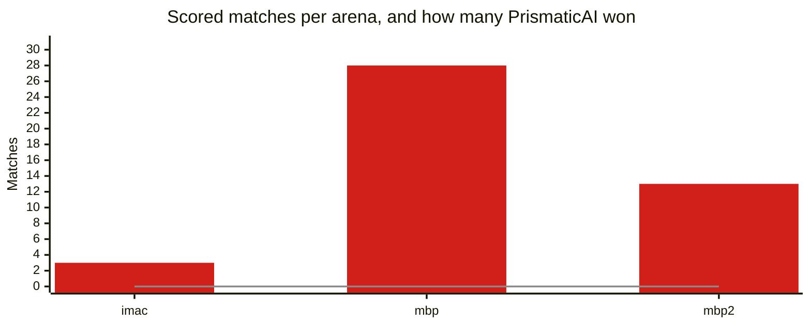

# battle-20261121T230908-1425f2c3

Derived from `battle-20261121T230908-1425f2c3.json` by `tools/research/ai-battle/battle.py report`; do not edit.

- Edition `1425f2c357fba4b6`: PrismaticAI and referee at `8c8d025388e85261a60027d9983d8588d720a2e9`, base set `opengfx-8.0.tar`
- 20-year free-for-all from 1960, map 256x256 temperate, breakdowns 1
- 44 scored match(es) on `imac` (20261119-master-gdf1e05e7d8), `mbp` (20261120-master-m17653b726e), `mbp2` (20261119-master-gdf1e05e7d8)
- Replays: 0 of 0 identical to their original on another arena

| # | Contestant | Played | Wins | Points | Points/match | Avg rank | Avg final value | Squirrel errors | Matches with anomalies |
|---|---|---|---|---|---|---|---|---|---|
| 1 | AAAHogEx | 44 | 44 | 176 | 4.0 | 1.0 | 100.7 M | 0 | 0 |
| 2 | PrismaticAI | 7 | 0 | 21 | 3.0 | 2.0 | 18.1 M | 0 | 0 |
| 3 | PrismaticAI pre-g150 | 7 | 0 | 21 | 3.0 | 2.0 | 17.1 M | 0 | 0 |
| 4 | PrismaticAI GA g318.brainSafe | 9 | 0 | 26 | 2.889 | 2.11 | 11.1 M | 0 | 0 |
| 5 | PrismaticAI GA g318.0 | 8 | 0 | 23 | 2.875 | 2.12 | 15.1 M | 0 | 0 |
| 6 | PrismaticAI GA g318.3 | 6 | 0 | 16 | 2.667 | 2.33 | 12.9 M | 0 | 0 |
| 7 | PrismaticAI GA g318.brainExplore | 7 | 0 | 16 | 2.286 | 2.71 | 9.9 M | 0 | 0 |
| 8 | AdmiralAI | 44 | 0 | 96 | 2.182 | 2.82 | 8.0 M | 0 | 2 |
| 9 | LuDiAI AfterFix | 44 | 0 | 43 | 0.977 | 4.02 | 2.1 M | 0 | 0 |
| 10 | CivilAI | 44 | 0 | 2 | 0.045 | 4.95 | 653.3 k | 0 | 11 |

```mermaid
---
config:
  xyChart:
    width: 900
    height: 360
  themeVariables:
    xyChart:
      plotColorPalette: "#d11f1a, #8a8a8a, #0b0b0b, #ece4d6"
---
xychart-beta
    title "Final company value per scored match: winner vs best PrismaticAI"
    x-axis ["m-0001", "m-0002", "m-0003", "m-0004", "m-0005", "m-0006", "m-0007", "m-0008", "m-0009", "m-0010", "m-0011", "m-0012", "m-0013", "m-0014", "m-0015", "m-0017", "m-0018", "m-0020", "m-0021", "m-0022", "m-0024", "m-0025", "m-0026", "m-0027", "m-0028", "m-0036", "m-0037", "m-0038", "m-0039", "m-0040", "m-0041", "m-0042", "m-0043", "m-0044", "m-0045", "m-0046", "m-0047", "m-0048", "m-0049", "m-0050", "m-0051", "m-0052", "m-0053", "m-0057"]
    %% series: Winner | Best PrismaticAI
    %% links: battle-20261121T230908-1425f2c3.md?col=Match&filter=m-0001 | battle-20261121T230908-1425f2c3.md?col=Match&filter=m-0002 | battle-20261121T230908-1425f2c3.md?col=Match&filter=m-0003 | battle-20261121T230908-1425f2c3.md?col=Match&filter=m-0004 | battle-20261121T230908-1425f2c3.md?col=Match&filter=m-0005 | battle-20261121T230908-1425f2c3.md?col=Match&filter=m-0006 | battle-20261121T230908-1425f2c3.md?col=Match&filter=m-0007 | battle-20261121T230908-1425f2c3.md?col=Match&filter=m-0008 | battle-20261121T230908-1425f2c3.md?col=Match&filter=m-0009 | battle-20261121T230908-1425f2c3.md?col=Match&filter=m-0010 | battle-20261121T230908-1425f2c3.md?col=Match&filter=m-0011 | battle-20261121T230908-1425f2c3.md?col=Match&filter=m-0012 | battle-20261121T230908-1425f2c3.md?col=Match&filter=m-0013 | battle-20261121T230908-1425f2c3.md?col=Match&filter=m-0014 | battle-20261121T230908-1425f2c3.md?col=Match&filter=m-0015 | battle-20261121T230908-1425f2c3.md?col=Match&filter=m-0017 | battle-20261121T230908-1425f2c3.md?col=Match&filter=m-0018 | battle-20261121T230908-1425f2c3.md?col=Match&filter=m-0020 | battle-20261121T230908-1425f2c3.md?col=Match&filter=m-0021 | battle-20261121T230908-1425f2c3.md?col=Match&filter=m-0022 | battle-20261121T230908-1425f2c3.md?col=Match&filter=m-0024 | battle-20261121T230908-1425f2c3.md?col=Match&filter=m-0025 | battle-20261121T230908-1425f2c3.md?col=Match&filter=m-0026 | battle-20261121T230908-1425f2c3.md?col=Match&filter=m-0027 | battle-20261121T230908-1425f2c3.md?col=Match&filter=m-0028 | battle-20261121T230908-1425f2c3.md?col=Match&filter=m-0036 | battle-20261121T230908-1425f2c3.md?col=Match&filter=m-0037 | battle-20261121T230908-1425f2c3.md?col=Match&filter=m-0038 | battle-20261121T230908-1425f2c3.md?col=Match&filter=m-0039 | battle-20261121T230908-1425f2c3.md?col=Match&filter=m-0040 | battle-20261121T230908-1425f2c3.md?col=Match&filter=m-0041 | battle-20261121T230908-1425f2c3.md?col=Match&filter=m-0042 | battle-20261121T230908-1425f2c3.md?col=Match&filter=m-0043 | battle-20261121T230908-1425f2c3.md?col=Match&filter=m-0044 | battle-20261121T230908-1425f2c3.md?col=Match&filter=m-0045 | battle-20261121T230908-1425f2c3.md?col=Match&filter=m-0046 | battle-20261121T230908-1425f2c3.md?col=Match&filter=m-0047 | battle-20261121T230908-1425f2c3.md?col=Match&filter=m-0048 | battle-20261121T230908-1425f2c3.md?col=Match&filter=m-0049 | battle-20261121T230908-1425f2c3.md?col=Match&filter=m-0050 | battle-20261121T230908-1425f2c3.md?col=Match&filter=m-0051 | battle-20261121T230908-1425f2c3.md?col=Match&filter=m-0052 | battle-20261121T230908-1425f2c3.md?col=Match&filter=m-0053 | battle-20261121T230908-1425f2c3.md?col=Match&filter=m-0057
    y-axis "Company value" 0 --> 189000000
    bar [118672741, 134370919, 171424302, 146806818, 116529612, 73575325, 79010880, 63936372, 81525975, 96944857, 74378113, 113828032, 115062082, 108817706, 116175654, 115012402, 94277683, 104916628, 109045622, 123723924, 71937870, 102665437, 85113608, 70587945, 89540695, 91868729, 104830627, 83027268, 88042332, 105317134, 74938107, 100078654, 85424036, 77433575, 69325744, 60301222, 52564516, 137136778, 118226825, 110090774, 130829256, 132417390, 115627517, 115779540]
    line [11148724, 12769959, 8399803, 6792029, 10557029, 24445267, 14028428, 15748639, 12138656, 10257271, 10643688, 13685881, 13252093, 6677976, 2583792, 5227979, 15409696, 14443406, 15354345, 5305458, 17897512, 17538753, 14903626, 15228505, 14330001, 19953986, 19607338, 21116081, 11585533, 11964921, 14414784, 16661729, 23106337, 12368244, 16772621, 11460170, 19462733, 18795310, 20701434, 22894040, 10237161, 8959417, 17059581, 7692694]
```

<!-- battle-charts:begin -->
<!-- derived from battle-20261121T230908-1425f2c3.json by `battle.py render`; `battle.py check` fails when it is stale -->

<!-- battle-charts:end -->

| Match | Arena | Seed | Winner | Value | Last | Anomalies |
|---|---|---|---|---|---|---|
| m-0001 | mbp | 1867615314 | AAAHogEx | 118.7 M | CivilAI | CivilAI: fleet_drop:42->20 |
| m-0002 | mbp | 1867615314 | AAAHogEx | 134.4 M | CivilAI | - |
| m-0003 | mbp | 1867615314 | AAAHogEx | 171.4 M | CivilAI | - |
| m-0004 | mbp | 1867615314 | AAAHogEx | 146.8 M | CivilAI | - |
| m-0005 | mbp | 1867615314 | AAAHogEx | 116.5 M | CivilAI | - |
| m-0006 | mbp | 766638401 | AAAHogEx | 73.6 M | CivilAI | - |
| m-0007 | mbp | 766638401 | AAAHogEx | 79.0 M | CivilAI | - |
| m-0008 | mbp | 766638401 | AAAHogEx | 63.9 M | CivilAI | CivilAI: fleet_drop:47->15 |
| m-0009 | mbp | 766638401 | AAAHogEx | 81.5 M | CivilAI | - |
| m-0010 | imac | 766638401 | AAAHogEx | 96.9 M | CivilAI | CivilAI: fleet_drop:34->22 |
| m-0011 | imac | 766638401 | AAAHogEx | 74.4 M | CivilAI | CivilAI: fleet_drop:25->9 |
| m-0012 | imac | 223943789 | AAAHogEx | 113.8 M | CivilAI | - |
| m-0013 | mbp2 | 223943789 | AAAHogEx | 115.1 M | CivilAI | - |
| m-0014 | mbp2 | 223943789 | AAAHogEx | 108.8 M | CivilAI | CivilAI: fleet_drop:26->10 |
| m-0015 | mbp2 | 223943789 | AAAHogEx | 116.2 M | CivilAI | - |
| m-0017 | mbp2 | 223943789 | AAAHogEx | 115.0 M | CivilAI | - |
| m-0018 | mbp2 | 1239234087 | AAAHogEx | 94.3 M | CivilAI | - |
| m-0020 | mbp2 | 1239234087 | AAAHogEx | 104.9 M | CivilAI | - |
| m-0021 | mbp2 | 1239234087 | AAAHogEx | 109.0 M | CivilAI | - |
| m-0022 | mbp2 | 1239234087 | AAAHogEx | 123.7 M | CivilAI | CivilAI: fleet_drop:49->26 |
| m-0024 | mbp2 | 1540882012 | AAAHogEx | 71.9 M | LuDiAI AfterFix | - |
| m-0025 | mbp2 | 1540882012 | AAAHogEx | 102.7 M | CivilAI | CivilAI: fleet_drop:42->27 |
| m-0026 | mbp2 | 1540882012 | AAAHogEx | 85.1 M | LuDiAI AfterFix | - |
| m-0027 | mbp2 | 1540882012 | AAAHogEx | 70.6 M | CivilAI | AdmiralAI: fleet_drop:442->293 |
| m-0028 | mbp2 | 1540882012 | AAAHogEx | 89.5 M | CivilAI | - |
| m-0036 | mbp | 854559175 | AAAHogEx | 91.9 M | CivilAI | AdmiralAI: fleet_drop:359->250 |
| m-0037 | mbp | 854559175 | AAAHogEx | 104.8 M | CivilAI | - |
| m-0038 | mbp | 854559175 | AAAHogEx | 83.0 M | CivilAI | - |
| m-0039 | mbp | 854559175 | AAAHogEx | 88.0 M | CivilAI | CivilAI: fleet_drop:22->9 |
| m-0040 | mbp | 854559175 | AAAHogEx | 105.3 M | CivilAI | - |
| m-0041 | mbp | 854559175 | AAAHogEx | 74.9 M | CivilAI | - |
| m-0042 | mbp | 1972078983 | AAAHogEx | 100.1 M | CivilAI | - |
| m-0043 | mbp | 1972078983 | AAAHogEx | 85.4 M | CivilAI | - |
| m-0044 | mbp | 1972078983 | AAAHogEx | 77.4 M | CivilAI | - |
| m-0045 | mbp | 1972078983 | AAAHogEx | 69.3 M | CivilAI | CivilAI: fleet_drop:29->12 |
| m-0046 | mbp | 1972078983 | AAAHogEx | 60.3 M | CivilAI | - |
| m-0047 | mbp | 1972078983 | AAAHogEx | 52.6 M | CivilAI | CivilAI: fleet_drop:72->46 |
| m-0048 | mbp | 1159589989 | AAAHogEx | 137.1 M | CivilAI | - |
| m-0049 | mbp | 1159589989 | AAAHogEx | 118.2 M | CivilAI | - |
| m-0050 | mbp | 1159589989 | AAAHogEx | 110.1 M | CivilAI | - |
| m-0051 | mbp | 1159589989 | AAAHogEx | 130.8 M | CivilAI | - |
| m-0052 | mbp | 1159589989 | AAAHogEx | 132.4 M | CivilAI | - |
| m-0053 | mbp | 1159589989 | AAAHogEx | 115.6 M | CivilAI | - |
| m-0057 | mbp | 961366027 | AAAHogEx | 115.8 M | CivilAI | CivilAI: no_vehicles |
