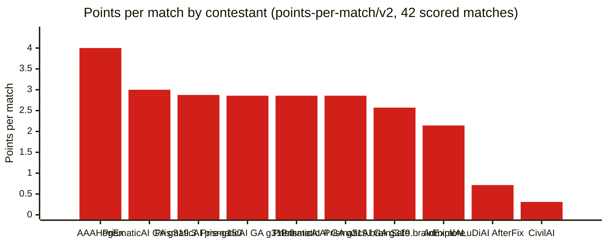
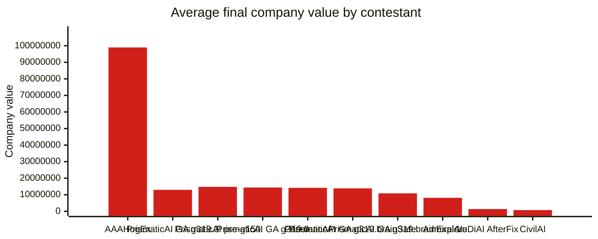
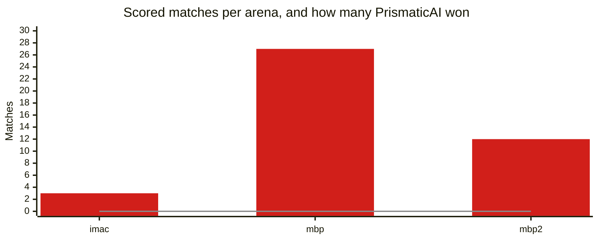

# battle-20261121T231937-99064377

Derived from `battle-20261121T231937-99064377.json` by `tools/research/ai-battle/battle.py report`; do not edit.

- Edition `9906437774d2a3bb`: PrismaticAI and referee at `8c8d025388e85261a60027d9983d8588d720a2e9`, base set `opengfx-8.0.tar`
- 20-year free-for-all from 1960, map 256x256 temperate, breakdowns 1
- 42 scored match(es) on `imac` (20261119-master-gdf1e05e7d8), `mbp` (20261120-master-m17653b726e), `mbp2` (20261119-master-gdf1e05e7d8)
- Replays: 0 of 0 identical to their original on another arena

| # | Contestant | Played | Wins | Points | Points/match | Avg rank | Avg final value | Squirrel errors | Matches with anomalies |
|---|---|---|---|---|---|---|---|---|---|
| 1 | AAAHogEx | 42 | 42 | 168 | 4.0 | 1.0 | 99.0 M | 0 | 0 |
| 2 | PrismaticAI GA g319.3 | 6 | 0 | 18 | 3.0 | 2.0 | 13.0 M | 0 | 0 |
| 3 | PrismaticAI pre-g150 | 8 | 0 | 23 | 2.875 | 2.12 | 14.8 M | 0 | 0 |
| 4 | PrismaticAI GA g319.0 | 7 | 0 | 20 | 2.857 | 2.14 | 14.4 M | 0 | 0 |
| 5 | PrismaticAI | 7 | 0 | 20 | 2.857 | 2.14 | 14.2 M | 0 | 0 |
| 6 | PrismaticAI GA g319.brainSafe | 7 | 0 | 20 | 2.857 | 2.14 | 13.8 M | 0 | 0 |
| 7 | PrismaticAI GA g319.brainExplore | 7 | 0 | 18 | 2.571 | 2.43 | 10.8 M | 0 | 0 |
| 8 | AdmiralAI | 42 | 0 | 90 | 2.143 | 2.86 | 8.2 M | 0 | 3 |
| 9 | LuDiAI AfterFix | 42 | 0 | 30 | 0.714 | 4.29 | 1.4 M | 0 | 3 |
| 10 | CivilAI | 42 | 0 | 13 | 0.31 | 4.69 | 730.6 k | 0 | 9 |

```mermaid
---
config:
  xyChart:
    width: 900
    height: 360
  themeVariables:
    xyChart:
      plotColorPalette: "#d11f1a, #8a8a8a, #0b0b0b, #ece4d6"
---
xychart-beta
    title "Final company value per scored match: winner vs best PrismaticAI"
    x-axis ["m-0001", "m-0002", "m-0003", "m-0004", "m-0005", "m-0006", "m-0007", "m-0008", "m-0009", "m-0010", "m-0011", "m-0012", "m-0013", "m-0018", "m-0019", "m-0020", "m-0021", "m-0022", "m-0023", "m-0024", "m-0025", "m-0026", "m-0027", "m-0028", "m-0036", "m-0037", "m-0038", "m-0039", "m-0040", "m-0041", "m-0042", "m-0043", "m-0044", "m-0045", "m-0046", "m-0047", "m-0048", "m-0049", "m-0050", "m-0051", "m-0052", "m-0053"]
    %% series: Winner | Best PrismaticAI
    %% links: battle-20261121T231937-99064377.md?col=Match&filter=m-0001 | battle-20261121T231937-99064377.md?col=Match&filter=m-0002 | battle-20261121T231937-99064377.md?col=Match&filter=m-0003 | battle-20261121T231937-99064377.md?col=Match&filter=m-0004 | battle-20261121T231937-99064377.md?col=Match&filter=m-0005 | battle-20261121T231937-99064377.md?col=Match&filter=m-0006 | battle-20261121T231937-99064377.md?col=Match&filter=m-0007 | battle-20261121T231937-99064377.md?col=Match&filter=m-0008 | battle-20261121T231937-99064377.md?col=Match&filter=m-0009 | battle-20261121T231937-99064377.md?col=Match&filter=m-0010 | battle-20261121T231937-99064377.md?col=Match&filter=m-0011 | battle-20261121T231937-99064377.md?col=Match&filter=m-0012 | battle-20261121T231937-99064377.md?col=Match&filter=m-0013 | battle-20261121T231937-99064377.md?col=Match&filter=m-0018 | battle-20261121T231937-99064377.md?col=Match&filter=m-0019 | battle-20261121T231937-99064377.md?col=Match&filter=m-0020 | battle-20261121T231937-99064377.md?col=Match&filter=m-0021 | battle-20261121T231937-99064377.md?col=Match&filter=m-0022 | battle-20261121T231937-99064377.md?col=Match&filter=m-0023 | battle-20261121T231937-99064377.md?col=Match&filter=m-0024 | battle-20261121T231937-99064377.md?col=Match&filter=m-0025 | battle-20261121T231937-99064377.md?col=Match&filter=m-0026 | battle-20261121T231937-99064377.md?col=Match&filter=m-0027 | battle-20261121T231937-99064377.md?col=Match&filter=m-0028 | battle-20261121T231937-99064377.md?col=Match&filter=m-0036 | battle-20261121T231937-99064377.md?col=Match&filter=m-0037 | battle-20261121T231937-99064377.md?col=Match&filter=m-0038 | battle-20261121T231937-99064377.md?col=Match&filter=m-0039 | battle-20261121T231937-99064377.md?col=Match&filter=m-0040 | battle-20261121T231937-99064377.md?col=Match&filter=m-0041 | battle-20261121T231937-99064377.md?col=Match&filter=m-0042 | battle-20261121T231937-99064377.md?col=Match&filter=m-0043 | battle-20261121T231937-99064377.md?col=Match&filter=m-0044 | battle-20261121T231937-99064377.md?col=Match&filter=m-0045 | battle-20261121T231937-99064377.md?col=Match&filter=m-0046 | battle-20261121T231937-99064377.md?col=Match&filter=m-0047 | battle-20261121T231937-99064377.md?col=Match&filter=m-0048 | battle-20261121T231937-99064377.md?col=Match&filter=m-0049 | battle-20261121T231937-99064377.md?col=Match&filter=m-0050 | battle-20261121T231937-99064377.md?col=Match&filter=m-0051 | battle-20261121T231937-99064377.md?col=Match&filter=m-0052 | battle-20261121T231937-99064377.md?col=Match&filter=m-0053
    y-axis "Company value" 0 --> 177000000
    bar [92047905, 91701357, 90267282, 84434218, 82672967, 85258657, 132474492, 89394885, 89435744, 87277817, 90099880, 149469116, 123779464, 56677598, 62296452, 74835001, 63210781, 74222464, 63576592, 84196728, 88085735, 118886502, 109799950, 111997989, 107338022, 92558224, 92761950, 78764856, 107875678, 81649364, 147522348, 140250966, 128306717, 153102936, 144679692, 160511807, 60922157, 79745699, 97323634, 104442699, 90852932, 91719364]
    line [15258753, 14979110, 16410431, 10224132, 12988049, 12364180, 11754941, 15284482, 14308981, 13335812, 15175605, 12700135, 19637179, 10180496, 10088003, 11123455, 9230227, 11719717, 9470486, 16552541, 18482669, 22838702, 20281426, 14752647, 18955023, 13375976, 12231794, 14856807, 11577917, 15686036, 24367174, 21504727, 17891450, 17626054, 7927716, 13568567, 4209058, 7968559, 6265086, 4154793, 6354686, 10985946]
```

<!-- battle-charts:begin -->
<!-- derived from battle-20261121T231937-99064377.json by `battle.py render`; `battle.py check` fails when it is stale -->

<!-- battle-charts:end -->

| Match | Arena | Seed | Winner | Value | Last | Anomalies |
|---|---|---|---|---|---|---|
| m-0001 | mbp | 1645344272 | AAAHogEx | 92.0 M | CivilAI | - |
| m-0002 | mbp | 1645344272 | AAAHogEx | 91.7 M | CivilAI | - |
| m-0003 | mbp | 1645344272 | AAAHogEx | 90.3 M | CivilAI | - |
| m-0004 | mbp | 1645344272 | AAAHogEx | 84.4 M | CivilAI | - |
| m-0005 | mbp | 1645344272 | AAAHogEx | 82.7 M | CivilAI | - |
| m-0006 | mbp | 882181470 | AAAHogEx | 85.3 M | CivilAI | - |
| m-0007 | mbp | 882181470 | AAAHogEx | 132.5 M | CivilAI | - |
| m-0008 | mbp | 882181470 | AAAHogEx | 89.4 M | CivilAI | - |
| m-0009 | mbp | 882181470 | AAAHogEx | 89.4 M | CivilAI | CivilAI: fleet_drop:42->25 |
| m-0010 | imac | 882181470 | AAAHogEx | 87.3 M | CivilAI | - |
| m-0011 | imac | 882181470 | AAAHogEx | 90.1 M | CivilAI | CivilAI: fleet_drop:42->21 |
| m-0012 | imac | 209348007 | AAAHogEx | 149.5 M | CivilAI | - |
| m-0013 | mbp2 | 209348007 | AAAHogEx | 123.8 M | CivilAI | - |
| m-0018 | mbp2 | 1238841973 | AAAHogEx | 56.7 M | CivilAI | - |
| m-0019 | mbp2 | 1238841973 | AAAHogEx | 62.3 M | CivilAI | AdmiralAI: fleet_drop:157->109 |
| m-0020 | mbp2 | 1238841973 | AAAHogEx | 74.8 M | LuDiAI AfterFix | - |
| m-0021 | mbp2 | 1238841973 | AAAHogEx | 63.2 M | CivilAI | - |
| m-0022 | mbp2 | 1238841973 | AAAHogEx | 74.2 M | CivilAI | - |
| m-0023 | mbp2 | 1238841973 | AAAHogEx | 63.6 M | LuDiAI AfterFix | AdmiralAI: fleet_drop:77->53; LuDiAI AfterFix: fleet_drop:86->58 |
| m-0024 | mbp2 | 1364813893 | AAAHogEx | 84.2 M | CivilAI | - |
| m-0025 | mbp2 | 1364813893 | AAAHogEx | 88.1 M | CivilAI | - |
| m-0026 | mbp2 | 1364813893 | AAAHogEx | 118.9 M | LuDiAI AfterFix | - |
| m-0027 | mbp2 | 1364813893 | AAAHogEx | 109.8 M | LuDiAI AfterFix | LuDiAI AfterFix: fleet_drop:25->14 |
| m-0028 | mbp2 | 1364813893 | AAAHogEx | 112.0 M | CivilAI | CivilAI: fleet_drop:14->9 |
| m-0036 | mbp | 264252790 | AAAHogEx | 107.3 M | CivilAI | AdmiralAI: fleet_drop:357->245 |
| m-0037 | mbp | 264252790 | AAAHogEx | 92.6 M | CivilAI | - |
| m-0038 | mbp | 264252790 | AAAHogEx | 92.8 M | CivilAI | LuDiAI AfterFix: fleet_drop:161->99 |
| m-0039 | mbp | 264252790 | AAAHogEx | 78.8 M | CivilAI | - |
| m-0040 | mbp | 264252790 | AAAHogEx | 107.9 M | CivilAI | CivilAI: fleet_drop:61->34 |
| m-0041 | mbp | 264252790 | AAAHogEx | 81.6 M | CivilAI | CivilAI: fleet_drop:55->33 |
| m-0042 | mbp | 1414687701 | AAAHogEx | 147.5 M | LuDiAI AfterFix | - |
| m-0043 | mbp | 1414687701 | AAAHogEx | 140.3 M | CivilAI | - |
| m-0044 | mbp | 1414687701 | AAAHogEx | 128.3 M | CivilAI | CivilAI: fleet_drop:37->21 |
| m-0045 | mbp | 1414687701 | AAAHogEx | 153.1 M | LuDiAI AfterFix | - |
| m-0046 | mbp | 1414687701 | AAAHogEx | 144.7 M | CivilAI | - |
| m-0047 | mbp | 1414687701 | AAAHogEx | 160.5 M | CivilAI | - |
| m-0048 | mbp | 580166553 | AAAHogEx | 60.9 M | LuDiAI AfterFix | - |
| m-0049 | mbp | 580166553 | AAAHogEx | 79.7 M | LuDiAI AfterFix | - |
| m-0050 | mbp | 580166553 | AAAHogEx | 97.3 M | LuDiAI AfterFix | CivilAI: fleet_drop:79->45 |
| m-0051 | mbp | 580166553 | AAAHogEx | 104.4 M | LuDiAI AfterFix | CivilAI: fleet_drop:67->40 |
| m-0052 | mbp | 580166553 | AAAHogEx | 90.9 M | LuDiAI AfterFix | - |
| m-0053 | mbp | 580166553 | AAAHogEx | 91.7 M | LuDiAI AfterFix | CivilAI: fleet_drop:109->71 |
