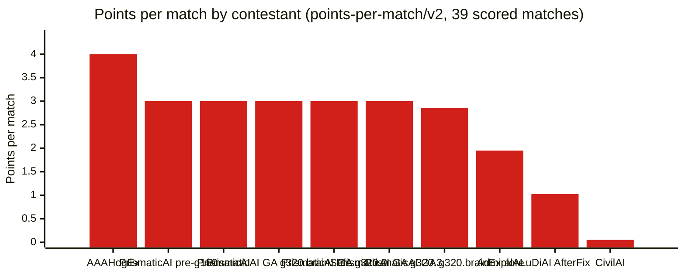
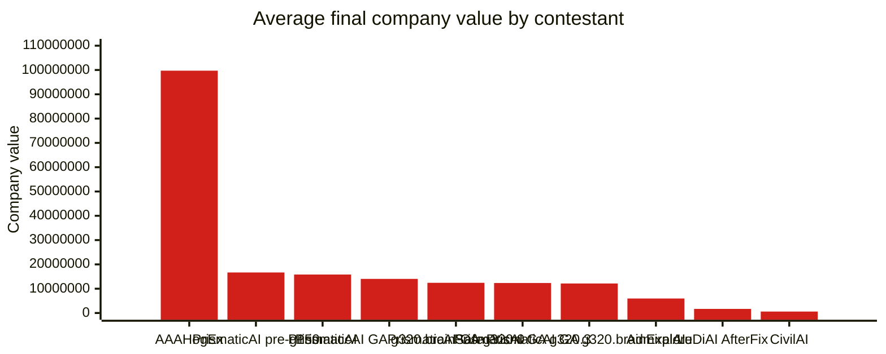
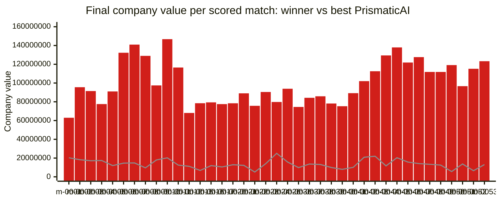
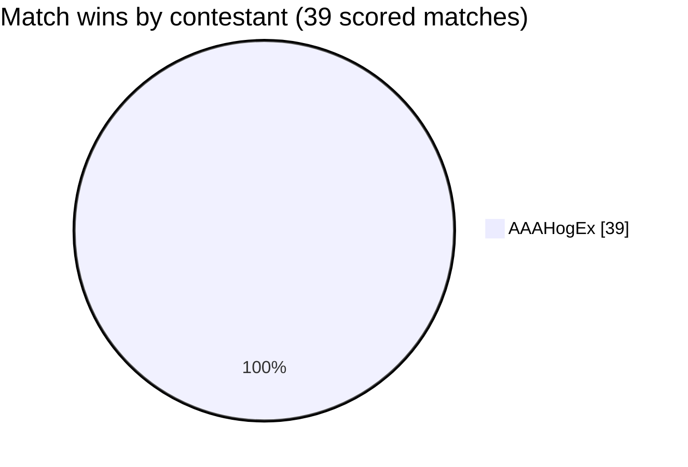
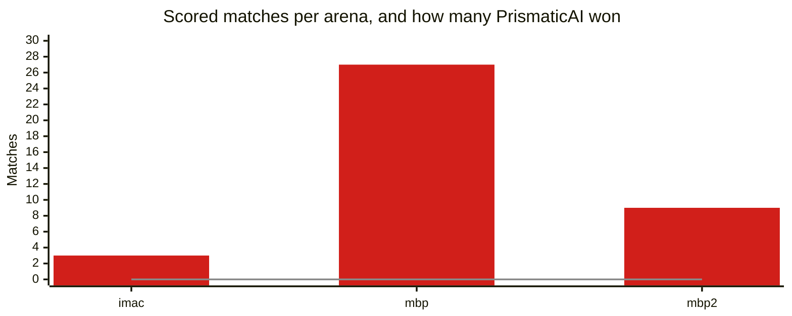

# battle-20261121T233047-c5a3b6b4

Derived from `battle-20261121T233047-c5a3b6b4.json` by `tools/research/ai-battle/battle.py report`; do not edit.

- Edition `c5a3b6b4160414ce`: PrismaticAI and referee at `8c8d025388e85261a60027d9983d8588d720a2e9`, base set `opengfx-8.0.tar`
- 20-year free-for-all from 1960, map 256x256 temperate, breakdowns 1
- 39 scored match(es) on `imac` (20261119-master-gdf1e05e7d8), `mbp` (20261120-master-m17653b726e), `mbp2` (20261119-master-gdf1e05e7d8)
- Replays: 0 of 0 identical to their original on another arena

| # | Contestant | Played | Wins | Points | Points/match | Avg rank | Avg final value | Squirrel errors | Matches with anomalies |
|---|---|---|---|---|---|---|---|---|---|
| 1 | AAAHogEx | 39 | 39 | 156 | 4.0 | 1.0 | 99.7 M | 0 | 0 |
| 2 | PrismaticAI pre-g150 | 5 | 0 | 15 | 3.0 | 2.0 | 16.7 M | 0 | 0 |
| 3 | PrismaticAI | 6 | 0 | 18 | 3.0 | 2.0 | 15.8 M | 0 | 0 |
| 4 | PrismaticAI GA g320.brainSafe | 7 | 0 | 21 | 3.0 | 2.0 | 14.0 M | 0 | 0 |
| 5 | PrismaticAI GA g320.0 | 7 | 0 | 21 | 3.0 | 2.0 | 12.4 M | 0 | 0 |
| 6 | PrismaticAI GA g320.3 | 7 | 0 | 21 | 3.0 | 2.0 | 12.3 M | 0 | 0 |
| 7 | PrismaticAI GA g320.brainExplore | 7 | 0 | 20 | 2.857 | 2.14 | 12.1 M | 0 | 0 |
| 8 | AdmiralAI | 39 | 0 | 76 | 1.949 | 3.05 | 6.0 M | 0 | 2 |
| 9 | LuDiAI AfterFix | 39 | 0 | 40 | 1.026 | 3.97 | 1.7 M | 0 | 3 |
| 10 | CivilAI | 39 | 0 | 2 | 0.051 | 4.95 | 593.8 k | 0 | 8 |

<!-- battle-charts:begin -->
<!-- derived from battle-20261121T233047-c5a3b6b4.json by `battle.py render`; `battle.py check` fails when it is stale -->

<!-- battle-charts:end -->

| Match | Arena | Seed | Winner | Value | Last | Anomalies |
|---|---|---|---|---|---|---|
| m-0001 | mbp | 86937581 | AAAHogEx | 63.0 M | CivilAI | - |
| m-0002 | mbp | 86937581 | AAAHogEx | 95.5 M | CivilAI | - |
| m-0003 | mbp | 86937581 | AAAHogEx | 91.4 M | CivilAI | CivilAI: fleet_drop:63->25 |
| m-0004 | mbp | 86937581 | AAAHogEx | 77.6 M | CivilAI | - |
| m-0005 | mbp | 86937581 | AAAHogEx | 91.0 M | CivilAI | CivilAI: fleet_drop:50->32 |
| m-0006 | mbp | 214160926 | AAAHogEx | 132.3 M | CivilAI | LuDiAI AfterFix: fleet_drop:54->32 |
| m-0007 | mbp | 214160926 | AAAHogEx | 141.0 M | CivilAI | CivilAI: no_vehicles |
| m-0008 | mbp | 214160926 | AAAHogEx | 129.0 M | CivilAI | - |
| m-0009 | mbp | 214160926 | AAAHogEx | 97.5 M | CivilAI | - |
| m-0010 | imac | 214160926 | AAAHogEx | 146.8 M | CivilAI | - |
| m-0011 | imac | 214160926 | AAAHogEx | 116.5 M | CivilAI | - |
| m-0012 | imac | 1905895919 | AAAHogEx | 68.1 M | CivilAI | - |
| m-0015 | mbp2 | 1905895919 | AAAHogEx | 78.5 M | CivilAI | LuDiAI AfterFix: fleet_drop:158->106 |
| m-0016 | mbp2 | 1905895919 | AAAHogEx | 79.4 M | CivilAI | AdmiralAI: fleet_drop:225->150 |
| m-0017 | mbp2 | 1905895919 | AAAHogEx | 77.5 M | CivilAI | CivilAI: fleet_drop:16->9 |
| m-0020 | mbp2 | 630402903 | AAAHogEx | 78.4 M | CivilAI | AdmiralAI: fleet_drop:265->120; CivilAI: fleet_drop:37->14 |
| m-0021 | mbp2 | 630402903 | AAAHogEx | 89.0 M | CivilAI | - |
| m-0022 | mbp2 | 630402903 | AAAHogEx | 75.7 M | CivilAI | - |
| m-0023 | mbp2 | 630402903 | AAAHogEx | 90.5 M | CivilAI | - |
| m-0024 | mbp2 | 470750031 | AAAHogEx | 79.8 M | CivilAI | - |
| m-0026 | mbp2 | 470750031 | AAAHogEx | 93.9 M | CivilAI | - |
| m-0036 | mbp | 1048563119 | AAAHogEx | 74.5 M | CivilAI | - |
| m-0037 | mbp | 1048563119 | AAAHogEx | 84.3 M | CivilAI | CivilAI: fleet_drop:44->28 |
| m-0038 | mbp | 1048563119 | AAAHogEx | 85.9 M | CivilAI | - |
| m-0039 | mbp | 1048563119 | AAAHogEx | 78.2 M | CivilAI | - |
| m-0040 | mbp | 1048563119 | AAAHogEx | 75.3 M | CivilAI | - |
| m-0041 | mbp | 1048563119 | AAAHogEx | 89.2 M | CivilAI | - |
| m-0042 | mbp | 1419145779 | AAAHogEx | 102.0 M | CivilAI | - |
| m-0043 | mbp | 1419145779 | AAAHogEx | 112.6 M | CivilAI | - |
| m-0044 | mbp | 1419145779 | AAAHogEx | 129.4 M | CivilAI | - |
| m-0045 | mbp | 1419145779 | AAAHogEx | 138.0 M | CivilAI | - |
| m-0046 | mbp | 1419145779 | AAAHogEx | 121.9 M | CivilAI | - |
| m-0047 | mbp | 1419145779 | AAAHogEx | 127.6 M | AdmiralAI | - |
| m-0048 | mbp | 1144388176 | AAAHogEx | 111.8 M | CivilAI | - |
| m-0049 | mbp | 1144388176 | AAAHogEx | 111.8 M | CivilAI | - |
| m-0050 | mbp | 1144388176 | AAAHogEx | 119.1 M | CivilAI | - |
| m-0051 | mbp | 1144388176 | AAAHogEx | 96.7 M | CivilAI | LuDiAI AfterFix: fleet_drop:35->8; CivilAI: fleet_drop:37->25 |
| m-0052 | mbp | 1144388176 | AAAHogEx | 115.2 M | LuDiAI AfterFix | CivilAI: fleet_drop:35->19 |
| m-0053 | mbp | 1144388176 | AAAHogEx | 123.3 M | CivilAI | - |
