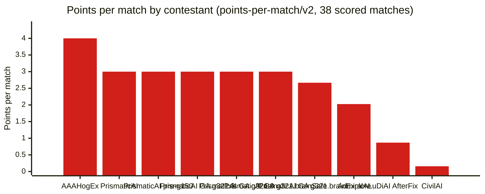
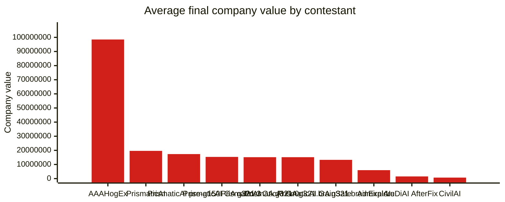
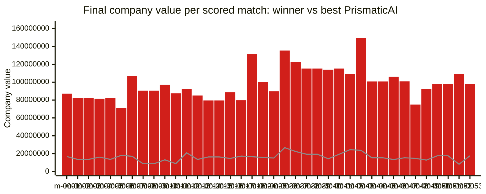
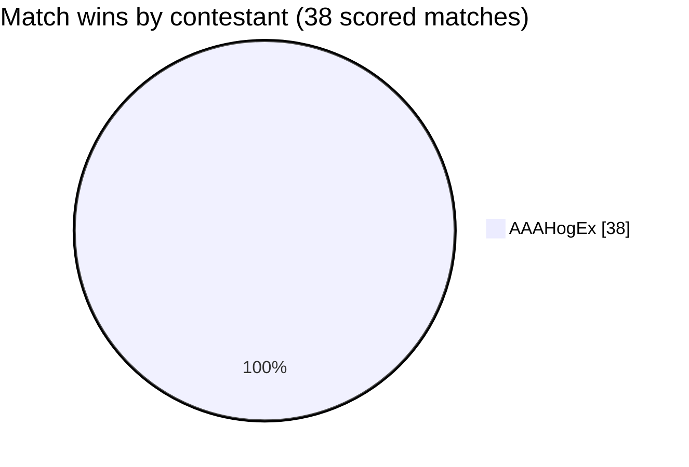
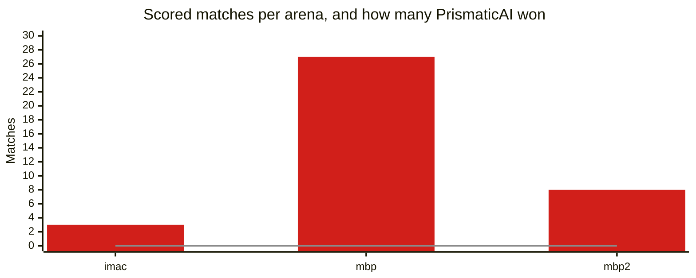

# battle-20261121T234143-6236d8dd

Derived from `battle-20261121T234143-6236d8dd.json` by `tools/research/ai-battle/battle.py report`; do not edit.

- Edition `6236d8ddc2d09fe7`: PrismaticAI and referee at `8c8d025388e85261a60027d9983d8588d720a2e9`, base set `opengfx-8.0.tar`
- 20-year free-for-all from 1960, map 256x256 temperate, breakdowns 1
- 38 scored match(es) on `imac` (20261119-master-gdf1e05e7d8), `mbp` (20261120-master-m17653b726e), `mbp2` (20261119-master-gdf1e05e7d8)
- Replays: 0 of 0 identical to their original on another arena

| # | Contestant | Played | Wins | Points | Points/match | Avg rank | Avg final value | Squirrel errors | Matches with anomalies |
|---|---|---|---|---|---|---|---|---|---|
| 1 | AAAHogEx | 38 | 38 | 152 | 4.0 | 1.0 | 98.5 M | 0 | 0 |
| 2 | PrismaticAI | 7 | 0 | 21 | 3.0 | 2.0 | 19.6 M | 0 | 0 |
| 3 | PrismaticAI pre-g150 | 7 | 0 | 21 | 3.0 | 2.0 | 17.4 M | 0 | 0 |
| 4 | PrismaticAI GA g321.3 | 6 | 0 | 18 | 3.0 | 2.0 | 15.4 M | 0 | 0 |
| 5 | PrismaticAI GA g321.0 | 6 | 0 | 18 | 3.0 | 2.0 | 15.2 M | 0 | 0 |
| 6 | PrismaticAI GA g321.brainSafe | 6 | 0 | 18 | 3.0 | 2.0 | 15.2 M | 0 | 0 |
| 7 | PrismaticAI GA g321.brainExplore | 6 | 0 | 16 | 2.667 | 2.33 | 13.3 M | 0 | 0 |
| 8 | AdmiralAI | 38 | 0 | 77 | 2.026 | 2.97 | 6.0 M | 44 | 1 |
| 9 | LuDiAI AfterFix | 38 | 0 | 33 | 0.868 | 4.13 | 1.5 M | 0 | 1 |
| 10 | CivilAI | 38 | 0 | 6 | 0.158 | 4.84 | 709.1 k | 0 | 6 |

<!-- battle-charts:begin -->
<!-- derived from battle-20261121T234143-6236d8dd.json by `battle.py render`; `battle.py check` fails when it is stale -->

<!-- battle-charts:end -->

| Match | Arena | Seed | Winner | Value | Last | Anomalies |
|---|---|---|---|---|---|---|
| m-0001 | mbp | 1384886982 | AAAHogEx | 87.2 M | CivilAI | - |
| m-0002 | mbp | 1384886982 | AAAHogEx | 82.3 M | LuDiAI AfterFix | - |
| m-0003 | mbp | 1384886982 | AAAHogEx | 82.3 M | LuDiAI AfterFix | - |
| m-0004 | mbp | 1384886982 | AAAHogEx | 81.4 M | CivilAI | CivilAI: fleet_drop:58->11 |
| m-0005 | mbp | 1384886982 | AAAHogEx | 82.3 M | LuDiAI AfterFix | - |
| m-0006 | mbp | 1310943560 | AAAHogEx | 71.0 M | CivilAI | - |
| m-0007 | mbp | 1310943560 | AAAHogEx | 106.8 M | CivilAI | LuDiAI AfterFix: fleet_drop:138->91 |
| m-0008 | mbp | 1310943560 | AAAHogEx | 90.5 M | CivilAI | - |
| m-0009 | mbp | 1310943560 | AAAHogEx | 90.5 M | CivilAI | - |
| m-0010 | imac | 1310943560 | AAAHogEx | 97.3 M | CivilAI | - |
| m-0011 | imac | 1310943560 | AAAHogEx | 87.5 M | CivilAI | - |
| m-0012 | imac | 231872917 | AAAHogEx | 92.4 M | LuDiAI AfterFix | - |
| m-0013 | mbp2 | 231872917 | AAAHogEx | 85.1 M | CivilAI | - |
| m-0014 | mbp2 | 231872917 | AAAHogEx | 79.5 M | CivilAI | - |
| m-0015 | mbp2 | 231872917 | AAAHogEx | 79.5 M | CivilAI | - |
| m-0016 | mbp2 | 231872917 | AAAHogEx | 88.6 M | LuDiAI AfterFix | - |
| m-0017 | mbp2 | 231872917 | AAAHogEx | 79.9 M | CivilAI | - |
| m-0018 | mbp2 | 309472251 | AAAHogEx | 131.5 M | CivilAI | - |
| m-0024 | mbp2 | 405877295 | AAAHogEx | 100.3 M | LuDiAI AfterFix | - |
| m-0025 | mbp2 | 405877295 | AAAHogEx | 89.9 M | CivilAI | - |
| m-0036 | mbp | 277345345 | AAAHogEx | 135.5 M | CivilAI | - |
| m-0037 | mbp | 277345345 | AAAHogEx | 122.7 M | CivilAI | - |
| m-0038 | mbp | 277345345 | AAAHogEx | 115.3 M | CivilAI | - |
| m-0039 | mbp | 277345345 | AAAHogEx | 115.3 M | CivilAI | - |
| m-0040 | mbp | 277345345 | AAAHogEx | 113.9 M | CivilAI | - |
| m-0041 | mbp | 277345345 | AAAHogEx | 115.3 M | CivilAI | - |
| m-0042 | mbp | 1163243012 | AAAHogEx | 109.1 M | CivilAI | - |
| m-0043 | mbp | 1163243012 | AAAHogEx | 149.5 M | CivilAI | CivilAI: fleet_drop:54->23 |
| m-0044 | mbp | 1163243012 | AAAHogEx | 100.9 M | CivilAI | CivilAI: fleet_drop:94->56 |
| m-0045 | mbp | 1163243012 | AAAHogEx | 100.9 M | CivilAI | CivilAI: fleet_drop:94->56 |
| m-0046 | mbp | 1163243012 | AAAHogEx | 106.1 M | CivilAI | CivilAI: fleet_drop:33->15 |
| m-0047 | mbp | 1163243012 | AAAHogEx | 101.0 M | CivilAI | CivilAI: fleet_drop:94->60 |
| m-0048 | mbp | 224420206 | AAAHogEx | 75.0 M | CivilAI | AdmiralAI: squirrel_errors:44 |
| m-0049 | mbp | 224420206 | AAAHogEx | 92.4 M | CivilAI | - |
| m-0050 | mbp | 224420206 | AAAHogEx | 98.3 M | CivilAI | - |
| m-0051 | mbp | 224420206 | AAAHogEx | 98.3 M | CivilAI | - |
| m-0052 | mbp | 224420206 | AAAHogEx | 109.3 M | CivilAI | - |
| m-0053 | mbp | 224420206 | AAAHogEx | 98.3 M | CivilAI | - |
