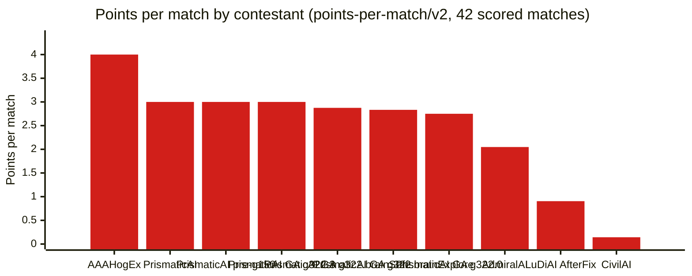
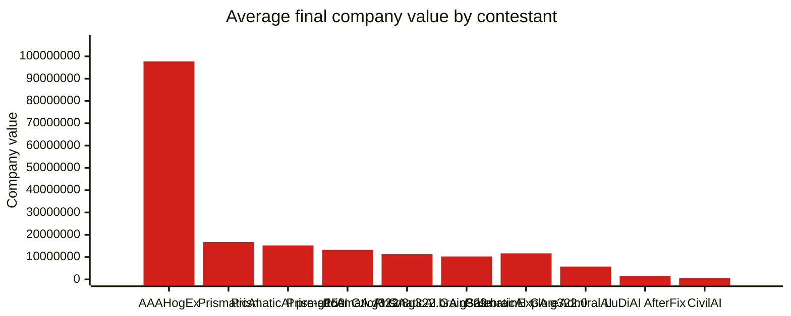
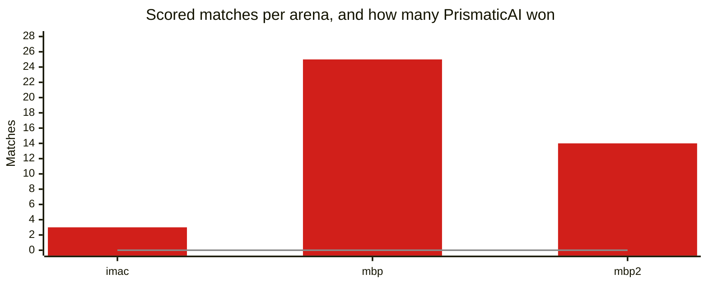

# battle-20261121T235330-e0b35beb

Derived from `battle-20261121T235330-e0b35beb.json` by `tools/research/ai-battle/battle.py report`; do not edit.

- Edition `e0b35beba4371e3f`: PrismaticAI and referee at `8c8d025388e85261a60027d9983d8588d720a2e9`, base set `opengfx-8.0.tar`
- 20-year free-for-all from 1960, map 256x256 temperate, breakdowns 1
- 42 scored match(es) on `imac` (20261119-master-gdf1e05e7d8), `mbp` (20261120-master-m17653b726e), `mbp2` (20261119-master-gdf1e05e7d8)
- Replays: 0 of 2 identical to their original on another arena

| # | Contestant | Played | Wins | Points | Points/match | Avg rank | Avg final value | Squirrel errors | Matches with anomalies |
|---|---|---|---|---|---|---|---|---|---|
| 1 | AAAHogEx | 42 | 42 | 168 | 4.0 | 1.0 | 97.7 M | 0 | 0 |
| 2 | PrismaticAI | 7 | 0 | 21 | 3.0 | 2.0 | 16.8 M | 0 | 0 |
| 3 | PrismaticAI pre-g150 | 7 | 0 | 21 | 3.0 | 2.0 | 15.2 M | 0 | 0 |
| 4 | PrismaticAI GA g322.3 | 6 | 0 | 18 | 3.0 | 2.0 | 13.2 M | 0 | 0 |
| 5 | PrismaticAI GA g322.brainSafe | 8 | 0 | 23 | 2.875 | 2.12 | 11.3 M | 0 | 0 |
| 6 | PrismaticAI GA g322.brainExplore | 6 | 0 | 17 | 2.833 | 2.17 | 10.3 M | 0 | 0 |
| 7 | PrismaticAI GA g322.0 | 8 | 0 | 22 | 2.75 | 2.25 | 11.7 M | 0 | 0 |
| 8 | AdmiralAI | 42 | 0 | 86 | 2.048 | 2.95 | 5.8 M | 47 | 2 |
| 9 | LuDiAI AfterFix | 42 | 0 | 38 | 0.905 | 4.1 | 1.6 M | 0 | 2 |
| 10 | CivilAI | 42 | 0 | 6 | 0.143 | 4.86 | 637.9 k | 0 | 4 |

```mermaid
---
config:
  xyChart:
    width: 900
    height: 360
  themeVariables:
    xyChart:
      plotColorPalette: "#d11f1a, #8a8a8a, #0b0b0b, #ece4d6"
---
xychart-beta
    title "Final company value per scored match: winner vs best PrismaticAI"
    x-axis ["m-0001", "m-0002", "m-0003", "m-0004", "m-0005", "m-0006", "m-0007", "m-0008", "m-0009", "m-0010", "m-0011", "m-0012", "m-0013", "m-0014", "m-0015", "m-0016", "m-0017", "m-0018", "m-0020", "m-0021", "m-0023", "m-0024", "m-0025", "m-0026", "m-0027", "m-0028", "m-0036", "m-0037", "m-0038", "m-0039", "m-0040", "m-0041", "m-0042", "m-0043", "m-0044", "m-0045", "m-0049", "m-0050", "m-0051", "m-0052", "m-0053", "m-0054"]
    %% series: Winner | Best PrismaticAI
    %% links: battle-20261121T235330-e0b35beb.md?col=Match&filter=m-0001 | battle-20261121T235330-e0b35beb.md?col=Match&filter=m-0002 | battle-20261121T235330-e0b35beb.md?col=Match&filter=m-0003 | battle-20261121T235330-e0b35beb.md?col=Match&filter=m-0004 | battle-20261121T235330-e0b35beb.md?col=Match&filter=m-0005 | battle-20261121T235330-e0b35beb.md?col=Match&filter=m-0006 | battle-20261121T235330-e0b35beb.md?col=Match&filter=m-0007 | battle-20261121T235330-e0b35beb.md?col=Match&filter=m-0008 | battle-20261121T235330-e0b35beb.md?col=Match&filter=m-0009 | battle-20261121T235330-e0b35beb.md?col=Match&filter=m-0010 | battle-20261121T235330-e0b35beb.md?col=Match&filter=m-0011 | battle-20261121T235330-e0b35beb.md?col=Match&filter=m-0012 | battle-20261121T235330-e0b35beb.md?col=Match&filter=m-0013 | battle-20261121T235330-e0b35beb.md?col=Match&filter=m-0014 | battle-20261121T235330-e0b35beb.md?col=Match&filter=m-0015 | battle-20261121T235330-e0b35beb.md?col=Match&filter=m-0016 | battle-20261121T235330-e0b35beb.md?col=Match&filter=m-0017 | battle-20261121T235330-e0b35beb.md?col=Match&filter=m-0018 | battle-20261121T235330-e0b35beb.md?col=Match&filter=m-0020 | battle-20261121T235330-e0b35beb.md?col=Match&filter=m-0021 | battle-20261121T235330-e0b35beb.md?col=Match&filter=m-0023 | battle-20261121T235330-e0b35beb.md?col=Match&filter=m-0024 | battle-20261121T235330-e0b35beb.md?col=Match&filter=m-0025 | battle-20261121T235330-e0b35beb.md?col=Match&filter=m-0026 | battle-20261121T235330-e0b35beb.md?col=Match&filter=m-0027 | battle-20261121T235330-e0b35beb.md?col=Match&filter=m-0028 | battle-20261121T235330-e0b35beb.md?col=Match&filter=m-0036 | battle-20261121T235330-e0b35beb.md?col=Match&filter=m-0037 | battle-20261121T235330-e0b35beb.md?col=Match&filter=m-0038 | battle-20261121T235330-e0b35beb.md?col=Match&filter=m-0039 | battle-20261121T235330-e0b35beb.md?col=Match&filter=m-0040 | battle-20261121T235330-e0b35beb.md?col=Match&filter=m-0041 | battle-20261121T235330-e0b35beb.md?col=Match&filter=m-0042 | battle-20261121T235330-e0b35beb.md?col=Match&filter=m-0043 | battle-20261121T235330-e0b35beb.md?col=Match&filter=m-0044 | battle-20261121T235330-e0b35beb.md?col=Match&filter=m-0045 | battle-20261121T235330-e0b35beb.md?col=Match&filter=m-0049 | battle-20261121T235330-e0b35beb.md?col=Match&filter=m-0050 | battle-20261121T235330-e0b35beb.md?col=Match&filter=m-0051 | battle-20261121T235330-e0b35beb.md?col=Match&filter=m-0052 | battle-20261121T235330-e0b35beb.md?col=Match&filter=m-0053 | battle-20261121T235330-e0b35beb.md?col=Match&filter=m-0054
    y-axis "Company value" 0 --> 175000000
    bar [80334646, 84380400, 85646435, 87372842, 100236855, 83254923, 96782871, 87222024, 89179770, 105250331, 91296684, 48306134, 76102407, 98102529, 96285196, 80154975, 101086808, 132084347, 133460717, 120326828, 136134668, 80635332, 84499454, 84241456, 89508639, 78230255, 118609932, 159393088, 136528947, 125368080, 159338101, 150265908, 58023698, 65403285, 79472978, 83792161, 103819931, 84466513, 97713780, 87245547, 86572212, 78229032]
    line [12303701, 10552428, 12535175, 13970517, 13163756, 17244448, 10133963, 13487182, 11256581, 10853757, 16552825, 16520038, 13500223, 5126137, 4912907, 10779868, 5076291, 12511897, 7735541, 10052476, 11190931, 18506427, 13758690, 20142758, 13475677, 5831769, 22836236, 19038171, 16096660, 17247873, 13895057, 18915490, 14601819, 14340636, 6273945, 9008711, 23621078, 14059489, 12059112, 6435726, 14489175, 15069365]
```

<!-- battle-charts:begin -->
<!-- derived from battle-20261121T235330-e0b35beb.json by `battle.py render`; `battle.py check` fails when it is stale -->

<!-- battle-charts:end -->

| Seed | Original | Replay | Arenas | Identical |
|---|---|---|---|---|
| 1543600598 | m-0010 | m-0048 | imac / mbp | NO |
| 1543600598 | m-0011 | m-0056 | imac / mbp | NO |

| Match | Arena | Seed | Winner | Value | Last | Anomalies |
|---|---|---|---|---|---|---|
| m-0001 | mbp | 867977081 | AAAHogEx | 80.3 M | CivilAI | - |
| m-0002 | mbp | 867977081 | AAAHogEx | 84.4 M | CivilAI | - |
| m-0003 | mbp | 867977081 | AAAHogEx | 85.6 M | CivilAI | - |
| m-0004 | mbp | 867977081 | AAAHogEx | 87.4 M | CivilAI | - |
| m-0005 | mbp | 867977081 | AAAHogEx | 100.2 M | CivilAI | - |
| m-0006 | mbp | 1543600598 | AAAHogEx | 83.3 M | CivilAI | - |
| m-0007 | mbp | 1543600598 | AAAHogEx | 96.8 M | CivilAI | CivilAI: fleet_drop:65->39 |
| m-0008 | mbp | 1543600598 | AAAHogEx | 87.2 M | CivilAI | AdmiralAI: fleet_drop:159->105; CivilAI: fleet_drop:84->46 |
| m-0009 | mbp | 1543600598 | AAAHogEx | 89.2 M | CivilAI | LuDiAI AfterFix: fleet_drop:50->24 |
| m-0010 | imac | 1543600598 | AAAHogEx | 105.3 M | AdmiralAI | - |
| m-0011 | imac | 1543600598 | AAAHogEx | 91.3 M | CivilAI | - |
| m-0012 | imac | 123771418 | AAAHogEx | 48.3 M | CivilAI | - |
| m-0013 | mbp2 | 123771418 | AAAHogEx | 76.1 M | CivilAI | LuDiAI AfterFix: fleet_drop:124->39 |
| m-0014 | mbp2 | 123771418 | AAAHogEx | 98.1 M | CivilAI | - |
| m-0015 | mbp2 | 123771418 | AAAHogEx | 96.3 M | CivilAI | - |
| m-0016 | mbp2 | 123771418 | AAAHogEx | 80.2 M | CivilAI | - |
| m-0017 | mbp2 | 123771418 | AAAHogEx | 101.1 M | CivilAI | - |
| m-0018 | mbp2 | 532089605 | AAAHogEx | 132.1 M | CivilAI | - |
| m-0020 | mbp2 | 532089605 | AAAHogEx | 133.5 M | CivilAI | - |
| m-0021 | mbp2 | 532089605 | AAAHogEx | 120.3 M | CivilAI | - |
| m-0023 | mbp2 | 532089605 | AAAHogEx | 136.1 M | CivilAI | - |
| m-0024 | mbp2 | 673232134 | AAAHogEx | 80.6 M | LuDiAI AfterFix | - |
| m-0025 | mbp2 | 673232134 | AAAHogEx | 84.5 M | LuDiAI AfterFix | - |
| m-0026 | mbp2 | 673232134 | AAAHogEx | 84.2 M | CivilAI | - |
| m-0027 | mbp2 | 673232134 | AAAHogEx | 89.5 M | LuDiAI AfterFix | - |
| m-0028 | mbp2 | 673232134 | AAAHogEx | 78.2 M | CivilAI | - |
| m-0036 | mbp | 669284705 | AAAHogEx | 118.6 M | CivilAI | CivilAI: fleet_drop:80->46 |
| m-0037 | mbp | 669284705 | AAAHogEx | 159.4 M | CivilAI | - |
| m-0038 | mbp | 669284705 | AAAHogEx | 136.5 M | CivilAI | - |
| m-0039 | mbp | 669284705 | AAAHogEx | 125.4 M | CivilAI | AdmiralAI: squirrel_errors:47 |
| m-0040 | mbp | 669284705 | AAAHogEx | 159.3 M | CivilAI | - |
| m-0041 | mbp | 669284705 | AAAHogEx | 150.3 M | CivilAI | - |
| m-0042 | mbp | 15789917 | AAAHogEx | 58.0 M | LuDiAI AfterFix | CivilAI: fleet_drop:12->8 |
| m-0043 | mbp | 15789917 | AAAHogEx | 65.4 M | CivilAI | - |
| m-0044 | mbp | 15789917 | AAAHogEx | 79.5 M | CivilAI | - |
| m-0045 | mbp | 15789917 | AAAHogEx | 83.8 M | CivilAI | - |
| m-0048 (replay) | mbp | 1543600598 | AAAHogEx | 102.8 M | AdmiralAI | - |
| m-0049 | mbp | 1761465102 | AAAHogEx | 103.8 M | CivilAI | - |
| m-0050 | mbp | 1761465102 | AAAHogEx | 84.5 M | CivilAI | - |
| m-0051 | mbp | 1761465102 | AAAHogEx | 97.7 M | CivilAI | - |
| m-0052 | mbp | 1761465102 | AAAHogEx | 87.2 M | CivilAI | - |
| m-0053 | mbp | 1761465102 | AAAHogEx | 86.6 M | CivilAI | - |
| m-0054 | mbp | 947631261 | AAAHogEx | 78.2 M | LuDiAI AfterFix | - |
| m-0056 (replay) | mbp | 1543600598 | AAAHogEx | 97.6 M | CivilAI | - |
