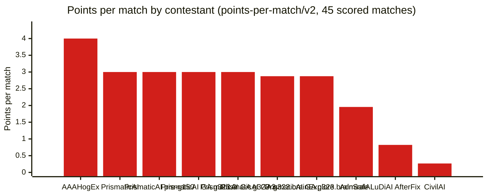
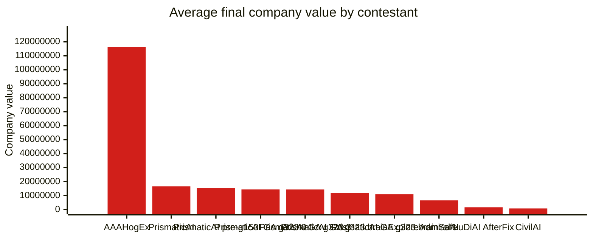
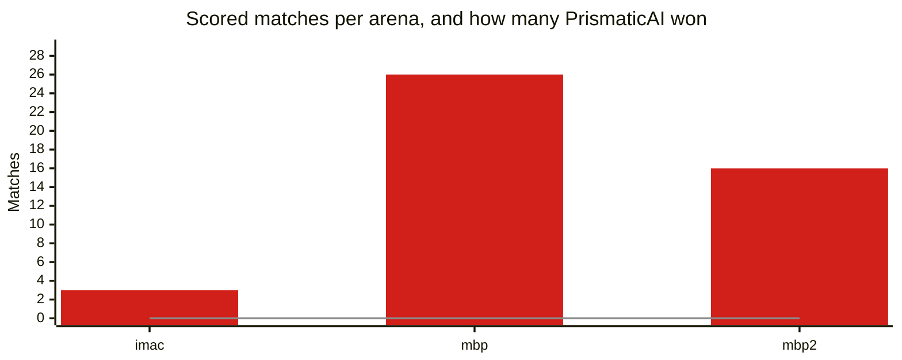

# battle-20261122T000611-0357dbbe

Derived from `battle-20261122T000611-0357dbbe.json` by `tools/research/ai-battle/battle.py report`; do not edit.

- Edition `0357dbbe0ddefdef`: PrismaticAI and referee at `8c8d025388e85261a60027d9983d8588d720a2e9`, base set `opengfx-8.0.tar`
- 20-year free-for-all from 1960, map 256x256 temperate, breakdowns 1
- 45 scored match(es) on `imac` (20261119-master-gdf1e05e7d8), `mbp` (20261120-master-m17653b726e), `mbp2` (20261119-master-gdf1e05e7d8)
- Replays: 0 of 1 identical to their original on another arena

| # | Contestant | Played | Wins | Points | Points/match | Avg rank | Avg final value | Squirrel errors | Matches with anomalies |
|---|---|---|---|---|---|---|---|---|---|
| 1 | AAAHogEx | 45 | 45 | 180 | 4.0 | 1.0 | 116.4 M | 68 | 1 |
| 2 | PrismaticAI | 7 | 0 | 21 | 3.0 | 2.0 | 16.6 M | 0 | 0 |
| 3 | PrismaticAI pre-g150 | 8 | 0 | 24 | 3.0 | 2.0 | 15.3 M | 0 | 0 |
| 4 | PrismaticAI GA g323.0 | 8 | 0 | 24 | 3.0 | 2.0 | 14.4 M | 0 | 0 |
| 5 | PrismaticAI GA g323.3 | 6 | 0 | 18 | 3.0 | 2.0 | 14.4 M | 0 | 0 |
| 6 | PrismaticAI GA g323.brainExplore | 8 | 0 | 23 | 2.875 | 2.12 | 11.7 M | 0 | 0 |
| 7 | PrismaticAI GA g323.brainSafe | 8 | 0 | 23 | 2.875 | 2.12 | 11.0 M | 0 | 0 |
| 8 | AdmiralAI | 45 | 0 | 88 | 1.956 | 3.04 | 6.5 M | 0 | 4 |
| 9 | LuDiAI AfterFix | 45 | 0 | 37 | 0.822 | 4.18 | 1.6 M | 0 | 1 |
| 10 | CivilAI | 45 | 0 | 12 | 0.267 | 4.73 | 775.6 k | 0 | 10 |

```mermaid
---
config:
  xyChart:
    width: 900
    height: 360
  themeVariables:
    xyChart:
      plotColorPalette: "#d11f1a, #8a8a8a, #0b0b0b, #ece4d6"
---
xychart-beta
    title "Final company value per scored match: winner vs best PrismaticAI"
    x-axis ["m-0001", "m-0002", "m-0003", "m-0004", "m-0005", "m-0006", "m-0007", "m-0008", "m-0009", "m-0010", "m-0011", "m-0012", "m-0013", "m-0014", "m-0015", "m-0016", "m-0017", "m-0018", "m-0019", "m-0020", "m-0021", "m-0022", "m-0023", "m-0024", "m-0025", "m-0026", "m-0027", "m-0028", "m-0036", "m-0037", "m-0038", "m-0039", "m-0040", "m-0041", "m-0042", "m-0043", "m-0044", "m-0045", "m-0046", "m-0049", "m-0050", "m-0051", "m-0052", "m-0053", "m-0054"]
    %% series: Winner | Best PrismaticAI
    %% links: battle-20261122T000611-0357dbbe.md?col=Match&filter=m-0001 | battle-20261122T000611-0357dbbe.md?col=Match&filter=m-0002 | battle-20261122T000611-0357dbbe.md?col=Match&filter=m-0003 | battle-20261122T000611-0357dbbe.md?col=Match&filter=m-0004 | battle-20261122T000611-0357dbbe.md?col=Match&filter=m-0005 | battle-20261122T000611-0357dbbe.md?col=Match&filter=m-0006 | battle-20261122T000611-0357dbbe.md?col=Match&filter=m-0007 | battle-20261122T000611-0357dbbe.md?col=Match&filter=m-0008 | battle-20261122T000611-0357dbbe.md?col=Match&filter=m-0009 | battle-20261122T000611-0357dbbe.md?col=Match&filter=m-0010 | battle-20261122T000611-0357dbbe.md?col=Match&filter=m-0011 | battle-20261122T000611-0357dbbe.md?col=Match&filter=m-0012 | battle-20261122T000611-0357dbbe.md?col=Match&filter=m-0013 | battle-20261122T000611-0357dbbe.md?col=Match&filter=m-0014 | battle-20261122T000611-0357dbbe.md?col=Match&filter=m-0015 | battle-20261122T000611-0357dbbe.md?col=Match&filter=m-0016 | battle-20261122T000611-0357dbbe.md?col=Match&filter=m-0017 | battle-20261122T000611-0357dbbe.md?col=Match&filter=m-0018 | battle-20261122T000611-0357dbbe.md?col=Match&filter=m-0019 | battle-20261122T000611-0357dbbe.md?col=Match&filter=m-0020 | battle-20261122T000611-0357dbbe.md?col=Match&filter=m-0021 | battle-20261122T000611-0357dbbe.md?col=Match&filter=m-0022 | battle-20261122T000611-0357dbbe.md?col=Match&filter=m-0023 | battle-20261122T000611-0357dbbe.md?col=Match&filter=m-0024 | battle-20261122T000611-0357dbbe.md?col=Match&filter=m-0025 | battle-20261122T000611-0357dbbe.md?col=Match&filter=m-0026 | battle-20261122T000611-0357dbbe.md?col=Match&filter=m-0027 | battle-20261122T000611-0357dbbe.md?col=Match&filter=m-0028 | battle-20261122T000611-0357dbbe.md?col=Match&filter=m-0036 | battle-20261122T000611-0357dbbe.md?col=Match&filter=m-0037 | battle-20261122T000611-0357dbbe.md?col=Match&filter=m-0038 | battle-20261122T000611-0357dbbe.md?col=Match&filter=m-0039 | battle-20261122T000611-0357dbbe.md?col=Match&filter=m-0040 | battle-20261122T000611-0357dbbe.md?col=Match&filter=m-0041 | battle-20261122T000611-0357dbbe.md?col=Match&filter=m-0042 | battle-20261122T000611-0357dbbe.md?col=Match&filter=m-0043 | battle-20261122T000611-0357dbbe.md?col=Match&filter=m-0044 | battle-20261122T000611-0357dbbe.md?col=Match&filter=m-0045 | battle-20261122T000611-0357dbbe.md?col=Match&filter=m-0046 | battle-20261122T000611-0357dbbe.md?col=Match&filter=m-0049 | battle-20261122T000611-0357dbbe.md?col=Match&filter=m-0050 | battle-20261122T000611-0357dbbe.md?col=Match&filter=m-0051 | battle-20261122T000611-0357dbbe.md?col=Match&filter=m-0052 | battle-20261122T000611-0357dbbe.md?col=Match&filter=m-0053 | battle-20261122T000611-0357dbbe.md?col=Match&filter=m-0054
    y-axis "Company value" 0 --> 208000000
    bar [93542360, 91520012, 91689142, 71770982, 81632742, 83180428, 86246478, 65161587, 81411845, 89169788, 85507437, 152059893, 144589652, 133122096, 134030037, 51331587, 129849723, 189142904, 156377667, 154896753, 185206496, 168311113, 137279527, 82646742, 99310430, 94517467, 103251469, 89403926, 95918230, 105867982, 92565468, 122442999, 125048502, 102038449, 135574754, 133742268, 142074431, 149886125, 119667053, 143359070, 146696369, 144706905, 150577768, 137668803, 63984607]
    line [11013804, 9172670, 7418688, 10826066, 8351659, 16662034, 16855843, 11257895, 14062021, 13914384, 9848082, 14449158, 17329616, 16456254, 7548591, 8066934, 16467583, 19965602, 10917902, 17511828, 6864527, 8435513, 19715455, 13537549, 10574364, 13774368, 12441867, 11444136, 14512899, 14158911, 14926436, 7239649, 9237954, 12355023, 25166617, 19947510, 15160857, 12180356, 13179265, 21689724, 16817827, 19898687, 18878136, 19369462, 11956317]
```

<!-- battle-charts:begin -->
<!-- derived from battle-20261122T000611-0357dbbe.json by `battle.py render`; `battle.py check` fails when it is stale -->

<!-- battle-charts:end -->

| Seed | Original | Replay | Arenas | Identical |
|---|---|---|---|---|
| 1537706734 | m-0010 | m-0048 | imac / mbp | NO |

| Match | Arena | Seed | Winner | Value | Last | Anomalies |
|---|---|---|---|---|---|---|
| m-0001 | mbp | 843035273 | AAAHogEx | 93.5 M | LuDiAI AfterFix | CivilAI: fleet_drop:54->33 |
| m-0002 | mbp | 843035273 | AAAHogEx | 91.5 M | CivilAI | - |
| m-0003 | mbp | 843035273 | AAAHogEx | 91.7 M | CivilAI | - |
| m-0004 | mbp | 843035273 | AAAHogEx | 71.8 M | CivilAI | - |
| m-0005 | mbp | 843035273 | AAAHogEx | 81.6 M | CivilAI | LuDiAI AfterFix: fleet_drop:98->57 |
| m-0006 | mbp | 1537706734 | AAAHogEx | 83.2 M | CivilAI | AdmiralAI: fleet_drop:167->98 |
| m-0007 | mbp | 1537706734 | AAAHogEx | 86.2 M | CivilAI | - |
| m-0008 | mbp | 1537706734 | AAAHogEx | 65.2 M | CivilAI | CivilAI: fleet_drop:43->13 |
| m-0009 | mbp | 1537706734 | AAAHogEx | 81.4 M | CivilAI | - |
| m-0010 | imac | 1537706734 | AAAHogEx | 89.2 M | CivilAI | CivilAI: fleet_drop:77->32 |
| m-0011 | imac | 1537706734 | AAAHogEx | 85.5 M | CivilAI | - |
| m-0012 | imac | 1832942079 | AAAHogEx | 152.1 M | CivilAI | - |
| m-0013 | mbp2 | 1832942079 | AAAHogEx | 144.6 M | LuDiAI AfterFix | - |
| m-0014 | mbp2 | 1832942079 | AAAHogEx | 133.1 M | LuDiAI AfterFix | CivilAI: fleet_drop:63->43 |
| m-0015 | mbp2 | 1832942079 | AAAHogEx | 134.0 M | LuDiAI AfterFix | - |
| m-0016 | mbp2 | 1832942079 | AAAHogEx | 51.3 M | CivilAI | AAAHogEx: squirrel_errors:68 |
| m-0017 | mbp2 | 1832942079 | AAAHogEx | 129.8 M | LuDiAI AfterFix | CivilAI: fleet_drop:63->41 |
| m-0018 | mbp2 | 280875505 | AAAHogEx | 189.1 M | CivilAI | CivilAI: fleet_drop:16->11 |
| m-0019 | mbp2 | 280875505 | AAAHogEx | 156.4 M | CivilAI | - |
| m-0020 | mbp2 | 280875505 | AAAHogEx | 154.9 M | CivilAI | - |
| m-0021 | mbp2 | 280875505 | AAAHogEx | 185.2 M | CivilAI | - |
| m-0022 | mbp2 | 280875505 | AAAHogEx | 168.3 M | CivilAI | - |
| m-0023 | mbp2 | 280875505 | AAAHogEx | 137.3 M | CivilAI | - |
| m-0024 | mbp2 | 82621439 | AAAHogEx | 82.6 M | CivilAI | - |
| m-0025 | mbp2 | 82621439 | AAAHogEx | 99.3 M | CivilAI | - |
| m-0026 | mbp2 | 82621439 | AAAHogEx | 94.5 M | CivilAI | CivilAI: fleet_drop:26->3 |
| m-0027 | mbp2 | 82621439 | AAAHogEx | 103.3 M | LuDiAI AfterFix | - |
| m-0028 | mbp2 | 82621439 | AAAHogEx | 89.4 M | CivilAI | - |
| m-0036 | mbp | 94132948 | AAAHogEx | 95.9 M | LuDiAI AfterFix | CivilAI: fleet_drop:80->41 |
| m-0037 | mbp | 94132948 | AAAHogEx | 105.9 M | LuDiAI AfterFix | - |
| m-0038 | mbp | 94132948 | AAAHogEx | 92.6 M | CivilAI | CivilAI: fleet_drop:57->35 |
| m-0039 | mbp | 94132948 | AAAHogEx | 122.4 M | CivilAI | - |
| m-0040 | mbp | 94132948 | AAAHogEx | 125.0 M | CivilAI | - |
| m-0041 | mbp | 94132948 | AAAHogEx | 102.0 M | CivilAI | - |
| m-0042 | mbp | 422407772 | AAAHogEx | 135.6 M | CivilAI | - |
| m-0043 | mbp | 422407772 | AAAHogEx | 133.7 M | CivilAI | CivilAI: fleet_drop:20->13 |
| m-0044 | mbp | 422407772 | AAAHogEx | 142.1 M | CivilAI | - |
| m-0045 | mbp | 422407772 | AAAHogEx | 149.9 M | CivilAI | AdmiralAI: fleet_drop:188->131 |
| m-0046 | mbp | 422407772 | AAAHogEx | 119.7 M | CivilAI | - |
| m-0048 (replay) | mbp | 1537706734 | AAAHogEx | 93.4 M | CivilAI | AdmiralAI: fleet_drop:94->63; CivilAI: fleet_drop:91->28 |
| m-0049 | mbp | 1799896076 | AAAHogEx | 143.4 M | AdmiralAI | AdmiralAI: no_vehicles |
| m-0050 | mbp | 1799896076 | AAAHogEx | 146.7 M | AdmiralAI | AdmiralAI: fleet_drop:113->61 |
| m-0051 | mbp | 1799896076 | AAAHogEx | 144.7 M | CivilAI | - |
| m-0052 | mbp | 1799896076 | AAAHogEx | 150.6 M | CivilAI | - |
| m-0053 | mbp | 1799896076 | AAAHogEx | 137.7 M | LuDiAI AfterFix | - |
| m-0054 | mbp | 1789638180 | AAAHogEx | 64.0 M | CivilAI | - |
