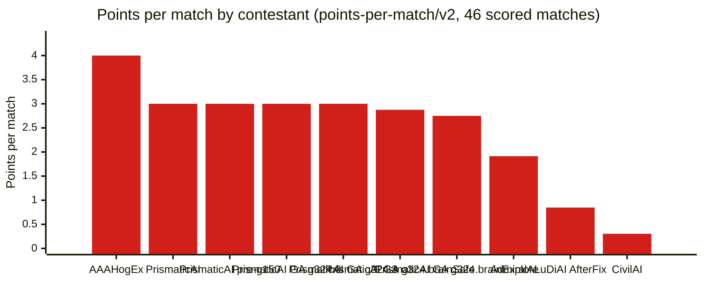
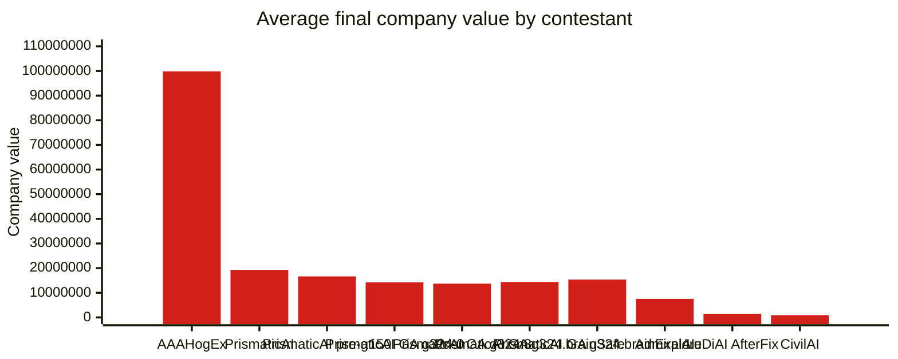
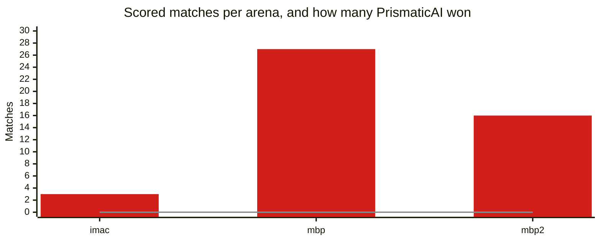

# battle-20261122T001844-c4259c33

Derived from `battle-20261122T001844-c4259c33.json` by `tools/research/ai-battle/battle.py report`; do not edit.

- Edition `c4259c33cfd8d52b`: PrismaticAI and referee at `8c8d025388e85261a60027d9983d8588d720a2e9`, base set `opengfx-8.0.tar`
- 20-year free-for-all from 1960, map 256x256 temperate, breakdowns 1
- 46 scored match(es) on `imac` (20261119-master-gdf1e05e7d8), `mbp` (20261120-master-m17653b726e), `mbp2` (20261119-master-gdf1e05e7d8)
- Replays: 0 of 0 identical to their original on another arena

| # | Contestant | Played | Wins | Points | Points/match | Avg rank | Avg final value | Squirrel errors | Matches with anomalies |
|---|---|---|---|---|---|---|---|---|---|
| 1 | AAAHogEx | 46 | 46 | 184 | 4.0 | 1.0 | 99.8 M | 0 | 0 |
| 2 | PrismaticAI | 7 | 0 | 21 | 3.0 | 2.0 | 19.3 M | 0 | 0 |
| 3 | PrismaticAI pre-g150 | 9 | 0 | 27 | 3.0 | 2.0 | 16.6 M | 0 | 0 |
| 4 | PrismaticAI GA g324.0 | 8 | 0 | 24 | 3.0 | 2.0 | 14.3 M | 0 | 0 |
| 5 | PrismaticAI GA g324.3 | 6 | 0 | 18 | 3.0 | 2.0 | 13.7 M | 0 | 0 |
| 6 | PrismaticAI GA g324.brainSafe | 8 | 0 | 23 | 2.875 | 2.12 | 14.4 M | 0 | 0 |
| 7 | PrismaticAI GA g324.brainExplore | 8 | 0 | 22 | 2.75 | 2.25 | 15.4 M | 0 | 0 |
| 8 | AdmiralAI | 46 | 0 | 88 | 1.913 | 3.09 | 7.5 M | 0 | 2 |
| 9 | LuDiAI AfterFix | 46 | 0 | 39 | 0.848 | 4.15 | 1.5 M | 0 | 0 |
| 10 | CivilAI | 46 | 0 | 14 | 0.304 | 4.7 | 911.6 k | 0 | 8 |

```mermaid
---
config:
  xyChart:
    width: 900
    height: 360
  themeVariables:
    xyChart:
      plotColorPalette: "#d11f1a, #8a8a8a, #0b0b0b, #ece4d6"
---
xychart-beta
    title "Final company value per scored match: winner vs best PrismaticAI"
    x-axis ["m-0001", "m-0002", "m-0003", "m-0004", "m-0005", "m-0006", "m-0007", "m-0008", "m-0009", "m-0010", "m-0011", "m-0012", "m-0013", "m-0014", "m-0015", "m-0016", "m-0017", "m-0018", "m-0019", "m-0020", "m-0021", "m-0022", "m-0023", "m-0024", "m-0025", "m-0026", "m-0027", "m-0028", "m-0036", "m-0037", "m-0038", "m-0039", "m-0040", "m-0041", "m-0042", "m-0043", "m-0044", "m-0045", "m-0046", "m-0047", "m-0048", "m-0049", "m-0050", "m-0051", "m-0052", "m-0055"]
    %% series: Winner | Best PrismaticAI
    %% links: battle-20261122T001844-c4259c33.md?col=Match&filter=m-0001 | battle-20261122T001844-c4259c33.md?col=Match&filter=m-0002 | battle-20261122T001844-c4259c33.md?col=Match&filter=m-0003 | battle-20261122T001844-c4259c33.md?col=Match&filter=m-0004 | battle-20261122T001844-c4259c33.md?col=Match&filter=m-0005 | battle-20261122T001844-c4259c33.md?col=Match&filter=m-0006 | battle-20261122T001844-c4259c33.md?col=Match&filter=m-0007 | battle-20261122T001844-c4259c33.md?col=Match&filter=m-0008 | battle-20261122T001844-c4259c33.md?col=Match&filter=m-0009 | battle-20261122T001844-c4259c33.md?col=Match&filter=m-0010 | battle-20261122T001844-c4259c33.md?col=Match&filter=m-0011 | battle-20261122T001844-c4259c33.md?col=Match&filter=m-0012 | battle-20261122T001844-c4259c33.md?col=Match&filter=m-0013 | battle-20261122T001844-c4259c33.md?col=Match&filter=m-0014 | battle-20261122T001844-c4259c33.md?col=Match&filter=m-0015 | battle-20261122T001844-c4259c33.md?col=Match&filter=m-0016 | battle-20261122T001844-c4259c33.md?col=Match&filter=m-0017 | battle-20261122T001844-c4259c33.md?col=Match&filter=m-0018 | battle-20261122T001844-c4259c33.md?col=Match&filter=m-0019 | battle-20261122T001844-c4259c33.md?col=Match&filter=m-0020 | battle-20261122T001844-c4259c33.md?col=Match&filter=m-0021 | battle-20261122T001844-c4259c33.md?col=Match&filter=m-0022 | battle-20261122T001844-c4259c33.md?col=Match&filter=m-0023 | battle-20261122T001844-c4259c33.md?col=Match&filter=m-0024 | battle-20261122T001844-c4259c33.md?col=Match&filter=m-0025 | battle-20261122T001844-c4259c33.md?col=Match&filter=m-0026 | battle-20261122T001844-c4259c33.md?col=Match&filter=m-0027 | battle-20261122T001844-c4259c33.md?col=Match&filter=m-0028 | battle-20261122T001844-c4259c33.md?col=Match&filter=m-0036 | battle-20261122T001844-c4259c33.md?col=Match&filter=m-0037 | battle-20261122T001844-c4259c33.md?col=Match&filter=m-0038 | battle-20261122T001844-c4259c33.md?col=Match&filter=m-0039 | battle-20261122T001844-c4259c33.md?col=Match&filter=m-0040 | battle-20261122T001844-c4259c33.md?col=Match&filter=m-0041 | battle-20261122T001844-c4259c33.md?col=Match&filter=m-0042 | battle-20261122T001844-c4259c33.md?col=Match&filter=m-0043 | battle-20261122T001844-c4259c33.md?col=Match&filter=m-0044 | battle-20261122T001844-c4259c33.md?col=Match&filter=m-0045 | battle-20261122T001844-c4259c33.md?col=Match&filter=m-0046 | battle-20261122T001844-c4259c33.md?col=Match&filter=m-0047 | battle-20261122T001844-c4259c33.md?col=Match&filter=m-0048 | battle-20261122T001844-c4259c33.md?col=Match&filter=m-0049 | battle-20261122T001844-c4259c33.md?col=Match&filter=m-0050 | battle-20261122T001844-c4259c33.md?col=Match&filter=m-0051 | battle-20261122T001844-c4259c33.md?col=Match&filter=m-0052 | battle-20261122T001844-c4259c33.md?col=Match&filter=m-0055
    y-axis "Company value" 0 --> 151000000
    bar [105759188, 92711234, 100030158, 92258045, 94221257, 119394897, 111850903, 121108867, 116165179, 103249774, 97393532, 96287612, 99802875, 107290807, 108067992, 101918197, 116016266, 75833401, 99027628, 91869120, 100192821, 97732625, 90281717, 103579287, 116108707, 118354438, 127670459, 125574146, 67349961, 80586079, 76717271, 72403618, 74710522, 93045776, 136849938, 129586538, 102463907, 101828117, 104405479, 117899350, 68157127, 75834477, 73985539, 82032059, 72313219, 132494761]
    line [11513596, 11108689, 15448338, 13414161, 10906199, 17692290, 14284567, 14316123, 11959809, 18744561, 14424330, 28221408, 17652898, 18058971, 18634143, 12837792, 16246594, 14153084, 16925097, 14585315, 19659172, 15763602, 13973251, 21644278, 22725055, 16594166, 15495474, 15036766, 11878204, 10871714, 9916181, 9527415, 7138195, 12500848, 24831993, 22189508, 19882696, 15637523, 24709388, 14283994, 16585629, 13889992, 9634857, 8662402, 15297139, 19646913]
```

<!-- battle-charts:begin -->
<!-- derived from battle-20261122T001844-c4259c33.json by `battle.py render`; `battle.py check` fails when it is stale -->

<!-- battle-charts:end -->

| Match | Arena | Seed | Winner | Value | Last | Anomalies |
|---|---|---|---|---|---|---|
| m-0001 | mbp | 253271301 | AAAHogEx | 105.8 M | LuDiAI AfterFix | - |
| m-0002 | mbp | 253271301 | AAAHogEx | 92.7 M | LuDiAI AfterFix | - |
| m-0003 | mbp | 253271301 | AAAHogEx | 100.0 M | LuDiAI AfterFix | - |
| m-0004 | mbp | 253271301 | AAAHogEx | 92.3 M | LuDiAI AfterFix | - |
| m-0005 | mbp | 253271301 | AAAHogEx | 94.2 M | LuDiAI AfterFix | - |
| m-0006 | mbp | 643074390 | AAAHogEx | 119.4 M | CivilAI | CivilAI: fleet_drop:53->35 |
| m-0007 | mbp | 643074390 | AAAHogEx | 111.9 M | CivilAI | - |
| m-0008 | mbp | 643074390 | AAAHogEx | 121.1 M | CivilAI | - |
| m-0009 | mbp | 643074390 | AAAHogEx | 116.2 M | CivilAI | CivilAI: fleet_drop:28->10 |
| m-0010 | imac | 643074390 | AAAHogEx | 103.2 M | CivilAI | - |
| m-0011 | imac | 643074390 | AAAHogEx | 97.4 M | CivilAI | - |
| m-0012 | imac | 624452365 | AAAHogEx | 96.3 M | CivilAI | CivilAI: fleet_drop:79->43 |
| m-0013 | mbp2 | 624452365 | AAAHogEx | 99.8 M | CivilAI | CivilAI: fleet_drop:125->74 |
| m-0014 | mbp2 | 624452365 | AAAHogEx | 107.3 M | CivilAI | - |
| m-0015 | mbp2 | 624452365 | AAAHogEx | 108.1 M | LuDiAI AfterFix | - |
| m-0016 | mbp2 | 624452365 | AAAHogEx | 101.9 M | LuDiAI AfterFix | - |
| m-0017 | mbp2 | 624452365 | AAAHogEx | 116.0 M | CivilAI | - |
| m-0018 | mbp2 | 577080538 | AAAHogEx | 75.8 M | LuDiAI AfterFix | - |
| m-0019 | mbp2 | 577080538 | AAAHogEx | 99.0 M | LuDiAI AfterFix | - |
| m-0020 | mbp2 | 577080538 | AAAHogEx | 91.9 M | CivilAI | - |
| m-0021 | mbp2 | 577080538 | AAAHogEx | 100.2 M | CivilAI | - |
| m-0022 | mbp2 | 577080538 | AAAHogEx | 97.7 M | CivilAI | - |
| m-0023 | mbp2 | 577080538 | AAAHogEx | 90.3 M | CivilAI | - |
| m-0024 | mbp2 | 1368585352 | AAAHogEx | 103.6 M | CivilAI | AdmiralAI: fleet_drop:160->83; CivilAI: fleet_drop:24->14 |
| m-0025 | mbp2 | 1368585352 | AAAHogEx | 116.1 M | CivilAI | - |
| m-0026 | mbp2 | 1368585352 | AAAHogEx | 118.4 M | CivilAI | - |
| m-0027 | mbp2 | 1368585352 | AAAHogEx | 127.7 M | AdmiralAI | - |
| m-0028 | mbp2 | 1368585352 | AAAHogEx | 125.6 M | CivilAI | - |
| m-0036 | mbp | 894261034 | AAAHogEx | 67.3 M | CivilAI | - |
| m-0037 | mbp | 894261034 | AAAHogEx | 80.6 M | CivilAI | CivilAI: fleet_drop:36->25 |
| m-0038 | mbp | 894261034 | AAAHogEx | 76.7 M | CivilAI | CivilAI: fleet_drop:46->24 |
| m-0039 | mbp | 894261034 | AAAHogEx | 72.4 M | CivilAI | - |
| m-0040 | mbp | 894261034 | AAAHogEx | 74.7 M | CivilAI | - |
| m-0041 | mbp | 894261034 | AAAHogEx | 93.0 M | CivilAI | - |
| m-0042 | mbp | 1845969835 | AAAHogEx | 136.8 M | LuDiAI AfterFix | - |
| m-0043 | mbp | 1845969835 | AAAHogEx | 129.6 M | AdmiralAI | - |
| m-0044 | mbp | 1845969835 | AAAHogEx | 102.5 M | CivilAI | - |
| m-0045 | mbp | 1845969835 | AAAHogEx | 101.8 M | CivilAI | - |
| m-0046 | mbp | 1845969835 | AAAHogEx | 104.4 M | CivilAI | - |
| m-0047 | mbp | 1845969835 | AAAHogEx | 117.9 M | CivilAI | - |
| m-0048 | mbp | 33411426 | AAAHogEx | 68.2 M | CivilAI | CivilAI: fleet_drop:49->28 |
| m-0049 | mbp | 33411426 | AAAHogEx | 75.8 M | LuDiAI AfterFix | - |
| m-0050 | mbp | 33411426 | AAAHogEx | 74.0 M | CivilAI | - |
| m-0051 | mbp | 33411426 | AAAHogEx | 82.0 M | CivilAI | - |
| m-0052 | mbp | 33411426 | AAAHogEx | 72.3 M | CivilAI | AdmiralAI: fleet_drop:339->207 |
| m-0055 | mbp | 437061869 | AAAHogEx | 132.5 M | CivilAI | - |
