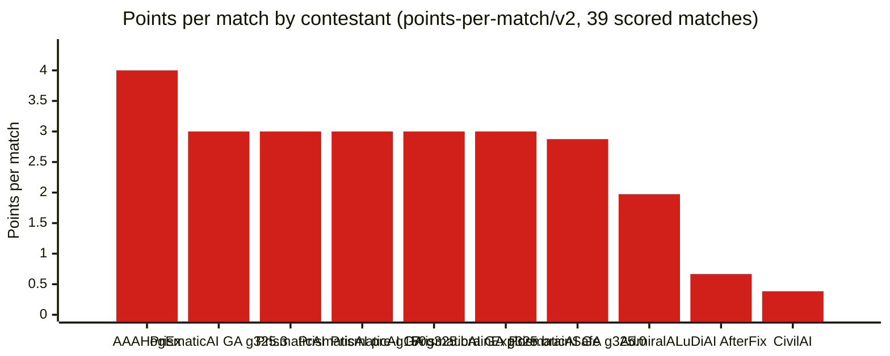
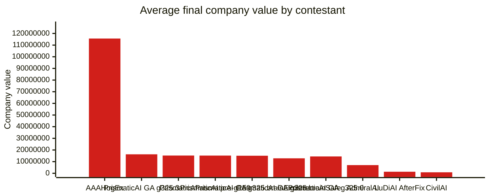
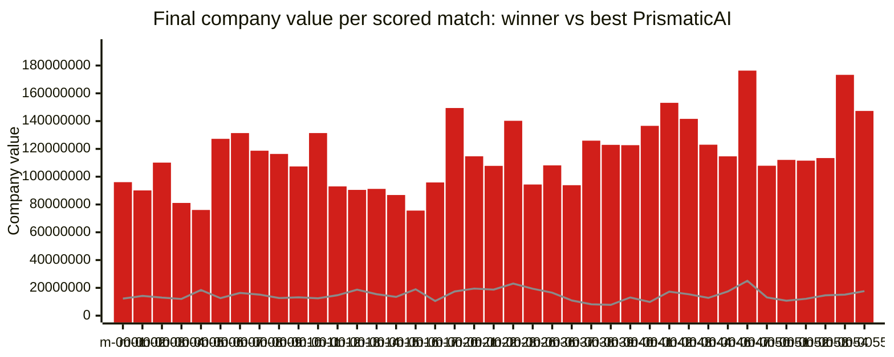
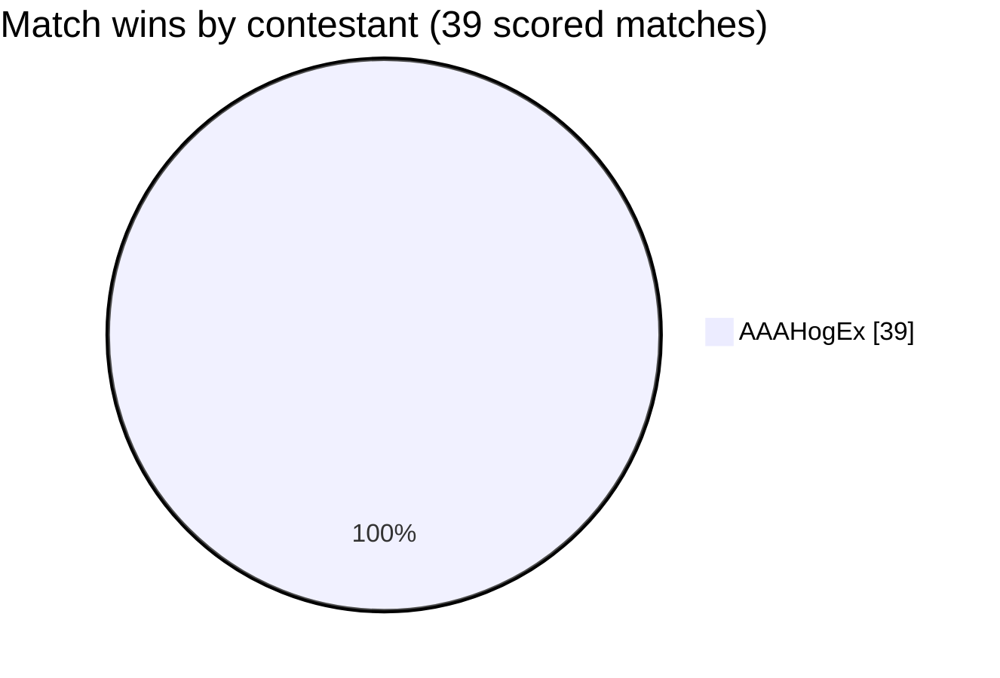
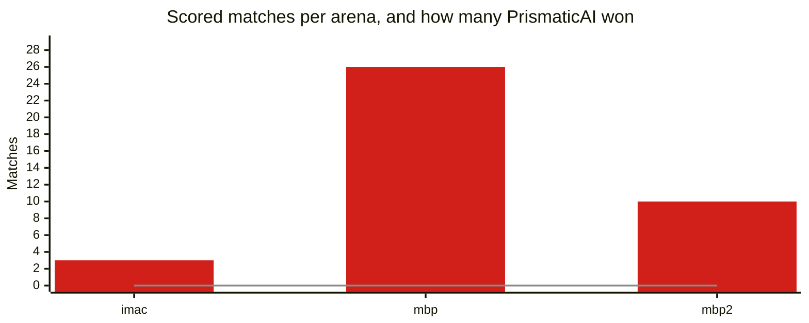

# battle-20261122T003042-08697b91

Derived from `battle-20261122T003042-08697b91.json` by `tools/research/ai-battle/battle.py report`; do not edit.

- Edition `08697b919260b5aa`: PrismaticAI and referee at `8c8d025388e85261a60027d9983d8588d720a2e9`, base set `opengfx-8.0.tar`
- 20-year free-for-all from 1960, map 256x256 temperate, breakdowns 1
- 39 scored match(es) on `imac` (20261119-master-gdf1e05e7d8), `mbp` (20261120-master-m17653b726e), `mbp2` (20261119-master-gdf1e05e7d8)
- Replays: 0 of 1 identical to their original on another arena

| # | Contestant | Played | Wins | Points | Points/match | Avg rank | Avg final value | Squirrel errors | Matches with anomalies |
|---|---|---|---|---|---|---|---|---|---|
| 1 | AAAHogEx | 39 | 39 | 156 | 4.0 | 1.0 | 115.6 M | 0 | 0 |
| 2 | PrismaticAI GA g325.3 | 7 | 0 | 21 | 3.0 | 2.0 | 16.3 M | 0 | 0 |
| 3 | PrismaticAI | 5 | 0 | 15 | 3.0 | 2.0 | 15.2 M | 0 | 0 |
| 4 | PrismaticAI pre-g150 | 6 | 0 | 18 | 3.0 | 2.0 | 15.2 M | 0 | 0 |
| 5 | PrismaticAI GA g325.brainExplore | 7 | 0 | 21 | 3.0 | 2.0 | 15.1 M | 0 | 0 |
| 6 | PrismaticAI GA g325.brainSafe | 6 | 0 | 18 | 3.0 | 2.0 | 12.8 M | 0 | 0 |
| 7 | PrismaticAI GA g325.0 | 8 | 0 | 23 | 2.875 | 2.12 | 14.5 M | 0 | 0 |
| 8 | AdmiralAI | 39 | 0 | 77 | 1.974 | 3.03 | 7.0 M | 0 | 1 |
| 9 | LuDiAI AfterFix | 39 | 0 | 26 | 0.667 | 4.33 | 1.3 M | 0 | 2 |
| 10 | CivilAI | 39 | 0 | 15 | 0.385 | 4.62 | 845.0 k | 0 | 6 |

<!-- battle-charts:begin -->
<!-- derived from battle-20261122T003042-08697b91.json by `battle.py render`; `battle.py check` fails when it is stale -->

<!-- battle-charts:end -->

| Seed | Original | Replay | Arenas | Identical |
|---|---|---|---|---|
| 1936504216 | m-0010 | m-0048 | imac / mbp | NO |

| Match | Arena | Seed | Winner | Value | Last | Anomalies |
|---|---|---|---|---|---|---|
| m-0001 | mbp | 388859736 | AAAHogEx | 96.1 M | CivilAI | CivilAI: no_vehicles |
| m-0002 | mbp | 388859736 | AAAHogEx | 90.1 M | CivilAI | - |
| m-0003 | mbp | 388859736 | AAAHogEx | 110.1 M | CivilAI | - |
| m-0004 | mbp | 388859736 | AAAHogEx | 81.1 M | CivilAI | - |
| m-0005 | mbp | 388859736 | AAAHogEx | 76.1 M | CivilAI | - |
| m-0006 | mbp | 1936504216 | AAAHogEx | 127.3 M | AdmiralAI | - |
| m-0007 | mbp | 1936504216 | AAAHogEx | 131.4 M | LuDiAI AfterFix | CivilAI: fleet_drop:45->26 |
| m-0008 | mbp | 1936504216 | AAAHogEx | 118.7 M | LuDiAI AfterFix | - |
| m-0009 | mbp | 1936504216 | AAAHogEx | 116.4 M | LuDiAI AfterFix | LuDiAI AfterFix: fleet_drop:18->9 |
| m-0010 | imac | 1936504216 | AAAHogEx | 107.4 M | CivilAI | CivilAI: no_vehicles |
| m-0011 | imac | 1936504216 | AAAHogEx | 131.4 M | CivilAI | - |
| m-0012 | imac | 811064121 | AAAHogEx | 93.0 M | CivilAI | - |
| m-0013 | mbp2 | 811064121 | AAAHogEx | 90.5 M | LuDiAI AfterFix | - |
| m-0014 | mbp2 | 811064121 | AAAHogEx | 91.2 M | CivilAI | CivilAI: fleet_drop:39->17 |
| m-0015 | mbp2 | 811064121 | AAAHogEx | 86.8 M | CivilAI | - |
| m-0016 | mbp2 | 811064121 | AAAHogEx | 75.6 M | CivilAI | - |
| m-0017 | mbp2 | 811064121 | AAAHogEx | 95.9 M | CivilAI | - |
| m-0020 | mbp2 | 235538491 | AAAHogEx | 149.4 M | LuDiAI AfterFix | - |
| m-0021 | mbp2 | 235538491 | AAAHogEx | 114.7 M | LuDiAI AfterFix | - |
| m-0022 | mbp2 | 235538491 | AAAHogEx | 107.8 M | LuDiAI AfterFix | - |
| m-0023 | mbp2 | 235538491 | AAAHogEx | 140.2 M | LuDiAI AfterFix | - |
| m-0026 | mbp2 | 1299160119 | AAAHogEx | 94.4 M | CivilAI | - |
| m-0036 | mbp | 1318011244 | AAAHogEx | 108.1 M | LuDiAI AfterFix | - |
| m-0037 | mbp | 1318011244 | AAAHogEx | 93.9 M | CivilAI | - |
| m-0038 | mbp | 1318011244 | AAAHogEx | 125.9 M | CivilAI | - |
| m-0039 | mbp | 1318011244 | AAAHogEx | 122.9 M | CivilAI | - |
| m-0040 | mbp | 1318011244 | AAAHogEx | 122.7 M | CivilAI | - |
| m-0041 | mbp | 1318011244 | AAAHogEx | 136.6 M | CivilAI | - |
| m-0042 | mbp | 456678657 | AAAHogEx | 153.2 M | CivilAI | LuDiAI AfterFix: fleet_drop:110->63 |
| m-0043 | mbp | 456678657 | AAAHogEx | 141.6 M | CivilAI | - |
| m-0044 | mbp | 456678657 | AAAHogEx | 123.0 M | LuDiAI AfterFix | - |
| m-0046 | mbp | 456678657 | AAAHogEx | 114.6 M | LuDiAI AfterFix | CivilAI: fleet_drop:57->39 |
| m-0047 | mbp | 456678657 | AAAHogEx | 176.3 M | LuDiAI AfterFix | - |
| m-0048 (replay) | mbp | 1936504216 | AAAHogEx | 109.3 M | CivilAI | CivilAI: no_vehicles |
| m-0050 | mbp | 1129157410 | AAAHogEx | 107.9 M | LuDiAI AfterFix | - |
| m-0051 | mbp | 1129157410 | AAAHogEx | 112.1 M | CivilAI | - |
| m-0052 | mbp | 1129157410 | AAAHogEx | 111.5 M | LuDiAI AfterFix | - |
| m-0053 | mbp | 1129157410 | AAAHogEx | 113.4 M | CivilAI | - |
| m-0054 | mbp | 155472362 | AAAHogEx | 173.3 M | CivilAI | CivilAI: fleet_drop:47->29 |
| m-0055 | mbp | 155472362 | AAAHogEx | 147.3 M | CivilAI | AdmiralAI: fleet_drop:200->132 |
