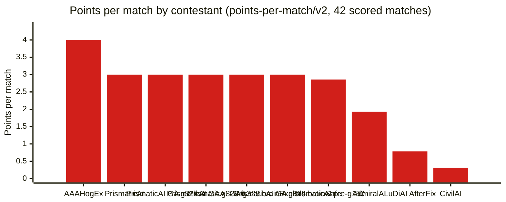
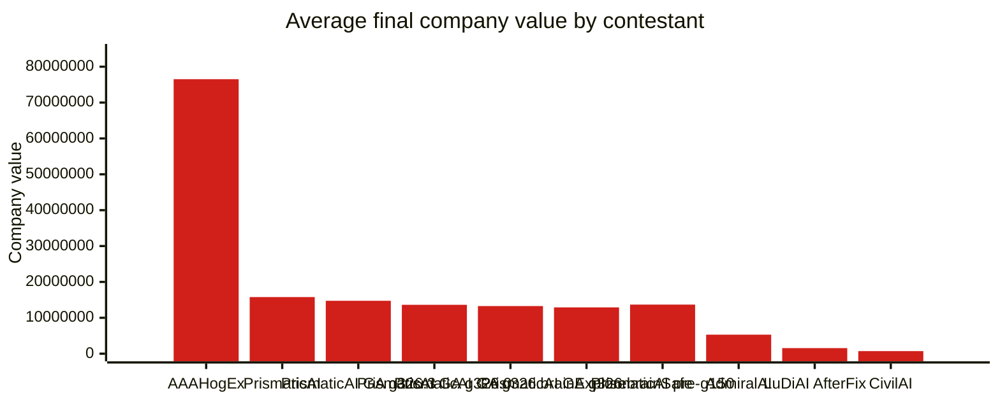
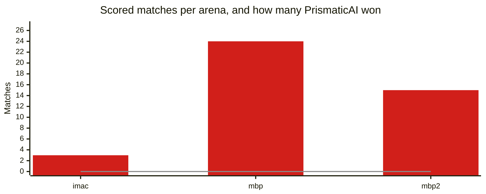

# battle-20261122T004102-8d325d2f

Derived from `battle-20261122T004102-8d325d2f.json` by `tools/research/ai-battle/battle.py report`; do not edit.

- Edition `8d325d2f3c4d08b9`: PrismaticAI and referee at `8c8d025388e85261a60027d9983d8588d720a2e9`, base set `opengfx-8.0.tar`
- 20-year free-for-all from 1960, map 256x256 temperate, breakdowns 1
- 42 scored match(es) on `imac` (20261119-master-gdf1e05e7d8), `mbp` (20261120-master-m17653b726e), `mbp2` (20261119-master-gdf1e05e7d8)
- Replays: 0 of 1 identical to their original on another arena

| # | Contestant | Played | Wins | Points | Points/match | Avg rank | Avg final value | Squirrel errors | Matches with anomalies |
|---|---|---|---|---|---|---|---|---|---|
| 1 | AAAHogEx | 42 | 42 | 168 | 4.0 | 1.0 | 76.5 M | 0 | 0 |
| 2 | PrismaticAI | 5 | 0 | 15 | 3.0 | 2.0 | 15.8 M | 0 | 0 |
| 3 | PrismaticAI GA g326.3 | 6 | 0 | 18 | 3.0 | 2.0 | 14.7 M | 0 | 0 |
| 4 | PrismaticAI GA g326.0 | 8 | 0 | 24 | 3.0 | 2.0 | 13.6 M | 0 | 0 |
| 5 | PrismaticAI GA g326.brainExplore | 8 | 0 | 24 | 3.0 | 2.0 | 13.3 M | 0 | 0 |
| 6 | PrismaticAI GA g326.brainSafe | 8 | 0 | 24 | 3.0 | 2.0 | 12.9 M | 0 | 0 |
| 7 | PrismaticAI pre-g150 | 7 | 0 | 20 | 2.857 | 2.14 | 13.7 M | 0 | 0 |
| 8 | AdmiralAI | 42 | 0 | 81 | 1.929 | 3.07 | 5.3 M | 62 | 3 |
| 9 | LuDiAI AfterFix | 42 | 0 | 33 | 0.786 | 4.21 | 1.5 M | 0 | 6 |
| 10 | CivilAI | 42 | 0 | 13 | 0.31 | 4.69 | 711.4 k | 0 | 13 |

```mermaid
---
config:
  xyChart:
    width: 900
    height: 360
  themeVariables:
    xyChart:
      plotColorPalette: "#d11f1a, #8a8a8a, #0b0b0b, #ece4d6"
---
xychart-beta
    title "Final company value per scored match: winner vs best PrismaticAI"
    x-axis ["m-0001", "m-0002", "m-0003", "m-0004", "m-0005", "m-0006", "m-0007", "m-0008", "m-0009", "m-0010", "m-0011", "m-0012", "m-0013", "m-0014", "m-0015", "m-0016", "m-0017", "m-0019", "m-0020", "m-0021", "m-0022", "m-0023", "m-0024", "m-0025", "m-0026", "m-0027", "m-0028", "m-0036", "m-0037", "m-0038", "m-0039", "m-0040", "m-0041", "m-0042", "m-0043", "m-0044", "m-0045", "m-0046", "m-0047", "m-0050", "m-0051", "m-0052"]
    %% series: Winner | Best PrismaticAI
    %% links: battle-20261122T004102-8d325d2f.md?col=Match&filter=m-0001 | battle-20261122T004102-8d325d2f.md?col=Match&filter=m-0002 | battle-20261122T004102-8d325d2f.md?col=Match&filter=m-0003 | battle-20261122T004102-8d325d2f.md?col=Match&filter=m-0004 | battle-20261122T004102-8d325d2f.md?col=Match&filter=m-0005 | battle-20261122T004102-8d325d2f.md?col=Match&filter=m-0006 | battle-20261122T004102-8d325d2f.md?col=Match&filter=m-0007 | battle-20261122T004102-8d325d2f.md?col=Match&filter=m-0008 | battle-20261122T004102-8d325d2f.md?col=Match&filter=m-0009 | battle-20261122T004102-8d325d2f.md?col=Match&filter=m-0010 | battle-20261122T004102-8d325d2f.md?col=Match&filter=m-0011 | battle-20261122T004102-8d325d2f.md?col=Match&filter=m-0012 | battle-20261122T004102-8d325d2f.md?col=Match&filter=m-0013 | battle-20261122T004102-8d325d2f.md?col=Match&filter=m-0014 | battle-20261122T004102-8d325d2f.md?col=Match&filter=m-0015 | battle-20261122T004102-8d325d2f.md?col=Match&filter=m-0016 | battle-20261122T004102-8d325d2f.md?col=Match&filter=m-0017 | battle-20261122T004102-8d325d2f.md?col=Match&filter=m-0019 | battle-20261122T004102-8d325d2f.md?col=Match&filter=m-0020 | battle-20261122T004102-8d325d2f.md?col=Match&filter=m-0021 | battle-20261122T004102-8d325d2f.md?col=Match&filter=m-0022 | battle-20261122T004102-8d325d2f.md?col=Match&filter=m-0023 | battle-20261122T004102-8d325d2f.md?col=Match&filter=m-0024 | battle-20261122T004102-8d325d2f.md?col=Match&filter=m-0025 | battle-20261122T004102-8d325d2f.md?col=Match&filter=m-0026 | battle-20261122T004102-8d325d2f.md?col=Match&filter=m-0027 | battle-20261122T004102-8d325d2f.md?col=Match&filter=m-0028 | battle-20261122T004102-8d325d2f.md?col=Match&filter=m-0036 | battle-20261122T004102-8d325d2f.md?col=Match&filter=m-0037 | battle-20261122T004102-8d325d2f.md?col=Match&filter=m-0038 | battle-20261122T004102-8d325d2f.md?col=Match&filter=m-0039 | battle-20261122T004102-8d325d2f.md?col=Match&filter=m-0040 | battle-20261122T004102-8d325d2f.md?col=Match&filter=m-0041 | battle-20261122T004102-8d325d2f.md?col=Match&filter=m-0042 | battle-20261122T004102-8d325d2f.md?col=Match&filter=m-0043 | battle-20261122T004102-8d325d2f.md?col=Match&filter=m-0044 | battle-20261122T004102-8d325d2f.md?col=Match&filter=m-0045 | battle-20261122T004102-8d325d2f.md?col=Match&filter=m-0046 | battle-20261122T004102-8d325d2f.md?col=Match&filter=m-0047 | battle-20261122T004102-8d325d2f.md?col=Match&filter=m-0050 | battle-20261122T004102-8d325d2f.md?col=Match&filter=m-0051 | battle-20261122T004102-8d325d2f.md?col=Match&filter=m-0052
    y-axis "Company value" 0 --> 127000000
    bar [73273017, 67109359, 57068998, 67717542, 65676997, 50035346, 50897079, 51042379, 42201120, 55485076, 52428411, 110474791, 98323279, 103760991, 101527157, 84606306, 106827878, 80444662, 103647179, 100810034, 115400821, 104660682, 82885516, 97995930, 89675051, 76456764, 73420254, 67036152, 63394600, 50214348, 80676879, 71018428, 61789030, 65946248, 79603673, 72973240, 72653770, 76864725, 73908552, 71574517, 64150489, 77948290]
    line [15084874, 14409222, 13207206, 12195782, 15402051, 14684991, 10504478, 6880961, 6926310, 6863457, 7373504, 20076698, 15888942, 15766760, 13816299, 16151432, 11039864, 17310942, 12547396, 14829111, 10902264, 19998491, 13727217, 7255693, 7365056, 9400652, 8972038, 12742552, 13629312, 22166793, 18810610, 19562645, 20497981, 17637049, 16064795, 17245558, 14976199, 12771478, 14137786, 12559074, 11255369, 18727740]
```

<!-- battle-charts:begin -->
<!-- derived from battle-20261122T004102-8d325d2f.json by `battle.py render`; `battle.py check` fails when it is stale -->

<!-- battle-charts:end -->

| Seed | Original | Replay | Arenas | Identical |
|---|---|---|---|---|
| 709227424 | m-0012 | m-0048 | imac / mbp | NO |

| Match | Arena | Seed | Winner | Value | Last | Anomalies |
|---|---|---|---|---|---|---|
| m-0001 | mbp | 109736582 | AAAHogEx | 73.3 M | CivilAI | - |
| m-0002 | mbp | 109736582 | AAAHogEx | 67.1 M | CivilAI | AdmiralAI: fleet_drop:392->255 |
| m-0003 | mbp | 109736582 | AAAHogEx | 57.1 M | CivilAI | - |
| m-0004 | mbp | 109736582 | AAAHogEx | 67.7 M | CivilAI | - |
| m-0005 | mbp | 109736582 | AAAHogEx | 65.7 M | CivilAI | - |
| m-0006 | mbp | 987934185 | AAAHogEx | 50.0 M | AdmiralAI | - |
| m-0007 | mbp | 987934185 | AAAHogEx | 50.9 M | CivilAI | - |
| m-0008 | mbp | 987934185 | AAAHogEx | 51.0 M | LuDiAI AfterFix | LuDiAI AfterFix: fleet_drop:46->29 |
| m-0009 | mbp | 987934185 | AAAHogEx | 42.2 M | CivilAI | CivilAI: fleet_drop:29->16 |
| m-0010 | imac | 987934185 | AAAHogEx | 55.5 M | LuDiAI AfterFix | - |
| m-0011 | imac | 987934185 | AAAHogEx | 52.4 M | CivilAI | - |
| m-0012 | imac | 709227424 | AAAHogEx | 110.5 M | CivilAI | AdmiralAI: squirrel_errors:62 |
| m-0013 | mbp2 | 709227424 | AAAHogEx | 98.3 M | CivilAI | - |
| m-0014 | mbp2 | 709227424 | AAAHogEx | 103.8 M | CivilAI | LuDiAI AfterFix: fleet_drop:45->12; CivilAI: fleet_drop:51->32 |
| m-0015 | mbp2 | 709227424 | AAAHogEx | 101.5 M | CivilAI | CivilAI: fleet_drop:47->23 |
| m-0016 | mbp2 | 709227424 | AAAHogEx | 84.6 M | CivilAI | CivilAI: fleet_drop:41->15 |
| m-0017 | mbp2 | 709227424 | AAAHogEx | 106.8 M | CivilAI | CivilAI: fleet_drop:49->24 |
| m-0019 | mbp2 | 168844187 | AAAHogEx | 80.4 M | LuDiAI AfterFix | - |
| m-0020 | mbp2 | 168844187 | AAAHogEx | 103.6 M | LuDiAI AfterFix | CivilAI: fleet_drop:51->30; LuDiAI AfterFix: fleet_drop:101->64 |
| m-0021 | mbp2 | 168844187 | AAAHogEx | 100.8 M | LuDiAI AfterFix | - |
| m-0022 | mbp2 | 168844187 | AAAHogEx | 115.4 M | LuDiAI AfterFix | - |
| m-0023 | mbp2 | 168844187 | AAAHogEx | 104.7 M | LuDiAI AfterFix | - |
| m-0024 | mbp2 | 736843653 | AAAHogEx | 82.9 M | LuDiAI AfterFix | CivilAI: fleet_drop:63->34 |
| m-0025 | mbp2 | 736843653 | AAAHogEx | 98.0 M | CivilAI | - |
| m-0026 | mbp2 | 736843653 | AAAHogEx | 89.7 M | LuDiAI AfterFix | CivilAI: fleet_drop:67->23 |
| m-0027 | mbp2 | 736843653 | AAAHogEx | 76.5 M | LuDiAI AfterFix | - |
| m-0028 | mbp2 | 736843653 | AAAHogEx | 73.4 M | LuDiAI AfterFix | - |
| m-0036 | mbp | 314183378 | AAAHogEx | 67.0 M | CivilAI | - |
| m-0037 | mbp | 314183378 | AAAHogEx | 63.4 M | CivilAI | CivilAI: fleet_drop:18->9 |
| m-0038 | mbp | 314183378 | AAAHogEx | 50.2 M | CivilAI | - |
| m-0039 | mbp | 314183378 | AAAHogEx | 80.7 M | CivilAI | CivilAI: fleet_drop:15->10 |
| m-0040 | mbp | 314183378 | AAAHogEx | 71.0 M | CivilAI | CivilAI: fleet_drop:23->7 |
| m-0041 | mbp | 314183378 | AAAHogEx | 61.8 M | CivilAI | - |
| m-0042 | mbp | 910313474 | AAAHogEx | 65.9 M | CivilAI | LuDiAI AfterFix: fleet_drop:58->27; CivilAI: fleet_drop:25->16 |
| m-0043 | mbp | 910313474 | AAAHogEx | 79.6 M | CivilAI | CivilAI: fleet_drop:12->8 |
| m-0044 | mbp | 910313474 | AAAHogEx | 73.0 M | CivilAI | AdmiralAI: fleet_drop:243->166 |
| m-0045 | mbp | 910313474 | AAAHogEx | 72.7 M | CivilAI | - |
| m-0046 | mbp | 910313474 | AAAHogEx | 76.9 M | CivilAI | - |
| m-0047 | mbp | 910313474 | AAAHogEx | 73.9 M | CivilAI | - |
| m-0048 (replay) | mbp | 709227424 | AAAHogEx | 111.4 M | CivilAI | AdmiralAI: squirrel_errors:62 |
| m-0050 | mbp | 1320840860 | AAAHogEx | 71.6 M | CivilAI | LuDiAI AfterFix: fleet_drop:139->83 |
| m-0051 | mbp | 1320840860 | AAAHogEx | 64.2 M | CivilAI | - |
| m-0052 | mbp | 1320840860 | AAAHogEx | 77.9 M | LuDiAI AfterFix | LuDiAI AfterFix: fleet_drop:106->56 |
