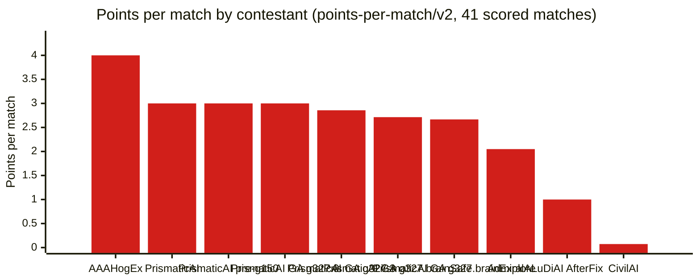
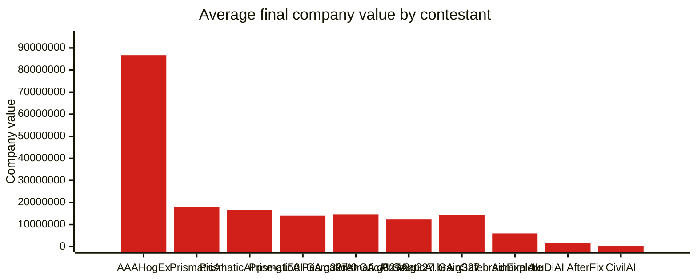
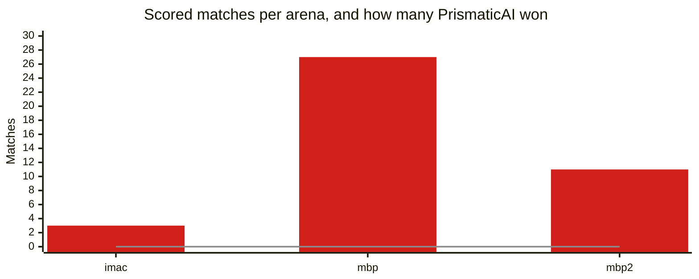

# battle-20261122T005135-109a2d65

Derived from `battle-20261122T005135-109a2d65.json` by `tools/research/ai-battle/battle.py report`; do not edit.

- Edition `109a2d65c05c5323`: PrismaticAI and referee at `8c8d025388e85261a60027d9983d8588d720a2e9`, base set `opengfx-8.0.tar`
- 20-year free-for-all from 1960, map 256x256 temperate, breakdowns 1
- 41 scored match(es) on `imac` (20261119-master-gdf1e05e7d8), `mbp` (20261120-master-m17653b726e), `mbp2` (20261119-master-gdf1e05e7d8)
- Replays: 0 of 0 identical to their original on another arena

| # | Contestant | Played | Wins | Points | Points/match | Avg rank | Avg final value | Squirrel errors | Matches with anomalies |
|---|---|---|---|---|---|---|---|---|---|
| 1 | AAAHogEx | 41 | 41 | 164 | 4.0 | 1.0 | 86.7 M | 0 | 0 |
| 2 | PrismaticAI | 6 | 0 | 18 | 3.0 | 2.0 | 18.1 M | 0 | 0 |
| 3 | PrismaticAI pre-g150 | 7 | 0 | 21 | 3.0 | 2.0 | 16.6 M | 0 | 0 |
| 4 | PrismaticAI GA g327.0 | 8 | 0 | 24 | 3.0 | 2.0 | 14.0 M | 0 | 0 |
| 5 | PrismaticAI GA g327.3 | 7 | 0 | 20 | 2.857 | 2.14 | 14.7 M | 0 | 0 |
| 6 | PrismaticAI GA g327.brainSafe | 7 | 0 | 19 | 2.714 | 2.29 | 12.3 M | 0 | 1 |
| 7 | PrismaticAI GA g327.brainExplore | 6 | 0 | 16 | 2.667 | 2.33 | 14.5 M | 0 | 0 |
| 8 | AdmiralAI | 41 | 0 | 84 | 2.049 | 2.95 | 6.0 M | 0 | 2 |
| 9 | LuDiAI AfterFix | 41 | 0 | 41 | 1.0 | 4.0 | 1.5 M | 0 | 4 |
| 10 | CivilAI | 41 | 0 | 3 | 0.073 | 4.93 | 450.2 k | 7315 | 7 |

```mermaid
---
config:
  xyChart:
    width: 900
    height: 360
  themeVariables:
    xyChart:
      plotColorPalette: "#d11f1a, #8a8a8a, #0b0b0b, #ece4d6"
---
xychart-beta
    title "Final company value per scored match: winner vs best PrismaticAI"
    x-axis ["m-0001", "m-0002", "m-0003", "m-0004", "m-0005", "m-0006", "m-0007", "m-0008", "m-0009", "m-0010", "m-0011", "m-0012", "m-0013", "m-0014", "m-0017", "m-0018", "m-0020", "m-0021", "m-0023", "m-0025", "m-0026", "m-0027", "m-0028", "m-0036", "m-0037", "m-0038", "m-0039", "m-0040", "m-0041", "m-0042", "m-0043", "m-0044", "m-0045", "m-0046", "m-0047", "m-0048", "m-0049", "m-0050", "m-0051", "m-0052", "m-0053"]
    %% series: Winner | Best PrismaticAI
    %% links: battle-20261122T005135-109a2d65.md?col=Match&filter=m-0001 | battle-20261122T005135-109a2d65.md?col=Match&filter=m-0002 | battle-20261122T005135-109a2d65.md?col=Match&filter=m-0003 | battle-20261122T005135-109a2d65.md?col=Match&filter=m-0004 | battle-20261122T005135-109a2d65.md?col=Match&filter=m-0005 | battle-20261122T005135-109a2d65.md?col=Match&filter=m-0006 | battle-20261122T005135-109a2d65.md?col=Match&filter=m-0007 | battle-20261122T005135-109a2d65.md?col=Match&filter=m-0008 | battle-20261122T005135-109a2d65.md?col=Match&filter=m-0009 | battle-20261122T005135-109a2d65.md?col=Match&filter=m-0010 | battle-20261122T005135-109a2d65.md?col=Match&filter=m-0011 | battle-20261122T005135-109a2d65.md?col=Match&filter=m-0012 | battle-20261122T005135-109a2d65.md?col=Match&filter=m-0013 | battle-20261122T005135-109a2d65.md?col=Match&filter=m-0014 | battle-20261122T005135-109a2d65.md?col=Match&filter=m-0017 | battle-20261122T005135-109a2d65.md?col=Match&filter=m-0018 | battle-20261122T005135-109a2d65.md?col=Match&filter=m-0020 | battle-20261122T005135-109a2d65.md?col=Match&filter=m-0021 | battle-20261122T005135-109a2d65.md?col=Match&filter=m-0023 | battle-20261122T005135-109a2d65.md?col=Match&filter=m-0025 | battle-20261122T005135-109a2d65.md?col=Match&filter=m-0026 | battle-20261122T005135-109a2d65.md?col=Match&filter=m-0027 | battle-20261122T005135-109a2d65.md?col=Match&filter=m-0028 | battle-20261122T005135-109a2d65.md?col=Match&filter=m-0036 | battle-20261122T005135-109a2d65.md?col=Match&filter=m-0037 | battle-20261122T005135-109a2d65.md?col=Match&filter=m-0038 | battle-20261122T005135-109a2d65.md?col=Match&filter=m-0039 | battle-20261122T005135-109a2d65.md?col=Match&filter=m-0040 | battle-20261122T005135-109a2d65.md?col=Match&filter=m-0041 | battle-20261122T005135-109a2d65.md?col=Match&filter=m-0042 | battle-20261122T005135-109a2d65.md?col=Match&filter=m-0043 | battle-20261122T005135-109a2d65.md?col=Match&filter=m-0044 | battle-20261122T005135-109a2d65.md?col=Match&filter=m-0045 | battle-20261122T005135-109a2d65.md?col=Match&filter=m-0046 | battle-20261122T005135-109a2d65.md?col=Match&filter=m-0047 | battle-20261122T005135-109a2d65.md?col=Match&filter=m-0048 | battle-20261122T005135-109a2d65.md?col=Match&filter=m-0049 | battle-20261122T005135-109a2d65.md?col=Match&filter=m-0050 | battle-20261122T005135-109a2d65.md?col=Match&filter=m-0051 | battle-20261122T005135-109a2d65.md?col=Match&filter=m-0052 | battle-20261122T005135-109a2d65.md?col=Match&filter=m-0053
    y-axis "Company value" 0 --> 134000000
    bar [106425687, 87944499, 97377636, 90195428, 84319630, 91842493, 87285964, 78804097, 77726636, 75513189, 72005599, 77510317, 79485728, 69642942, 80467639, 63071655, 60032607, 62229619, 59505545, 84876266, 87421158, 113781031, 101907407, 73269304, 68604103, 85681019, 56275606, 73714721, 72051383, 109900211, 121396219, 101834772, 109804724, 120319179, 104832704, 76403192, 70359177, 97388677, 109273608, 109273608, 105915956]
    line [20447939, 15783035, 10660098, 17062267, 13442346, 16240252, 15864656, 16693150, 15356152, 17335637, 19491461, 18683596, 16113840, 14932990, 14858266, 15228303, 15651929, 9394820, 16773370, 16996384, 9565034, 19093231, 17558881, 21148170, 20059829, 17158752, 12904505, 13049998, 18106374, 16915438, 14897692, 13315038, 10869235, 13989957, 13172534, 20453365, 11630530, 8791552, 7726379, 7726379, 6760307]
```

<!-- battle-charts:begin -->
<!-- derived from battle-20261122T005135-109a2d65.json by `battle.py render`; `battle.py check` fails when it is stale -->

<!-- battle-charts:end -->

| Match | Arena | Seed | Winner | Value | Last | Anomalies |
|---|---|---|---|---|---|---|
| m-0001 | mbp | 1815893317 | AAAHogEx | 106.4 M | CivilAI | - |
| m-0002 | mbp | 1815893317 | AAAHogEx | 87.9 M | CivilAI | - |
| m-0003 | mbp | 1815893317 | AAAHogEx | 97.4 M | CivilAI | - |
| m-0004 | mbp | 1815893317 | AAAHogEx | 90.2 M | CivilAI | - |
| m-0005 | mbp | 1815893317 | AAAHogEx | 84.3 M | CivilAI | CivilAI: fleet_drop:54->17 |
| m-0006 | mbp | 427534357 | AAAHogEx | 91.8 M | CivilAI | - |
| m-0007 | mbp | 427534357 | AAAHogEx | 87.3 M | CivilAI | - |
| m-0008 | mbp | 427534357 | AAAHogEx | 78.8 M | CivilAI | CivilAI: squirrel_errors:3650 |
| m-0009 | mbp | 427534357 | AAAHogEx | 77.7 M | CivilAI | LuDiAI AfterFix: fleet_drop:129->88 |
| m-0010 | imac | 427534357 | AAAHogEx | 75.5 M | CivilAI | LuDiAI AfterFix: fleet_drop:87->52 |
| m-0011 | imac | 427534357 | AAAHogEx | 72.0 M | CivilAI | CivilAI: squirrel_errors:3665 |
| m-0012 | imac | 392040915 | AAAHogEx | 77.5 M | CivilAI | CivilAI: fleet_drop:32->22 |
| m-0013 | mbp2 | 392040915 | AAAHogEx | 79.5 M | CivilAI | - |
| m-0014 | mbp2 | 392040915 | AAAHogEx | 69.6 M | CivilAI | - |
| m-0017 | mbp2 | 392040915 | AAAHogEx | 80.5 M | CivilAI | AdmiralAI: fleet_drop:340->187 |
| m-0018 | mbp2 | 1920776679 | AAAHogEx | 63.1 M | CivilAI | AdmiralAI: fleet_drop:394->271; LuDiAI AfterFix: fleet_drop:113->70 |
| m-0020 | mbp2 | 1920776679 | AAAHogEx | 60.0 M | CivilAI | CivilAI: fleet_drop:20->11 |
| m-0021 | mbp2 | 1920776679 | AAAHogEx | 62.2 M | CivilAI | PrismaticAI GA g327.brainSafe: fleet_drop:36->25 |
| m-0023 | mbp2 | 1920776679 | AAAHogEx | 59.5 M | CivilAI | CivilAI: fleet_drop:19->8 |
| m-0025 | mbp2 | 794708006 | AAAHogEx | 84.9 M | CivilAI | - |
| m-0026 | mbp2 | 794708006 | AAAHogEx | 87.4 M | CivilAI | CivilAI: fleet_drop:39->18 |
| m-0027 | mbp2 | 794708006 | AAAHogEx | 113.8 M | CivilAI | - |
| m-0028 | mbp2 | 794708006 | AAAHogEx | 101.9 M | CivilAI | - |
| m-0036 | mbp | 439446752 | AAAHogEx | 73.3 M | CivilAI | LuDiAI AfterFix: fleet_drop:23->7 |
| m-0037 | mbp | 439446752 | AAAHogEx | 68.6 M | LuDiAI AfterFix | - |
| m-0038 | mbp | 439446752 | AAAHogEx | 85.7 M | CivilAI | - |
| m-0039 | mbp | 439446752 | AAAHogEx | 56.3 M | CivilAI | - |
| m-0040 | mbp | 439446752 | AAAHogEx | 73.7 M | CivilAI | - |
| m-0041 | mbp | 439446752 | AAAHogEx | 72.1 M | CivilAI | - |
| m-0042 | mbp | 315022756 | AAAHogEx | 109.9 M | CivilAI | - |
| m-0043 | mbp | 315022756 | AAAHogEx | 121.4 M | CivilAI | - |
| m-0044 | mbp | 315022756 | AAAHogEx | 101.8 M | CivilAI | - |
| m-0045 | mbp | 315022756 | AAAHogEx | 109.8 M | CivilAI | - |
| m-0046 | mbp | 315022756 | AAAHogEx | 120.3 M | CivilAI | - |
| m-0047 | mbp | 315022756 | AAAHogEx | 104.8 M | CivilAI | - |
| m-0048 | mbp | 178936755 | AAAHogEx | 76.4 M | CivilAI | - |
| m-0049 | mbp | 178936755 | AAAHogEx | 70.4 M | CivilAI | - |
| m-0050 | mbp | 178936755 | AAAHogEx | 97.4 M | LuDiAI AfterFix | - |
| m-0051 | mbp | 178936755 | AAAHogEx | 109.3 M | CivilAI | - |
| m-0052 | mbp | 178936755 | AAAHogEx | 109.3 M | CivilAI | - |
| m-0053 | mbp | 178936755 | AAAHogEx | 105.9 M | LuDiAI AfterFix | - |
