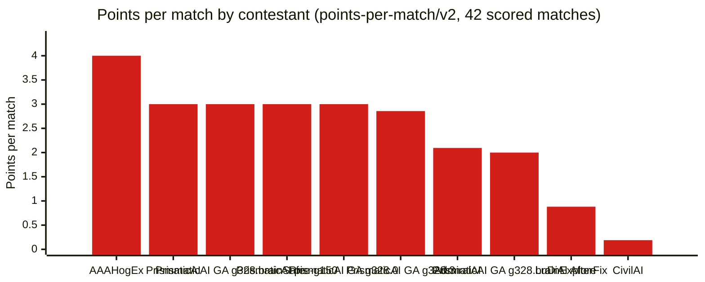
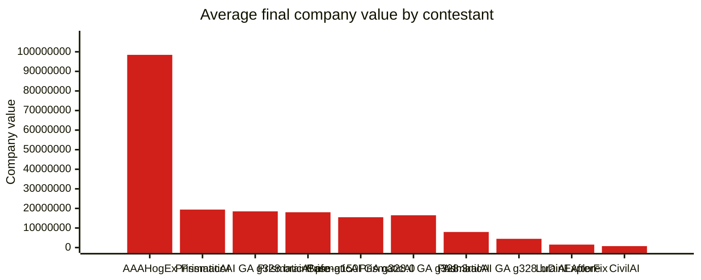
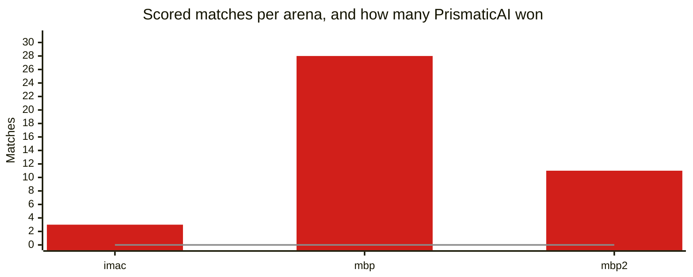

# battle-20261122T010258-a66399c0

Derived from `battle-20261122T010258-a66399c0.json` by `tools/research/ai-battle/battle.py report`; do not edit.

- Edition `a66399c04f785bfc`: PrismaticAI and referee at `8c8d025388e85261a60027d9983d8588d720a2e9`, base set `opengfx-8.0.tar`
- 20-year free-for-all from 1960, map 256x256 temperate, breakdowns 1
- 42 scored match(es) on `imac` (20261119-master-gdf1e05e7d8), `mbp` (20261120-master-m17653b726e), `mbp2` (20261119-master-gdf1e05e7d8)
- Replays: 0 of 0 identical to their original on another arena

| # | Contestant | Played | Wins | Points | Points/match | Avg rank | Avg final value | Squirrel errors | Matches with anomalies |
|---|---|---|---|---|---|---|---|---|---|
| 1 | AAAHogEx | 42 | 42 | 168 | 4.0 | 1.0 | 98.4 M | 0 | 0 |
| 2 | PrismaticAI | 8 | 0 | 24 | 3.0 | 2.0 | 19.4 M | 0 | 0 |
| 3 | PrismaticAI GA g328.brainSafe | 7 | 0 | 21 | 3.0 | 2.0 | 18.5 M | 0 | 0 |
| 4 | PrismaticAI pre-g150 | 7 | 0 | 21 | 3.0 | 2.0 | 18.0 M | 0 | 0 |
| 5 | PrismaticAI GA g328.0 | 7 | 0 | 21 | 3.0 | 2.0 | 15.5 M | 0 | 0 |
| 6 | PrismaticAI GA g328.3 | 7 | 0 | 20 | 2.857 | 2.14 | 16.5 M | 0 | 1 |
| 7 | AdmiralAI | 42 | 0 | 88 | 2.095 | 2.9 | 8.0 M | 0 | 3 |
| 8 | PrismaticAI GA g328.brainExplore | 6 | 0 | 12 | 2.0 | 3.0 | 4.5 M | 0 | 3 |
| 9 | LuDiAI AfterFix | 42 | 0 | 37 | 0.881 | 4.12 | 1.5 M | 0 | 0 |
| 10 | CivilAI | 42 | 0 | 8 | 0.19 | 4.81 | 738.3 k | 3698 | 4 |

```mermaid
---
config:
  xyChart:
    width: 900
    height: 360
  themeVariables:
    xyChart:
      plotColorPalette: "#d11f1a, #8a8a8a, #0b0b0b, #ece4d6"
---
xychart-beta
    title "Final company value per scored match: winner vs best PrismaticAI"
    x-axis ["m-0001", "m-0002", "m-0003", "m-0004", "m-0005", "m-0006", "m-0007", "m-0008", "m-0009", "m-0010", "m-0011", "m-0012", "m-0014", "m-0015", "m-0016", "m-0017", "m-0018", "m-0019", "m-0021", "m-0023", "m-0024", "m-0025", "m-0026", "m-0036", "m-0037", "m-0038", "m-0039", "m-0040", "m-0041", "m-0042", "m-0043", "m-0044", "m-0045", "m-0046", "m-0047", "m-0048", "m-0049", "m-0050", "m-0051", "m-0052", "m-0053", "m-0054"]
    %% series: Winner | Best PrismaticAI
    %% links: battle-20261122T010258-a66399c0.md?col=Match&filter=m-0001 | battle-20261122T010258-a66399c0.md?col=Match&filter=m-0002 | battle-20261122T010258-a66399c0.md?col=Match&filter=m-0003 | battle-20261122T010258-a66399c0.md?col=Match&filter=m-0004 | battle-20261122T010258-a66399c0.md?col=Match&filter=m-0005 | battle-20261122T010258-a66399c0.md?col=Match&filter=m-0006 | battle-20261122T010258-a66399c0.md?col=Match&filter=m-0007 | battle-20261122T010258-a66399c0.md?col=Match&filter=m-0008 | battle-20261122T010258-a66399c0.md?col=Match&filter=m-0009 | battle-20261122T010258-a66399c0.md?col=Match&filter=m-0010 | battle-20261122T010258-a66399c0.md?col=Match&filter=m-0011 | battle-20261122T010258-a66399c0.md?col=Match&filter=m-0012 | battle-20261122T010258-a66399c0.md?col=Match&filter=m-0014 | battle-20261122T010258-a66399c0.md?col=Match&filter=m-0015 | battle-20261122T010258-a66399c0.md?col=Match&filter=m-0016 | battle-20261122T010258-a66399c0.md?col=Match&filter=m-0017 | battle-20261122T010258-a66399c0.md?col=Match&filter=m-0018 | battle-20261122T010258-a66399c0.md?col=Match&filter=m-0019 | battle-20261122T010258-a66399c0.md?col=Match&filter=m-0021 | battle-20261122T010258-a66399c0.md?col=Match&filter=m-0023 | battle-20261122T010258-a66399c0.md?col=Match&filter=m-0024 | battle-20261122T010258-a66399c0.md?col=Match&filter=m-0025 | battle-20261122T010258-a66399c0.md?col=Match&filter=m-0026 | battle-20261122T010258-a66399c0.md?col=Match&filter=m-0036 | battle-20261122T010258-a66399c0.md?col=Match&filter=m-0037 | battle-20261122T010258-a66399c0.md?col=Match&filter=m-0038 | battle-20261122T010258-a66399c0.md?col=Match&filter=m-0039 | battle-20261122T010258-a66399c0.md?col=Match&filter=m-0040 | battle-20261122T010258-a66399c0.md?col=Match&filter=m-0041 | battle-20261122T010258-a66399c0.md?col=Match&filter=m-0042 | battle-20261122T010258-a66399c0.md?col=Match&filter=m-0043 | battle-20261122T010258-a66399c0.md?col=Match&filter=m-0044 | battle-20261122T010258-a66399c0.md?col=Match&filter=m-0045 | battle-20261122T010258-a66399c0.md?col=Match&filter=m-0046 | battle-20261122T010258-a66399c0.md?col=Match&filter=m-0047 | battle-20261122T010258-a66399c0.md?col=Match&filter=m-0048 | battle-20261122T010258-a66399c0.md?col=Match&filter=m-0049 | battle-20261122T010258-a66399c0.md?col=Match&filter=m-0050 | battle-20261122T010258-a66399c0.md?col=Match&filter=m-0051 | battle-20261122T010258-a66399c0.md?col=Match&filter=m-0052 | battle-20261122T010258-a66399c0.md?col=Match&filter=m-0053 | battle-20261122T010258-a66399c0.md?col=Match&filter=m-0054
    y-axis "Company value" 0 --> 172000000
    bar [68143296, 44283934, 45534855, 78241324, 60994035, 92625523, 85862305, 84297480, 87348613, 114392394, 101409105, 107618928, 114763535, 102228315, 113927314, 111894591, 112613686, 123456419, 120696910, 113536952, 77225012, 92758559, 100118401, 88327744, 102233687, 73125748, 86533757, 89325982, 88218617, 93623119, 102967450, 89210096, 91301290, 95009326, 99647759, 100667509, 132517804, 129079452, 156019961, 142830968, 135915774, 83972090]
    line [12999015, 14750452, 14210312, 2678457, 10943425, 14744033, 21924836, 15606151, 18217362, 3457216, 11916482, 17769105, 16938616, 16725889, 2860541, 13949266, 28292378, 20063385, 20192258, 30935918, 16531962, 16660022, 11373907, 14239430, 14366414, 13230917, 17303262, 3565344, 6485501, 23009693, 17934901, 21881165, 22277619, 12062345, 21052915, 24093027, 22252591, 14723915, 20516380, 2187845, 20238222, 16504292]
```

<!-- battle-charts:begin -->
<!-- derived from battle-20261122T010258-a66399c0.json by `battle.py render`; `battle.py check` fails when it is stale -->

<!-- battle-charts:end -->

| Match | Arena | Seed | Winner | Value | Last | Anomalies |
|---|---|---|---|---|---|---|
| m-0001 | mbp | 1523916848 | AAAHogEx | 68.1 M | CivilAI | - |
| m-0002 | mbp | 1523916848 | AAAHogEx | 44.3 M | CivilAI | - |
| m-0003 | mbp | 1523916848 | AAAHogEx | 45.5 M | CivilAI | - |
| m-0004 | mbp | 1523916848 | AAAHogEx | 78.2 M | CivilAI | - |
| m-0005 | mbp | 1523916848 | AAAHogEx | 61.0 M | CivilAI | - |
| m-0006 | mbp | 1065454410 | AAAHogEx | 92.6 M | CivilAI | - |
| m-0007 | mbp | 1065454410 | AAAHogEx | 85.9 M | CivilAI | - |
| m-0008 | mbp | 1065454410 | AAAHogEx | 84.3 M | CivilAI | - |
| m-0009 | mbp | 1065454410 | AAAHogEx | 87.3 M | CivilAI | AdmiralAI: fleet_drop:271->189 |
| m-0010 | imac | 1065454410 | AAAHogEx | 114.4 M | CivilAI | AdmiralAI: fleet_drop:338->234; PrismaticAI GA g328.brainExplore: fleet_drop:31->21 |
| m-0011 | imac | 1065454410 | AAAHogEx | 101.4 M | CivilAI | - |
| m-0012 | imac | 1136473355 | AAAHogEx | 107.6 M | CivilAI | - |
| m-0014 | mbp2 | 1136473355 | AAAHogEx | 114.8 M | CivilAI | - |
| m-0015 | mbp2 | 1136473355 | AAAHogEx | 102.2 M | CivilAI | - |
| m-0016 | mbp2 | 1136473355 | AAAHogEx | 113.9 M | CivilAI | PrismaticAI GA g328.brainExplore: fleet_drop:33->19 |
| m-0017 | mbp2 | 1136473355 | AAAHogEx | 111.9 M | LuDiAI AfterFix | - |
| m-0018 | mbp2 | 1654347514 | AAAHogEx | 112.6 M | CivilAI | - |
| m-0019 | mbp2 | 1654347514 | AAAHogEx | 123.5 M | CivilAI | - |
| m-0021 | mbp2 | 1654347514 | AAAHogEx | 120.7 M | CivilAI | - |
| m-0023 | mbp2 | 1654347514 | AAAHogEx | 113.5 M | CivilAI | - |
| m-0024 | mbp2 | 1087655593 | AAAHogEx | 77.2 M | CivilAI | - |
| m-0025 | mbp2 | 1087655593 | AAAHogEx | 92.8 M | CivilAI | - |
| m-0026 | mbp2 | 1087655593 | AAAHogEx | 100.1 M | CivilAI | - |
| m-0036 | mbp | 97758498 | AAAHogEx | 88.3 M | LuDiAI AfterFix | - |
| m-0037 | mbp | 97758498 | AAAHogEx | 102.2 M | CivilAI | CivilAI: fleet_drop:44->6 |
| m-0038 | mbp | 97758498 | AAAHogEx | 73.1 M | CivilAI | - |
| m-0039 | mbp | 97758498 | AAAHogEx | 86.5 M | CivilAI | - |
| m-0040 | mbp | 97758498 | AAAHogEx | 89.3 M | CivilAI | - |
| m-0041 | mbp | 97758498 | AAAHogEx | 88.2 M | LuDiAI AfterFix | PrismaticAI GA g328.3: fleet_drop:38->26 |
| m-0042 | mbp | 313228190 | AAAHogEx | 93.6 M | CivilAI | CivilAI: fleet_drop:36->18 |
| m-0043 | mbp | 313228190 | AAAHogEx | 103.0 M | CivilAI | - |
| m-0044 | mbp | 313228190 | AAAHogEx | 89.2 M | LuDiAI AfterFix | CivilAI: squirrel_errors:3665 |
| m-0045 | mbp | 313228190 | AAAHogEx | 91.3 M | LuDiAI AfterFix | - |
| m-0046 | mbp | 313228190 | AAAHogEx | 95.0 M | LuDiAI AfterFix | - |
| m-0047 | mbp | 313228190 | AAAHogEx | 99.6 M | LuDiAI AfterFix | - |
| m-0048 | mbp | 978726336 | AAAHogEx | 100.7 M | LuDiAI AfterFix | - |
| m-0049 | mbp | 978726336 | AAAHogEx | 132.5 M | CivilAI | - |
| m-0050 | mbp | 978726336 | AAAHogEx | 129.1 M | CivilAI | AdmiralAI: fleet_drop:273->170; CivilAI: squirrel_errors:33 |
| m-0051 | mbp | 978726336 | AAAHogEx | 156.0 M | CivilAI | - |
| m-0052 | mbp | 978726336 | AAAHogEx | 142.8 M | CivilAI | PrismaticAI GA g328.brainExplore: fleet_drop:31->18 |
| m-0053 | mbp | 978726336 | AAAHogEx | 135.9 M | CivilAI | - |
| m-0054 | mbp | 732575998 | AAAHogEx | 84.0 M | CivilAI | - |
