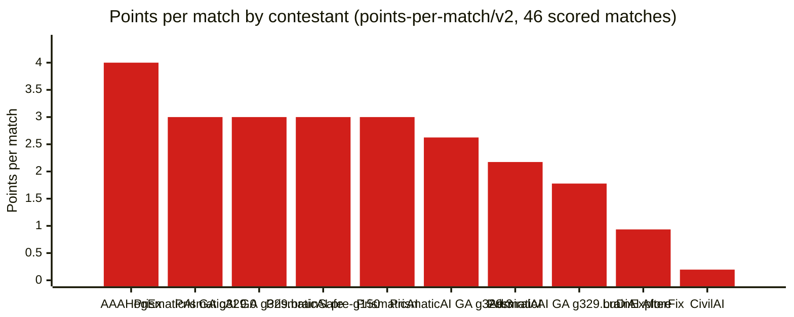
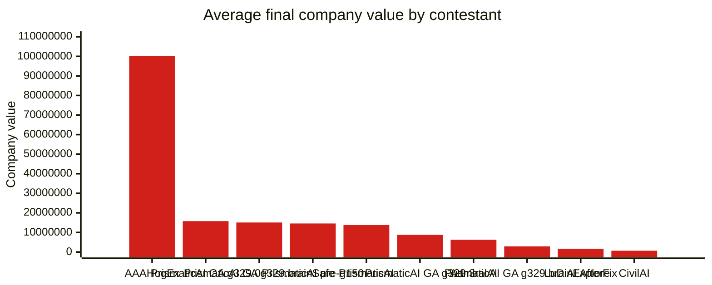
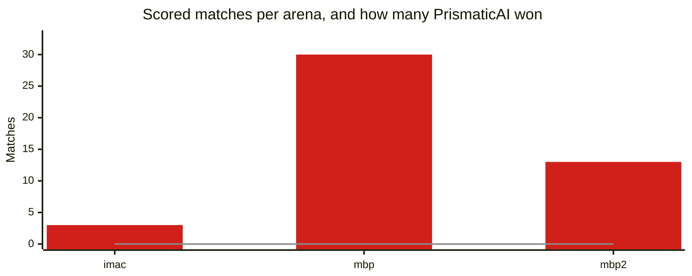

# battle-20261122T011512-055f18e9

Derived from `battle-20261122T011512-055f18e9.json` by `tools/research/ai-battle/battle.py report`; do not edit.

- Edition `055f18e9c2704f2d`: PrismaticAI and referee at `8c8d025388e85261a60027d9983d8588d720a2e9`, base set `opengfx-8.0.tar`
- 20-year free-for-all from 1960, map 256x256 temperate, breakdowns 1
- 46 scored match(es) on `imac` (20261119-master-gdf1e05e7d8), `mbp` (20261120-master-m17653b726e), `mbp2` (20261119-master-gdf1e05e7d8)
- Replays: 0 of 0 identical to their original on another arena

| # | Contestant | Played | Wins | Points | Points/match | Avg rank | Avg final value | Squirrel errors | Matches with anomalies |
|---|---|---|---|---|---|---|---|---|---|
| 1 | AAAHogEx | 46 | 46 | 184 | 4.0 | 1.0 | 100.1 M | 0 | 0 |
| 2 | PrismaticAI GA g329.0 | 7 | 0 | 21 | 3.0 | 2.0 | 15.8 M | 0 | 0 |
| 3 | PrismaticAI GA g329.brainSafe | 8 | 0 | 24 | 3.0 | 2.0 | 15.1 M | 0 | 0 |
| 4 | PrismaticAI pre-g150 | 8 | 0 | 24 | 3.0 | 2.0 | 14.6 M | 0 | 0 |
| 5 | PrismaticAI | 6 | 0 | 18 | 3.0 | 2.0 | 13.8 M | 0 | 0 |
| 6 | PrismaticAI GA g329.3 | 8 | 0 | 21 | 2.625 | 2.38 | 8.8 M | 0 | 1 |
| 7 | AdmiralAI | 46 | 0 | 100 | 2.174 | 2.83 | 6.2 M | 114 | 2 |
| 8 | PrismaticAI GA g329.brainExplore | 9 | 0 | 16 | 1.778 | 3.22 | 2.9 M | 0 | 3 |
| 9 | LuDiAI AfterFix | 46 | 0 | 43 | 0.935 | 4.07 | 1.7 M | 0 | 0 |
| 10 | CivilAI | 46 | 0 | 9 | 0.196 | 4.8 | 645.6 k | 0 | 11 |

```mermaid
---
config:
  xyChart:
    width: 900
    height: 360
  themeVariables:
    xyChart:
      plotColorPalette: "#d11f1a, #8a8a8a, #0b0b0b, #ece4d6"
---
xychart-beta
    title "Final company value per scored match: winner vs best PrismaticAI"
    x-axis ["m-0001", "m-0002", "m-0003", "m-0004", "m-0005", "m-0006", "m-0007", "m-0008", "m-0009", "m-0010", "m-0011", "m-0012", "m-0013", "m-0014", "m-0015", "m-0016", "m-0017", "m-0019", "m-0022", "m-0023", "m-0024", "m-0025", "m-0026", "m-0027", "m-0028", "m-0036", "m-0037", "m-0038", "m-0039", "m-0040", "m-0041", "m-0042", "m-0043", "m-0044", "m-0045", "m-0046", "m-0047", "m-0048", "m-0049", "m-0050", "m-0051", "m-0052", "m-0053", "m-0057", "m-0058", "m-0059"]
    %% series: Winner | Best PrismaticAI
    %% links: battle-20261122T011512-055f18e9.md?col=Match&filter=m-0001 | battle-20261122T011512-055f18e9.md?col=Match&filter=m-0002 | battle-20261122T011512-055f18e9.md?col=Match&filter=m-0003 | battle-20261122T011512-055f18e9.md?col=Match&filter=m-0004 | battle-20261122T011512-055f18e9.md?col=Match&filter=m-0005 | battle-20261122T011512-055f18e9.md?col=Match&filter=m-0006 | battle-20261122T011512-055f18e9.md?col=Match&filter=m-0007 | battle-20261122T011512-055f18e9.md?col=Match&filter=m-0008 | battle-20261122T011512-055f18e9.md?col=Match&filter=m-0009 | battle-20261122T011512-055f18e9.md?col=Match&filter=m-0010 | battle-20261122T011512-055f18e9.md?col=Match&filter=m-0011 | battle-20261122T011512-055f18e9.md?col=Match&filter=m-0012 | battle-20261122T011512-055f18e9.md?col=Match&filter=m-0013 | battle-20261122T011512-055f18e9.md?col=Match&filter=m-0014 | battle-20261122T011512-055f18e9.md?col=Match&filter=m-0015 | battle-20261122T011512-055f18e9.md?col=Match&filter=m-0016 | battle-20261122T011512-055f18e9.md?col=Match&filter=m-0017 | battle-20261122T011512-055f18e9.md?col=Match&filter=m-0019 | battle-20261122T011512-055f18e9.md?col=Match&filter=m-0022 | battle-20261122T011512-055f18e9.md?col=Match&filter=m-0023 | battle-20261122T011512-055f18e9.md?col=Match&filter=m-0024 | battle-20261122T011512-055f18e9.md?col=Match&filter=m-0025 | battle-20261122T011512-055f18e9.md?col=Match&filter=m-0026 | battle-20261122T011512-055f18e9.md?col=Match&filter=m-0027 | battle-20261122T011512-055f18e9.md?col=Match&filter=m-0028 | battle-20261122T011512-055f18e9.md?col=Match&filter=m-0036 | battle-20261122T011512-055f18e9.md?col=Match&filter=m-0037 | battle-20261122T011512-055f18e9.md?col=Match&filter=m-0038 | battle-20261122T011512-055f18e9.md?col=Match&filter=m-0039 | battle-20261122T011512-055f18e9.md?col=Match&filter=m-0040 | battle-20261122T011512-055f18e9.md?col=Match&filter=m-0041 | battle-20261122T011512-055f18e9.md?col=Match&filter=m-0042 | battle-20261122T011512-055f18e9.md?col=Match&filter=m-0043 | battle-20261122T011512-055f18e9.md?col=Match&filter=m-0044 | battle-20261122T011512-055f18e9.md?col=Match&filter=m-0045 | battle-20261122T011512-055f18e9.md?col=Match&filter=m-0046 | battle-20261122T011512-055f18e9.md?col=Match&filter=m-0047 | battle-20261122T011512-055f18e9.md?col=Match&filter=m-0048 | battle-20261122T011512-055f18e9.md?col=Match&filter=m-0049 | battle-20261122T011512-055f18e9.md?col=Match&filter=m-0050 | battle-20261122T011512-055f18e9.md?col=Match&filter=m-0051 | battle-20261122T011512-055f18e9.md?col=Match&filter=m-0052 | battle-20261122T011512-055f18e9.md?col=Match&filter=m-0053 | battle-20261122T011512-055f18e9.md?col=Match&filter=m-0057 | battle-20261122T011512-055f18e9.md?col=Match&filter=m-0058 | battle-20261122T011512-055f18e9.md?col=Match&filter=m-0059
    y-axis "Company value" 0 --> 172000000
    bar [98790575, 71126713, 71126713, 87299406, 82044264, 53787370, 80692978, 77369972, 77369972, 101577084, 86669336, 137861975, 138820537, 120873573, 120873573, 150042222, 138226009, 108903246, 130879656, 112973909, 131485036, 126401823, 156661631, 156661631, 149908982, 76220832, 66387081, 51781029, 51781029, 77163614, 88596359, 70032428, 62083600, 82554449, 82554449, 92481290, 92015598, 117142669, 105319649, 128354860, 128354860, 85583754, 96797565, 91297580, 101641102, 87633976]
    line [10571662, 13127005, 13127005, 501209, 12151571, 8175743, 11768084, 11049726, 11049726, 2763011, 9376570, 15438094, 13898249, 18202744, 18202744, 3081014, 7106854, 17557471, 3479218, 8329392, 17074541, 19396650, 21154396, 21154396, 2315141, 8882519, 12678751, 13303275, 13303275, 3864727, 6642093, 15539838, 17785114, 16542012, 16542012, 1772301, 10344396, 17407815, 12909898, 17054909, 17054909, 4809433, 12641383, 10154046, 3160080, 3520569]
```

<!-- battle-charts:begin -->
<!-- derived from battle-20261122T011512-055f18e9.json by `battle.py render`; `battle.py check` fails when it is stale -->

<!-- battle-charts:end -->

| Match | Arena | Seed | Winner | Value | Last | Anomalies |
|---|---|---|---|---|---|---|
| m-0001 | mbp | 1410409341 | AAAHogEx | 98.8 M | LuDiAI AfterFix | CivilAI: fleet_drop:52->25 |
| m-0002 | mbp | 1410409341 | AAAHogEx | 71.1 M | CivilAI | CivilAI: fleet_drop:74->31 |
| m-0003 | mbp | 1410409341 | AAAHogEx | 71.1 M | CivilAI | CivilAI: fleet_drop:74->31 |
| m-0004 | mbp | 1410409341 | AAAHogEx | 87.3 M | CivilAI | PrismaticAI GA g329.brainExplore: fleet_drop:24->5; CivilAI: fleet_drop:49->29 |
| m-0005 | mbp | 1410409341 | AAAHogEx | 82.0 M | LuDiAI AfterFix | - |
| m-0006 | mbp | 1888634150 | AAAHogEx | 53.8 M | LuDiAI AfterFix | - |
| m-0007 | mbp | 1888634150 | AAAHogEx | 80.7 M | LuDiAI AfterFix | - |
| m-0008 | mbp | 1888634150 | AAAHogEx | 77.4 M | CivilAI | - |
| m-0009 | mbp | 1888634150 | AAAHogEx | 77.4 M | CivilAI | - |
| m-0010 | imac | 1888634150 | AAAHogEx | 101.6 M | LuDiAI AfterFix | PrismaticAI GA g329.brainExplore: fleet_drop:37->22 |
| m-0011 | imac | 1888634150 | AAAHogEx | 86.7 M | CivilAI | CivilAI: fleet_drop:79->38 |
| m-0012 | imac | 79102548 | AAAHogEx | 137.9 M | CivilAI | - |
| m-0013 | mbp2 | 79102548 | AAAHogEx | 138.8 M | CivilAI | - |
| m-0014 | mbp2 | 79102548 | AAAHogEx | 120.9 M | CivilAI | - |
| m-0015 | mbp2 | 79102548 | AAAHogEx | 120.9 M | CivilAI | - |
| m-0016 | mbp2 | 79102548 | AAAHogEx | 150.0 M | CivilAI | CivilAI: fleet_drop:43->24 |
| m-0017 | mbp2 | 79102548 | AAAHogEx | 138.2 M | CivilAI | - |
| m-0019 | mbp2 | 247094226 | AAAHogEx | 108.9 M | CivilAI | - |
| m-0022 | mbp2 | 247094226 | AAAHogEx | 130.9 M | CivilAI | - |
| m-0023 | mbp2 | 247094226 | AAAHogEx | 113.0 M | CivilAI | - |
| m-0024 | mbp2 | 287364745 | AAAHogEx | 131.5 M | CivilAI | - |
| m-0025 | mbp2 | 287364745 | AAAHogEx | 126.4 M | CivilAI | - |
| m-0026 | mbp2 | 287364745 | AAAHogEx | 156.7 M | CivilAI | AdmiralAI: squirrel_errors:57 |
| m-0027 | mbp2 | 287364745 | AAAHogEx | 156.7 M | CivilAI | AdmiralAI: squirrel_errors:57 |
| m-0028 | mbp2 | 287364745 | AAAHogEx | 149.9 M | CivilAI | - |
| m-0036 | mbp | 1686457656 | AAAHogEx | 76.2 M | CivilAI | - |
| m-0037 | mbp | 1686457656 | AAAHogEx | 66.4 M | CivilAI | CivilAI: fleet_drop:57->30 |
| m-0038 | mbp | 1686457656 | AAAHogEx | 51.8 M | CivilAI | - |
| m-0039 | mbp | 1686457656 | AAAHogEx | 51.8 M | CivilAI | - |
| m-0040 | mbp | 1686457656 | AAAHogEx | 77.2 M | CivilAI | - |
| m-0041 | mbp | 1686457656 | AAAHogEx | 88.6 M | AdmiralAI | - |
| m-0042 | mbp | 1760075543 | AAAHogEx | 70.0 M | CivilAI | - |
| m-0043 | mbp | 1760075543 | AAAHogEx | 62.1 M | CivilAI | CivilAI: fleet_drop:31->16 |
| m-0044 | mbp | 1760075543 | AAAHogEx | 82.6 M | CivilAI | - |
| m-0045 | mbp | 1760075543 | AAAHogEx | 82.6 M | CivilAI | - |
| m-0046 | mbp | 1760075543 | AAAHogEx | 92.5 M | CivilAI | PrismaticAI GA g329.brainExplore: fleet_drop:22->14 |
| m-0047 | mbp | 1760075543 | AAAHogEx | 92.0 M | CivilAI | - |
| m-0048 | mbp | 1266536054 | AAAHogEx | 117.1 M | CivilAI | CivilAI: fleet_drop:20->9 |
| m-0049 | mbp | 1266536054 | AAAHogEx | 105.3 M | CivilAI | - |
| m-0050 | mbp | 1266536054 | AAAHogEx | 128.4 M | LuDiAI AfterFix | - |
| m-0051 | mbp | 1266536054 | AAAHogEx | 128.4 M | LuDiAI AfterFix | - |
| m-0052 | mbp | 1266536054 | AAAHogEx | 85.6 M | CivilAI | CivilAI: fleet_drop:52->33 |
| m-0053 | mbp | 1266536054 | AAAHogEx | 96.8 M | CivilAI | PrismaticAI GA g329.3: fleet_drop:47->31 |
| m-0057 | mbp | 73519808 | AAAHogEx | 91.3 M | CivilAI | CivilAI: fleet_drop:40->25 |
| m-0058 | mbp | 73519808 | AAAHogEx | 101.6 M | CivilAI | - |
| m-0059 | mbp | 73519808 | AAAHogEx | 87.6 M | CivilAI | - |
