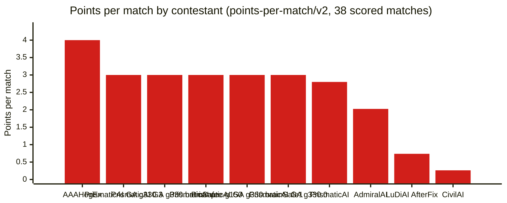
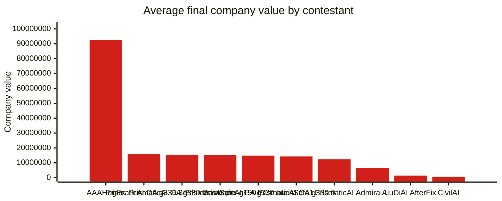
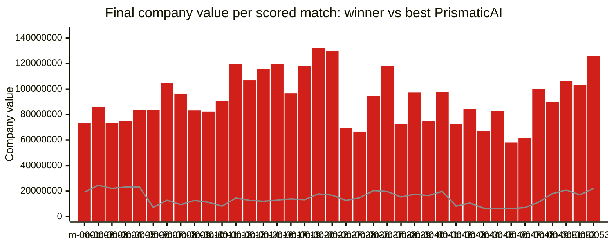
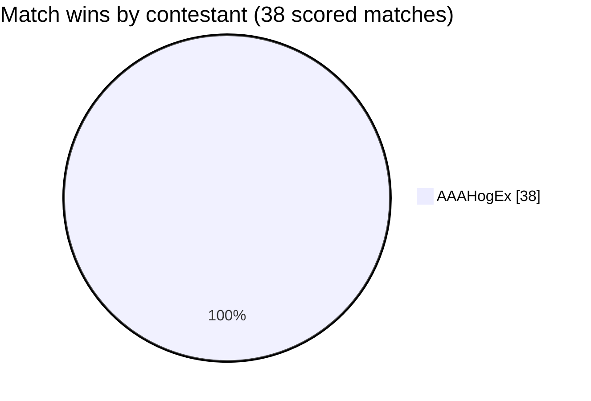
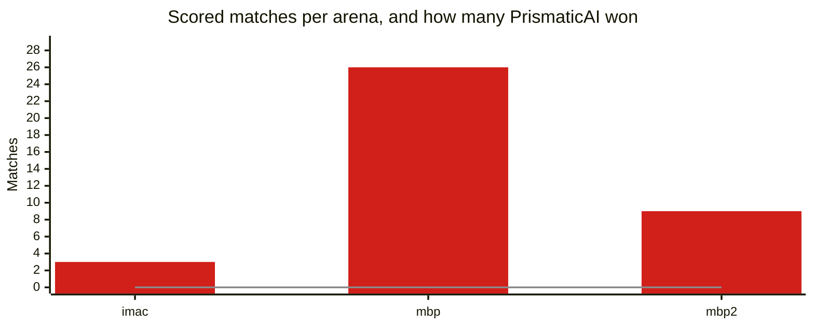

# battle-20261122T012603-401ad069

Derived from `battle-20261122T012603-401ad069.json` by `tools/research/ai-battle/battle.py report`; do not edit.

- Edition `401ad0695cbf4a7b`: PrismaticAI and referee at `8c8d025388e85261a60027d9983d8588d720a2e9`, base set `opengfx-8.0.tar`
- 20-year free-for-all from 1960, map 256x256 temperate, breakdowns 1
- 38 scored match(es) on `imac` (20261119-master-gdf1e05e7d8), `mbp` (20261120-master-m17653b726e), `mbp2` (20261119-master-gdf1e05e7d8)
- Replays: 0 of 0 identical to their original on another arena

| # | Contestant | Played | Wins | Points | Points/match | Avg rank | Avg final value | Squirrel errors | Matches with anomalies |
|---|---|---|---|---|---|---|---|---|---|
| 1 | AAAHogEx | 38 | 38 | 152 | 4.0 | 1.0 | 92.5 M | 0 | 0 |
| 2 | PrismaticAI GA g330.3 | 6 | 0 | 18 | 3.0 | 2.0 | 15.8 M | 0 | 0 |
| 3 | PrismaticAI GA g330.brainSafe | 6 | 0 | 18 | 3.0 | 2.0 | 15.4 M | 0 | 0 |
| 4 | PrismaticAI pre-g150 | 7 | 0 | 21 | 3.0 | 2.0 | 15.2 M | 0 | 0 |
| 5 | PrismaticAI GA g330.brainSafe1 | 8 | 0 | 24 | 3.0 | 2.0 | 14.8 M | 0 | 0 |
| 6 | PrismaticAI GA g330.0 | 6 | 0 | 18 | 3.0 | 2.0 | 14.3 M | 0 | 0 |
| 7 | PrismaticAI | 5 | 0 | 14 | 2.8 | 2.2 | 12.4 M | 0 | 0 |
| 8 | AdmiralAI | 38 | 0 | 77 | 2.026 | 2.97 | 6.5 M | 160 | 5 |
| 9 | LuDiAI AfterFix | 38 | 0 | 28 | 0.737 | 4.26 | 1.4 M | 0 | 1 |
| 10 | CivilAI | 38 | 0 | 10 | 0.263 | 4.74 | 718.4 k | 0 | 2 |

<!-- battle-charts:begin -->
<!-- derived from battle-20261122T012603-401ad069.json by `battle.py render`; `battle.py check` fails when it is stale -->

<!-- battle-charts:end -->

| Match | Arena | Seed | Winner | Value | Last | Anomalies |
|---|---|---|---|---|---|---|
| m-0001 | mbp | 289562772 | AAAHogEx | 73.3 M | CivilAI | - |
| m-0002 | mbp | 289562772 | AAAHogEx | 86.3 M | CivilAI | - |
| m-0003 | mbp | 289562772 | AAAHogEx | 73.7 M | CivilAI | - |
| m-0004 | mbp | 289562772 | AAAHogEx | 75.0 M | LuDiAI AfterFix | - |
| m-0005 | mbp | 289562772 | AAAHogEx | 83.4 M | CivilAI | AdmiralAI: squirrel_errors:72 |
| m-0006 | mbp | 1172355367 | AAAHogEx | 83.4 M | CivilAI | CivilAI: fleet_drop:41->17 |
| m-0007 | mbp | 1172355367 | AAAHogEx | 104.9 M | LuDiAI AfterFix | - |
| m-0008 | mbp | 1172355367 | AAAHogEx | 96.4 M | LuDiAI AfterFix | - |
| m-0009 | mbp | 1172355367 | AAAHogEx | 83.2 M | CivilAI | - |
| m-0010 | imac | 1172355367 | AAAHogEx | 82.4 M | CivilAI | - |
| m-0011 | imac | 1172355367 | AAAHogEx | 90.7 M | LuDiAI AfterFix | - |
| m-0012 | imac | 881326386 | AAAHogEx | 119.6 M | CivilAI | - |
| m-0013 | mbp2 | 881326386 | AAAHogEx | 106.8 M | CivilAI | - |
| m-0014 | mbp2 | 881326386 | AAAHogEx | 115.8 M | CivilAI | - |
| m-0016 | mbp2 | 881326386 | AAAHogEx | 119.8 M | CivilAI | AdmiralAI: fleet_drop:193->82 |
| m-0017 | mbp2 | 881326386 | AAAHogEx | 96.7 M | CivilAI | LuDiAI AfterFix: fleet_drop:59->38 |
| m-0019 | mbp2 | 1460415958 | AAAHogEx | 117.9 M | CivilAI | - |
| m-0020 | mbp2 | 1460415958 | AAAHogEx | 132.2 M | CivilAI | - |
| m-0022 | mbp2 | 1460415958 | AAAHogEx | 129.6 M | CivilAI | - |
| m-0027 | mbp2 | 695235465 | AAAHogEx | 69.8 M | CivilAI | - |
| m-0028 | mbp2 | 695235465 | AAAHogEx | 66.5 M | CivilAI | - |
| m-0036 | mbp | 90881307 | AAAHogEx | 94.6 M | LuDiAI AfterFix | AdmiralAI: squirrel_errors:44; CivilAI: fleet_drop:61->40 |
| m-0037 | mbp | 90881307 | AAAHogEx | 118.2 M | LuDiAI AfterFix | - |
| m-0038 | mbp | 90881307 | AAAHogEx | 72.8 M | CivilAI | - |
| m-0039 | mbp | 90881307 | AAAHogEx | 97.2 M | CivilAI | - |
| m-0040 | mbp | 90881307 | AAAHogEx | 75.3 M | LuDiAI AfterFix | - |
| m-0041 | mbp | 90881307 | AAAHogEx | 97.7 M | LuDiAI AfterFix | - |
| m-0042 | mbp | 1227148552 | AAAHogEx | 72.5 M | CivilAI | AdmiralAI: fleet_drop:178->120 |
| m-0043 | mbp | 1227148552 | AAAHogEx | 84.4 M | CivilAI | - |
| m-0044 | mbp | 1227148552 | AAAHogEx | 67.1 M | CivilAI | - |
| m-0045 | mbp | 1227148552 | AAAHogEx | 82.9 M | CivilAI | - |
| m-0046 | mbp | 1227148552 | AAAHogEx | 58.0 M | CivilAI | - |
| m-0047 | mbp | 1227148552 | AAAHogEx | 61.6 M | CivilAI | - |
| m-0048 | mbp | 1859052300 | AAAHogEx | 100.3 M | CivilAI | - |
| m-0049 | mbp | 1859052300 | AAAHogEx | 89.7 M | LuDiAI AfterFix | - |
| m-0051 | mbp | 1859052300 | AAAHogEx | 106.3 M | CivilAI | - |
| m-0052 | mbp | 1859052300 | AAAHogEx | 103.1 M | LuDiAI AfterFix | AdmiralAI: squirrel_errors:44 |
| m-0053 | mbp | 1859052300 | AAAHogEx | 125.8 M | CivilAI | - |
