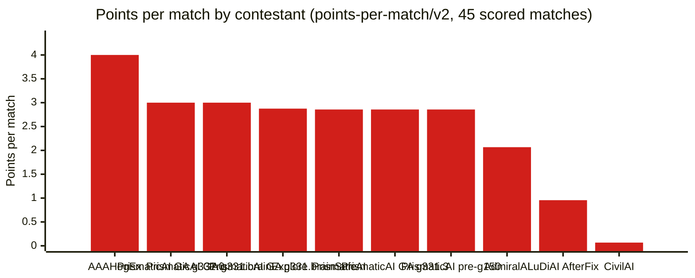
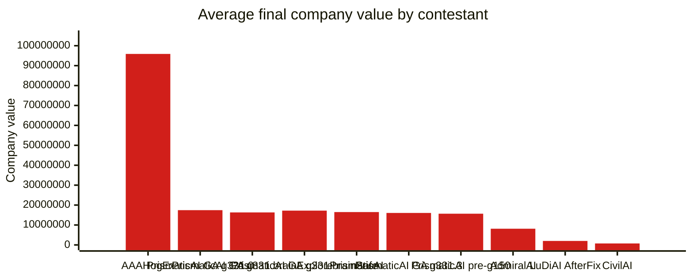
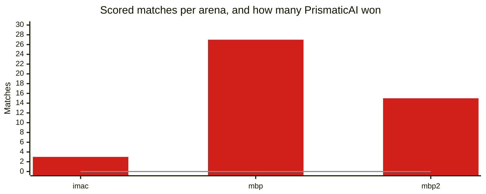

# battle-20261122T013743-144c6422

Derived from `battle-20261122T013743-144c6422.json` by `tools/research/ai-battle/battle.py report`; do not edit.

- Edition `144c64224c550110`: PrismaticAI and referee at `8c8d025388e85261a60027d9983d8588d720a2e9`, base set `opengfx-8.0.tar`
- 20-year free-for-all from 1960, map 256x256 temperate, breakdowns 1
- 45 scored match(es) on `imac` (20261119-master-gdf1e05e7d8), `mbp` (20261120-master-m17653b726e), `mbp2` (20261119-master-gdf1e05e7d8)
- Replays: 0 of 0 identical to their original on another arena

| # | Contestant | Played | Wins | Points | Points/match | Avg rank | Avg final value | Squirrel errors | Matches with anomalies |
|---|---|---|---|---|---|---|---|---|---|
| 1 | AAAHogEx | 45 | 45 | 180 | 4.0 | 1.0 | 95.9 M | 0 | 0 |
| 2 | PrismaticAI GA g331.0 | 8 | 0 | 24 | 3.0 | 2.0 | 17.4 M | 0 | 0 |
| 3 | PrismaticAI GA g331.brainExplore | 8 | 0 | 24 | 3.0 | 2.0 | 16.3 M | 0 | 0 |
| 4 | PrismaticAI GA g331.brainSafe | 8 | 0 | 23 | 2.875 | 2.12 | 17.2 M | 0 | 0 |
| 5 | PrismaticAI | 7 | 0 | 20 | 2.857 | 2.14 | 16.5 M | 0 | 0 |
| 6 | PrismaticAI GA g331.3 | 7 | 0 | 20 | 2.857 | 2.14 | 16.0 M | 0 | 0 |
| 7 | PrismaticAI pre-g150 | 7 | 0 | 20 | 2.857 | 2.14 | 15.7 M | 0 | 0 |
| 8 | AdmiralAI | 45 | 0 | 93 | 2.067 | 2.93 | 8.1 M | 0 | 1 |
| 9 | LuDiAI AfterFix | 45 | 0 | 43 | 0.956 | 4.04 | 2.0 M | 0 | 1 |
| 10 | CivilAI | 45 | 0 | 3 | 0.067 | 4.93 | 731.7 k | 0 | 8 |

```mermaid
---
config:
  xyChart:
    width: 900
    height: 360
  themeVariables:
    xyChart:
      plotColorPalette: "#d11f1a, #8a8a8a, #0b0b0b, #ece4d6"
---
xychart-beta
    title "Final company value per scored match: winner vs best PrismaticAI"
    x-axis ["m-0001", "m-0002", "m-0003", "m-0004", "m-0005", "m-0006", "m-0007", "m-0008", "m-0009", "m-0010", "m-0011", "m-0012", "m-0013", "m-0014", "m-0015", "m-0016", "m-0017", "m-0018", "m-0020", "m-0021", "m-0022", "m-0023", "m-0024", "m-0025", "m-0026", "m-0027", "m-0028", "m-0036", "m-0037", "m-0038", "m-0039", "m-0040", "m-0041", "m-0042", "m-0043", "m-0044", "m-0045", "m-0046", "m-0047", "m-0048", "m-0049", "m-0050", "m-0051", "m-0052", "m-0053"]
    %% series: Winner | Best PrismaticAI
    %% links: battle-20261122T013743-144c6422.md?col=Match&filter=m-0001 | battle-20261122T013743-144c6422.md?col=Match&filter=m-0002 | battle-20261122T013743-144c6422.md?col=Match&filter=m-0003 | battle-20261122T013743-144c6422.md?col=Match&filter=m-0004 | battle-20261122T013743-144c6422.md?col=Match&filter=m-0005 | battle-20261122T013743-144c6422.md?col=Match&filter=m-0006 | battle-20261122T013743-144c6422.md?col=Match&filter=m-0007 | battle-20261122T013743-144c6422.md?col=Match&filter=m-0008 | battle-20261122T013743-144c6422.md?col=Match&filter=m-0009 | battle-20261122T013743-144c6422.md?col=Match&filter=m-0010 | battle-20261122T013743-144c6422.md?col=Match&filter=m-0011 | battle-20261122T013743-144c6422.md?col=Match&filter=m-0012 | battle-20261122T013743-144c6422.md?col=Match&filter=m-0013 | battle-20261122T013743-144c6422.md?col=Match&filter=m-0014 | battle-20261122T013743-144c6422.md?col=Match&filter=m-0015 | battle-20261122T013743-144c6422.md?col=Match&filter=m-0016 | battle-20261122T013743-144c6422.md?col=Match&filter=m-0017 | battle-20261122T013743-144c6422.md?col=Match&filter=m-0018 | battle-20261122T013743-144c6422.md?col=Match&filter=m-0020 | battle-20261122T013743-144c6422.md?col=Match&filter=m-0021 | battle-20261122T013743-144c6422.md?col=Match&filter=m-0022 | battle-20261122T013743-144c6422.md?col=Match&filter=m-0023 | battle-20261122T013743-144c6422.md?col=Match&filter=m-0024 | battle-20261122T013743-144c6422.md?col=Match&filter=m-0025 | battle-20261122T013743-144c6422.md?col=Match&filter=m-0026 | battle-20261122T013743-144c6422.md?col=Match&filter=m-0027 | battle-20261122T013743-144c6422.md?col=Match&filter=m-0028 | battle-20261122T013743-144c6422.md?col=Match&filter=m-0036 | battle-20261122T013743-144c6422.md?col=Match&filter=m-0037 | battle-20261122T013743-144c6422.md?col=Match&filter=m-0038 | battle-20261122T013743-144c6422.md?col=Match&filter=m-0039 | battle-20261122T013743-144c6422.md?col=Match&filter=m-0040 | battle-20261122T013743-144c6422.md?col=Match&filter=m-0041 | battle-20261122T013743-144c6422.md?col=Match&filter=m-0042 | battle-20261122T013743-144c6422.md?col=Match&filter=m-0043 | battle-20261122T013743-144c6422.md?col=Match&filter=m-0044 | battle-20261122T013743-144c6422.md?col=Match&filter=m-0045 | battle-20261122T013743-144c6422.md?col=Match&filter=m-0046 | battle-20261122T013743-144c6422.md?col=Match&filter=m-0047 | battle-20261122T013743-144c6422.md?col=Match&filter=m-0048 | battle-20261122T013743-144c6422.md?col=Match&filter=m-0049 | battle-20261122T013743-144c6422.md?col=Match&filter=m-0050 | battle-20261122T013743-144c6422.md?col=Match&filter=m-0051 | battle-20261122T013743-144c6422.md?col=Match&filter=m-0052 | battle-20261122T013743-144c6422.md?col=Match&filter=m-0053
    y-axis "Company value" 0 --> 148000000
    bar [118865612, 106251949, 95309990, 102991253, 97117817, 93752546, 87843002, 84580272, 74390064, 85577117, 85297420, 114974188, 134424082, 95605873, 114818621, 89751148, 132358576, 86815307, 103369819, 107738532, 106246552, 97708205, 112633401, 109998923, 109186410, 85967644, 98130687, 85459396, 70332990, 92228141, 70060073, 78007478, 90920812, 79448461, 94064953, 92656091, 89335108, 82339554, 82557167, 93650630, 98877583, 88251895, 95306199, 98645982, 100461235]
    line [26799231, 20659469, 15547019, 18645495, 14943737, 16580752, 16185644, 14583094, 18663801, 15293146, 14000268, 19372857, 16370579, 23062367, 17757503, 19039859, 16357019, 21711507, 25562680, 19590856, 21904722, 19155808, 8072744, 10838158, 12180252, 14224946, 11963335, 23666186, 15565455, 13238015, 14903189, 13839939, 10600662, 8366195, 10761352, 14653921, 18022177, 14928772, 19024210, 17651227, 13133735, 15617510, 18950738, 14875005, 18265556]
```

<!-- battle-charts:begin -->
<!-- derived from battle-20261122T013743-144c6422.json by `battle.py render`; `battle.py check` fails when it is stale -->

<!-- battle-charts:end -->

| Match | Arena | Seed | Winner | Value | Last | Anomalies |
|---|---|---|---|---|---|---|
| m-0001 | mbp | 79964787 | AAAHogEx | 118.9 M | CivilAI | - |
| m-0002 | mbp | 79964787 | AAAHogEx | 106.3 M | CivilAI | - |
| m-0003 | mbp | 79964787 | AAAHogEx | 95.3 M | CivilAI | - |
| m-0004 | mbp | 79964787 | AAAHogEx | 103.0 M | CivilAI | - |
| m-0005 | mbp | 79964787 | AAAHogEx | 97.1 M | CivilAI | - |
| m-0006 | mbp | 17123442 | AAAHogEx | 93.8 M | CivilAI | - |
| m-0007 | mbp | 17123442 | AAAHogEx | 87.8 M | CivilAI | - |
| m-0008 | mbp | 17123442 | AAAHogEx | 84.6 M | CivilAI | - |
| m-0009 | mbp | 17123442 | AAAHogEx | 74.4 M | CivilAI | - |
| m-0010 | imac | 17123442 | AAAHogEx | 85.6 M | CivilAI | - |
| m-0011 | imac | 17123442 | AAAHogEx | 85.3 M | CivilAI | - |
| m-0012 | imac | 616868563 | AAAHogEx | 115.0 M | CivilAI | - |
| m-0013 | mbp2 | 616868563 | AAAHogEx | 134.4 M | CivilAI | AdmiralAI: fleet_drop:78->53 |
| m-0014 | mbp2 | 616868563 | AAAHogEx | 95.6 M | CivilAI | - |
| m-0015 | mbp2 | 616868563 | AAAHogEx | 114.8 M | CivilAI | CivilAI: fleet_drop:13->9 |
| m-0016 | mbp2 | 616868563 | AAAHogEx | 89.8 M | CivilAI | - |
| m-0017 | mbp2 | 616868563 | AAAHogEx | 132.4 M | CivilAI | - |
| m-0018 | mbp2 | 541440355 | AAAHogEx | 86.8 M | LuDiAI AfterFix | - |
| m-0020 | mbp2 | 541440355 | AAAHogEx | 103.4 M | CivilAI | CivilAI: fleet_drop:29->14 |
| m-0021 | mbp2 | 541440355 | AAAHogEx | 107.7 M | CivilAI | - |
| m-0022 | mbp2 | 541440355 | AAAHogEx | 106.2 M | CivilAI | - |
| m-0023 | mbp2 | 541440355 | AAAHogEx | 97.7 M | CivilAI | CivilAI: fleet_drop:50->15 |
| m-0024 | mbp2 | 1400452995 | AAAHogEx | 112.6 M | CivilAI | CivilAI: fleet_drop:35->24 |
| m-0025 | mbp2 | 1400452995 | AAAHogEx | 110.0 M | CivilAI | - |
| m-0026 | mbp2 | 1400452995 | AAAHogEx | 109.2 M | CivilAI | - |
| m-0027 | mbp2 | 1400452995 | AAAHogEx | 86.0 M | CivilAI | - |
| m-0028 | mbp2 | 1400452995 | AAAHogEx | 98.1 M | CivilAI | - |
| m-0036 | mbp | 469651254 | AAAHogEx | 85.5 M | CivilAI | LuDiAI AfterFix: fleet_drop:93->65 |
| m-0037 | mbp | 469651254 | AAAHogEx | 70.3 M | CivilAI | CivilAI: fleet_drop:54->26 |
| m-0038 | mbp | 469651254 | AAAHogEx | 92.2 M | CivilAI | - |
| m-0039 | mbp | 469651254 | AAAHogEx | 70.1 M | CivilAI | - |
| m-0040 | mbp | 469651254 | AAAHogEx | 78.0 M | CivilAI | - |
| m-0041 | mbp | 469651254 | AAAHogEx | 90.9 M | CivilAI | - |
| m-0042 | mbp | 1902196662 | AAAHogEx | 79.4 M | CivilAI | - |
| m-0043 | mbp | 1902196662 | AAAHogEx | 94.1 M | CivilAI | - |
| m-0044 | mbp | 1902196662 | AAAHogEx | 92.7 M | LuDiAI AfterFix | - |
| m-0045 | mbp | 1902196662 | AAAHogEx | 89.3 M | CivilAI | - |
| m-0046 | mbp | 1902196662 | AAAHogEx | 82.3 M | LuDiAI AfterFix | CivilAI: fleet_drop:104->72 |
| m-0047 | mbp | 1902196662 | AAAHogEx | 82.6 M | CivilAI | CivilAI: fleet_drop:90->53 |
| m-0048 | mbp | 1302293978 | AAAHogEx | 93.7 M | CivilAI | - |
| m-0049 | mbp | 1302293978 | AAAHogEx | 98.9 M | CivilAI | - |
| m-0050 | mbp | 1302293978 | AAAHogEx | 88.3 M | CivilAI | - |
| m-0051 | mbp | 1302293978 | AAAHogEx | 95.3 M | CivilAI | - |
| m-0052 | mbp | 1302293978 | AAAHogEx | 98.6 M | CivilAI | - |
| m-0053 | mbp | 1302293978 | AAAHogEx | 100.5 M | CivilAI | CivilAI: fleet_drop:34->20 |
