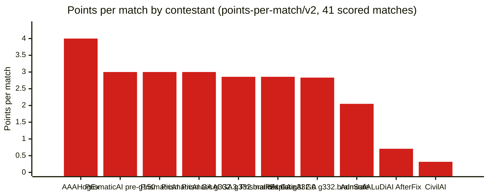
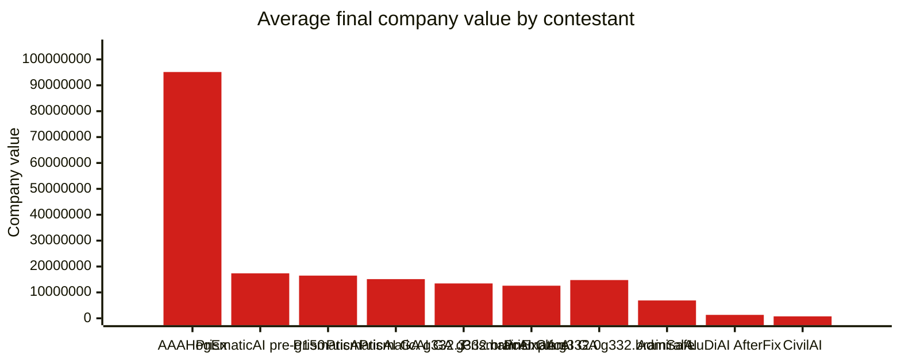
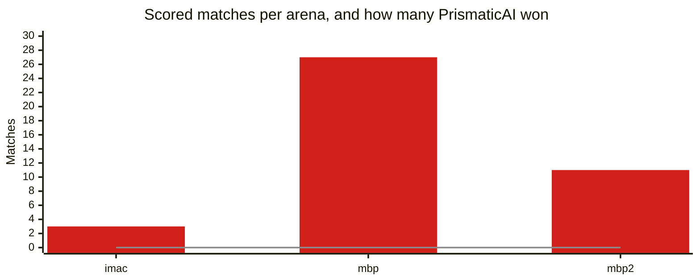

# battle-20261122T014852-cd53ac37

Derived from `battle-20261122T014852-cd53ac37.json` by `tools/research/ai-battle/battle.py report`; do not edit.

- Edition `cd53ac375318d6f9`: PrismaticAI and referee at `8c8d025388e85261a60027d9983d8588d720a2e9`, base set `opengfx-8.0.tar`
- 20-year free-for-all from 1960, map 256x256 temperate, breakdowns 1
- 41 scored match(es) on `imac` (20261119-master-gdf1e05e7d8), `mbp` (20261120-master-m17653b726e), `mbp2` (20261119-master-gdf1e05e7d8)
- Replays: 0 of 0 identical to their original on another arena

| # | Contestant | Played | Wins | Points | Points/match | Avg rank | Avg final value | Squirrel errors | Matches with anomalies |
|---|---|---|---|---|---|---|---|---|---|
| 1 | AAAHogEx | 41 | 41 | 164 | 4.0 | 1.0 | 95.1 M | 0 | 0 |
| 2 | PrismaticAI pre-g150 | 8 | 0 | 24 | 3.0 | 2.0 | 17.4 M | 0 | 0 |
| 3 | PrismaticAI | 7 | 0 | 21 | 3.0 | 2.0 | 16.5 M | 0 | 0 |
| 4 | PrismaticAI GA g332.3 | 6 | 0 | 18 | 3.0 | 2.0 | 15.1 M | 0 | 0 |
| 5 | PrismaticAI GA g332.brainExplore | 7 | 0 | 20 | 2.857 | 2.14 | 13.5 M | 0 | 0 |
| 6 | PrismaticAI GA g332.0 | 7 | 0 | 20 | 2.857 | 2.14 | 12.6 M | 0 | 0 |
| 7 | PrismaticAI GA g332.brainSafe | 6 | 0 | 17 | 2.833 | 2.17 | 14.8 M | 0 | 0 |
| 8 | AdmiralAI | 41 | 0 | 84 | 2.049 | 2.95 | 6.9 M | 0 | 3 |
| 9 | LuDiAI AfterFix | 41 | 0 | 29 | 0.707 | 4.29 | 1.3 M | 0 | 1 |
| 10 | CivilAI | 41 | 0 | 13 | 0.317 | 4.68 | 748.3 k | 0 | 5 |

```mermaid
---
config:
  xyChart:
    width: 900
    height: 360
  themeVariables:
    xyChart:
      plotColorPalette: "#d11f1a, #8a8a8a, #0b0b0b, #ece4d6"
---
xychart-beta
    title "Final company value per scored match: winner vs best PrismaticAI"
    x-axis ["m-0001", "m-0002", "m-0003", "m-0004", "m-0005", "m-0006", "m-0007", "m-0008", "m-0009", "m-0010", "m-0011", "m-0012", "m-0013", "m-0014", "m-0016", "m-0018", "m-0019", "m-0020", "m-0021", "m-0022", "m-0023", "m-0024", "m-0025", "m-0036", "m-0037", "m-0038", "m-0039", "m-0040", "m-0041", "m-0042", "m-0043", "m-0044", "m-0045", "m-0046", "m-0047", "m-0048", "m-0049", "m-0050", "m-0051", "m-0052", "m-0053"]
    %% series: Winner | Best PrismaticAI
    %% links: battle-20261122T014852-cd53ac37.md?col=Match&filter=m-0001 | battle-20261122T014852-cd53ac37.md?col=Match&filter=m-0002 | battle-20261122T014852-cd53ac37.md?col=Match&filter=m-0003 | battle-20261122T014852-cd53ac37.md?col=Match&filter=m-0004 | battle-20261122T014852-cd53ac37.md?col=Match&filter=m-0005 | battle-20261122T014852-cd53ac37.md?col=Match&filter=m-0006 | battle-20261122T014852-cd53ac37.md?col=Match&filter=m-0007 | battle-20261122T014852-cd53ac37.md?col=Match&filter=m-0008 | battle-20261122T014852-cd53ac37.md?col=Match&filter=m-0009 | battle-20261122T014852-cd53ac37.md?col=Match&filter=m-0010 | battle-20261122T014852-cd53ac37.md?col=Match&filter=m-0011 | battle-20261122T014852-cd53ac37.md?col=Match&filter=m-0012 | battle-20261122T014852-cd53ac37.md?col=Match&filter=m-0013 | battle-20261122T014852-cd53ac37.md?col=Match&filter=m-0014 | battle-20261122T014852-cd53ac37.md?col=Match&filter=m-0016 | battle-20261122T014852-cd53ac37.md?col=Match&filter=m-0018 | battle-20261122T014852-cd53ac37.md?col=Match&filter=m-0019 | battle-20261122T014852-cd53ac37.md?col=Match&filter=m-0020 | battle-20261122T014852-cd53ac37.md?col=Match&filter=m-0021 | battle-20261122T014852-cd53ac37.md?col=Match&filter=m-0022 | battle-20261122T014852-cd53ac37.md?col=Match&filter=m-0023 | battle-20261122T014852-cd53ac37.md?col=Match&filter=m-0024 | battle-20261122T014852-cd53ac37.md?col=Match&filter=m-0025 | battle-20261122T014852-cd53ac37.md?col=Match&filter=m-0036 | battle-20261122T014852-cd53ac37.md?col=Match&filter=m-0037 | battle-20261122T014852-cd53ac37.md?col=Match&filter=m-0038 | battle-20261122T014852-cd53ac37.md?col=Match&filter=m-0039 | battle-20261122T014852-cd53ac37.md?col=Match&filter=m-0040 | battle-20261122T014852-cd53ac37.md?col=Match&filter=m-0041 | battle-20261122T014852-cd53ac37.md?col=Match&filter=m-0042 | battle-20261122T014852-cd53ac37.md?col=Match&filter=m-0043 | battle-20261122T014852-cd53ac37.md?col=Match&filter=m-0044 | battle-20261122T014852-cd53ac37.md?col=Match&filter=m-0045 | battle-20261122T014852-cd53ac37.md?col=Match&filter=m-0046 | battle-20261122T014852-cd53ac37.md?col=Match&filter=m-0047 | battle-20261122T014852-cd53ac37.md?col=Match&filter=m-0048 | battle-20261122T014852-cd53ac37.md?col=Match&filter=m-0049 | battle-20261122T014852-cd53ac37.md?col=Match&filter=m-0050 | battle-20261122T014852-cd53ac37.md?col=Match&filter=m-0051 | battle-20261122T014852-cd53ac37.md?col=Match&filter=m-0052 | battle-20261122T014852-cd53ac37.md?col=Match&filter=m-0053
    y-axis "Company value" 0 --> 159000000
    bar [89580502, 87830784, 88641805, 97603044, 80419755, 104079474, 117641874, 112471598, 126777021, 100493012, 102006549, 116368179, 85338329, 81573529, 81978778, 61296891, 77794258, 96787743, 96354281, 79066597, 67284059, 106558479, 119278298, 61124315, 72999765, 67504760, 88458176, 68088998, 72345922, 123676434, 116006122, 113778747, 144579315, 112057100, 123220221, 97313575, 93153289, 100757788, 87462425, 89922087, 90725456]
    line [17129472, 13441000, 16071944, 16657242, 22215905, 16664176, 18286468, 14615212, 17059881, 16666800, 19286217, 14765547, 13363245, 11690415, 11930458, 13844073, 10701011, 12909388, 12617199, 13777595, 11136160, 20098877, 26248639, 11394060, 14468379, 4440309, 7226941, 4465769, 8289052, 21268789, 23044293, 19059019, 22927493, 20048161, 17582923, 17390255, 15740730, 11969686, 12731015, 10742698, 12289533]
```

<!-- battle-charts:begin -->
<!-- derived from battle-20261122T014852-cd53ac37.json by `battle.py render`; `battle.py check` fails when it is stale -->

<!-- battle-charts:end -->

| Match | Arena | Seed | Winner | Value | Last | Anomalies |
|---|---|---|---|---|---|---|
| m-0001 | mbp | 336293823 | AAAHogEx | 89.6 M | CivilAI | - |
| m-0002 | mbp | 336293823 | AAAHogEx | 87.8 M | LuDiAI AfterFix | - |
| m-0003 | mbp | 336293823 | AAAHogEx | 88.6 M | CivilAI | - |
| m-0004 | mbp | 336293823 | AAAHogEx | 97.6 M | LuDiAI AfterFix | - |
| m-0005 | mbp | 336293823 | AAAHogEx | 80.4 M | LuDiAI AfterFix | AdmiralAI: fleet_drop:173->100; LuDiAI AfterFix: fleet_drop:70->38 |
| m-0006 | mbp | 751710290 | AAAHogEx | 104.1 M | CivilAI | - |
| m-0007 | mbp | 751710290 | AAAHogEx | 117.6 M | LuDiAI AfterFix | - |
| m-0008 | mbp | 751710290 | AAAHogEx | 112.5 M | LuDiAI AfterFix | - |
| m-0009 | mbp | 751710290 | AAAHogEx | 126.8 M | CivilAI | - |
| m-0010 | imac | 751710290 | AAAHogEx | 100.5 M | CivilAI | - |
| m-0011 | imac | 751710290 | AAAHogEx | 102.0 M | CivilAI | - |
| m-0012 | imac | 1428525582 | AAAHogEx | 116.4 M | CivilAI | - |
| m-0013 | mbp2 | 1428525582 | AAAHogEx | 85.3 M | CivilAI | - |
| m-0014 | mbp2 | 1428525582 | AAAHogEx | 81.6 M | CivilAI | - |
| m-0016 | mbp2 | 1428525582 | AAAHogEx | 82.0 M | CivilAI | - |
| m-0018 | mbp2 | 780094265 | AAAHogEx | 61.3 M | CivilAI | - |
| m-0019 | mbp2 | 780094265 | AAAHogEx | 77.8 M | CivilAI | - |
| m-0020 | mbp2 | 780094265 | AAAHogEx | 96.8 M | LuDiAI AfterFix | - |
| m-0021 | mbp2 | 780094265 | AAAHogEx | 96.4 M | LuDiAI AfterFix | - |
| m-0022 | mbp2 | 780094265 | AAAHogEx | 79.1 M | LuDiAI AfterFix | - |
| m-0023 | mbp2 | 780094265 | AAAHogEx | 67.3 M | LuDiAI AfterFix | - |
| m-0024 | mbp2 | 1294755227 | AAAHogEx | 106.6 M | CivilAI | - |
| m-0025 | mbp2 | 1294755227 | AAAHogEx | 119.3 M | CivilAI | - |
| m-0036 | mbp | 1697130462 | AAAHogEx | 61.1 M | CivilAI | - |
| m-0037 | mbp | 1697130462 | AAAHogEx | 73.0 M | CivilAI | - |
| m-0038 | mbp | 1697130462 | AAAHogEx | 67.5 M | CivilAI | - |
| m-0039 | mbp | 1697130462 | AAAHogEx | 88.5 M | CivilAI | - |
| m-0040 | mbp | 1697130462 | AAAHogEx | 68.1 M | CivilAI | - |
| m-0041 | mbp | 1697130462 | AAAHogEx | 72.3 M | CivilAI | - |
| m-0042 | mbp | 119244061 | AAAHogEx | 123.7 M | CivilAI | - |
| m-0043 | mbp | 119244061 | AAAHogEx | 116.0 M | CivilAI | AdmiralAI: fleet_drop:180->117 |
| m-0044 | mbp | 119244061 | AAAHogEx | 113.8 M | CivilAI | - |
| m-0045 | mbp | 119244061 | AAAHogEx | 144.6 M | CivilAI | CivilAI: fleet_drop:61->41 |
| m-0046 | mbp | 119244061 | AAAHogEx | 112.1 M | CivilAI | - |
| m-0047 | mbp | 119244061 | AAAHogEx | 123.2 M | CivilAI | CivilAI: fleet_drop:48->30 |
| m-0048 | mbp | 240529779 | AAAHogEx | 97.3 M | CivilAI | - |
| m-0049 | mbp | 240529779 | AAAHogEx | 93.2 M | LuDiAI AfterFix | - |
| m-0050 | mbp | 240529779 | AAAHogEx | 100.8 M | LuDiAI AfterFix | - |
| m-0051 | mbp | 240529779 | AAAHogEx | 87.5 M | CivilAI | CivilAI: fleet_drop:34->16 |
| m-0052 | mbp | 240529779 | AAAHogEx | 89.9 M | LuDiAI AfterFix | CivilAI: fleet_drop:22->14 |
| m-0053 | mbp | 240529779 | AAAHogEx | 90.7 M | LuDiAI AfterFix | AdmiralAI: fleet_drop:102->56; CivilAI: fleet_drop:51->26 |
