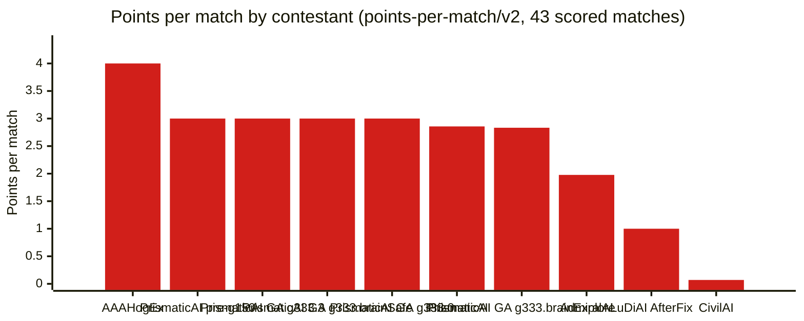
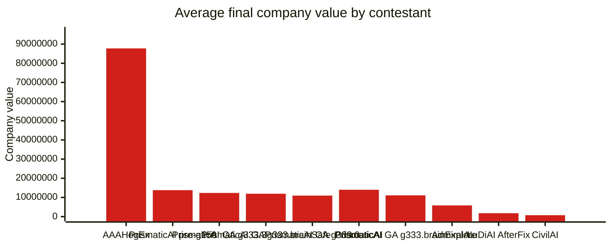
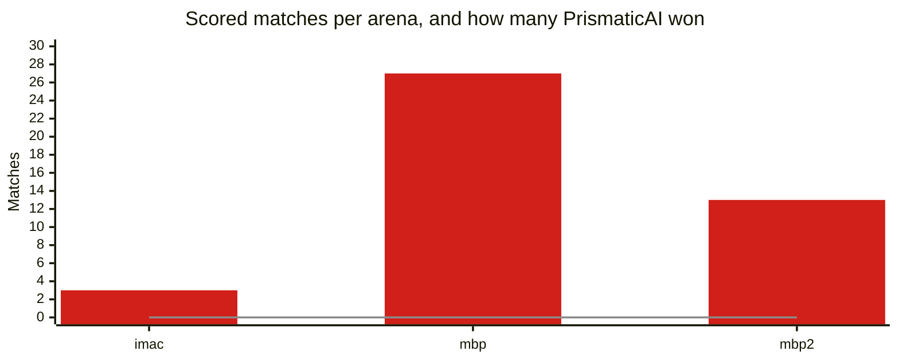

# battle-20261122T015948-e9e1a237

Derived from `battle-20261122T015948-e9e1a237.json` by `tools/research/ai-battle/battle.py report`; do not edit.

- Edition `e9e1a237e653ef30`: PrismaticAI and referee at `8c8d025388e85261a60027d9983d8588d720a2e9`, base set `opengfx-8.0.tar`
- 20-year free-for-all from 1960, map 256x256 temperate, breakdowns 1
- 43 scored match(es) on `imac` (20261119-master-gdf1e05e7d8), `mbp` (20261120-master-m17653b726e), `mbp2` (20261119-master-gdf1e05e7d8)
- Replays: 0 of 0 identical to their original on another arena

| # | Contestant | Played | Wins | Points | Points/match | Avg rank | Avg final value | Squirrel errors | Matches with anomalies |
|---|---|---|---|---|---|---|---|---|---|
| 1 | AAAHogEx | 43 | 43 | 172 | 4.0 | 1.0 | 87.7 M | 0 | 0 |
| 2 | PrismaticAI pre-g150 | 8 | 0 | 24 | 3.0 | 2.0 | 13.8 M | 0 | 0 |
| 3 | PrismaticAI GA g333.3 | 7 | 0 | 21 | 3.0 | 2.0 | 12.3 M | 0 | 0 |
| 4 | PrismaticAI GA g333.brainSafe | 8 | 0 | 24 | 3.0 | 2.0 | 11.9 M | 0 | 0 |
| 5 | PrismaticAI GA g333.0 | 7 | 0 | 21 | 3.0 | 2.0 | 11.0 M | 0 | 0 |
| 6 | PrismaticAI | 7 | 0 | 20 | 2.857 | 2.14 | 14.0 M | 0 | 0 |
| 7 | PrismaticAI GA g333.brainExplore | 6 | 0 | 17 | 2.833 | 2.17 | 11.1 M | 0 | 0 |
| 8 | AdmiralAI | 43 | 0 | 85 | 1.977 | 3.02 | 5.8 M | 0 | 1 |
| 9 | LuDiAI AfterFix | 43 | 0 | 43 | 1.0 | 4.0 | 1.8 M | 0 | 3 |
| 10 | CivilAI | 43 | 0 | 3 | 0.07 | 4.93 | 741.6 k | 11400 | 9 |

```mermaid
---
config:
  xyChart:
    width: 900
    height: 360
  themeVariables:
    xyChart:
      plotColorPalette: "#d11f1a, #8a8a8a, #0b0b0b, #ece4d6"
---
xychart-beta
    title "Final company value per scored match: winner vs best PrismaticAI"
    x-axis ["m-0001", "m-0002", "m-0003", "m-0004", "m-0005", "m-0006", "m-0007", "m-0008", "m-0009", "m-0010", "m-0011", "m-0012", "m-0013", "m-0015", "m-0016", "m-0017", "m-0018", "m-0019", "m-0020", "m-0021", "m-0023", "m-0024", "m-0025", "m-0026", "m-0027", "m-0036", "m-0037", "m-0038", "m-0039", "m-0040", "m-0041", "m-0042", "m-0043", "m-0044", "m-0045", "m-0046", "m-0047", "m-0048", "m-0049", "m-0050", "m-0051", "m-0052", "m-0053"]
    %% series: Winner | Best PrismaticAI
    %% links: battle-20261122T015948-e9e1a237.md?col=Match&filter=m-0001 | battle-20261122T015948-e9e1a237.md?col=Match&filter=m-0002 | battle-20261122T015948-e9e1a237.md?col=Match&filter=m-0003 | battle-20261122T015948-e9e1a237.md?col=Match&filter=m-0004 | battle-20261122T015948-e9e1a237.md?col=Match&filter=m-0005 | battle-20261122T015948-e9e1a237.md?col=Match&filter=m-0006 | battle-20261122T015948-e9e1a237.md?col=Match&filter=m-0007 | battle-20261122T015948-e9e1a237.md?col=Match&filter=m-0008 | battle-20261122T015948-e9e1a237.md?col=Match&filter=m-0009 | battle-20261122T015948-e9e1a237.md?col=Match&filter=m-0010 | battle-20261122T015948-e9e1a237.md?col=Match&filter=m-0011 | battle-20261122T015948-e9e1a237.md?col=Match&filter=m-0012 | battle-20261122T015948-e9e1a237.md?col=Match&filter=m-0013 | battle-20261122T015948-e9e1a237.md?col=Match&filter=m-0015 | battle-20261122T015948-e9e1a237.md?col=Match&filter=m-0016 | battle-20261122T015948-e9e1a237.md?col=Match&filter=m-0017 | battle-20261122T015948-e9e1a237.md?col=Match&filter=m-0018 | battle-20261122T015948-e9e1a237.md?col=Match&filter=m-0019 | battle-20261122T015948-e9e1a237.md?col=Match&filter=m-0020 | battle-20261122T015948-e9e1a237.md?col=Match&filter=m-0021 | battle-20261122T015948-e9e1a237.md?col=Match&filter=m-0023 | battle-20261122T015948-e9e1a237.md?col=Match&filter=m-0024 | battle-20261122T015948-e9e1a237.md?col=Match&filter=m-0025 | battle-20261122T015948-e9e1a237.md?col=Match&filter=m-0026 | battle-20261122T015948-e9e1a237.md?col=Match&filter=m-0027 | battle-20261122T015948-e9e1a237.md?col=Match&filter=m-0036 | battle-20261122T015948-e9e1a237.md?col=Match&filter=m-0037 | battle-20261122T015948-e9e1a237.md?col=Match&filter=m-0038 | battle-20261122T015948-e9e1a237.md?col=Match&filter=m-0039 | battle-20261122T015948-e9e1a237.md?col=Match&filter=m-0040 | battle-20261122T015948-e9e1a237.md?col=Match&filter=m-0041 | battle-20261122T015948-e9e1a237.md?col=Match&filter=m-0042 | battle-20261122T015948-e9e1a237.md?col=Match&filter=m-0043 | battle-20261122T015948-e9e1a237.md?col=Match&filter=m-0044 | battle-20261122T015948-e9e1a237.md?col=Match&filter=m-0045 | battle-20261122T015948-e9e1a237.md?col=Match&filter=m-0046 | battle-20261122T015948-e9e1a237.md?col=Match&filter=m-0047 | battle-20261122T015948-e9e1a237.md?col=Match&filter=m-0048 | battle-20261122T015948-e9e1a237.md?col=Match&filter=m-0049 | battle-20261122T015948-e9e1a237.md?col=Match&filter=m-0050 | battle-20261122T015948-e9e1a237.md?col=Match&filter=m-0051 | battle-20261122T015948-e9e1a237.md?col=Match&filter=m-0052 | battle-20261122T015948-e9e1a237.md?col=Match&filter=m-0053
    y-axis "Company value" 0 --> 138000000
    bar [55325759, 65453158, 63933916, 62344670, 70016837, 75308379, 95188722, 84027978, 82888305, 79243049, 92220293, 88180226, 100372447, 84664982, 71357415, 90444250, 72073590, 80020620, 98397427, 87840577, 66451050, 71868213, 75924295, 78129208, 88139649, 109622565, 106633658, 96620130, 83125904, 80317221, 91978585, 102903301, 85082105, 100944412, 101125238, 95141551, 125782761, 98456307, 91991882, 106376062, 106898920, 103095091, 106581532]
    line [14989261, 11389527, 11767810, 14246695, 8338616, 11422979, 12366623, 5541895, 10390167, 8089402, 5803193, 12708736, 11380711, 13683881, 16705809, 15328589, 18281511, 22430322, 12303347, 11296553, 10861860, 18793606, 7565208, 10291151, 8467039, 7828814, 11415708, 7290233, 9869465, 7813652, 8872213, 19512086, 19484764, 15537630, 19395050, 11022831, 21632183, 9511092, 10748579, 14358210, 10658175, 8684409, 15596769]
```

<!-- battle-charts:begin -->
<!-- derived from battle-20261122T015948-e9e1a237.json by `battle.py render`; `battle.py check` fails when it is stale -->

<!-- battle-charts:end -->

| Match | Arena | Seed | Winner | Value | Last | Anomalies |
|---|---|---|---|---|---|---|
| m-0001 | mbp | 646189384 | AAAHogEx | 55.3 M | CivilAI | - |
| m-0002 | mbp | 646189384 | AAAHogEx | 65.5 M | CivilAI | CivilAI: fleet_drop:24->16 |
| m-0003 | mbp | 646189384 | AAAHogEx | 63.9 M | CivilAI | CivilAI: fleet_drop:98->51 |
| m-0004 | mbp | 646189384 | AAAHogEx | 62.3 M | CivilAI | LuDiAI AfterFix: fleet_drop:193->79 |
| m-0005 | mbp | 646189384 | AAAHogEx | 70.0 M | CivilAI | LuDiAI AfterFix: fleet_drop:133->79 |
| m-0006 | mbp | 1103367550 | AAAHogEx | 75.3 M | CivilAI | CivilAI: fleet_drop:48->24 |
| m-0007 | mbp | 1103367550 | AAAHogEx | 95.2 M | CivilAI | - |
| m-0008 | mbp | 1103367550 | AAAHogEx | 84.0 M | CivilAI | - |
| m-0009 | mbp | 1103367550 | AAAHogEx | 82.9 M | CivilAI | - |
| m-0010 | imac | 1103367550 | AAAHogEx | 79.2 M | CivilAI | CivilAI: squirrel_errors:3945 |
| m-0011 | imac | 1103367550 | AAAHogEx | 92.2 M | CivilAI | - |
| m-0012 | imac | 1731073115 | AAAHogEx | 88.2 M | LuDiAI AfterFix | CivilAI: squirrel_errors:3690; LuDiAI AfterFix: fleet_drop:56->15 |
| m-0013 | mbp2 | 1731073115 | AAAHogEx | 100.4 M | CivilAI | - |
| m-0015 | mbp2 | 1731073115 | AAAHogEx | 84.7 M | CivilAI | - |
| m-0016 | mbp2 | 1731073115 | AAAHogEx | 71.4 M | CivilAI | - |
| m-0017 | mbp2 | 1731073115 | AAAHogEx | 90.4 M | CivilAI | - |
| m-0018 | mbp2 | 1624164927 | AAAHogEx | 72.1 M | CivilAI | - |
| m-0019 | mbp2 | 1624164927 | AAAHogEx | 80.0 M | CivilAI | - |
| m-0020 | mbp2 | 1624164927 | AAAHogEx | 98.4 M | CivilAI | - |
| m-0021 | mbp2 | 1624164927 | AAAHogEx | 87.8 M | CivilAI | - |
| m-0023 | mbp2 | 1624164927 | AAAHogEx | 66.5 M | CivilAI | - |
| m-0024 | mbp2 | 374407889 | AAAHogEx | 71.9 M | LuDiAI AfterFix | - |
| m-0025 | mbp2 | 374407889 | AAAHogEx | 75.9 M | CivilAI | - |
| m-0026 | mbp2 | 374407889 | AAAHogEx | 78.1 M | CivilAI | CivilAI: fleet_drop:71->48 |
| m-0027 | mbp2 | 374407889 | AAAHogEx | 88.1 M | CivilAI | CivilAI: fleet_drop:85->54 |
| m-0036 | mbp | 587126070 | AAAHogEx | 109.6 M | CivilAI | - |
| m-0037 | mbp | 587126070 | AAAHogEx | 106.6 M | CivilAI | - |
| m-0038 | mbp | 587126070 | AAAHogEx | 96.6 M | CivilAI | - |
| m-0039 | mbp | 587126070 | AAAHogEx | 83.1 M | CivilAI | - |
| m-0040 | mbp | 587126070 | AAAHogEx | 80.3 M | CivilAI | CivilAI: fleet_drop:48->30 |
| m-0041 | mbp | 587126070 | AAAHogEx | 92.0 M | CivilAI | - |
| m-0042 | mbp | 934091103 | AAAHogEx | 102.9 M | CivilAI | - |
| m-0043 | mbp | 934091103 | AAAHogEx | 85.1 M | CivilAI | - |
| m-0044 | mbp | 934091103 | AAAHogEx | 100.9 M | CivilAI | - |
| m-0045 | mbp | 934091103 | AAAHogEx | 101.1 M | CivilAI | - |
| m-0046 | mbp | 934091103 | AAAHogEx | 95.1 M | CivilAI | - |
| m-0047 | mbp | 934091103 | AAAHogEx | 125.8 M | CivilAI | - |
| m-0048 | mbp | 1815194552 | AAAHogEx | 98.5 M | CivilAI | CivilAI: squirrel_errors:3765 |
| m-0049 | mbp | 1815194552 | AAAHogEx | 92.0 M | LuDiAI AfterFix | - |
| m-0050 | mbp | 1815194552 | AAAHogEx | 106.4 M | CivilAI | - |
| m-0051 | mbp | 1815194552 | AAAHogEx | 106.9 M | CivilAI | AdmiralAI: fleet_drop:140->93 |
| m-0052 | mbp | 1815194552 | AAAHogEx | 103.1 M | CivilAI | - |
| m-0053 | mbp | 1815194552 | AAAHogEx | 106.6 M | CivilAI | - |
