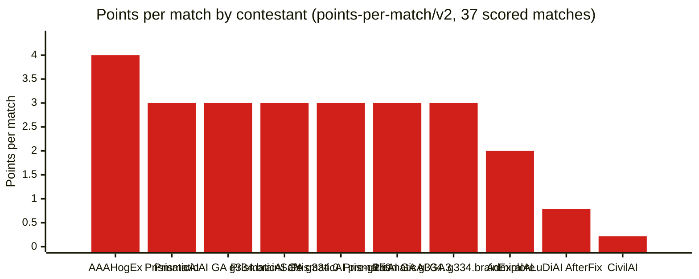
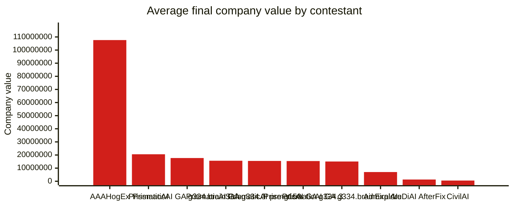
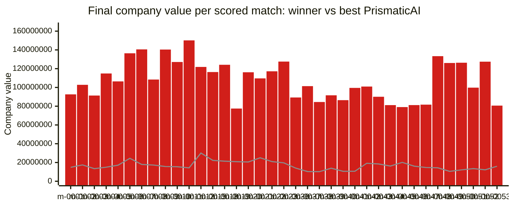
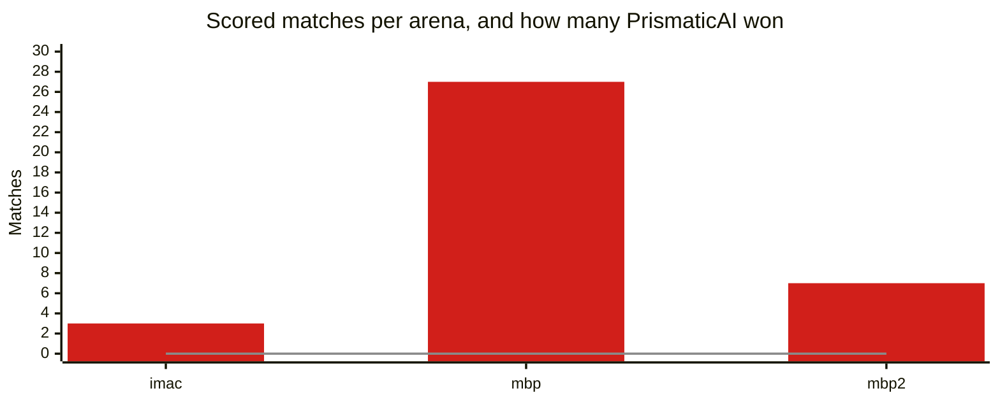

# battle-20261122T020945-6873c911

Derived from `battle-20261122T020945-6873c911.json` by `tools/research/ai-battle/battle.py report`; do not edit.

- Edition `6873c9111f5b8f8c`: PrismaticAI and referee at `8c8d025388e85261a60027d9983d8588d720a2e9`, base set `opengfx-8.0.tar`
- 20-year free-for-all from 1960, map 256x256 temperate, breakdowns 1
- 37 scored match(es) on `imac` (20261119-master-gdf1e05e7d8), `mbp` (20261120-master-m17653b726e), `mbp2` (20261119-master-gdf1e05e7d8)
- Replays: 0 of 0 identical to their original on another arena

| # | Contestant | Played | Wins | Points | Points/match | Avg rank | Avg final value | Squirrel errors | Matches with anomalies |
|---|---|---|---|---|---|---|---|---|---|
| 1 | AAAHogEx | 37 | 37 | 148 | 4.0 | 1.0 | 107.6 M | 0 | 0 |
| 2 | PrismaticAI | 6 | 0 | 18 | 3.0 | 2.0 | 20.6 M | 0 | 0 |
| 3 | PrismaticAI GA g334.brainSafe | 7 | 0 | 21 | 3.0 | 2.0 | 17.7 M | 0 | 0 |
| 4 | PrismaticAI GA g334.0 | 6 | 0 | 18 | 3.0 | 2.0 | 15.6 M | 0 | 0 |
| 5 | PrismaticAI pre-g150 | 6 | 0 | 18 | 3.0 | 2.0 | 15.5 M | 0 | 0 |
| 6 | PrismaticAI GA g334.3 | 6 | 0 | 18 | 3.0 | 2.0 | 15.4 M | 0 | 0 |
| 7 | PrismaticAI GA g334.brainExplore | 6 | 0 | 18 | 3.0 | 2.0 | 15.1 M | 0 | 0 |
| 8 | AdmiralAI | 37 | 0 | 74 | 2.0 | 3.0 | 7.0 M | 0 | 0 |
| 9 | LuDiAI AfterFix | 37 | 0 | 29 | 0.784 | 4.22 | 1.3 M | 0 | 3 |
| 10 | CivilAI | 37 | 0 | 8 | 0.216 | 4.78 | 531.0 k | 0 | 10 |

<!-- battle-charts:begin -->
<!-- derived from battle-20261122T020945-6873c911.json by `battle.py render`; `battle.py check` fails when it is stale -->

<!-- battle-charts:end -->

| Match | Arena | Seed | Winner | Value | Last | Anomalies |
|---|---|---|---|---|---|---|
| m-0001 | mbp | 407245137 | AAAHogEx | 92.6 M | CivilAI | CivilAI: fleet_drop:138->93 |
| m-0002 | mbp | 407245137 | AAAHogEx | 102.8 M | CivilAI | - |
| m-0003 | mbp | 407245137 | AAAHogEx | 91.4 M | CivilAI | - |
| m-0004 | mbp | 407245137 | AAAHogEx | 114.9 M | CivilAI | - |
| m-0005 | mbp | 407245137 | AAAHogEx | 106.4 M | CivilAI | - |
| m-0006 | mbp | 1844104682 | AAAHogEx | 136.4 M | CivilAI | CivilAI: fleet_drop:62->36 |
| m-0007 | mbp | 1844104682 | AAAHogEx | 140.6 M | CivilAI | - |
| m-0008 | mbp | 1844104682 | AAAHogEx | 108.4 M | CivilAI | - |
| m-0009 | mbp | 1844104682 | AAAHogEx | 140.4 M | CivilAI | - |
| m-0010 | imac | 1844104682 | AAAHogEx | 127.1 M | CivilAI | - |
| m-0011 | imac | 1844104682 | AAAHogEx | 150.2 M | CivilAI | - |
| m-0012 | imac | 1851255129 | AAAHogEx | 121.9 M | CivilAI | - |
| m-0015 | mbp2 | 1851255129 | AAAHogEx | 116.4 M | CivilAI | LuDiAI AfterFix: fleet_drop:152->58; CivilAI: fleet_drop:29->17 |
| m-0018 | mbp2 | 1217655480 | AAAHogEx | 124.1 M | LuDiAI AfterFix | - |
| m-0019 | mbp2 | 1217655480 | AAAHogEx | 77.5 M | LuDiAI AfterFix | - |
| m-0020 | mbp2 | 1217655480 | AAAHogEx | 116.2 M | LuDiAI AfterFix | CivilAI: no_vehicles |
| m-0021 | mbp2 | 1217655480 | AAAHogEx | 109.6 M | LuDiAI AfterFix | - |
| m-0022 | mbp2 | 1217655480 | AAAHogEx | 117.2 M | LuDiAI AfterFix | CivilAI: no_vehicles |
| m-0023 | mbp2 | 1217655480 | AAAHogEx | 127.6 M | LuDiAI AfterFix | - |
| m-0036 | mbp | 1995119021 | AAAHogEx | 89.3 M | CivilAI | - |
| m-0037 | mbp | 1995119021 | AAAHogEx | 101.4 M | CivilAI | - |
| m-0038 | mbp | 1995119021 | AAAHogEx | 84.5 M | CivilAI | - |
| m-0039 | mbp | 1995119021 | AAAHogEx | 91.6 M | CivilAI | LuDiAI AfterFix: fleet_drop:55->35 |
| m-0040 | mbp | 1995119021 | AAAHogEx | 86.4 M | CivilAI | LuDiAI AfterFix: fleet_drop:54->34; CivilAI: fleet_drop:23->7 |
| m-0041 | mbp | 1995119021 | AAAHogEx | 99.5 M | CivilAI | CivilAI: fleet_drop:41->17 |
| m-0042 | mbp | 516277951 | AAAHogEx | 100.9 M | CivilAI | - |
| m-0043 | mbp | 516277951 | AAAHogEx | 90.1 M | CivilAI | - |
| m-0044 | mbp | 516277951 | AAAHogEx | 81.2 M | CivilAI | - |
| m-0045 | mbp | 516277951 | AAAHogEx | 79.1 M | CivilAI | CivilAI: fleet_drop:43->5 |
| m-0046 | mbp | 516277951 | AAAHogEx | 81.2 M | CivilAI | - |
| m-0047 | mbp | 516277951 | AAAHogEx | 81.7 M | CivilAI | - |
| m-0048 | mbp | 1953022544 | AAAHogEx | 133.3 M | CivilAI | - |
| m-0049 | mbp | 1953022544 | AAAHogEx | 126.1 M | CivilAI | - |
| m-0050 | mbp | 1953022544 | AAAHogEx | 126.3 M | LuDiAI AfterFix | CivilAI: fleet_drop:48->21 |
| m-0051 | mbp | 1953022544 | AAAHogEx | 99.8 M | CivilAI | - |
| m-0052 | mbp | 1953022544 | AAAHogEx | 127.5 M | CivilAI | CivilAI: fleet_drop:48->27 |
| m-0053 | mbp | 1953022544 | AAAHogEx | 80.6 M | LuDiAI AfterFix | - |
