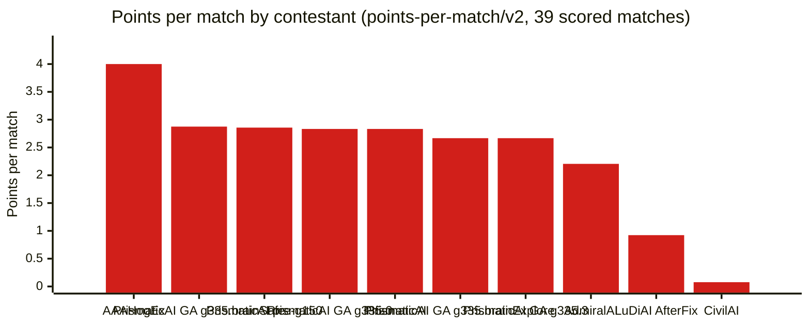
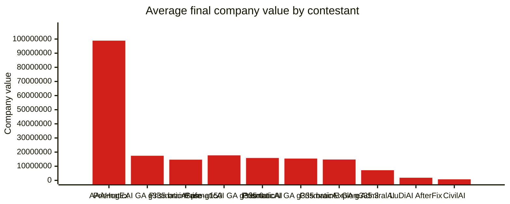
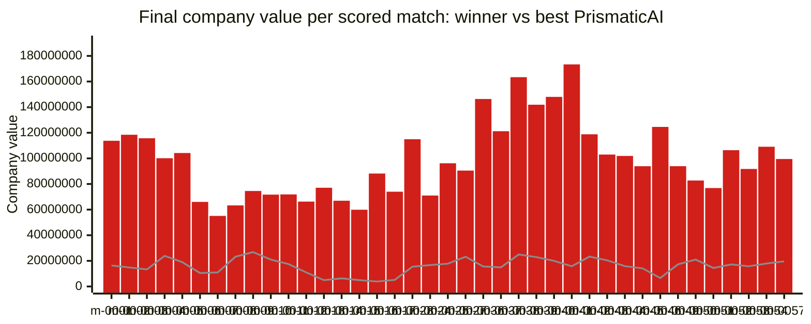
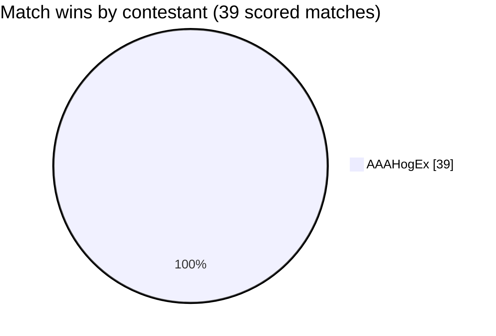
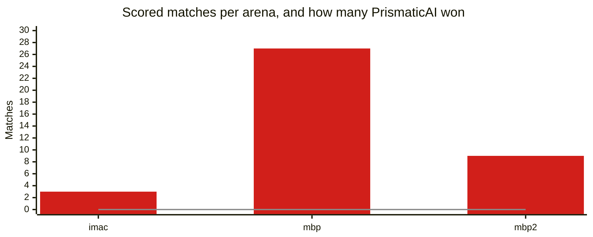

# battle-20261122T022123-113d6ccc

Derived from `battle-20261122T022123-113d6ccc.json` by `tools/research/ai-battle/battle.py report`; do not edit.

- Edition `113d6cccf21829fe`: PrismaticAI and referee at `8c8d025388e85261a60027d9983d8588d720a2e9`, base set `opengfx-8.0.tar`
- 20-year free-for-all from 1960, map 256x256 temperate, breakdowns 1
- 39 scored match(es) on `imac` (20261119-master-gdf1e05e7d8), `mbp` (20261120-master-m17653b726e), `mbp2` (20261119-master-gdf1e05e7d8)
- Replays: 0 of 1 identical to their original on another arena

| # | Contestant | Played | Wins | Points | Points/match | Avg rank | Avg final value | Squirrel errors | Matches with anomalies |
|---|---|---|---|---|---|---|---|---|---|
| 1 | AAAHogEx | 39 | 39 | 156 | 4.0 | 1.0 | 98.9 M | 0 | 1 |
| 2 | PrismaticAI GA g335.brainSafe | 8 | 0 | 23 | 2.875 | 2.12 | 17.4 M | 0 | 0 |
| 3 | PrismaticAI pre-g150 | 7 | 0 | 20 | 2.857 | 2.14 | 14.7 M | 0 | 0 |
| 4 | PrismaticAI GA g335.0 | 6 | 0 | 17 | 2.833 | 2.17 | 17.7 M | 0 | 0 |
| 5 | PrismaticAI | 6 | 0 | 17 | 2.833 | 2.17 | 15.8 M | 0 | 0 |
| 6 | PrismaticAI GA g335.brainExplore | 6 | 0 | 16 | 2.667 | 2.33 | 15.4 M | 0 | 0 |
| 7 | PrismaticAI GA g335.3 | 6 | 0 | 16 | 2.667 | 2.33 | 14.8 M | 0 | 0 |
| 8 | AdmiralAI | 39 | 0 | 86 | 2.205 | 2.79 | 7.2 M | 0 | 4 |
| 9 | LuDiAI AfterFix | 39 | 0 | 36 | 0.923 | 4.08 | 1.9 M | 0 | 0 |
| 10 | CivilAI | 39 | 0 | 3 | 0.077 | 4.92 | 740.4 k | 0 | 7 |

<!-- battle-charts:begin -->
<!-- derived from battle-20261122T022123-113d6ccc.json by `battle.py render`; `battle.py check` fails when it is stale -->

<!-- battle-charts:end -->

| Seed | Original | Replay | Arenas | Identical |
|---|---|---|---|---|
| 180877948 | m-0012 | m-0048 | imac / mbp | NO |

| Match | Arena | Seed | Winner | Value | Last | Anomalies |
|---|---|---|---|---|---|---|
| m-0001 | mbp | 1969309436 | AAAHogEx | 113.7 M | CivilAI | CivilAI: fleet_drop:29->12 |
| m-0002 | mbp | 1969309436 | AAAHogEx | 118.4 M | CivilAI | - |
| m-0003 | mbp | 1969309436 | AAAHogEx | 115.7 M | CivilAI | CivilAI: fleet_drop:26->7 |
| m-0004 | mbp | 1969309436 | AAAHogEx | 100.1 M | CivilAI | - |
| m-0005 | mbp | 1969309436 | AAAHogEx | 104.2 M | CivilAI | - |
| m-0006 | mbp | 1682506640 | AAAHogEx | 66.0 M | CivilAI | - |
| m-0007 | mbp | 1682506640 | AAAHogEx | 55.1 M | CivilAI | AdmiralAI: fleet_drop:455->308 |
| m-0008 | mbp | 1682506640 | AAAHogEx | 63.3 M | CivilAI | CivilAI: fleet_drop:40->23 |
| m-0009 | mbp | 1682506640 | AAAHogEx | 74.5 M | CivilAI | AdmiralAI: fleet_drop:135->33 |
| m-0010 | imac | 1682506640 | AAAHogEx | 71.7 M | CivilAI | CivilAI: fleet_drop:45->27 |
| m-0011 | imac | 1682506640 | AAAHogEx | 71.9 M | CivilAI | - |
| m-0012 | imac | 180877948 | AAAHogEx | 66.3 M | CivilAI | CivilAI: fleet_drop:36->21 |
| m-0013 | mbp2 | 180877948 | AAAHogEx | 77.1 M | CivilAI | - |
| m-0014 | mbp2 | 180877948 | AAAHogEx | 66.9 M | CivilAI | AAAHogEx: fleet_drop:566->382 |
| m-0015 | mbp2 | 180877948 | AAAHogEx | 59.9 M | CivilAI | - |
| m-0016 | mbp2 | 180877948 | AAAHogEx | 88.2 M | CivilAI | CivilAI: fleet_drop:17->8 |
| m-0017 | mbp2 | 180877948 | AAAHogEx | 74.0 M | CivilAI | - |
| m-0023 | mbp2 | 1346788318 | AAAHogEx | 115.0 M | LuDiAI AfterFix | - |
| m-0024 | mbp2 | 1573460213 | AAAHogEx | 71.0 M | LuDiAI AfterFix | - |
| m-0025 | mbp2 | 1573460213 | AAAHogEx | 96.2 M | CivilAI | - |
| m-0027 | mbp2 | 1573460213 | AAAHogEx | 90.5 M | CivilAI | - |
| m-0036 | mbp | 364328552 | AAAHogEx | 146.4 M | CivilAI | - |
| m-0037 | mbp | 364328552 | AAAHogEx | 121.2 M | CivilAI | - |
| m-0038 | mbp | 364328552 | AAAHogEx | 163.4 M | CivilAI | - |
| m-0039 | mbp | 364328552 | AAAHogEx | 141.9 M | CivilAI | - |
| m-0040 | mbp | 364328552 | AAAHogEx | 148.0 M | CivilAI | - |
| m-0041 | mbp | 364328552 | AAAHogEx | 173.4 M | CivilAI | - |
| m-0042 | mbp | 1313172784 | AAAHogEx | 118.8 M | LuDiAI AfterFix | AdmiralAI: fleet_drop:389->268 |
| m-0043 | mbp | 1313172784 | AAAHogEx | 103.0 M | CivilAI | AdmiralAI: fleet_drop:358->240; CivilAI: fleet_drop:34->22 |
| m-0044 | mbp | 1313172784 | AAAHogEx | 101.9 M | CivilAI | - |
| m-0045 | mbp | 1313172784 | AAAHogEx | 93.9 M | CivilAI | - |
| m-0046 | mbp | 1313172784 | AAAHogEx | 124.6 M | CivilAI | - |
| m-0048 (replay) | mbp | 180877948 | AAAHogEx | 60.8 M | CivilAI | CivilAI: fleet_drop:33->15 |
| m-0049 | mbp | 297374650 | AAAHogEx | 93.9 M | CivilAI | - |
| m-0050 | mbp | 297374650 | AAAHogEx | 82.7 M | CivilAI | - |
| m-0051 | mbp | 297374650 | AAAHogEx | 76.8 M | CivilAI | - |
| m-0052 | mbp | 297374650 | AAAHogEx | 106.4 M | CivilAI | - |
| m-0053 | mbp | 297374650 | AAAHogEx | 91.7 M | CivilAI | - |
| m-0054 | mbp | 892266886 | AAAHogEx | 109.1 M | CivilAI | - |
| m-0057 | mbp | 892266886 | AAAHogEx | 99.5 M | CivilAI | - |
