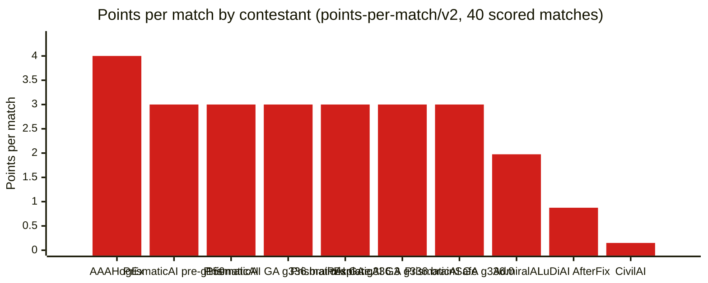
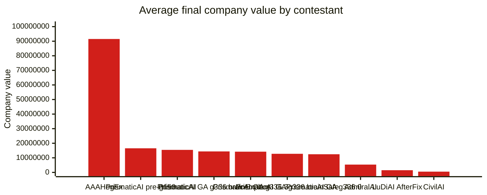
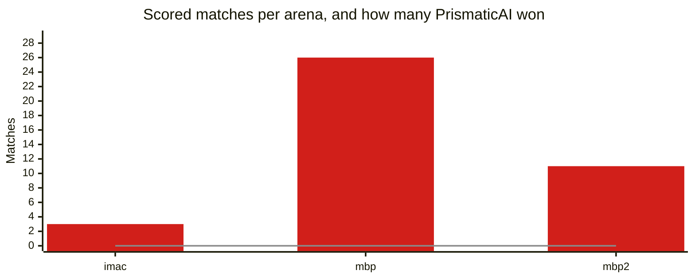

# battle-20261122T023249-007e4e6c

Derived from `battle-20261122T023249-007e4e6c.json` by `tools/research/ai-battle/battle.py report`; do not edit.

- Edition `007e4e6c89cfe163`: PrismaticAI and referee at `8c8d025388e85261a60027d9983d8588d720a2e9`, base set `opengfx-8.0.tar`
- 20-year free-for-all from 1960, map 256x256 temperate, breakdowns 1
- 40 scored match(es) on `imac` (20261119-master-gdf1e05e7d8), `mbp` (20261120-master-m17653b726e), `mbp2` (20261119-master-gdf1e05e7d8)
- Replays: 0 of 1 identical to their original on another arena

| # | Contestant | Played | Wins | Points | Points/match | Avg rank | Avg final value | Squirrel errors | Matches with anomalies |
|---|---|---|---|---|---|---|---|---|---|
| 1 | AAAHogEx | 40 | 40 | 160 | 4.0 | 1.0 | 91.5 M | 0 | 0 |
| 2 | PrismaticAI pre-g150 | 7 | 0 | 21 | 3.0 | 2.0 | 16.5 M | 0 | 0 |
| 3 | PrismaticAI | 6 | 0 | 18 | 3.0 | 2.0 | 15.5 M | 0 | 0 |
| 4 | PrismaticAI GA g336.brainExplore | 8 | 0 | 24 | 3.0 | 2.0 | 14.4 M | 0 | 0 |
| 5 | PrismaticAI GA g336.3 | 6 | 0 | 18 | 3.0 | 2.0 | 14.2 M | 0 | 0 |
| 6 | PrismaticAI GA g336.brainSafe | 6 | 0 | 18 | 3.0 | 2.0 | 12.8 M | 0 | 0 |
| 7 | PrismaticAI GA g336.0 | 7 | 0 | 21 | 3.0 | 2.0 | 12.5 M | 0 | 0 |
| 8 | AdmiralAI | 40 | 0 | 79 | 1.975 | 3.02 | 5.4 M | 0 | 2 |
| 9 | LuDiAI AfterFix | 40 | 0 | 35 | 0.875 | 4.12 | 1.5 M | 0 | 4 |
| 10 | CivilAI | 40 | 0 | 6 | 0.15 | 4.85 | 527.5 k | 0 | 5 |

```mermaid
---
config:
  xyChart:
    width: 900
    height: 360
  themeVariables:
    xyChart:
      plotColorPalette: "#d11f1a, #8a8a8a, #0b0b0b, #ece4d6"
---
xychart-beta
    title "Final company value per scored match: winner vs best PrismaticAI"
    x-axis ["m-0001", "m-0002", "m-0003", "m-0004", "m-0005", "m-0006", "m-0007", "m-0008", "m-0009", "m-0010", "m-0011", "m-0012", "m-0013", "m-0014", "m-0015", "m-0016", "m-0017", "m-0022", "m-0024", "m-0025", "m-0026", "m-0027", "m-0028", "m-0036", "m-0037", "m-0038", "m-0039", "m-0040", "m-0041", "m-0042", "m-0043", "m-0044", "m-0046", "m-0047", "m-0049", "m-0050", "m-0051", "m-0052", "m-0053", "m-0054"]
    %% series: Winner | Best PrismaticAI
    %% links: battle-20261122T023249-007e4e6c.md?col=Match&filter=m-0001 | battle-20261122T023249-007e4e6c.md?col=Match&filter=m-0002 | battle-20261122T023249-007e4e6c.md?col=Match&filter=m-0003 | battle-20261122T023249-007e4e6c.md?col=Match&filter=m-0004 | battle-20261122T023249-007e4e6c.md?col=Match&filter=m-0005 | battle-20261122T023249-007e4e6c.md?col=Match&filter=m-0006 | battle-20261122T023249-007e4e6c.md?col=Match&filter=m-0007 | battle-20261122T023249-007e4e6c.md?col=Match&filter=m-0008 | battle-20261122T023249-007e4e6c.md?col=Match&filter=m-0009 | battle-20261122T023249-007e4e6c.md?col=Match&filter=m-0010 | battle-20261122T023249-007e4e6c.md?col=Match&filter=m-0011 | battle-20261122T023249-007e4e6c.md?col=Match&filter=m-0012 | battle-20261122T023249-007e4e6c.md?col=Match&filter=m-0013 | battle-20261122T023249-007e4e6c.md?col=Match&filter=m-0014 | battle-20261122T023249-007e4e6c.md?col=Match&filter=m-0015 | battle-20261122T023249-007e4e6c.md?col=Match&filter=m-0016 | battle-20261122T023249-007e4e6c.md?col=Match&filter=m-0017 | battle-20261122T023249-007e4e6c.md?col=Match&filter=m-0022 | battle-20261122T023249-007e4e6c.md?col=Match&filter=m-0024 | battle-20261122T023249-007e4e6c.md?col=Match&filter=m-0025 | battle-20261122T023249-007e4e6c.md?col=Match&filter=m-0026 | battle-20261122T023249-007e4e6c.md?col=Match&filter=m-0027 | battle-20261122T023249-007e4e6c.md?col=Match&filter=m-0028 | battle-20261122T023249-007e4e6c.md?col=Match&filter=m-0036 | battle-20261122T023249-007e4e6c.md?col=Match&filter=m-0037 | battle-20261122T023249-007e4e6c.md?col=Match&filter=m-0038 | battle-20261122T023249-007e4e6c.md?col=Match&filter=m-0039 | battle-20261122T023249-007e4e6c.md?col=Match&filter=m-0040 | battle-20261122T023249-007e4e6c.md?col=Match&filter=m-0041 | battle-20261122T023249-007e4e6c.md?col=Match&filter=m-0042 | battle-20261122T023249-007e4e6c.md?col=Match&filter=m-0043 | battle-20261122T023249-007e4e6c.md?col=Match&filter=m-0044 | battle-20261122T023249-007e4e6c.md?col=Match&filter=m-0046 | battle-20261122T023249-007e4e6c.md?col=Match&filter=m-0047 | battle-20261122T023249-007e4e6c.md?col=Match&filter=m-0049 | battle-20261122T023249-007e4e6c.md?col=Match&filter=m-0050 | battle-20261122T023249-007e4e6c.md?col=Match&filter=m-0051 | battle-20261122T023249-007e4e6c.md?col=Match&filter=m-0052 | battle-20261122T023249-007e4e6c.md?col=Match&filter=m-0053 | battle-20261122T023249-007e4e6c.md?col=Match&filter=m-0054
    y-axis "Company value" 0 --> 183000000
    bar [125826795, 119187512, 119187512, 129824641, 116628667, 72736849, 66120553, 71031152, 71031152, 55428422, 59959441, 68918448, 80034229, 84723747, 84723747, 81178679, 66568602, 166561338, 81722147, 92947272, 94650386, 94650386, 69524446, 80867644, 58299399, 63722804, 63722804, 61770892, 57918248, 125344408, 152207428, 123666361, 115729869, 122959633, 51670563, 102337996, 102337996, 101818246, 108806604, 94322414]
    line [17947533, 18642213, 18642213, 11368356, 12146847, 14950033, 13975428, 9835415, 9835415, 13840156, 18860919, 18004562, 16927003, 11585816, 11585816, 13340664, 13167820, 23377083, 21097276, 17213857, 13715757, 13715757, 13126002, 12872697, 17590794, 10159622, 10159622, 10385690, 13336992, 12158273, 13358797, 10651628, 11205643, 13687741, 18780936, 12641336, 12641336, 18531031, 14140829, 13658792]
```

<!-- battle-charts:begin -->
<!-- derived from battle-20261122T023249-007e4e6c.json by `battle.py render`; `battle.py check` fails when it is stale -->

<!-- battle-charts:end -->

| Seed | Original | Replay | Arenas | Identical |
|---|---|---|---|---|
| 269932071 | m-0012 | m-0048 | imac / mbp | NO |

| Match | Arena | Seed | Winner | Value | Last | Anomalies |
|---|---|---|---|---|---|---|
| m-0001 | mbp | 119982385 | AAAHogEx | 125.8 M | CivilAI | - |
| m-0002 | mbp | 119982385 | AAAHogEx | 119.2 M | CivilAI | - |
| m-0003 | mbp | 119982385 | AAAHogEx | 119.2 M | CivilAI | - |
| m-0004 | mbp | 119982385 | AAAHogEx | 129.8 M | CivilAI | - |
| m-0005 | mbp | 119982385 | AAAHogEx | 116.6 M | CivilAI | - |
| m-0006 | mbp | 863838332 | AAAHogEx | 72.7 M | CivilAI | - |
| m-0007 | mbp | 863838332 | AAAHogEx | 66.1 M | CivilAI | - |
| m-0008 | mbp | 863838332 | AAAHogEx | 71.0 M | CivilAI | - |
| m-0009 | mbp | 863838332 | AAAHogEx | 71.0 M | CivilAI | - |
| m-0010 | imac | 863838332 | AAAHogEx | 55.4 M | CivilAI | CivilAI: fleet_drop:31->13 |
| m-0011 | imac | 863838332 | AAAHogEx | 60.0 M | CivilAI | - |
| m-0012 | imac | 269932071 | AAAHogEx | 68.9 M | CivilAI | - |
| m-0013 | mbp2 | 269932071 | AAAHogEx | 80.0 M | CivilAI | - |
| m-0014 | mbp2 | 269932071 | AAAHogEx | 84.7 M | LuDiAI AfterFix | CivilAI: fleet_drop:29->19 |
| m-0015 | mbp2 | 269932071 | AAAHogEx | 84.7 M | LuDiAI AfterFix | CivilAI: fleet_drop:29->19 |
| m-0016 | mbp2 | 269932071 | AAAHogEx | 81.2 M | LuDiAI AfterFix | - |
| m-0017 | mbp2 | 269932071 | AAAHogEx | 66.6 M | LuDiAI AfterFix | - |
| m-0022 | mbp2 | 1856471129 | AAAHogEx | 166.6 M | CivilAI | - |
| m-0024 | mbp2 | 1468136484 | AAAHogEx | 81.7 M | CivilAI | AdmiralAI: fleet_drop:281->167; CivilAI: fleet_drop:41->21 |
| m-0025 | mbp2 | 1468136484 | AAAHogEx | 92.9 M | CivilAI | - |
| m-0026 | mbp2 | 1468136484 | AAAHogEx | 94.7 M | CivilAI | LuDiAI AfterFix: fleet_drop:118->74 |
| m-0027 | mbp2 | 1468136484 | AAAHogEx | 94.7 M | CivilAI | LuDiAI AfterFix: fleet_drop:118->74 |
| m-0028 | mbp2 | 1468136484 | AAAHogEx | 69.5 M | CivilAI | AdmiralAI: fleet_drop:298->204 |
| m-0036 | mbp | 1096160927 | AAAHogEx | 80.9 M | CivilAI | - |
| m-0037 | mbp | 1096160927 | AAAHogEx | 58.3 M | CivilAI | LuDiAI AfterFix: fleet_drop:91->54 |
| m-0038 | mbp | 1096160927 | AAAHogEx | 63.7 M | CivilAI | - |
| m-0039 | mbp | 1096160927 | AAAHogEx | 63.7 M | CivilAI | - |
| m-0040 | mbp | 1096160927 | AAAHogEx | 61.8 M | CivilAI | CivilAI: fleet_drop:12->8 |
| m-0041 | mbp | 1096160927 | AAAHogEx | 57.9 M | CivilAI | - |
| m-0042 | mbp | 687620135 | AAAHogEx | 125.3 M | CivilAI | - |
| m-0043 | mbp | 687620135 | AAAHogEx | 152.2 M | CivilAI | - |
| m-0044 | mbp | 687620135 | AAAHogEx | 123.7 M | CivilAI | - |
| m-0046 | mbp | 687620135 | AAAHogEx | 115.7 M | CivilAI | - |
| m-0047 | mbp | 687620135 | AAAHogEx | 123.0 M | CivilAI | - |
| m-0048 (replay) | mbp | 269932071 | AAAHogEx | 70.6 M | CivilAI | - |
| m-0049 | mbp | 1705108175 | AAAHogEx | 51.7 M | CivilAI | - |
| m-0050 | mbp | 1705108175 | AAAHogEx | 102.3 M | CivilAI | - |
| m-0051 | mbp | 1705108175 | AAAHogEx | 102.3 M | CivilAI | - |
| m-0052 | mbp | 1705108175 | AAAHogEx | 101.8 M | LuDiAI AfterFix | - |
| m-0053 | mbp | 1705108175 | AAAHogEx | 108.8 M | CivilAI | LuDiAI AfterFix: fleet_drop:140->84 |
| m-0054 | mbp | 963192977 | AAAHogEx | 94.3 M | LuDiAI AfterFix | - |
