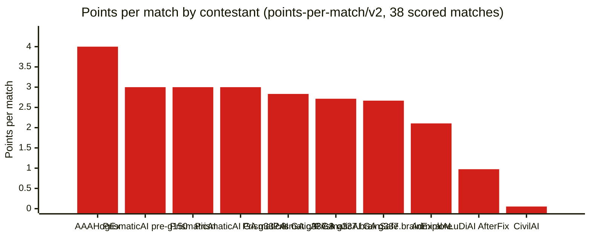
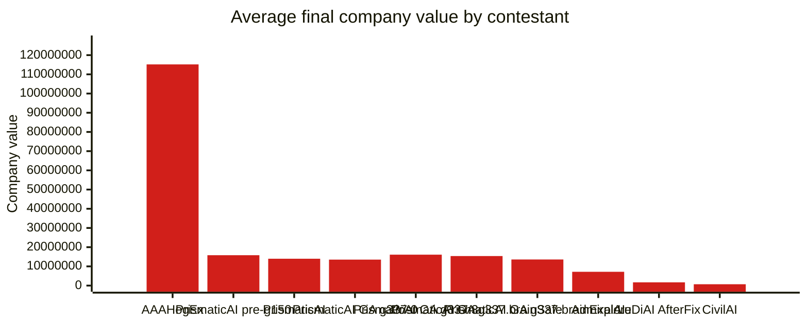
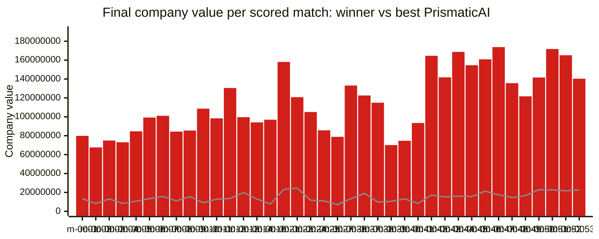
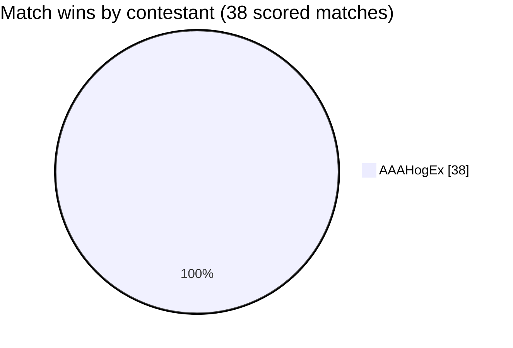
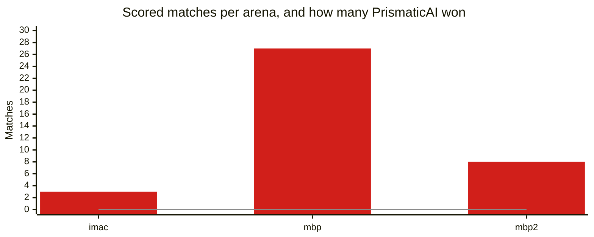

# battle-20261122T024427-f28c33e9

Derived from `battle-20261122T024427-f28c33e9.json` by `tools/research/ai-battle/battle.py report`; do not edit.

- Edition `f28c33e990da5071`: PrismaticAI and referee at `8c8d025388e85261a60027d9983d8588d720a2e9`, base set `opengfx-8.0.tar`
- 20-year free-for-all from 1960, map 256x256 temperate, breakdowns 1
- 38 scored match(es) on `imac` (20261119-master-gdf1e05e7d8), `mbp` (20261120-master-m17653b726e), `mbp2` (20261119-master-gdf1e05e7d8)
- Replays: 0 of 0 identical to their original on another arena

| # | Contestant | Played | Wins | Points | Points/match | Avg rank | Avg final value | Squirrel errors | Matches with anomalies |
|---|---|---|---|---|---|---|---|---|---|
| 1 | AAAHogEx | 38 | 38 | 152 | 4.0 | 1.0 | 115.2 M | 0 | 0 |
| 2 | PrismaticAI pre-g150 | 7 | 0 | 21 | 3.0 | 2.0 | 15.8 M | 0 | 0 |
| 3 | PrismaticAI | 6 | 0 | 18 | 3.0 | 2.0 | 14.0 M | 0 | 0 |
| 4 | PrismaticAI GA g337.0 | 6 | 0 | 18 | 3.0 | 2.0 | 13.5 M | 0 | 0 |
| 5 | PrismaticAI GA g337.3 | 6 | 0 | 17 | 2.833 | 2.17 | 16.1 M | 0 | 0 |
| 6 | PrismaticAI GA g337.brainSafe | 7 | 0 | 19 | 2.714 | 2.29 | 15.4 M | 0 | 0 |
| 7 | PrismaticAI GA g337.brainExplore | 6 | 0 | 16 | 2.667 | 2.33 | 13.6 M | 0 | 0 |
| 8 | AdmiralAI | 38 | 0 | 80 | 2.105 | 2.89 | 7.2 M | 59 | 1 |
| 9 | LuDiAI AfterFix | 38 | 0 | 37 | 0.974 | 4.03 | 1.7 M | 0 | 1 |
| 10 | CivilAI | 38 | 0 | 2 | 0.053 | 4.95 | 699.5 k | 0 | 11 |

<!-- battle-charts:begin -->
<!-- derived from battle-20261122T024427-f28c33e9.json by `battle.py render`; `battle.py check` fails when it is stale -->

<!-- battle-charts:end -->

| Match | Arena | Seed | Winner | Value | Last | Anomalies |
|---|---|---|---|---|---|---|
| m-0001 | mbp | 425116958 | AAAHogEx | 79.8 M | CivilAI | - |
| m-0002 | mbp | 425116958 | AAAHogEx | 67.6 M | CivilAI | CivilAI: fleet_drop:30->8 |
| m-0003 | mbp | 425116958 | AAAHogEx | 74.9 M | CivilAI | - |
| m-0004 | mbp | 425116958 | AAAHogEx | 73.1 M | CivilAI | - |
| m-0005 | mbp | 425116958 | AAAHogEx | 84.7 M | CivilAI | CivilAI: fleet_drop:65->42 |
| m-0006 | mbp | 119684552 | AAAHogEx | 99.3 M | CivilAI | AdmiralAI: squirrel_errors:59; CivilAI: fleet_drop:51->33 |
| m-0007 | mbp | 119684552 | AAAHogEx | 101.1 M | CivilAI | - |
| m-0008 | mbp | 119684552 | AAAHogEx | 84.4 M | CivilAI | CivilAI: fleet_drop:43->12 |
| m-0009 | mbp | 119684552 | AAAHogEx | 85.5 M | CivilAI | CivilAI: fleet_drop:54->32 |
| m-0010 | imac | 119684552 | AAAHogEx | 108.7 M | CivilAI | CivilAI: fleet_drop:57->28 |
| m-0011 | imac | 119684552 | AAAHogEx | 98.4 M | CivilAI | CivilAI: fleet_drop:51->27 |
| m-0012 | imac | 681967205 | AAAHogEx | 130.5 M | CivilAI | CivilAI: fleet_drop:58->25 |
| m-0013 | mbp2 | 681967205 | AAAHogEx | 99.6 M | CivilAI | - |
| m-0014 | mbp2 | 681967205 | AAAHogEx | 94.1 M | CivilAI | - |
| m-0016 | mbp2 | 681967205 | AAAHogEx | 96.9 M | CivilAI | - |
| m-0021 | mbp2 | 1754336080 | AAAHogEx | 158.1 M | CivilAI | - |
| m-0023 | mbp2 | 1754336080 | AAAHogEx | 120.8 M | CivilAI | - |
| m-0024 | mbp2 | 1476125677 | AAAHogEx | 105.1 M | CivilAI | CivilAI: fleet_drop:11->3 |
| m-0025 | mbp2 | 1476125677 | AAAHogEx | 85.7 M | CivilAI | - |
| m-0027 | mbp2 | 1476125677 | AAAHogEx | 78.9 M | CivilAI | - |
| m-0036 | mbp | 960360986 | AAAHogEx | 133.1 M | CivilAI | - |
| m-0037 | mbp | 960360986 | AAAHogEx | 122.6 M | CivilAI | - |
| m-0038 | mbp | 960360986 | AAAHogEx | 114.9 M | CivilAI | - |
| m-0039 | mbp | 960360986 | AAAHogEx | 70.1 M | CivilAI | LuDiAI AfterFix: fleet_drop:209->107 |
| m-0040 | mbp | 960360986 | AAAHogEx | 74.7 M | CivilAI | - |
| m-0041 | mbp | 960360986 | AAAHogEx | 93.5 M | CivilAI | - |
| m-0042 | mbp | 176193108 | AAAHogEx | 164.6 M | CivilAI | CivilAI: fleet_drop:32->7 |
| m-0043 | mbp | 176193108 | AAAHogEx | 141.8 M | CivilAI | - |
| m-0044 | mbp | 176193108 | AAAHogEx | 168.7 M | CivilAI | - |
| m-0045 | mbp | 176193108 | AAAHogEx | 154.6 M | CivilAI | - |
| m-0046 | mbp | 176193108 | AAAHogEx | 160.9 M | CivilAI | - |
| m-0047 | mbp | 176193108 | AAAHogEx | 173.8 M | CivilAI | - |
| m-0048 | mbp | 1940437681 | AAAHogEx | 135.6 M | CivilAI | - |
| m-0049 | mbp | 1940437681 | AAAHogEx | 121.7 M | CivilAI | - |
| m-0050 | mbp | 1940437681 | AAAHogEx | 141.6 M | LuDiAI AfterFix | - |
| m-0051 | mbp | 1940437681 | AAAHogEx | 171.8 M | CivilAI | CivilAI: fleet_drop:63->31 |
| m-0052 | mbp | 1940437681 | AAAHogEx | 165.2 M | CivilAI | - |
| m-0053 | mbp | 1940437681 | AAAHogEx | 140.4 M | LuDiAI AfterFix | - |
