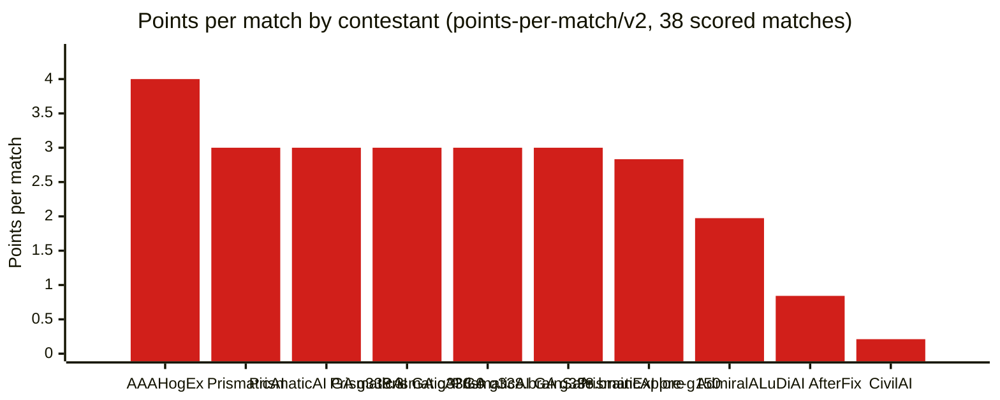
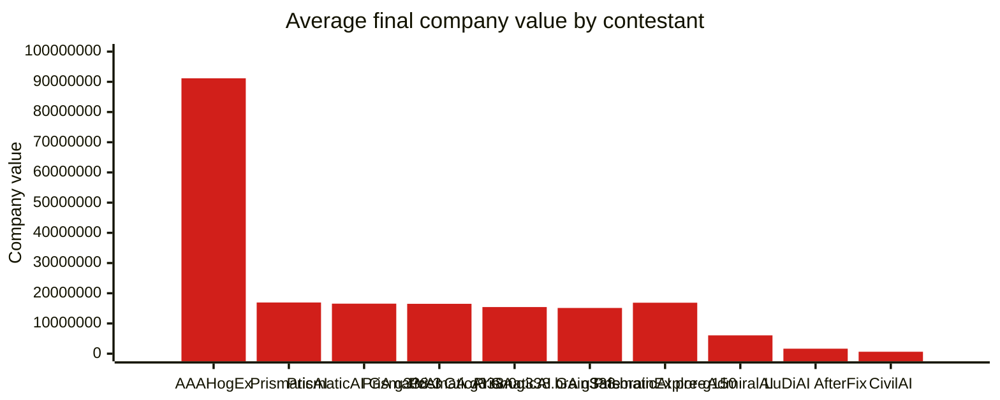
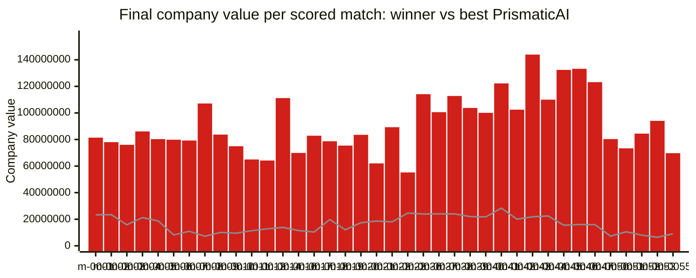
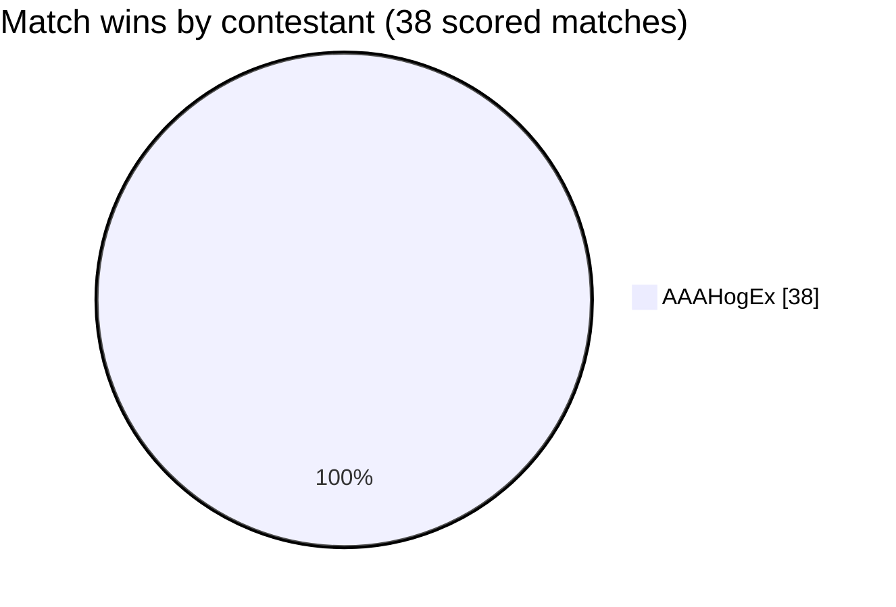
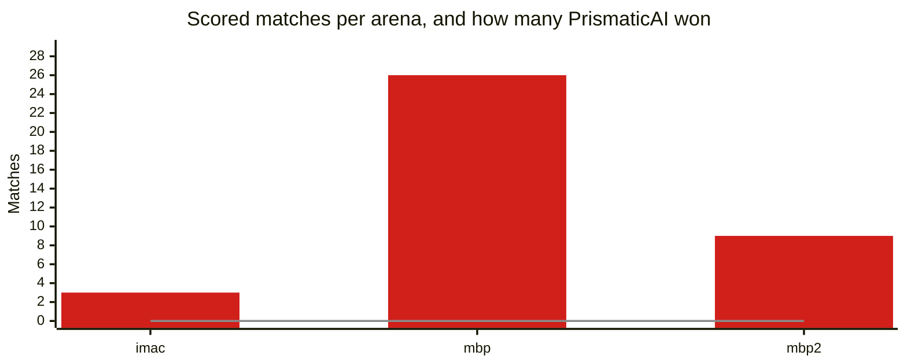

# battle-20261122T025436-606754c2

Derived from `battle-20261122T025436-606754c2.json` by `tools/research/ai-battle/battle.py report`; do not edit.

- Edition `606754c2f7df6808`: PrismaticAI and referee at `8c8d025388e85261a60027d9983d8588d720a2e9`, base set `opengfx-8.0.tar`
- 20-year free-for-all from 1960, map 256x256 temperate, breakdowns 1
- 38 scored match(es) on `imac` (20261119-master-gdf1e05e7d8), `mbp` (20261120-master-m17653b726e), `mbp2` (20261119-master-gdf1e05e7d8)
- Replays: 0 of 1 identical to their original on another arena

| # | Contestant | Played | Wins | Points | Points/match | Avg rank | Avg final value | Squirrel errors | Matches with anomalies |
|---|---|---|---|---|---|---|---|---|---|
| 1 | AAAHogEx | 38 | 38 | 152 | 4.0 | 1.0 | 91.2 M | 0 | 0 |
| 2 | PrismaticAI | 5 | 0 | 15 | 3.0 | 2.0 | 16.9 M | 0 | 0 |
| 3 | PrismaticAI GA g338.3 | 7 | 0 | 21 | 3.0 | 2.0 | 16.6 M | 0 | 0 |
| 4 | PrismaticAI GA g338.0 | 7 | 0 | 21 | 3.0 | 2.0 | 16.5 M | 0 | 0 |
| 5 | PrismaticAI GA g338.brainSafe | 6 | 0 | 18 | 3.0 | 2.0 | 15.4 M | 0 | 0 |
| 6 | PrismaticAI GA g338.brainExplore | 7 | 0 | 21 | 3.0 | 2.0 | 15.1 M | 0 | 0 |
| 7 | PrismaticAI pre-g150 | 6 | 0 | 17 | 2.833 | 2.17 | 16.9 M | 0 | 0 |
| 8 | AdmiralAI | 38 | 0 | 75 | 1.974 | 3.03 | 6.1 M | 94 | 4 |
| 9 | LuDiAI AfterFix | 38 | 0 | 32 | 0.842 | 4.16 | 1.7 M | 0 | 4 |
| 10 | CivilAI | 38 | 0 | 8 | 0.211 | 4.79 | 637.4 k | 0 | 12 |

<!-- battle-charts:begin -->
<!-- derived from battle-20261122T025436-606754c2.json by `battle.py render`; `battle.py check` fails when it is stale -->

<!-- battle-charts:end -->

| Seed | Original | Replay | Arenas | Identical |
|---|---|---|---|---|
| 1027876802 | m-0010 | m-0048 | imac / mbp | NO |

| Match | Arena | Seed | Winner | Value | Last | Anomalies |
|---|---|---|---|---|---|---|
| m-0001 | mbp | 578127460 | AAAHogEx | 81.4 M | CivilAI | CivilAI: fleet_drop:70->37 |
| m-0002 | mbp | 578127460 | AAAHogEx | 78.0 M | CivilAI | AdmiralAI: squirrel_errors:47 |
| m-0003 | mbp | 578127460 | AAAHogEx | 76.0 M | CivilAI | AdmiralAI: squirrel_errors:47 |
| m-0004 | mbp | 578127460 | AAAHogEx | 86.1 M | CivilAI | - |
| m-0005 | mbp | 578127460 | AAAHogEx | 80.3 M | CivilAI | - |
| m-0006 | mbp | 1027876802 | AAAHogEx | 79.8 M | CivilAI | CivilAI: fleet_drop:61->26 |
| m-0007 | mbp | 1027876802 | AAAHogEx | 79.2 M | CivilAI | CivilAI: fleet_drop:66->43 |
| m-0008 | mbp | 1027876802 | AAAHogEx | 107.1 M | CivilAI | - |
| m-0009 | mbp | 1027876802 | AAAHogEx | 83.7 M | CivilAI | - |
| m-0010 | imac | 1027876802 | AAAHogEx | 74.9 M | CivilAI | - |
| m-0011 | imac | 1027876802 | AAAHogEx | 65.0 M | CivilAI | - |
| m-0012 | imac | 604917465 | AAAHogEx | 64.2 M | CivilAI | CivilAI: fleet_drop:27->3 |
| m-0014 | mbp2 | 604917465 | AAAHogEx | 111.2 M | CivilAI | AdmiralAI: fleet_drop:169->106 |
| m-0016 | mbp2 | 604917465 | AAAHogEx | 69.9 M | CivilAI | - |
| m-0017 | mbp2 | 604917465 | AAAHogEx | 82.9 M | CivilAI | CivilAI: fleet_drop:58->32 |
| m-0018 | mbp2 | 1176570598 | AAAHogEx | 78.7 M | CivilAI | CivilAI: fleet_drop:39->19 |
| m-0019 | mbp2 | 1176570598 | AAAHogEx | 75.4 M | CivilAI | - |
| m-0020 | mbp2 | 1176570598 | AAAHogEx | 83.5 M | CivilAI | - |
| m-0021 | mbp2 | 1176570598 | AAAHogEx | 62.0 M | LuDiAI AfterFix | LuDiAI AfterFix: fleet_drop:25->13 |
| m-0022 | mbp2 | 1176570598 | AAAHogEx | 89.3 M | CivilAI | - |
| m-0023 | mbp2 | 1176570598 | AAAHogEx | 55.2 M | LuDiAI AfterFix | CivilAI: fleet_drop:80->36 |
| m-0036 | mbp | 424270194 | AAAHogEx | 114.1 M | CivilAI | - |
| m-0037 | mbp | 424270194 | AAAHogEx | 100.6 M | CivilAI | AdmiralAI: fleet_drop:317->174 |
| m-0038 | mbp | 424270194 | AAAHogEx | 112.8 M | LuDiAI AfterFix | LuDiAI AfterFix: fleet_drop:138->91 |
| m-0039 | mbp | 424270194 | AAAHogEx | 103.8 M | CivilAI | CivilAI: fleet_drop:17->8 |
| m-0040 | mbp | 424270194 | AAAHogEx | 100.1 M | CivilAI | - |
| m-0041 | mbp | 424270194 | AAAHogEx | 122.2 M | LuDiAI AfterFix | - |
| m-0042 | mbp | 1741773674 | AAAHogEx | 102.5 M | CivilAI | CivilAI: fleet_drop:124->80 |
| m-0043 | mbp | 1741773674 | AAAHogEx | 143.9 M | CivilAI | - |
| m-0044 | mbp | 1741773674 | AAAHogEx | 110.0 M | LuDiAI AfterFix | - |
| m-0045 | mbp | 1741773674 | AAAHogEx | 132.4 M | LuDiAI AfterFix | LuDiAI AfterFix: fleet_drop:60->40 |
| m-0046 | mbp | 1741773674 | AAAHogEx | 133.2 M | CivilAI | CivilAI: fleet_drop:42->17 |
| m-0047 | mbp | 1741773674 | AAAHogEx | 123.2 M | CivilAI | - |
| m-0048 (replay) | mbp | 1027876802 | AAAHogEx | 82.6 M | CivilAI | - |
| m-0050 | mbp | 696552172 | AAAHogEx | 80.3 M | CivilAI | - |
| m-0051 | mbp | 696552172 | AAAHogEx | 73.4 M | CivilAI | CivilAI: fleet_drop:72->40 |
| m-0052 | mbp | 696552172 | AAAHogEx | 84.4 M | LuDiAI AfterFix | CivilAI: fleet_drop:140->82; LuDiAI AfterFix: fleet_drop:26->9 |
| m-0053 | mbp | 696552172 | AAAHogEx | 94.1 M | CivilAI | - |
| m-0055 | mbp | 1041647830 | AAAHogEx | 69.7 M | CivilAI | - |
