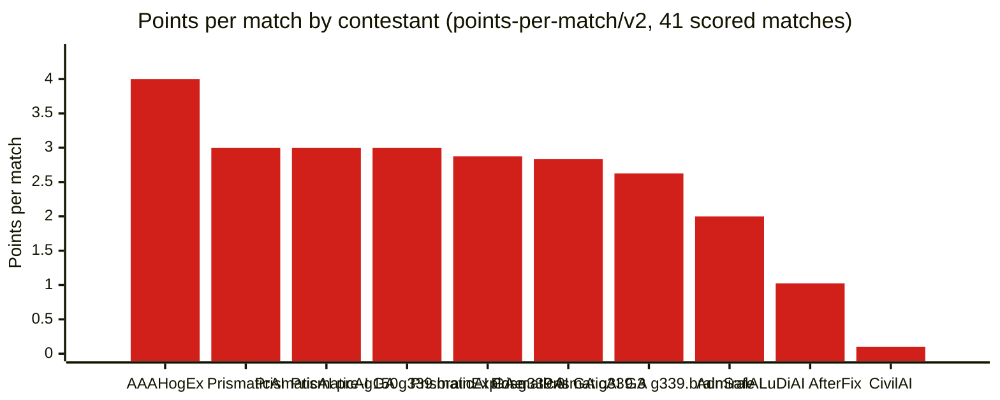
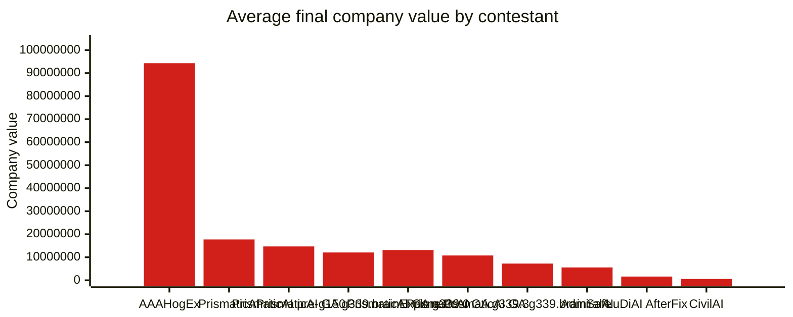
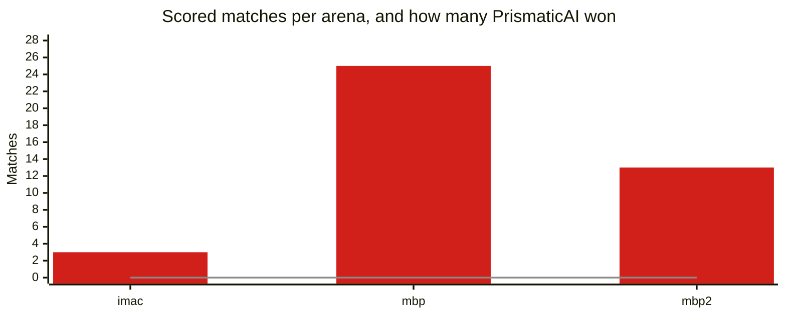

# battle-20261122T030440-21f6948d

Derived from `battle-20261122T030440-21f6948d.json` by `tools/research/ai-battle/battle.py report`; do not edit.

- Edition `21f6948dc2b61cea`: PrismaticAI and referee at `8c8d025388e85261a60027d9983d8588d720a2e9`, base set `opengfx-8.0.tar`
- 20-year free-for-all from 1960, map 256x256 temperate, breakdowns 1
- 41 scored match(es) on `imac` (20261119-master-gdf1e05e7d8), `mbp` (20261120-master-m17653b726e), `mbp2` (20261119-master-gdf1e05e7d8)
- Replays: 0 of 0 identical to their original on another arena

| # | Contestant | Played | Wins | Points | Points/match | Avg rank | Avg final value | Squirrel errors | Matches with anomalies |
|---|---|---|---|---|---|---|---|---|---|
| 1 | AAAHogEx | 41 | 41 | 164 | 4.0 | 1.0 | 94.3 M | 0 | 0 |
| 2 | PrismaticAI | 7 | 0 | 21 | 3.0 | 2.0 | 17.7 M | 0 | 0 |
| 3 | PrismaticAI pre-g150 | 6 | 0 | 18 | 3.0 | 2.0 | 14.7 M | 0 | 0 |
| 4 | PrismaticAI GA g339.brainExplore | 6 | 0 | 18 | 3.0 | 2.0 | 12.1 M | 0 | 0 |
| 5 | PrismaticAI GA g339.0 | 8 | 0 | 23 | 2.875 | 2.12 | 13.1 M | 0 | 0 |
| 6 | PrismaticAI GA g339.3 | 6 | 0 | 17 | 2.833 | 2.17 | 10.8 M | 0 | 0 |
| 7 | PrismaticAI GA g339.brainSafe | 8 | 0 | 21 | 2.625 | 2.38 | 7.3 M | 0 | 0 |
| 8 | AdmiralAI | 41 | 0 | 82 | 2.0 | 3.0 | 5.6 M | 0 | 1 |
| 9 | LuDiAI AfterFix | 41 | 0 | 42 | 1.024 | 3.98 | 1.6 M | 0 | 2 |
| 10 | CivilAI | 41 | 0 | 4 | 0.098 | 4.9 | 581.4 k | 0 | 10 |

```mermaid
---
config:
  xyChart:
    width: 900
    height: 360
  themeVariables:
    xyChart:
      plotColorPalette: "#d11f1a, #8a8a8a, #0b0b0b, #ece4d6"
---
xychart-beta
    title "Final company value per scored match: winner vs best PrismaticAI"
    x-axis ["m-0001", "m-0002", "m-0003", "m-0004", "m-0005", "m-0006", "m-0007", "m-0008", "m-0009", "m-0010", "m-0011", "m-0012", "m-0014", "m-0015", "m-0016", "m-0017", "m-0018", "m-0020", "m-0021", "m-0023", "m-0024", "m-0025", "m-0026", "m-0027", "m-0028", "m-0036", "m-0037", "m-0038", "m-0039", "m-0040", "m-0041", "m-0042", "m-0043", "m-0044", "m-0045", "m-0046", "m-0047", "m-0048", "m-0049", "m-0050", "m-0051"]
    %% series: Winner | Best PrismaticAI
    %% links: battle-20261122T030440-21f6948d.md?col=Match&filter=m-0001 | battle-20261122T030440-21f6948d.md?col=Match&filter=m-0002 | battle-20261122T030440-21f6948d.md?col=Match&filter=m-0003 | battle-20261122T030440-21f6948d.md?col=Match&filter=m-0004 | battle-20261122T030440-21f6948d.md?col=Match&filter=m-0005 | battle-20261122T030440-21f6948d.md?col=Match&filter=m-0006 | battle-20261122T030440-21f6948d.md?col=Match&filter=m-0007 | battle-20261122T030440-21f6948d.md?col=Match&filter=m-0008 | battle-20261122T030440-21f6948d.md?col=Match&filter=m-0009 | battle-20261122T030440-21f6948d.md?col=Match&filter=m-0010 | battle-20261122T030440-21f6948d.md?col=Match&filter=m-0011 | battle-20261122T030440-21f6948d.md?col=Match&filter=m-0012 | battle-20261122T030440-21f6948d.md?col=Match&filter=m-0014 | battle-20261122T030440-21f6948d.md?col=Match&filter=m-0015 | battle-20261122T030440-21f6948d.md?col=Match&filter=m-0016 | battle-20261122T030440-21f6948d.md?col=Match&filter=m-0017 | battle-20261122T030440-21f6948d.md?col=Match&filter=m-0018 | battle-20261122T030440-21f6948d.md?col=Match&filter=m-0020 | battle-20261122T030440-21f6948d.md?col=Match&filter=m-0021 | battle-20261122T030440-21f6948d.md?col=Match&filter=m-0023 | battle-20261122T030440-21f6948d.md?col=Match&filter=m-0024 | battle-20261122T030440-21f6948d.md?col=Match&filter=m-0025 | battle-20261122T030440-21f6948d.md?col=Match&filter=m-0026 | battle-20261122T030440-21f6948d.md?col=Match&filter=m-0027 | battle-20261122T030440-21f6948d.md?col=Match&filter=m-0028 | battle-20261122T030440-21f6948d.md?col=Match&filter=m-0036 | battle-20261122T030440-21f6948d.md?col=Match&filter=m-0037 | battle-20261122T030440-21f6948d.md?col=Match&filter=m-0038 | battle-20261122T030440-21f6948d.md?col=Match&filter=m-0039 | battle-20261122T030440-21f6948d.md?col=Match&filter=m-0040 | battle-20261122T030440-21f6948d.md?col=Match&filter=m-0041 | battle-20261122T030440-21f6948d.md?col=Match&filter=m-0042 | battle-20261122T030440-21f6948d.md?col=Match&filter=m-0043 | battle-20261122T030440-21f6948d.md?col=Match&filter=m-0044 | battle-20261122T030440-21f6948d.md?col=Match&filter=m-0045 | battle-20261122T030440-21f6948d.md?col=Match&filter=m-0046 | battle-20261122T030440-21f6948d.md?col=Match&filter=m-0047 | battle-20261122T030440-21f6948d.md?col=Match&filter=m-0048 | battle-20261122T030440-21f6948d.md?col=Match&filter=m-0049 | battle-20261122T030440-21f6948d.md?col=Match&filter=m-0050 | battle-20261122T030440-21f6948d.md?col=Match&filter=m-0051
    y-axis "Company value" 0 --> 159000000
    bar [100536748, 95668441, 104228704, 94224174, 139167142, 144968539, 132199743, 97256958, 135320515, 112882409, 116567600, 61263440, 66559800, 91652020, 81683147, 76217328, 89805263, 73449651, 94261834, 84498813, 94095733, 96700277, 85824799, 108905091, 70727441, 60948184, 68925972, 61993589, 84067268, 62532554, 65107077, 91236505, 69659704, 83765604, 103340866, 75079196, 100271001, 126604262, 126457658, 106797544, 131079551]
    line [16853059, 16757539, 6891527, 11215432, 11579679, 18157760, 18478069, 10153317, 10453350, 15714664, 15587876, 18499551, 17739619, 5988837, 14144079, 12356222, 17705457, 14148299, 9411647, 12931805, 14323816, 14668104, 11541308, 9663477, 12971374, 18754336, 17855328, 11817338, 5697053, 9874743, 6039690, 15103892, 5110567, 6004313, 4535222, 8553755, 6163509, 21575629, 15256580, 16995627, 5439524]
```

<!-- battle-charts:begin -->
<!-- derived from battle-20261122T030440-21f6948d.json by `battle.py render`; `battle.py check` fails when it is stale -->

<!-- battle-charts:end -->

| Match | Arena | Seed | Winner | Value | Last | Anomalies |
|---|---|---|---|---|---|---|
| m-0001 | mbp | 166644502 | AAAHogEx | 100.5 M | LuDiAI AfterFix | LuDiAI AfterFix: fleet_drop:82->35 |
| m-0002 | mbp | 166644502 | AAAHogEx | 95.7 M | CivilAI | AdmiralAI: fleet_drop:322->221 |
| m-0003 | mbp | 166644502 | AAAHogEx | 104.2 M | CivilAI | CivilAI: fleet_drop:39->17 |
| m-0004 | mbp | 166644502 | AAAHogEx | 94.2 M | CivilAI | - |
| m-0005 | mbp | 166644502 | AAAHogEx | 139.2 M | CivilAI | - |
| m-0006 | mbp | 627267065 | AAAHogEx | 145.0 M | CivilAI | - |
| m-0007 | mbp | 627267065 | AAAHogEx | 132.2 M | CivilAI | - |
| m-0008 | mbp | 627267065 | AAAHogEx | 97.3 M | CivilAI | CivilAI: fleet_drop:19->13 |
| m-0009 | mbp | 627267065 | AAAHogEx | 135.3 M | LuDiAI AfterFix | - |
| m-0010 | imac | 627267065 | AAAHogEx | 112.9 M | CivilAI | - |
| m-0011 | imac | 627267065 | AAAHogEx | 116.6 M | CivilAI | - |
| m-0012 | imac | 475657510 | AAAHogEx | 61.3 M | CivilAI | - |
| m-0014 | mbp2 | 475657510 | AAAHogEx | 66.6 M | CivilAI | CivilAI: fleet_drop:36->19 |
| m-0015 | mbp2 | 475657510 | AAAHogEx | 91.7 M | LuDiAI AfterFix | - |
| m-0016 | mbp2 | 475657510 | AAAHogEx | 81.7 M | CivilAI | - |
| m-0017 | mbp2 | 475657510 | AAAHogEx | 76.2 M | CivilAI | CivilAI: fleet_drop:42->28 |
| m-0018 | mbp2 | 879281721 | AAAHogEx | 89.8 M | CivilAI | CivilAI: fleet_drop:32->4 |
| m-0020 | mbp2 | 879281721 | AAAHogEx | 73.4 M | CivilAI | - |
| m-0021 | mbp2 | 879281721 | AAAHogEx | 94.3 M | CivilAI | - |
| m-0023 | mbp2 | 879281721 | AAAHogEx | 84.5 M | CivilAI | - |
| m-0024 | mbp2 | 277484730 | AAAHogEx | 94.1 M | CivilAI | - |
| m-0025 | mbp2 | 277484730 | AAAHogEx | 96.7 M | CivilAI | - |
| m-0026 | mbp2 | 277484730 | AAAHogEx | 85.8 M | CivilAI | - |
| m-0027 | mbp2 | 277484730 | AAAHogEx | 108.9 M | CivilAI | - |
| m-0028 | mbp2 | 277484730 | AAAHogEx | 70.7 M | CivilAI | - |
| m-0036 | mbp | 390599546 | AAAHogEx | 60.9 M | AdmiralAI | - |
| m-0037 | mbp | 390599546 | AAAHogEx | 68.9 M | CivilAI | - |
| m-0038 | mbp | 390599546 | AAAHogEx | 62.0 M | CivilAI | CivilAI: fleet_drop:26->18 |
| m-0039 | mbp | 390599546 | AAAHogEx | 84.1 M | CivilAI | CivilAI: fleet_drop:23->11 |
| m-0040 | mbp | 390599546 | AAAHogEx | 62.5 M | CivilAI | - |
| m-0041 | mbp | 390599546 | AAAHogEx | 65.1 M | CivilAI | - |
| m-0042 | mbp | 1871405414 | AAAHogEx | 91.2 M | CivilAI | CivilAI: fleet_drop:54->28 |
| m-0043 | mbp | 1871405414 | AAAHogEx | 69.7 M | CivilAI | - |
| m-0044 | mbp | 1871405414 | AAAHogEx | 83.8 M | CivilAI | - |
| m-0045 | mbp | 1871405414 | AAAHogEx | 103.3 M | CivilAI | - |
| m-0046 | mbp | 1871405414 | AAAHogEx | 75.1 M | CivilAI | LuDiAI AfterFix: fleet_drop:55->18; CivilAI: fleet_drop:71->46 |
| m-0047 | mbp | 1871405414 | AAAHogEx | 100.3 M | CivilAI | - |
| m-0048 | mbp | 1114822456 | AAAHogEx | 126.6 M | CivilAI | CivilAI: fleet_drop:42->20 |
| m-0049 | mbp | 1114822456 | AAAHogEx | 126.5 M | CivilAI | - |
| m-0050 | mbp | 1114822456 | AAAHogEx | 106.8 M | CivilAI | - |
| m-0051 | mbp | 1114822456 | AAAHogEx | 131.1 M | CivilAI | - |
