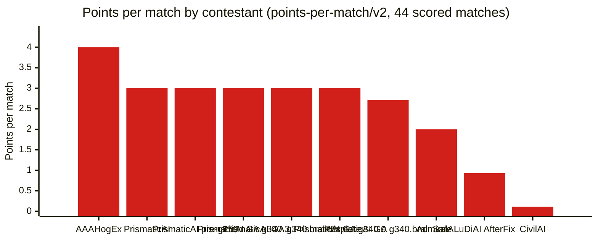
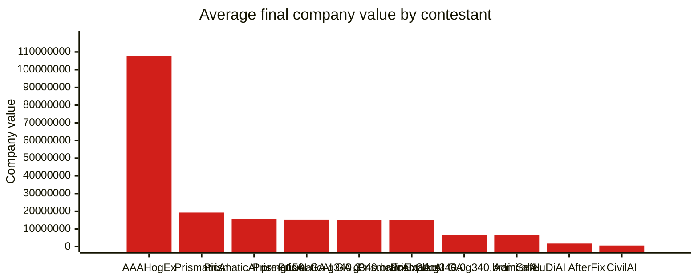
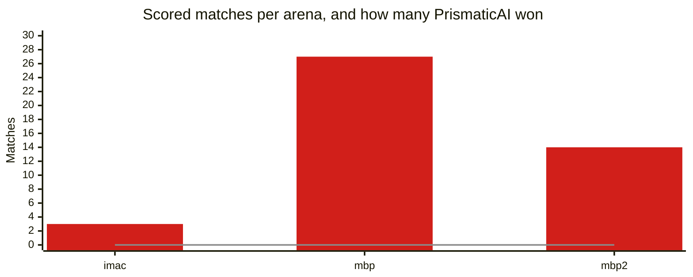

# battle-20261122T031606-de6c391a

Derived from `battle-20261122T031606-de6c391a.json` by `tools/research/ai-battle/battle.py report`; do not edit.

- Edition `de6c391a7d7ee4bb`: PrismaticAI and referee at `8c8d025388e85261a60027d9983d8588d720a2e9`, base set `opengfx-8.0.tar`
- 20-year free-for-all from 1960, map 256x256 temperate, breakdowns 1
- 44 scored match(es) on `imac` (20261119-master-gdf1e05e7d8), `mbp` (20261120-master-m17653b726e), `mbp2` (20261119-master-gdf1e05e7d8)
- Replays: 0 of 0 identical to their original on another arena

| # | Contestant | Played | Wins | Points | Points/match | Avg rank | Avg final value | Squirrel errors | Matches with anomalies |
|---|---|---|---|---|---|---|---|---|---|
| 1 | AAAHogEx | 44 | 44 | 176 | 4.0 | 1.0 | 108.0 M | 0 | 0 |
| 2 | PrismaticAI | 6 | 0 | 18 | 3.0 | 2.0 | 19.3 M | 0 | 0 |
| 3 | PrismaticAI pre-g150 | 8 | 0 | 24 | 3.0 | 2.0 | 15.7 M | 0 | 0 |
| 4 | PrismaticAI GA g340.3 | 7 | 0 | 21 | 3.0 | 2.0 | 15.1 M | 0 | 0 |
| 5 | PrismaticAI GA g340.brainExplore | 8 | 0 | 24 | 3.0 | 2.0 | 15.0 M | 0 | 0 |
| 6 | PrismaticAI GA g340.0 | 8 | 0 | 24 | 3.0 | 2.0 | 14.9 M | 0 | 0 |
| 7 | PrismaticAI GA g340.brainSafe | 7 | 0 | 19 | 2.714 | 2.29 | 6.6 M | 0 | 0 |
| 8 | AdmiralAI | 44 | 0 | 88 | 2.0 | 3.0 | 6.5 M | 0 | 1 |
| 9 | LuDiAI AfterFix | 44 | 0 | 41 | 0.932 | 4.07 | 1.7 M | 0 | 1 |
| 10 | CivilAI | 44 | 0 | 5 | 0.114 | 4.89 | 629.7 k | 0 | 8 |

```mermaid
---
config:
  xyChart:
    width: 900
    height: 360
  themeVariables:
    xyChart:
      plotColorPalette: "#d11f1a, #8a8a8a, #0b0b0b, #ece4d6"
---
xychart-beta
    title "Final company value per scored match: winner vs best PrismaticAI"
    x-axis ["m-0001", "m-0002", "m-0003", "m-0004", "m-0005", "m-0006", "m-0007", "m-0008", "m-0009", "m-0010", "m-0011", "m-0012", "m-0013", "m-0014", "m-0015", "m-0016", "m-0017", "m-0019", "m-0020", "m-0021", "m-0022", "m-0023", "m-0024", "m-0025", "m-0026", "m-0028", "m-0036", "m-0037", "m-0038", "m-0039", "m-0040", "m-0041", "m-0042", "m-0043", "m-0044", "m-0045", "m-0046", "m-0047", "m-0048", "m-0049", "m-0050", "m-0051", "m-0052", "m-0053"]
    %% series: Winner | Best PrismaticAI
    %% links: battle-20261122T031606-de6c391a.md?col=Match&filter=m-0001 | battle-20261122T031606-de6c391a.md?col=Match&filter=m-0002 | battle-20261122T031606-de6c391a.md?col=Match&filter=m-0003 | battle-20261122T031606-de6c391a.md?col=Match&filter=m-0004 | battle-20261122T031606-de6c391a.md?col=Match&filter=m-0005 | battle-20261122T031606-de6c391a.md?col=Match&filter=m-0006 | battle-20261122T031606-de6c391a.md?col=Match&filter=m-0007 | battle-20261122T031606-de6c391a.md?col=Match&filter=m-0008 | battle-20261122T031606-de6c391a.md?col=Match&filter=m-0009 | battle-20261122T031606-de6c391a.md?col=Match&filter=m-0010 | battle-20261122T031606-de6c391a.md?col=Match&filter=m-0011 | battle-20261122T031606-de6c391a.md?col=Match&filter=m-0012 | battle-20261122T031606-de6c391a.md?col=Match&filter=m-0013 | battle-20261122T031606-de6c391a.md?col=Match&filter=m-0014 | battle-20261122T031606-de6c391a.md?col=Match&filter=m-0015 | battle-20261122T031606-de6c391a.md?col=Match&filter=m-0016 | battle-20261122T031606-de6c391a.md?col=Match&filter=m-0017 | battle-20261122T031606-de6c391a.md?col=Match&filter=m-0019 | battle-20261122T031606-de6c391a.md?col=Match&filter=m-0020 | battle-20261122T031606-de6c391a.md?col=Match&filter=m-0021 | battle-20261122T031606-de6c391a.md?col=Match&filter=m-0022 | battle-20261122T031606-de6c391a.md?col=Match&filter=m-0023 | battle-20261122T031606-de6c391a.md?col=Match&filter=m-0024 | battle-20261122T031606-de6c391a.md?col=Match&filter=m-0025 | battle-20261122T031606-de6c391a.md?col=Match&filter=m-0026 | battle-20261122T031606-de6c391a.md?col=Match&filter=m-0028 | battle-20261122T031606-de6c391a.md?col=Match&filter=m-0036 | battle-20261122T031606-de6c391a.md?col=Match&filter=m-0037 | battle-20261122T031606-de6c391a.md?col=Match&filter=m-0038 | battle-20261122T031606-de6c391a.md?col=Match&filter=m-0039 | battle-20261122T031606-de6c391a.md?col=Match&filter=m-0040 | battle-20261122T031606-de6c391a.md?col=Match&filter=m-0041 | battle-20261122T031606-de6c391a.md?col=Match&filter=m-0042 | battle-20261122T031606-de6c391a.md?col=Match&filter=m-0043 | battle-20261122T031606-de6c391a.md?col=Match&filter=m-0044 | battle-20261122T031606-de6c391a.md?col=Match&filter=m-0045 | battle-20261122T031606-de6c391a.md?col=Match&filter=m-0046 | battle-20261122T031606-de6c391a.md?col=Match&filter=m-0047 | battle-20261122T031606-de6c391a.md?col=Match&filter=m-0048 | battle-20261122T031606-de6c391a.md?col=Match&filter=m-0049 | battle-20261122T031606-de6c391a.md?col=Match&filter=m-0050 | battle-20261122T031606-de6c391a.md?col=Match&filter=m-0051 | battle-20261122T031606-de6c391a.md?col=Match&filter=m-0052 | battle-20261122T031606-de6c391a.md?col=Match&filter=m-0053
    y-axis "Company value" 0 --> 154000000
    bar [109908128, 106913475, 106847547, 106913475, 94153538, 96822612, 88756528, 108269380, 113541640, 110482219, 97944250, 120643973, 109884122, 118642874, 114000669, 118642874, 130660328, 70415636, 99173294, 112262576, 99173294, 107029419, 101606574, 128978482, 119980346, 119980346, 122082333, 105444116, 100859785, 93782737, 100859785, 117832063, 104747856, 99444087, 127056797, 139955005, 127056797, 98491430, 93899494, 122726167, 94465040, 115259932, 94465040, 80618538]
    line [6457079, 16042593, 5261383, 16042593, 8774429, 14784938, 16595590, 11199430, 6570012, 12321031, 11231023, 18014398, 17010515, 16050339, 6328836, 16050339, 19157194, 13215492, 8493613, 6822109, 8493613, 12811606, 19878670, 22442321, 16939234, 16939234, 24483931, 19561799, 14836273, 7766063, 14836273, 18492277, 23277329, 21583181, 17718388, 8569770, 17718388, 17221759, 15226245, 8680468, 17818205, 4739950, 17818205, 18275858]
```

<!-- battle-charts:begin -->
<!-- derived from battle-20261122T031606-de6c391a.json by `battle.py render`; `battle.py check` fails when it is stale -->

<!-- battle-charts:end -->

| Match | Arena | Seed | Winner | Value | Last | Anomalies |
|---|---|---|---|---|---|---|
| m-0001 | mbp | 1062802855 | AAAHogEx | 109.9 M | CivilAI | - |
| m-0002 | mbp | 1062802855 | AAAHogEx | 106.9 M | CivilAI | CivilAI: fleet_drop:11->7 |
| m-0003 | mbp | 1062802855 | AAAHogEx | 106.8 M | CivilAI | - |
| m-0004 | mbp | 1062802855 | AAAHogEx | 106.9 M | CivilAI | CivilAI: fleet_drop:11->7 |
| m-0005 | mbp | 1062802855 | AAAHogEx | 94.2 M | CivilAI | - |
| m-0006 | mbp | 969007111 | AAAHogEx | 96.8 M | CivilAI | CivilAI: fleet_drop:35->24 |
| m-0007 | mbp | 969007111 | AAAHogEx | 88.8 M | CivilAI | - |
| m-0008 | mbp | 969007111 | AAAHogEx | 108.3 M | CivilAI | AdmiralAI: fleet_drop:239->152 |
| m-0009 | mbp | 969007111 | AAAHogEx | 113.5 M | CivilAI | - |
| m-0010 | imac | 969007111 | AAAHogEx | 110.5 M | CivilAI | - |
| m-0011 | imac | 969007111 | AAAHogEx | 97.9 M | CivilAI | - |
| m-0012 | imac | 67340439 | AAAHogEx | 120.6 M | LuDiAI AfterFix | - |
| m-0013 | mbp2 | 67340439 | AAAHogEx | 109.9 M | CivilAI | - |
| m-0014 | mbp2 | 67340439 | AAAHogEx | 118.6 M | CivilAI | CivilAI: fleet_drop:78->50 |
| m-0015 | mbp2 | 67340439 | AAAHogEx | 114.0 M | CivilAI | - |
| m-0016 | mbp2 | 67340439 | AAAHogEx | 118.6 M | CivilAI | CivilAI: fleet_drop:78->50 |
| m-0017 | mbp2 | 67340439 | AAAHogEx | 130.7 M | CivilAI | - |
| m-0019 | mbp2 | 1668067255 | AAAHogEx | 70.4 M | LuDiAI AfterFix | CivilAI: fleet_drop:53->34 |
| m-0020 | mbp2 | 1668067255 | AAAHogEx | 99.2 M | CivilAI | - |
| m-0021 | mbp2 | 1668067255 | AAAHogEx | 112.3 M | LuDiAI AfterFix | LuDiAI AfterFix: fleet_drop:23->11 |
| m-0022 | mbp2 | 1668067255 | AAAHogEx | 99.2 M | CivilAI | - |
| m-0023 | mbp2 | 1668067255 | AAAHogEx | 107.0 M | LuDiAI AfterFix | - |
| m-0024 | mbp2 | 674584279 | AAAHogEx | 101.6 M | CivilAI | - |
| m-0025 | mbp2 | 674584279 | AAAHogEx | 129.0 M | CivilAI | - |
| m-0026 | mbp2 | 674584279 | AAAHogEx | 120.0 M | CivilAI | - |
| m-0028 | mbp2 | 674584279 | AAAHogEx | 120.0 M | CivilAI | - |
| m-0036 | mbp | 1464075043 | AAAHogEx | 122.1 M | CivilAI | - |
| m-0037 | mbp | 1464075043 | AAAHogEx | 105.4 M | CivilAI | - |
| m-0038 | mbp | 1464075043 | AAAHogEx | 100.9 M | CivilAI | - |
| m-0039 | mbp | 1464075043 | AAAHogEx | 93.8 M | LuDiAI AfterFix | - |
| m-0040 | mbp | 1464075043 | AAAHogEx | 100.9 M | CivilAI | - |
| m-0041 | mbp | 1464075043 | AAAHogEx | 117.8 M | CivilAI | CivilAI: fleet_drop:11->7 |
| m-0042 | mbp | 519642278 | AAAHogEx | 104.7 M | CivilAI | - |
| m-0043 | mbp | 519642278 | AAAHogEx | 99.4 M | CivilAI | - |
| m-0044 | mbp | 519642278 | AAAHogEx | 127.1 M | CivilAI | - |
| m-0045 | mbp | 519642278 | AAAHogEx | 140.0 M | CivilAI | - |
| m-0046 | mbp | 519642278 | AAAHogEx | 127.1 M | CivilAI | - |
| m-0047 | mbp | 519642278 | AAAHogEx | 98.5 M | CivilAI | - |
| m-0048 | mbp | 1028030922 | AAAHogEx | 93.9 M | CivilAI | - |
| m-0049 | mbp | 1028030922 | AAAHogEx | 122.7 M | CivilAI | - |
| m-0050 | mbp | 1028030922 | AAAHogEx | 94.5 M | CivilAI | - |
| m-0051 | mbp | 1028030922 | AAAHogEx | 115.3 M | CivilAI | CivilAI: fleet_drop:63->34 |
| m-0052 | mbp | 1028030922 | AAAHogEx | 94.5 M | CivilAI | - |
| m-0053 | mbp | 1028030922 | AAAHogEx | 80.6 M | CivilAI | - |
