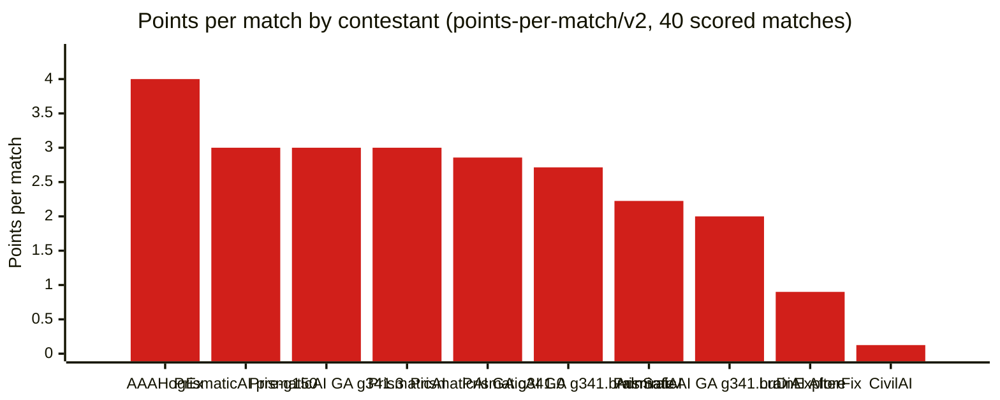
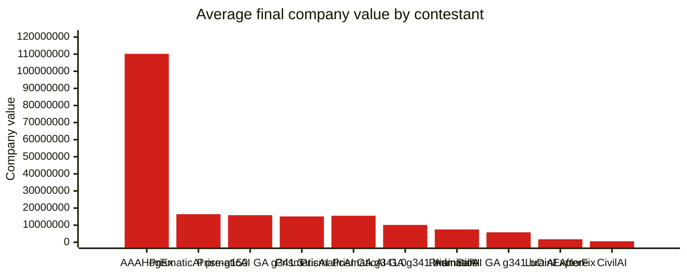
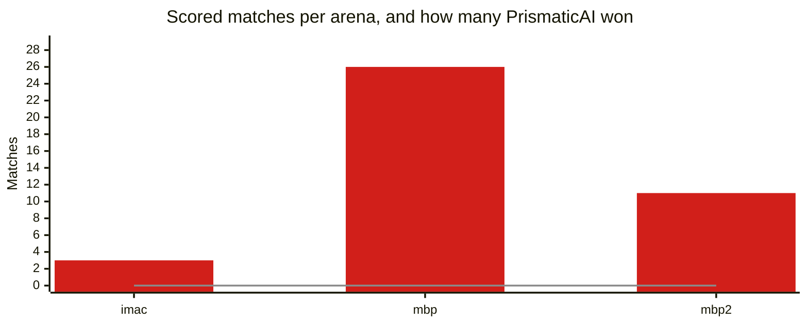

# battle-20261122T032640-55e2546b

Derived from `battle-20261122T032640-55e2546b.json` by `tools/research/ai-battle/battle.py report`; do not edit.

- Edition `55e2546b9692d785`: PrismaticAI and referee at `8c8d025388e85261a60027d9983d8588d720a2e9`, base set `opengfx-8.0.tar`
- 20-year free-for-all from 1960, map 256x256 temperate, breakdowns 1
- 40 scored match(es) on `imac` (20261119-master-gdf1e05e7d8), `mbp` (20261120-master-m17653b726e), `mbp2` (20261119-master-gdf1e05e7d8)
- Replays: 0 of 0 identical to their original on another arena

| # | Contestant | Played | Wins | Points | Points/match | Avg rank | Avg final value | Squirrel errors | Matches with anomalies |
|---|---|---|---|---|---|---|---|---|---|
| 1 | AAAHogEx | 40 | 40 | 160 | 4.0 | 1.0 | 110.2 M | 0 | 1 |
| 2 | PrismaticAI pre-g150 | 7 | 0 | 21 | 3.0 | 2.0 | 16.4 M | 0 | 0 |
| 3 | PrismaticAI GA g341.3 | 6 | 0 | 18 | 3.0 | 2.0 | 15.8 M | 0 | 0 |
| 4 | PrismaticAI | 6 | 0 | 18 | 3.0 | 2.0 | 15.1 M | 0 | 0 |
| 5 | PrismaticAI GA g341.0 | 7 | 0 | 20 | 2.857 | 2.14 | 15.5 M | 0 | 0 |
| 6 | PrismaticAI GA g341.brainSafe | 7 | 0 | 19 | 2.714 | 2.29 | 10.1 M | 0 | 0 |
| 7 | AdmiralAI | 40 | 0 | 89 | 2.225 | 2.77 | 7.5 M | 0 | 0 |
| 8 | PrismaticAI GA g341.brainExplore | 7 | 0 | 14 | 2.0 | 3.0 | 5.8 M | 0 | 3 |
| 9 | LuDiAI AfterFix | 40 | 0 | 36 | 0.9 | 4.1 | 1.7 M | 0 | 2 |
| 10 | CivilAI | 40 | 0 | 5 | 0.125 | 4.88 | 560.3 k | 0 | 7 |

```mermaid
---
config:
  xyChart:
    width: 900
    height: 360
  themeVariables:
    xyChart:
      plotColorPalette: "#d11f1a, #8a8a8a, #0b0b0b, #ece4d6"
---
xychart-beta
    title "Final company value per scored match: winner vs best PrismaticAI"
    x-axis ["m-0001", "m-0002", "m-0003", "m-0004", "m-0005", "m-0006", "m-0007", "m-0008", "m-0009", "m-0010", "m-0011", "m-0012", "m-0013", "m-0014", "m-0015", "m-0017", "m-0018", "m-0019", "m-0021", "m-0022", "m-0024", "m-0026", "m-0028", "m-0036", "m-0037", "m-0038", "m-0039", "m-0040", "m-0041", "m-0042", "m-0043", "m-0044", "m-0045", "m-0046", "m-0047", "m-0049", "m-0050", "m-0051", "m-0052", "m-0053"]
    %% series: Winner | Best PrismaticAI
    %% links: battle-20261122T032640-55e2546b.md?col=Match&filter=m-0001 | battle-20261122T032640-55e2546b.md?col=Match&filter=m-0002 | battle-20261122T032640-55e2546b.md?col=Match&filter=m-0003 | battle-20261122T032640-55e2546b.md?col=Match&filter=m-0004 | battle-20261122T032640-55e2546b.md?col=Match&filter=m-0005 | battle-20261122T032640-55e2546b.md?col=Match&filter=m-0006 | battle-20261122T032640-55e2546b.md?col=Match&filter=m-0007 | battle-20261122T032640-55e2546b.md?col=Match&filter=m-0008 | battle-20261122T032640-55e2546b.md?col=Match&filter=m-0009 | battle-20261122T032640-55e2546b.md?col=Match&filter=m-0010 | battle-20261122T032640-55e2546b.md?col=Match&filter=m-0011 | battle-20261122T032640-55e2546b.md?col=Match&filter=m-0012 | battle-20261122T032640-55e2546b.md?col=Match&filter=m-0013 | battle-20261122T032640-55e2546b.md?col=Match&filter=m-0014 | battle-20261122T032640-55e2546b.md?col=Match&filter=m-0015 | battle-20261122T032640-55e2546b.md?col=Match&filter=m-0017 | battle-20261122T032640-55e2546b.md?col=Match&filter=m-0018 | battle-20261122T032640-55e2546b.md?col=Match&filter=m-0019 | battle-20261122T032640-55e2546b.md?col=Match&filter=m-0021 | battle-20261122T032640-55e2546b.md?col=Match&filter=m-0022 | battle-20261122T032640-55e2546b.md?col=Match&filter=m-0024 | battle-20261122T032640-55e2546b.md?col=Match&filter=m-0026 | battle-20261122T032640-55e2546b.md?col=Match&filter=m-0028 | battle-20261122T032640-55e2546b.md?col=Match&filter=m-0036 | battle-20261122T032640-55e2546b.md?col=Match&filter=m-0037 | battle-20261122T032640-55e2546b.md?col=Match&filter=m-0038 | battle-20261122T032640-55e2546b.md?col=Match&filter=m-0039 | battle-20261122T032640-55e2546b.md?col=Match&filter=m-0040 | battle-20261122T032640-55e2546b.md?col=Match&filter=m-0041 | battle-20261122T032640-55e2546b.md?col=Match&filter=m-0042 | battle-20261122T032640-55e2546b.md?col=Match&filter=m-0043 | battle-20261122T032640-55e2546b.md?col=Match&filter=m-0044 | battle-20261122T032640-55e2546b.md?col=Match&filter=m-0045 | battle-20261122T032640-55e2546b.md?col=Match&filter=m-0046 | battle-20261122T032640-55e2546b.md?col=Match&filter=m-0047 | battle-20261122T032640-55e2546b.md?col=Match&filter=m-0049 | battle-20261122T032640-55e2546b.md?col=Match&filter=m-0050 | battle-20261122T032640-55e2546b.md?col=Match&filter=m-0051 | battle-20261122T032640-55e2546b.md?col=Match&filter=m-0052 | battle-20261122T032640-55e2546b.md?col=Match&filter=m-0053
    y-axis "Company value" 0 --> 193000000
    bar [146146043, 175885032, 141597854, 133990077, 157853631, 105443476, 143817585, 114047995, 98516268, 100601645, 98779457, 66777726, 84854529, 91346833, 74382675, 77885566, 95562676, 93812370, 97666700, 101360561, 97651177, 92538730, 108535597, 86751228, 83310691, 79162354, 99609061, 96210322, 91870083, 142701908, 121985630, 147738250, 134739735, 145895021, 141092433, 108932259, 102680603, 114320038, 112901043, 98537555]
    line [19427414, 13968488, 8061073, 4151138, 16886486, 23392056, 13381685, 17967840, 14660858, 9429541, 18274408, 9365760, 9752926, 7163293, 5153953, 11392245, 19317684, 15985210, 9850332, 2045671, 11581682, 11012124, 6669702, 11560123, 14694717, 19093653, 11359795, 2138380, 10627028, 15410543, 21805074, 21528175, 14085565, 7421731, 25340708, 19868901, 17849360, 7775589, 8847483, 12547544]
```

<!-- battle-charts:begin -->
<!-- derived from battle-20261122T032640-55e2546b.json by `battle.py render`; `battle.py check` fails when it is stale -->

<!-- battle-charts:end -->

| Match | Arena | Seed | Winner | Value | Last | Anomalies |
|---|---|---|---|---|---|---|
| m-0001 | mbp | 1784645933 | AAAHogEx | 146.1 M | CivilAI | - |
| m-0002 | mbp | 1784645933 | AAAHogEx | 175.9 M | CivilAI | - |
| m-0003 | mbp | 1784645933 | AAAHogEx | 141.6 M | CivilAI | - |
| m-0004 | mbp | 1784645933 | AAAHogEx | 134.0 M | CivilAI | PrismaticAI GA g341.brainExplore: fleet_drop:37->25 |
| m-0005 | mbp | 1784645933 | AAAHogEx | 157.9 M | CivilAI | - |
| m-0006 | mbp | 1523287685 | AAAHogEx | 105.4 M | CivilAI | - |
| m-0007 | mbp | 1523287685 | AAAHogEx | 143.8 M | LuDiAI AfterFix | - |
| m-0008 | mbp | 1523287685 | AAAHogEx | 114.0 M | CivilAI | CivilAI: fleet_drop:63->38 |
| m-0009 | mbp | 1523287685 | AAAHogEx | 98.5 M | CivilAI | LuDiAI AfterFix: fleet_drop:53->15 |
| m-0010 | imac | 1523287685 | AAAHogEx | 100.6 M | LuDiAI AfterFix | - |
| m-0011 | imac | 1523287685 | AAAHogEx | 98.8 M | LuDiAI AfterFix | - |
| m-0012 | imac | 1419404384 | AAAHogEx | 66.8 M | CivilAI | - |
| m-0013 | mbp2 | 1419404384 | AAAHogEx | 84.9 M | CivilAI | - |
| m-0014 | mbp2 | 1419404384 | AAAHogEx | 91.3 M | CivilAI | CivilAI: fleet_drop:49->28 |
| m-0015 | mbp2 | 1419404384 | AAAHogEx | 74.4 M | CivilAI | - |
| m-0017 | mbp2 | 1419404384 | AAAHogEx | 77.9 M | CivilAI | CivilAI: fleet_drop:55->25 |
| m-0018 | mbp2 | 1563225193 | AAAHogEx | 95.6 M | CivilAI | - |
| m-0019 | mbp2 | 1563225193 | AAAHogEx | 93.8 M | CivilAI | - |
| m-0021 | mbp2 | 1563225193 | AAAHogEx | 97.7 M | CivilAI | - |
| m-0022 | mbp2 | 1563225193 | AAAHogEx | 101.4 M | CivilAI | PrismaticAI GA g341.brainExplore: fleet_drop:34->18; CivilAI: fleet_drop:55->25 |
| m-0024 | mbp2 | 1429031987 | AAAHogEx | 97.7 M | CivilAI | LuDiAI AfterFix: fleet_drop:85->59 |
| m-0026 | mbp2 | 1429031987 | AAAHogEx | 92.5 M | LuDiAI AfterFix | - |
| m-0028 | mbp2 | 1429031987 | AAAHogEx | 108.5 M | CivilAI | - |
| m-0036 | mbp | 382646257 | AAAHogEx | 86.8 M | CivilAI | CivilAI: fleet_drop:33->3 |
| m-0037 | mbp | 382646257 | AAAHogEx | 83.3 M | CivilAI | - |
| m-0038 | mbp | 382646257 | AAAHogEx | 79.2 M | CivilAI | - |
| m-0039 | mbp | 382646257 | AAAHogEx | 99.6 M | CivilAI | CivilAI: fleet_drop:31->17 |
| m-0040 | mbp | 382646257 | AAAHogEx | 96.2 M | CivilAI | AAAHogEx: fleet_drop:429->285; PrismaticAI GA g341.brainExplore: fleet_drop:31->19 |
| m-0041 | mbp | 382646257 | AAAHogEx | 91.9 M | CivilAI | - |
| m-0042 | mbp | 1716688935 | AAAHogEx | 142.7 M | CivilAI | - |
| m-0043 | mbp | 1716688935 | AAAHogEx | 122.0 M | CivilAI | - |
| m-0044 | mbp | 1716688935 | AAAHogEx | 147.7 M | CivilAI | - |
| m-0045 | mbp | 1716688935 | AAAHogEx | 134.7 M | CivilAI | - |
| m-0046 | mbp | 1716688935 | AAAHogEx | 145.9 M | CivilAI | - |
| m-0047 | mbp | 1716688935 | AAAHogEx | 141.1 M | CivilAI | - |
| m-0049 | mbp | 650896071 | AAAHogEx | 108.9 M | CivilAI | - |
| m-0050 | mbp | 650896071 | AAAHogEx | 102.7 M | CivilAI | CivilAI: fleet_drop:49->34 |
| m-0051 | mbp | 650896071 | AAAHogEx | 114.3 M | LuDiAI AfterFix | - |
| m-0052 | mbp | 650896071 | AAAHogEx | 112.9 M | CivilAI | - |
| m-0053 | mbp | 650896071 | AAAHogEx | 98.5 M | CivilAI | - |
