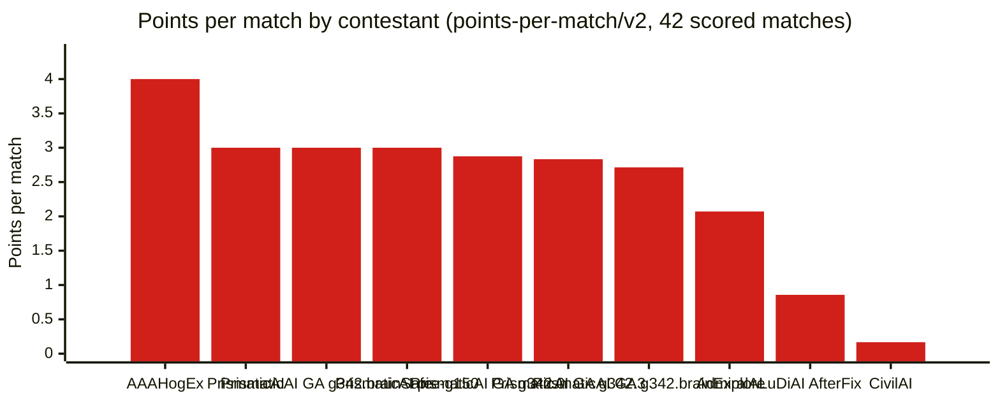
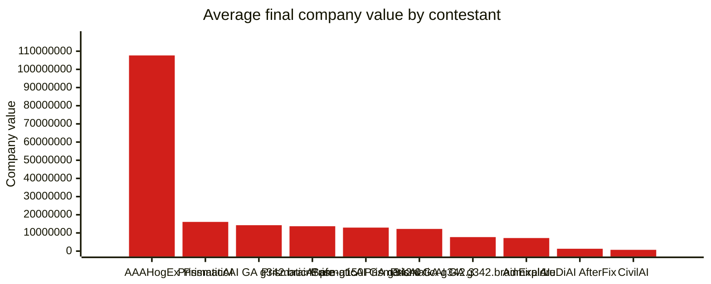
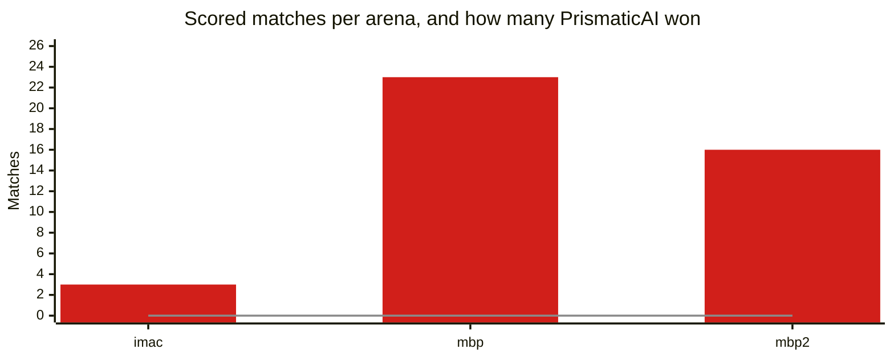

# battle-20261122T033635-6c294f07

Derived from `battle-20261122T033635-6c294f07.json` by `tools/research/ai-battle/battle.py report`; do not edit.

- Edition `6c294f0709c08f48`: PrismaticAI and referee at `8c8d025388e85261a60027d9983d8588d720a2e9`, base set `opengfx-8.0.tar`
- 20-year free-for-all from 1960, map 256x256 temperate, breakdowns 1
- 42 scored match(es) on `imac` (20261119-master-gdf1e05e7d8), `mbp` (20261120-master-m17653b726e), `mbp2` (20261119-master-gdf1e05e7d8)
- Replays: 0 of 1 identical to their original on another arena

| # | Contestant | Played | Wins | Points | Points/match | Avg rank | Avg final value | Squirrel errors | Matches with anomalies |
|---|---|---|---|---|---|---|---|---|---|
| 1 | AAAHogEx | 42 | 42 | 168 | 4.0 | 1.0 | 107.7 M | 0 | 0 |
| 2 | PrismaticAI | 6 | 0 | 18 | 3.0 | 2.0 | 16.1 M | 0 | 0 |
| 3 | PrismaticAI GA g342.brainSafe | 7 | 0 | 21 | 3.0 | 2.0 | 14.2 M | 0 | 0 |
| 4 | PrismaticAI pre-g150 | 8 | 0 | 24 | 3.0 | 2.0 | 13.7 M | 0 | 0 |
| 5 | PrismaticAI GA g342.0 | 8 | 0 | 23 | 2.875 | 2.12 | 12.9 M | 0 | 0 |
| 6 | PrismaticAI GA g342.3 | 6 | 0 | 17 | 2.833 | 2.17 | 12.2 M | 0 | 0 |
| 7 | PrismaticAI GA g342.brainExplore | 7 | 0 | 19 | 2.714 | 2.29 | 7.7 M | 0 | 0 |
| 8 | AdmiralAI | 42 | 0 | 87 | 2.071 | 2.93 | 7.2 M | 0 | 1 |
| 9 | LuDiAI AfterFix | 42 | 0 | 36 | 0.857 | 4.14 | 1.3 M | 0 | 2 |
| 10 | CivilAI | 42 | 0 | 7 | 0.167 | 4.83 | 702.0 k | 37 | 10 |

```mermaid
---
config:
  xyChart:
    width: 900
    height: 360
  themeVariables:
    xyChart:
      plotColorPalette: "#d11f1a, #8a8a8a, #0b0b0b, #ece4d6"
---
xychart-beta
    title "Final company value per scored match: winner vs best PrismaticAI"
    x-axis ["m-0001", "m-0002", "m-0003", "m-0004", "m-0005", "m-0006", "m-0007", "m-0008", "m-0009", "m-0010", "m-0011", "m-0012", "m-0013", "m-0014", "m-0015", "m-0016", "m-0017", "m-0018", "m-0019", "m-0020", "m-0021", "m-0022", "m-0023", "m-0024", "m-0025", "m-0026", "m-0027", "m-0028", "m-0036", "m-0037", "m-0038", "m-0039", "m-0040", "m-0041", "m-0042", "m-0043", "m-0044", "m-0045", "m-0046", "m-0047", "m-0049", "m-0050"]
    %% series: Winner | Best PrismaticAI
    %% links: battle-20261122T033635-6c294f07.md?col=Match&filter=m-0001 | battle-20261122T033635-6c294f07.md?col=Match&filter=m-0002 | battle-20261122T033635-6c294f07.md?col=Match&filter=m-0003 | battle-20261122T033635-6c294f07.md?col=Match&filter=m-0004 | battle-20261122T033635-6c294f07.md?col=Match&filter=m-0005 | battle-20261122T033635-6c294f07.md?col=Match&filter=m-0006 | battle-20261122T033635-6c294f07.md?col=Match&filter=m-0007 | battle-20261122T033635-6c294f07.md?col=Match&filter=m-0008 | battle-20261122T033635-6c294f07.md?col=Match&filter=m-0009 | battle-20261122T033635-6c294f07.md?col=Match&filter=m-0010 | battle-20261122T033635-6c294f07.md?col=Match&filter=m-0011 | battle-20261122T033635-6c294f07.md?col=Match&filter=m-0012 | battle-20261122T033635-6c294f07.md?col=Match&filter=m-0013 | battle-20261122T033635-6c294f07.md?col=Match&filter=m-0014 | battle-20261122T033635-6c294f07.md?col=Match&filter=m-0015 | battle-20261122T033635-6c294f07.md?col=Match&filter=m-0016 | battle-20261122T033635-6c294f07.md?col=Match&filter=m-0017 | battle-20261122T033635-6c294f07.md?col=Match&filter=m-0018 | battle-20261122T033635-6c294f07.md?col=Match&filter=m-0019 | battle-20261122T033635-6c294f07.md?col=Match&filter=m-0020 | battle-20261122T033635-6c294f07.md?col=Match&filter=m-0021 | battle-20261122T033635-6c294f07.md?col=Match&filter=m-0022 | battle-20261122T033635-6c294f07.md?col=Match&filter=m-0023 | battle-20261122T033635-6c294f07.md?col=Match&filter=m-0024 | battle-20261122T033635-6c294f07.md?col=Match&filter=m-0025 | battle-20261122T033635-6c294f07.md?col=Match&filter=m-0026 | battle-20261122T033635-6c294f07.md?col=Match&filter=m-0027 | battle-20261122T033635-6c294f07.md?col=Match&filter=m-0028 | battle-20261122T033635-6c294f07.md?col=Match&filter=m-0036 | battle-20261122T033635-6c294f07.md?col=Match&filter=m-0037 | battle-20261122T033635-6c294f07.md?col=Match&filter=m-0038 | battle-20261122T033635-6c294f07.md?col=Match&filter=m-0039 | battle-20261122T033635-6c294f07.md?col=Match&filter=m-0040 | battle-20261122T033635-6c294f07.md?col=Match&filter=m-0041 | battle-20261122T033635-6c294f07.md?col=Match&filter=m-0042 | battle-20261122T033635-6c294f07.md?col=Match&filter=m-0043 | battle-20261122T033635-6c294f07.md?col=Match&filter=m-0044 | battle-20261122T033635-6c294f07.md?col=Match&filter=m-0045 | battle-20261122T033635-6c294f07.md?col=Match&filter=m-0046 | battle-20261122T033635-6c294f07.md?col=Match&filter=m-0047 | battle-20261122T033635-6c294f07.md?col=Match&filter=m-0049 | battle-20261122T033635-6c294f07.md?col=Match&filter=m-0050
    y-axis "Company value" 0 --> 167000000
    bar [129172255, 140047391, 150329141, 151817280, 110617682, 113080866, 121365657, 118510075, 124564024, 134821797, 132468970, 68111263, 95343788, 51902345, 83668899, 69643918, 77463990, 91068110, 67633294, 102377795, 75582095, 95316344, 93355901, 95499453, 97749037, 89805474, 72583216, 92686668, 109589103, 97721374, 102289014, 108297617, 128370120, 119793914, 119381185, 139438647, 139236429, 126204458, 117612690, 114060999, 124810451, 128666903]
    line [18847401, 15946630, 18206451, 8027953, 16252770, 20741849, 9914634, 12634482, 18503547, 3799871, 15688122, 18363660, 11975079, 19123356, 14392329, 10513138, 12974298, 11623111, 12328804, 9478195, 6466781, 7951328, 5625685, 10724378, 11710932, 13408720, 12175198, 6677531, 12865936, 12402640, 9166941, 15361974, 9780826, 10418037, 22079924, 12937970, 12722524, 14634049, 7156852, 12247859, 19405601, 10961351]
```

<!-- battle-charts:begin -->
<!-- derived from battle-20261122T033635-6c294f07.json by `battle.py render`; `battle.py check` fails when it is stale -->

<!-- battle-charts:end -->

| Seed | Original | Replay | Arenas | Identical |
|---|---|---|---|---|
| 1373524440 | m-0012 | m-0048 | imac / mbp | NO |

| Match | Arena | Seed | Winner | Value | Last | Anomalies |
|---|---|---|---|---|---|---|
| m-0001 | mbp | 979227047 | AAAHogEx | 129.2 M | CivilAI | - |
| m-0002 | mbp | 979227047 | AAAHogEx | 140.0 M | CivilAI | - |
| m-0003 | mbp | 979227047 | AAAHogEx | 150.3 M | CivilAI | - |
| m-0004 | mbp | 979227047 | AAAHogEx | 151.8 M | LuDiAI AfterFix | - |
| m-0005 | mbp | 979227047 | AAAHogEx | 110.6 M | CivilAI | - |
| m-0006 | mbp | 288667329 | AAAHogEx | 113.1 M | CivilAI | - |
| m-0007 | mbp | 288667329 | AAAHogEx | 121.4 M | CivilAI | LuDiAI AfterFix: fleet_drop:19->8; CivilAI: fleet_drop:50->28 |
| m-0008 | mbp | 288667329 | AAAHogEx | 118.5 M | CivilAI | - |
| m-0009 | mbp | 288667329 | AAAHogEx | 124.6 M | CivilAI | - |
| m-0010 | imac | 288667329 | AAAHogEx | 134.8 M | CivilAI | CivilAI: squirrel_errors:37 |
| m-0011 | imac | 288667329 | AAAHogEx | 132.5 M | LuDiAI AfterFix | - |
| m-0012 | imac | 1373524440 | AAAHogEx | 68.1 M | LuDiAI AfterFix | CivilAI: fleet_drop:62->33 |
| m-0013 | mbp2 | 1373524440 | AAAHogEx | 95.3 M | CivilAI | - |
| m-0014 | mbp2 | 1373524440 | AAAHogEx | 51.9 M | CivilAI | AdmiralAI: fleet_drop:115->79 |
| m-0015 | mbp2 | 1373524440 | AAAHogEx | 83.7 M | LuDiAI AfterFix | CivilAI: fleet_drop:68->25 |
| m-0016 | mbp2 | 1373524440 | AAAHogEx | 69.6 M | CivilAI | - |
| m-0017 | mbp2 | 1373524440 | AAAHogEx | 77.5 M | CivilAI | - |
| m-0018 | mbp2 | 749251680 | AAAHogEx | 91.1 M | LuDiAI AfterFix | - |
| m-0019 | mbp2 | 749251680 | AAAHogEx | 67.6 M | CivilAI | CivilAI: fleet_drop:25->14 |
| m-0020 | mbp2 | 749251680 | AAAHogEx | 102.4 M | CivilAI | - |
| m-0021 | mbp2 | 749251680 | AAAHogEx | 75.6 M | CivilAI | CivilAI: fleet_drop:35->15 |
| m-0022 | mbp2 | 749251680 | AAAHogEx | 95.3 M | CivilAI | CivilAI: fleet_drop:51->18 |
| m-0023 | mbp2 | 749251680 | AAAHogEx | 93.4 M | LuDiAI AfterFix | CivilAI: fleet_drop:42->23 |
| m-0024 | mbp2 | 115045616 | AAAHogEx | 95.5 M | CivilAI | - |
| m-0025 | mbp2 | 115045616 | AAAHogEx | 97.7 M | CivilAI | - |
| m-0026 | mbp2 | 115045616 | AAAHogEx | 89.8 M | CivilAI | - |
| m-0027 | mbp2 | 115045616 | AAAHogEx | 72.6 M | CivilAI | - |
| m-0028 | mbp2 | 115045616 | AAAHogEx | 92.7 M | CivilAI | CivilAI: fleet_drop:33->23 |
| m-0036 | mbp | 1345737727 | AAAHogEx | 109.6 M | CivilAI | - |
| m-0037 | mbp | 1345737727 | AAAHogEx | 97.7 M | CivilAI | - |
| m-0038 | mbp | 1345737727 | AAAHogEx | 102.3 M | CivilAI | - |
| m-0039 | mbp | 1345737727 | AAAHogEx | 108.3 M | CivilAI | - |
| m-0040 | mbp | 1345737727 | AAAHogEx | 128.4 M | CivilAI | - |
| m-0041 | mbp | 1345737727 | AAAHogEx | 119.8 M | CivilAI | - |
| m-0042 | mbp | 1540471053 | AAAHogEx | 119.4 M | CivilAI | LuDiAI AfterFix: fleet_drop:91->56 |
| m-0043 | mbp | 1540471053 | AAAHogEx | 139.4 M | CivilAI | - |
| m-0044 | mbp | 1540471053 | AAAHogEx | 139.2 M | CivilAI | - |
| m-0045 | mbp | 1540471053 | AAAHogEx | 126.2 M | CivilAI | - |
| m-0046 | mbp | 1540471053 | AAAHogEx | 117.6 M | CivilAI | - |
| m-0047 | mbp | 1540471053 | AAAHogEx | 114.1 M | LuDiAI AfterFix | - |
| m-0048 (replay) | mbp | 1373524440 | AAAHogEx | 64.6 M | LuDiAI AfterFix | CivilAI: fleet_drop:62->38 |
| m-0049 | mbp | 1986212650 | AAAHogEx | 124.8 M | CivilAI | CivilAI: fleet_drop:39->7 |
| m-0050 | mbp | 1986212650 | AAAHogEx | 128.7 M | CivilAI | - |
