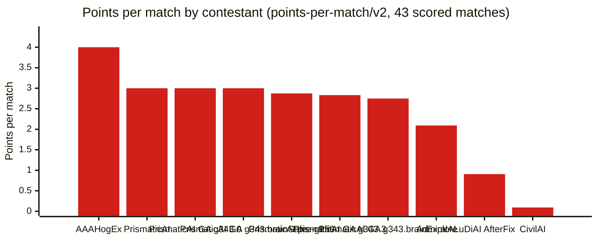
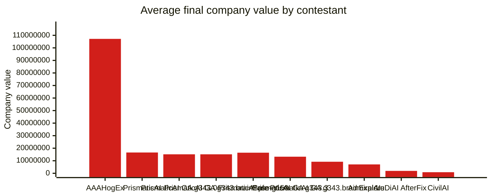
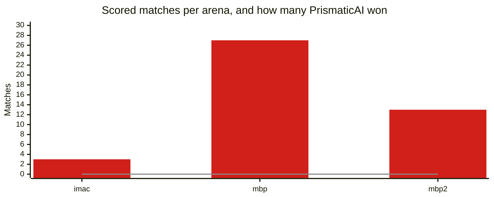

# battle-20261122T034646-07472abe

Derived from `battle-20261122T034646-07472abe.json` by `tools/research/ai-battle/battle.py report`; do not edit.

- Edition `07472abe62547121`: PrismaticAI and referee at `8c8d025388e85261a60027d9983d8588d720a2e9`, base set `opengfx-8.0.tar`
- 20-year free-for-all from 1960, map 256x256 temperate, breakdowns 1
- 43 scored match(es) on `imac` (20261119-master-gdf1e05e7d8), `mbp` (20261120-master-m17653b726e), `mbp2` (20261119-master-gdf1e05e7d8)
- Replays: 0 of 0 identical to their original on another arena

| # | Contestant | Played | Wins | Points | Points/match | Avg rank | Avg final value | Squirrel errors | Matches with anomalies |
|---|---|---|---|---|---|---|---|---|---|
| 1 | AAAHogEx | 43 | 43 | 172 | 4.0 | 1.0 | 107.2 M | 0 | 0 |
| 2 | PrismaticAI | 7 | 0 | 21 | 3.0 | 2.0 | 16.6 M | 0 | 0 |
| 3 | PrismaticAI GA g343.0 | 7 | 0 | 21 | 3.0 | 2.0 | 15.1 M | 0 | 0 |
| 4 | PrismaticAI GA g343.brainSafe | 7 | 0 | 21 | 3.0 | 2.0 | 15.1 M | 0 | 0 |
| 5 | PrismaticAI pre-g150 | 8 | 0 | 23 | 2.875 | 2.12 | 16.4 M | 0 | 0 |
| 6 | PrismaticAI GA g343.3 | 6 | 0 | 17 | 2.833 | 2.17 | 13.2 M | 0 | 0 |
| 7 | PrismaticAI GA g343.brainExplore | 8 | 0 | 22 | 2.75 | 2.25 | 9.2 M | 0 | 0 |
| 8 | AdmiralAI | 43 | 0 | 90 | 2.093 | 2.91 | 7.1 M | 0 | 6 |
| 9 | LuDiAI AfterFix | 43 | 0 | 39 | 0.907 | 4.09 | 1.9 M | 0 | 0 |
| 10 | CivilAI | 43 | 0 | 4 | 0.093 | 4.91 | 869.7 k | 0 | 3 |

```mermaid
---
config:
  xyChart:
    width: 900
    height: 360
  themeVariables:
    xyChart:
      plotColorPalette: "#d11f1a, #8a8a8a, #0b0b0b, #ece4d6"
---
xychart-beta
    title "Final company value per scored match: winner vs best PrismaticAI"
    x-axis ["m-0001", "m-0002", "m-0003", "m-0004", "m-0005", "m-0006", "m-0007", "m-0008", "m-0009", "m-0010", "m-0011", "m-0012", "m-0013", "m-0016", "m-0018", "m-0019", "m-0020", "m-0021", "m-0022", "m-0023", "m-0024", "m-0025", "m-0026", "m-0027", "m-0028", "m-0036", "m-0037", "m-0038", "m-0039", "m-0040", "m-0041", "m-0042", "m-0043", "m-0044", "m-0045", "m-0046", "m-0047", "m-0048", "m-0049", "m-0050", "m-0051", "m-0052", "m-0053"]
    %% series: Winner | Best PrismaticAI
    %% links: battle-20261122T034646-07472abe.md?col=Match&filter=m-0001 | battle-20261122T034646-07472abe.md?col=Match&filter=m-0002 | battle-20261122T034646-07472abe.md?col=Match&filter=m-0003 | battle-20261122T034646-07472abe.md?col=Match&filter=m-0004 | battle-20261122T034646-07472abe.md?col=Match&filter=m-0005 | battle-20261122T034646-07472abe.md?col=Match&filter=m-0006 | battle-20261122T034646-07472abe.md?col=Match&filter=m-0007 | battle-20261122T034646-07472abe.md?col=Match&filter=m-0008 | battle-20261122T034646-07472abe.md?col=Match&filter=m-0009 | battle-20261122T034646-07472abe.md?col=Match&filter=m-0010 | battle-20261122T034646-07472abe.md?col=Match&filter=m-0011 | battle-20261122T034646-07472abe.md?col=Match&filter=m-0012 | battle-20261122T034646-07472abe.md?col=Match&filter=m-0013 | battle-20261122T034646-07472abe.md?col=Match&filter=m-0016 | battle-20261122T034646-07472abe.md?col=Match&filter=m-0018 | battle-20261122T034646-07472abe.md?col=Match&filter=m-0019 | battle-20261122T034646-07472abe.md?col=Match&filter=m-0020 | battle-20261122T034646-07472abe.md?col=Match&filter=m-0021 | battle-20261122T034646-07472abe.md?col=Match&filter=m-0022 | battle-20261122T034646-07472abe.md?col=Match&filter=m-0023 | battle-20261122T034646-07472abe.md?col=Match&filter=m-0024 | battle-20261122T034646-07472abe.md?col=Match&filter=m-0025 | battle-20261122T034646-07472abe.md?col=Match&filter=m-0026 | battle-20261122T034646-07472abe.md?col=Match&filter=m-0027 | battle-20261122T034646-07472abe.md?col=Match&filter=m-0028 | battle-20261122T034646-07472abe.md?col=Match&filter=m-0036 | battle-20261122T034646-07472abe.md?col=Match&filter=m-0037 | battle-20261122T034646-07472abe.md?col=Match&filter=m-0038 | battle-20261122T034646-07472abe.md?col=Match&filter=m-0039 | battle-20261122T034646-07472abe.md?col=Match&filter=m-0040 | battle-20261122T034646-07472abe.md?col=Match&filter=m-0041 | battle-20261122T034646-07472abe.md?col=Match&filter=m-0042 | battle-20261122T034646-07472abe.md?col=Match&filter=m-0043 | battle-20261122T034646-07472abe.md?col=Match&filter=m-0044 | battle-20261122T034646-07472abe.md?col=Match&filter=m-0045 | battle-20261122T034646-07472abe.md?col=Match&filter=m-0046 | battle-20261122T034646-07472abe.md?col=Match&filter=m-0047 | battle-20261122T034646-07472abe.md?col=Match&filter=m-0048 | battle-20261122T034646-07472abe.md?col=Match&filter=m-0049 | battle-20261122T034646-07472abe.md?col=Match&filter=m-0050 | battle-20261122T034646-07472abe.md?col=Match&filter=m-0051 | battle-20261122T034646-07472abe.md?col=Match&filter=m-0052 | battle-20261122T034646-07472abe.md?col=Match&filter=m-0053
    y-axis "Company value" 0 --> 172000000
    bar [100683402, 108048132, 108048132, 99948494, 89864615, 135778904, 155046141, 138376858, 138376858, 109190269, 156423380, 99859614, 109720549, 107941640, 85832183, 91510730, 82602702, 82602702, 109583710, 95956761, 63485660, 64936033, 107169641, 107169641, 84128759, 81802694, 71788335, 105626971, 105626971, 103240683, 118077536, 149439218, 122862740, 156115421, 156115421, 135849749, 152821904, 78875358, 88157088, 81872512, 81872512, 95573722, 90291010]
    line [20746551, 21903169, 21903169, 12977856, 22181851, 24501441, 20584966, 19662494, 19662494, 7928278, 17457947, 18678878, 18678696, 14762207, 9767428, 14575220, 17959832, 17959832, 7738825, 15006846, 12953968, 14731189, 11987040, 11987040, 7047024, 15122047, 10595446, 8994932, 8994932, 7227315, 6746801, 18220853, 14794177, 11544265, 11544265, 5440861, 8581683, 16836844, 16672661, 13912619, 13912619, 10595453, 9435308]
```

<!-- battle-charts:begin -->
<!-- derived from battle-20261122T034646-07472abe.json by `battle.py render`; `battle.py check` fails when it is stale -->

<!-- battle-charts:end -->

| Match | Arena | Seed | Winner | Value | Last | Anomalies |
|---|---|---|---|---|---|---|
| m-0001 | mbp | 656604956 | AAAHogEx | 100.7 M | CivilAI | - |
| m-0002 | mbp | 656604956 | AAAHogEx | 108.0 M | CivilAI | AdmiralAI: fleet_drop:312->182 |
| m-0003 | mbp | 656604956 | AAAHogEx | 108.0 M | CivilAI | AdmiralAI: fleet_drop:312->182 |
| m-0004 | mbp | 656604956 | AAAHogEx | 99.9 M | CivilAI | - |
| m-0005 | mbp | 656604956 | AAAHogEx | 89.9 M | CivilAI | - |
| m-0006 | mbp | 700778346 | AAAHogEx | 135.8 M | CivilAI | - |
| m-0007 | mbp | 700778346 | AAAHogEx | 155.0 M | CivilAI | CivilAI: fleet_drop:71->40 |
| m-0008 | mbp | 700778346 | AAAHogEx | 138.4 M | CivilAI | - |
| m-0009 | mbp | 700778346 | AAAHogEx | 138.4 M | CivilAI | - |
| m-0010 | imac | 700778346 | AAAHogEx | 109.2 M | CivilAI | - |
| m-0011 | imac | 700778346 | AAAHogEx | 156.4 M | CivilAI | - |
| m-0012 | imac | 1038756969 | AAAHogEx | 99.9 M | CivilAI | - |
| m-0013 | mbp2 | 1038756969 | AAAHogEx | 109.7 M | CivilAI | - |
| m-0016 | mbp2 | 1038756969 | AAAHogEx | 107.9 M | CivilAI | AdmiralAI: fleet_drop:152->106 |
| m-0018 | mbp2 | 100767914 | AAAHogEx | 85.8 M | CivilAI | AdmiralAI: fleet_drop:111->67 |
| m-0019 | mbp2 | 100767914 | AAAHogEx | 91.5 M | CivilAI | - |
| m-0020 | mbp2 | 100767914 | AAAHogEx | 82.6 M | CivilAI | - |
| m-0021 | mbp2 | 100767914 | AAAHogEx | 82.6 M | CivilAI | - |
| m-0022 | mbp2 | 100767914 | AAAHogEx | 109.6 M | CivilAI | - |
| m-0023 | mbp2 | 100767914 | AAAHogEx | 96.0 M | CivilAI | - |
| m-0024 | mbp2 | 1500627367 | AAAHogEx | 63.5 M | CivilAI | AdmiralAI: fleet_drop:341->145 |
| m-0025 | mbp2 | 1500627367 | AAAHogEx | 64.9 M | CivilAI | CivilAI: fleet_drop:33->9 |
| m-0026 | mbp2 | 1500627367 | AAAHogEx | 107.2 M | CivilAI | - |
| m-0027 | mbp2 | 1500627367 | AAAHogEx | 107.2 M | CivilAI | - |
| m-0028 | mbp2 | 1500627367 | AAAHogEx | 84.1 M | CivilAI | - |
| m-0036 | mbp | 1386189230 | AAAHogEx | 81.8 M | CivilAI | - |
| m-0037 | mbp | 1386189230 | AAAHogEx | 71.8 M | CivilAI | - |
| m-0038 | mbp | 1386189230 | AAAHogEx | 105.6 M | LuDiAI AfterFix | - |
| m-0039 | mbp | 1386189230 | AAAHogEx | 105.6 M | LuDiAI AfterFix | - |
| m-0040 | mbp | 1386189230 | AAAHogEx | 103.2 M | CivilAI | - |
| m-0041 | mbp | 1386189230 | AAAHogEx | 118.1 M | LuDiAI AfterFix | - |
| m-0042 | mbp | 181104308 | AAAHogEx | 149.4 M | CivilAI | - |
| m-0043 | mbp | 181104308 | AAAHogEx | 122.9 M | CivilAI | - |
| m-0044 | mbp | 181104308 | AAAHogEx | 156.1 M | CivilAI | - |
| m-0045 | mbp | 181104308 | AAAHogEx | 156.1 M | CivilAI | - |
| m-0046 | mbp | 181104308 | AAAHogEx | 135.8 M | CivilAI | - |
| m-0047 | mbp | 181104308 | AAAHogEx | 152.8 M | CivilAI | - |
| m-0048 | mbp | 144859306 | AAAHogEx | 78.9 M | CivilAI | - |
| m-0049 | mbp | 144859306 | AAAHogEx | 88.2 M | LuDiAI AfterFix | AdmiralAI: fleet_drop:354->215 |
| m-0050 | mbp | 144859306 | AAAHogEx | 81.9 M | CivilAI | - |
| m-0051 | mbp | 144859306 | AAAHogEx | 81.9 M | CivilAI | - |
| m-0052 | mbp | 144859306 | AAAHogEx | 95.6 M | CivilAI | - |
| m-0053 | mbp | 144859306 | AAAHogEx | 90.3 M | CivilAI | CivilAI: fleet_drop:64->39 |
