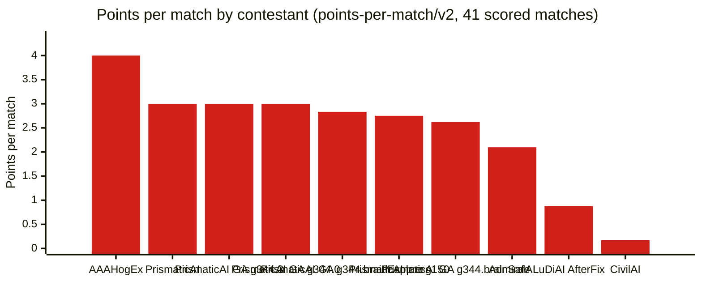
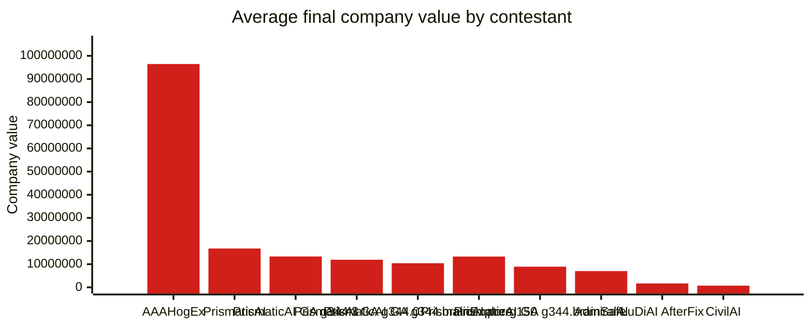
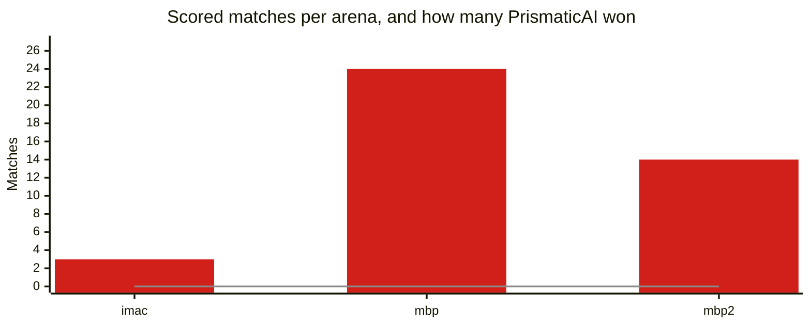

# battle-20261122T035646-e8396af1

Derived from `battle-20261122T035646-e8396af1.json` by `tools/research/ai-battle/battle.py report`; do not edit.

- Edition `e8396af19787e711`: PrismaticAI and referee at `8c8d025388e85261a60027d9983d8588d720a2e9`, base set `opengfx-8.0.tar`
- 20-year free-for-all from 1960, map 256x256 temperate, breakdowns 1
- 41 scored match(es) on `imac` (20261119-master-gdf1e05e7d8), `mbp` (20261120-master-m17653b726e), `mbp2` (20261119-master-gdf1e05e7d8)
- Replays: 0 of 0 identical to their original on another arena

| # | Contestant | Played | Wins | Points | Points/match | Avg rank | Avg final value | Squirrel errors | Matches with anomalies |
|---|---|---|---|---|---|---|---|---|---|
| 1 | AAAHogEx | 41 | 41 | 164 | 4.0 | 1.0 | 96.5 M | 0 | 0 |
| 2 | PrismaticAI | 6 | 0 | 18 | 3.0 | 2.0 | 16.8 M | 0 | 0 |
| 3 | PrismaticAI GA g344.3 | 6 | 0 | 18 | 3.0 | 2.0 | 13.3 M | 0 | 0 |
| 4 | PrismaticAI GA g344.0 | 7 | 0 | 21 | 3.0 | 2.0 | 11.9 M | 0 | 0 |
| 5 | PrismaticAI GA g344.brainExplore | 6 | 0 | 17 | 2.833 | 2.17 | 10.4 M | 0 | 0 |
| 6 | PrismaticAI pre-g150 | 8 | 0 | 22 | 2.75 | 2.25 | 13.3 M | 0 | 0 |
| 7 | PrismaticAI GA g344.brainSafe | 8 | 0 | 21 | 2.625 | 2.38 | 8.9 M | 0 | 0 |
| 8 | AdmiralAI | 41 | 0 | 86 | 2.098 | 2.9 | 7.0 M | 0 | 0 |
| 9 | LuDiAI AfterFix | 41 | 0 | 36 | 0.878 | 4.12 | 1.7 M | 0 | 3 |
| 10 | CivilAI | 41 | 0 | 7 | 0.171 | 4.83 | 728.9 k | 0 | 3 |

```mermaid
---
config:
  xyChart:
    width: 900
    height: 360
  themeVariables:
    xyChart:
      plotColorPalette: "#d11f1a, #8a8a8a, #0b0b0b, #ece4d6"
---
xychart-beta
    title "Final company value per scored match: winner vs best PrismaticAI"
    x-axis ["m-0001", "m-0002", "m-0003", "m-0004", "m-0005", "m-0006", "m-0007", "m-0008", "m-0009", "m-0010", "m-0011", "m-0012", "m-0013", "m-0014", "m-0015", "m-0017", "m-0019", "m-0020", "m-0021", "m-0022", "m-0023", "m-0024", "m-0025", "m-0026", "m-0027", "m-0028", "m-0036", "m-0037", "m-0038", "m-0039", "m-0040", "m-0041", "m-0042", "m-0043", "m-0044", "m-0045", "m-0046", "m-0047", "m-0048", "m-0049", "m-0051"]
    %% series: Winner | Best PrismaticAI
    %% links: battle-20261122T035646-e8396af1.md?col=Match&filter=m-0001 | battle-20261122T035646-e8396af1.md?col=Match&filter=m-0002 | battle-20261122T035646-e8396af1.md?col=Match&filter=m-0003 | battle-20261122T035646-e8396af1.md?col=Match&filter=m-0004 | battle-20261122T035646-e8396af1.md?col=Match&filter=m-0005 | battle-20261122T035646-e8396af1.md?col=Match&filter=m-0006 | battle-20261122T035646-e8396af1.md?col=Match&filter=m-0007 | battle-20261122T035646-e8396af1.md?col=Match&filter=m-0008 | battle-20261122T035646-e8396af1.md?col=Match&filter=m-0009 | battle-20261122T035646-e8396af1.md?col=Match&filter=m-0010 | battle-20261122T035646-e8396af1.md?col=Match&filter=m-0011 | battle-20261122T035646-e8396af1.md?col=Match&filter=m-0012 | battle-20261122T035646-e8396af1.md?col=Match&filter=m-0013 | battle-20261122T035646-e8396af1.md?col=Match&filter=m-0014 | battle-20261122T035646-e8396af1.md?col=Match&filter=m-0015 | battle-20261122T035646-e8396af1.md?col=Match&filter=m-0017 | battle-20261122T035646-e8396af1.md?col=Match&filter=m-0019 | battle-20261122T035646-e8396af1.md?col=Match&filter=m-0020 | battle-20261122T035646-e8396af1.md?col=Match&filter=m-0021 | battle-20261122T035646-e8396af1.md?col=Match&filter=m-0022 | battle-20261122T035646-e8396af1.md?col=Match&filter=m-0023 | battle-20261122T035646-e8396af1.md?col=Match&filter=m-0024 | battle-20261122T035646-e8396af1.md?col=Match&filter=m-0025 | battle-20261122T035646-e8396af1.md?col=Match&filter=m-0026 | battle-20261122T035646-e8396af1.md?col=Match&filter=m-0027 | battle-20261122T035646-e8396af1.md?col=Match&filter=m-0028 | battle-20261122T035646-e8396af1.md?col=Match&filter=m-0036 | battle-20261122T035646-e8396af1.md?col=Match&filter=m-0037 | battle-20261122T035646-e8396af1.md?col=Match&filter=m-0038 | battle-20261122T035646-e8396af1.md?col=Match&filter=m-0039 | battle-20261122T035646-e8396af1.md?col=Match&filter=m-0040 | battle-20261122T035646-e8396af1.md?col=Match&filter=m-0041 | battle-20261122T035646-e8396af1.md?col=Match&filter=m-0042 | battle-20261122T035646-e8396af1.md?col=Match&filter=m-0043 | battle-20261122T035646-e8396af1.md?col=Match&filter=m-0044 | battle-20261122T035646-e8396af1.md?col=Match&filter=m-0045 | battle-20261122T035646-e8396af1.md?col=Match&filter=m-0046 | battle-20261122T035646-e8396af1.md?col=Match&filter=m-0047 | battle-20261122T035646-e8396af1.md?col=Match&filter=m-0048 | battle-20261122T035646-e8396af1.md?col=Match&filter=m-0049 | battle-20261122T035646-e8396af1.md?col=Match&filter=m-0051
    y-axis "Company value" 0 --> 178000000
    bar [76871388, 95661889, 70132615, 100732273, 76878149, 71198072, 98687264, 86807021, 100840673, 88694630, 96264371, 116867309, 135570418, 113179670, 109766589, 121984470, 98287685, 91447833, 93979209, 95653945, 92642924, 86586191, 108162181, 78640417, 78918420, 93623971, 117844347, 162196963, 115897865, 108998606, 86256798, 109940564, 87240020, 89106471, 82836391, 71487315, 79633440, 79044749, 110201754, 92701504, 83643489]
    line [17427045, 11391957, 8323229, 10204441, 13306438, 11490320, 12121970, 8953662, 8424673, 11427173, 11072459, 23623683, 18069865, 15839857, 12672110, 19035485, 8971209, 9700427, 7803695, 4778542, 9294935, 16363368, 11698464, 8860987, 4675166, 9309575, 27929377, 17667076, 15671648, 11226997, 16934037, 12745158, 14823871, 14454142, 13099372, 9040915, 9900679, 14532561, 6397648, 5929733, 9313137]
```

<!-- battle-charts:begin -->
<!-- derived from battle-20261122T035646-e8396af1.json by `battle.py render`; `battle.py check` fails when it is stale -->

<!-- battle-charts:end -->

| Match | Arena | Seed | Winner | Value | Last | Anomalies |
|---|---|---|---|---|---|---|
| m-0001 | mbp | 1326631134 | AAAHogEx | 76.9 M | CivilAI | - |
| m-0002 | mbp | 1326631134 | AAAHogEx | 95.7 M | CivilAI | - |
| m-0003 | mbp | 1326631134 | AAAHogEx | 70.1 M | CivilAI | - |
| m-0004 | mbp | 1326631134 | AAAHogEx | 100.7 M | LuDiAI AfterFix | - |
| m-0005 | mbp | 1326631134 | AAAHogEx | 76.9 M | LuDiAI AfterFix | CivilAI: fleet_drop:61->36; LuDiAI AfterFix: fleet_drop:29->16 |
| m-0006 | mbp | 1415103968 | AAAHogEx | 71.2 M | CivilAI | - |
| m-0007 | mbp | 1415103968 | AAAHogEx | 98.7 M | CivilAI | - |
| m-0008 | mbp | 1415103968 | AAAHogEx | 86.8 M | CivilAI | - |
| m-0009 | mbp | 1415103968 | AAAHogEx | 100.8 M | CivilAI | - |
| m-0010 | imac | 1415103968 | AAAHogEx | 88.7 M | CivilAI | CivilAI: fleet_drop:89->48 |
| m-0011 | imac | 1415103968 | AAAHogEx | 96.3 M | CivilAI | - |
| m-0012 | imac | 380438750 | AAAHogEx | 116.9 M | CivilAI | - |
| m-0013 | mbp2 | 380438750 | AAAHogEx | 135.6 M | LuDiAI AfterFix | - |
| m-0014 | mbp2 | 380438750 | AAAHogEx | 113.2 M | CivilAI | - |
| m-0015 | mbp2 | 380438750 | AAAHogEx | 109.8 M | CivilAI | - |
| m-0017 | mbp2 | 380438750 | AAAHogEx | 122.0 M | LuDiAI AfterFix | - |
| m-0019 | mbp2 | 1590915126 | AAAHogEx | 98.3 M | CivilAI | - |
| m-0020 | mbp2 | 1590915126 | AAAHogEx | 91.4 M | CivilAI | - |
| m-0021 | mbp2 | 1590915126 | AAAHogEx | 94.0 M | CivilAI | - |
| m-0022 | mbp2 | 1590915126 | AAAHogEx | 95.7 M | CivilAI | - |
| m-0023 | mbp2 | 1590915126 | AAAHogEx | 92.6 M | CivilAI | - |
| m-0024 | mbp2 | 907998882 | AAAHogEx | 86.6 M | CivilAI | - |
| m-0025 | mbp2 | 907998882 | AAAHogEx | 108.2 M | CivilAI | - |
| m-0026 | mbp2 | 907998882 | AAAHogEx | 78.6 M | LuDiAI AfterFix | - |
| m-0027 | mbp2 | 907998882 | AAAHogEx | 78.9 M | CivilAI | - |
| m-0028 | mbp2 | 907998882 | AAAHogEx | 93.6 M | CivilAI | - |
| m-0036 | mbp | 831829111 | AAAHogEx | 117.8 M | CivilAI | - |
| m-0037 | mbp | 831829111 | AAAHogEx | 162.2 M | LuDiAI AfterFix | - |
| m-0038 | mbp | 831829111 | AAAHogEx | 115.9 M | CivilAI | - |
| m-0039 | mbp | 831829111 | AAAHogEx | 109.0 M | LuDiAI AfterFix | - |
| m-0040 | mbp | 831829111 | AAAHogEx | 86.3 M | CivilAI | - |
| m-0041 | mbp | 831829111 | AAAHogEx | 109.9 M | CivilAI | - |
| m-0042 | mbp | 1100056911 | AAAHogEx | 87.2 M | CivilAI | CivilAI: fleet_drop:70->34 |
| m-0043 | mbp | 1100056911 | AAAHogEx | 89.1 M | CivilAI | - |
| m-0044 | mbp | 1100056911 | AAAHogEx | 82.8 M | CivilAI | - |
| m-0045 | mbp | 1100056911 | AAAHogEx | 71.5 M | CivilAI | - |
| m-0046 | mbp | 1100056911 | AAAHogEx | 79.6 M | CivilAI | - |
| m-0047 | mbp | 1100056911 | AAAHogEx | 79.0 M | CivilAI | - |
| m-0048 | mbp | 169288430 | AAAHogEx | 110.2 M | CivilAI | - |
| m-0049 | mbp | 169288430 | AAAHogEx | 92.7 M | CivilAI | LuDiAI AfterFix: fleet_drop:125->69 |
| m-0051 | mbp | 169288430 | AAAHogEx | 83.6 M | CivilAI | LuDiAI AfterFix: fleet_drop:151->103 |
