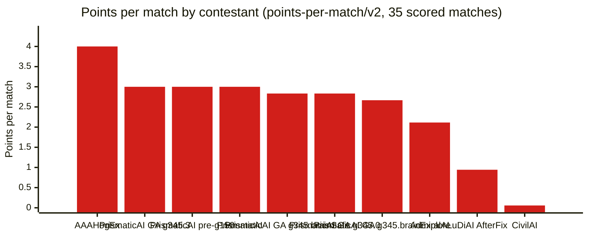
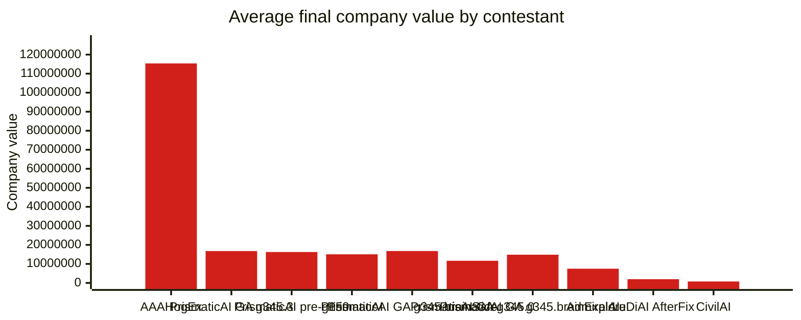
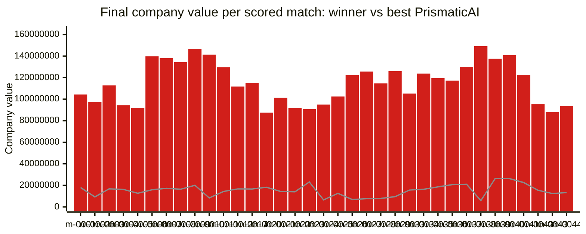
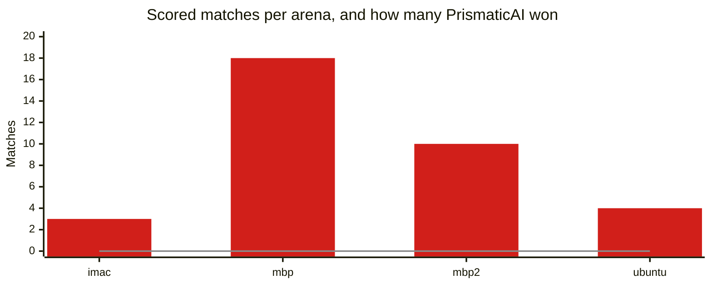

# battle-20261122T041253-fc6acf8c

Derived from `battle-20261122T041253-fc6acf8c.json` by `tools/research/ai-battle/battle.py report`; do not edit.

- Edition `fc6acf8cb06f73b1`: PrismaticAI and referee at `8c8d025388e85261a60027d9983d8588d720a2e9`, base set `opengfx-8.0.tar`
- 20-year free-for-all from 1960, map 256x256 temperate, breakdowns 1
- 35 scored match(es) on `imac` (20261119-master-gdf1e05e7d8), `mbp` (20261120-master-m17653b726e), `mbp2` (20261119-master-gdf1e05e7d8), `ubuntu` (20261119-master-gdf1e05e7d8)
- Replays: 0 of 0 identical to their original on another arena

| # | Contestant | Played | Wins | Points | Points/match | Avg rank | Avg final value | Squirrel errors | Matches with anomalies |
|---|---|---|---|---|---|---|---|---|---|
| 1 | AAAHogEx | 35 | 35 | 140 | 4.0 | 1.0 | 115.4 M | 0 | 0 |
| 2 | PrismaticAI GA g345.3 | 7 | 0 | 21 | 3.0 | 2.0 | 16.8 M | 0 | 0 |
| 3 | PrismaticAI pre-g150 | 5 | 0 | 15 | 3.0 | 2.0 | 16.2 M | 0 | 0 |
| 4 | PrismaticAI | 5 | 0 | 15 | 3.0 | 2.0 | 15.0 M | 0 | 0 |
| 5 | PrismaticAI GA g345.brainSafe | 6 | 0 | 17 | 2.833 | 2.17 | 16.8 M | 0 | 0 |
| 6 | PrismaticAI GA g345.0 | 6 | 0 | 17 | 2.833 | 2.17 | 11.6 M | 0 | 0 |
| 7 | PrismaticAI GA g345.brainExplore | 6 | 0 | 16 | 2.667 | 2.33 | 14.8 M | 0 | 0 |
| 8 | AdmiralAI | 35 | 0 | 74 | 2.114 | 2.89 | 7.5 M | 0 | 2 |
| 9 | LuDiAI AfterFix | 35 | 0 | 33 | 0.943 | 4.06 | 2.0 M | 0 | 1 |
| 10 | CivilAI | 35 | 0 | 2 | 0.057 | 4.94 | 757.1 k | 0 | 7 |

<!-- battle-charts:begin -->
<!-- derived from battle-20261122T041253-fc6acf8c.json by `battle.py render`; `battle.py check` fails when it is stale -->

<!-- battle-charts:end -->

| Match | Arena | Seed | Winner | Value | Last | Anomalies |
|---|---|---|---|---|---|---|
| m-0001 | mbp | 1103925980 | AAAHogEx | 104.3 M | CivilAI | CivilAI: fleet_drop:12->8 |
| m-0002 | mbp | 1103925980 | AAAHogEx | 97.5 M | CivilAI | CivilAI: fleet_drop:63->39 |
| m-0003 | mbp | 1103925980 | AAAHogEx | 112.7 M | CivilAI | CivilAI: fleet_drop:51->30 |
| m-0004 | mbp | 1103925980 | AAAHogEx | 94.4 M | CivilAI | - |
| m-0005 | mbp | 1103925980 | AAAHogEx | 92.0 M | LuDiAI AfterFix | - |
| m-0006 | mbp | 620081871 | AAAHogEx | 139.7 M | CivilAI | AdmiralAI: fleet_drop:219->146 |
| m-0007 | mbp | 620081871 | AAAHogEx | 138.1 M | CivilAI | - |
| m-0008 | mbp | 620081871 | AAAHogEx | 134.3 M | CivilAI | CivilAI: fleet_drop:40->21 |
| m-0009 | mbp | 620081871 | AAAHogEx | 146.7 M | CivilAI | LuDiAI AfterFix: fleet_drop:75->36 |
| m-0010 | imac | 620081871 | AAAHogEx | 141.3 M | CivilAI | - |
| m-0011 | imac | 620081871 | AAAHogEx | 129.7 M | CivilAI | - |
| m-0012 | imac | 426258531 | AAAHogEx | 111.7 M | CivilAI | - |
| m-0017 | mbp2 | 426258531 | AAAHogEx | 115.2 M | CivilAI | - |
| m-0020 | mbp2 | 780418434 | AAAHogEx | 87.4 M | CivilAI | - |
| m-0021 | mbp2 | 780418434 | AAAHogEx | 101.2 M | CivilAI | - |
| m-0022 | mbp2 | 780418434 | AAAHogEx | 91.9 M | CivilAI | - |
| m-0023 | mbp2 | 780418434 | AAAHogEx | 90.7 M | CivilAI | - |
| m-0024 | mbp2 | 663979117 | AAAHogEx | 95.0 M | CivilAI | - |
| m-0025 | mbp2 | 663979117 | AAAHogEx | 102.5 M | CivilAI | - |
| m-0026 | mbp2 | 663979117 | AAAHogEx | 122.3 M | CivilAI | CivilAI: fleet_drop:22->12 |
| m-0027 | mbp2 | 663979117 | AAAHogEx | 125.6 M | CivilAI | CivilAI: fleet_drop:34->20 |
| m-0028 | mbp2 | 663979117 | AAAHogEx | 114.7 M | CivilAI | CivilAI: fleet_drop:30->19 |
| m-0029 | ubuntu | 663979117 | AAAHogEx | 126.0 M | CivilAI | - |
| m-0033 | ubuntu | 1812262316 | AAAHogEx | 105.2 M | CivilAI | - |
| m-0034 | ubuntu | 1812262316 | AAAHogEx | 123.7 M | CivilAI | - |
| m-0035 | ubuntu | 1812262316 | AAAHogEx | 119.4 M | CivilAI | - |
| m-0036 | mbp | 64999860 | AAAHogEx | 117.1 M | CivilAI | - |
| m-0037 | mbp | 64999860 | AAAHogEx | 130.1 M | CivilAI | - |
| m-0038 | mbp | 64999860 | AAAHogEx | 149.2 M | CivilAI | - |
| m-0039 | mbp | 64999860 | AAAHogEx | 137.5 M | CivilAI | AdmiralAI: fleet_drop:167->110 |
| m-0040 | mbp | 64999860 | AAAHogEx | 141.0 M | CivilAI | - |
| m-0041 | mbp | 64999860 | AAAHogEx | 122.5 M | CivilAI | - |
| m-0042 | mbp | 1498200751 | AAAHogEx | 95.4 M | LuDiAI AfterFix | - |
| m-0043 | mbp | 1498200751 | AAAHogEx | 88.1 M | CivilAI | - |
| m-0044 | mbp | 1498200751 | AAAHogEx | 93.7 M | CivilAI | - |
