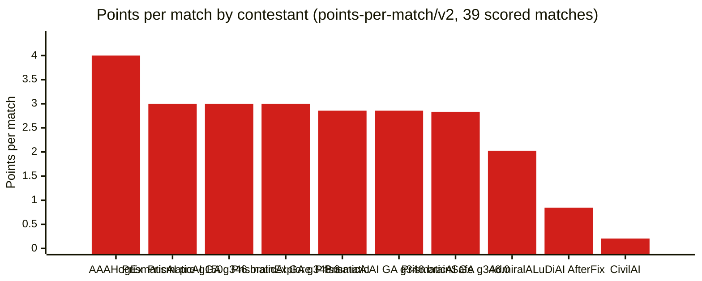
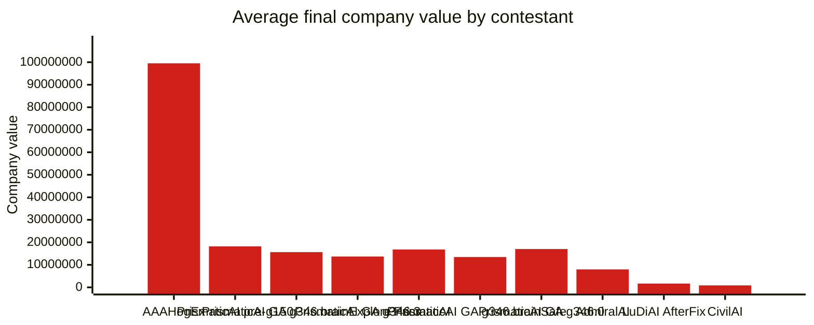
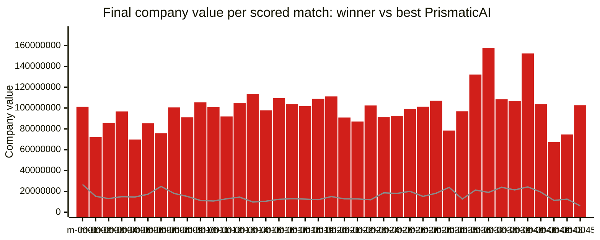
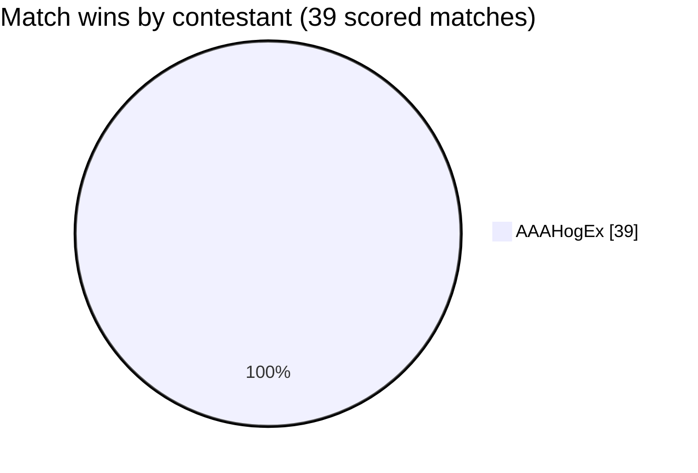
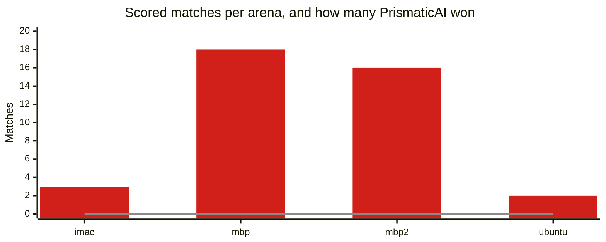

# battle-20261122T042734-dfcf62a2

Derived from `battle-20261122T042734-dfcf62a2.json` by `tools/research/ai-battle/battle.py report`; do not edit.

- Edition `dfcf62a2a44de527`: PrismaticAI and referee at `8c8d025388e85261a60027d9983d8588d720a2e9`, base set `opengfx-8.0.tar`
- 20-year free-for-all from 1960, map 256x256 temperate, breakdowns 1
- 39 scored match(es) on `imac` (20261119-master-gdf1e05e7d8), `mbp` (20261120-master-m17653b726e), `mbp2` (20261119-master-gdf1e05e7d8), `ubuntu` (20261119-master-gdf1e05e7d8)
- Replays: 0 of 0 identical to their original on another arena

| # | Contestant | Played | Wins | Points | Points/match | Avg rank | Avg final value | Squirrel errors | Matches with anomalies |
|---|---|---|---|---|---|---|---|---|---|
| 1 | AAAHogEx | 39 | 39 | 156 | 4.0 | 1.0 | 99.5 M | 0 | 0 |
| 2 | PrismaticAI pre-g150 | 7 | 0 | 21 | 3.0 | 2.0 | 18.2 M | 0 | 0 |
| 3 | PrismaticAI GA g346.brainExplore | 6 | 0 | 18 | 3.0 | 2.0 | 15.6 M | 0 | 0 |
| 4 | PrismaticAI GA g346.3 | 6 | 0 | 18 | 3.0 | 2.0 | 13.7 M | 0 | 0 |
| 5 | PrismaticAI | 7 | 0 | 20 | 2.857 | 2.14 | 16.8 M | 0 | 0 |
| 6 | PrismaticAI GA g346.brainSafe | 7 | 0 | 20 | 2.857 | 2.14 | 13.5 M | 0 | 0 |
| 7 | PrismaticAI GA g346.0 | 6 | 0 | 17 | 2.833 | 2.17 | 17.0 M | 0 | 0 |
| 8 | AdmiralAI | 39 | 0 | 79 | 2.026 | 2.97 | 8.0 M | 0 | 3 |
| 9 | LuDiAI AfterFix | 39 | 0 | 33 | 0.846 | 4.15 | 1.7 M | 0 | 0 |
| 10 | CivilAI | 39 | 0 | 8 | 0.205 | 4.79 | 880.4 k | 3650 | 4 |

<!-- battle-charts:begin -->
<!-- derived from battle-20261122T042734-dfcf62a2.json by `battle.py render`; `battle.py check` fails when it is stale -->

<!-- battle-charts:end -->

| Match | Arena | Seed | Winner | Value | Last | Anomalies |
|---|---|---|---|---|---|---|
| m-0001 | mbp | 32715329 | AAAHogEx | 101.2 M | LuDiAI AfterFix | - |
| m-0002 | mbp | 32715329 | AAAHogEx | 72.2 M | CivilAI | - |
| m-0003 | mbp | 32715329 | AAAHogEx | 85.8 M | CivilAI | AdmiralAI: fleet_drop:320->177 |
| m-0004 | mbp | 32715329 | AAAHogEx | 96.8 M | CivilAI | - |
| m-0005 | mbp | 32715329 | AAAHogEx | 69.7 M | CivilAI | AdmiralAI: fleet_drop:166->108 |
| m-0006 | mbp | 1111715431 | AAAHogEx | 85.4 M | CivilAI | CivilAI: fleet_drop:82->45 |
| m-0007 | mbp | 1111715431 | AAAHogEx | 75.8 M | CivilAI | - |
| m-0008 | mbp | 1111715431 | AAAHogEx | 100.6 M | CivilAI | CivilAI: no_vehicles |
| m-0009 | mbp | 1111715431 | AAAHogEx | 91.0 M | CivilAI | - |
| m-0010 | imac | 1111715431 | AAAHogEx | 105.5 M | CivilAI | - |
| m-0011 | imac | 1111715431 | AAAHogEx | 101.0 M | CivilAI | - |
| m-0012 | imac | 215544314 | AAAHogEx | 92.0 M | LuDiAI AfterFix | - |
| m-0013 | mbp2 | 215544314 | AAAHogEx | 104.6 M | CivilAI | - |
| m-0014 | mbp2 | 215544314 | AAAHogEx | 113.4 M | CivilAI | - |
| m-0015 | mbp2 | 215544314 | AAAHogEx | 97.8 M | LuDiAI AfterFix | - |
| m-0016 | mbp2 | 215544314 | AAAHogEx | 109.5 M | CivilAI | - |
| m-0017 | mbp2 | 215544314 | AAAHogEx | 103.7 M | LuDiAI AfterFix | - |
| m-0018 | mbp2 | 270571994 | AAAHogEx | 101.8 M | CivilAI | - |
| m-0019 | mbp2 | 270571994 | AAAHogEx | 108.8 M | CivilAI | - |
| m-0020 | mbp2 | 270571994 | AAAHogEx | 111.2 M | LuDiAI AfterFix | - |
| m-0021 | mbp2 | 270571994 | AAAHogEx | 90.9 M | CivilAI | - |
| m-0022 | mbp2 | 270571994 | AAAHogEx | 87.1 M | LuDiAI AfterFix | - |
| m-0023 | mbp2 | 270571994 | AAAHogEx | 102.5 M | LuDiAI AfterFix | - |
| m-0024 | mbp2 | 150943496 | AAAHogEx | 91.2 M | CivilAI | AdmiralAI: fleet_drop:215->150 |
| m-0025 | mbp2 | 150943496 | AAAHogEx | 92.6 M | CivilAI | - |
| m-0026 | mbp2 | 150943496 | AAAHogEx | 99.2 M | CivilAI | - |
| m-0027 | mbp2 | 150943496 | AAAHogEx | 101.3 M | CivilAI | CivilAI: fleet_drop:22->11 |
| m-0028 | mbp2 | 150943496 | AAAHogEx | 107.0 M | CivilAI | - |
| m-0030 | ubuntu | 1404100027 | AAAHogEx | 78.4 M | CivilAI | - |
| m-0035 | ubuntu | 1404100027 | AAAHogEx | 96.9 M | CivilAI | - |
| m-0036 | mbp | 87326789 | AAAHogEx | 132.2 M | CivilAI | - |
| m-0037 | mbp | 87326789 | AAAHogEx | 157.9 M | CivilAI | - |
| m-0038 | mbp | 87326789 | AAAHogEx | 108.4 M | LuDiAI AfterFix | - |
| m-0039 | mbp | 87326789 | AAAHogEx | 106.8 M | CivilAI | - |
| m-0040 | mbp | 87326789 | AAAHogEx | 152.4 M | CivilAI | - |
| m-0041 | mbp | 87326789 | AAAHogEx | 103.6 M | CivilAI | - |
| m-0042 | mbp | 1744591539 | AAAHogEx | 67.4 M | CivilAI | - |
| m-0043 | mbp | 1744591539 | AAAHogEx | 74.6 M | CivilAI | - |
| m-0045 | mbp | 1744591539 | AAAHogEx | 102.7 M | CivilAI | CivilAI: squirrel_errors:3650 |
