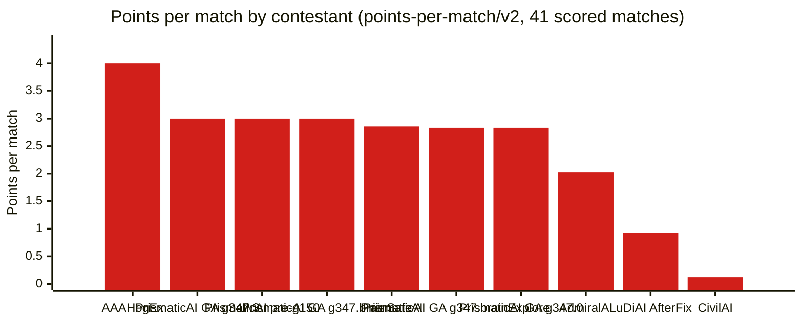
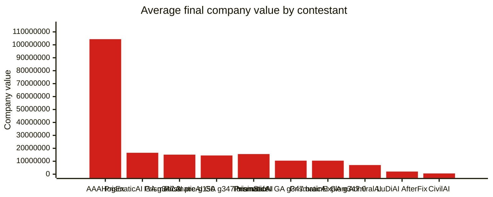
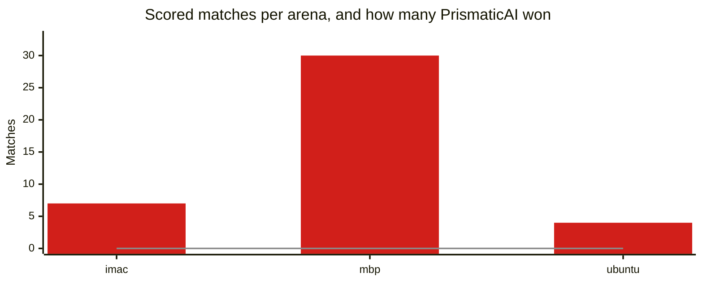

# battle-20261122T045411-a80cc94a

Derived from `battle-20261122T045411-a80cc94a.json` by `tools/research/ai-battle/battle.py report`; do not edit.

- Edition `a80cc94a275dbec1`: PrismaticAI and referee at `8c8d025388e85261a60027d9983d8588d720a2e9`, base set `opengfx-8.0.tar`
- 20-year free-for-all from 1960, map 256x256 temperate, breakdowns 1
- 41 scored match(es) on `imac` (20261119-master-gdf1e05e7d8), `mbp` (20261120-master-m17653b726e), `ubuntu` (20261119-master-gdf1e05e7d8)
- Replays: 0 of 4 identical to their original on another arena

| # | Contestant | Played | Wins | Points | Points/match | Avg rank | Avg final value | Squirrel errors | Matches with anomalies |
|---|---|---|---|---|---|---|---|---|---|
| 1 | AAAHogEx | 41 | 41 | 164 | 4.0 | 1.0 | 104.4 M | 0 | 0 |
| 2 | PrismaticAI GA g347.3 | 6 | 0 | 18 | 3.0 | 2.0 | 16.5 M | 0 | 0 |
| 3 | PrismaticAI pre-g150 | 8 | 0 | 24 | 3.0 | 2.0 | 15.1 M | 0 | 0 |
| 4 | PrismaticAI GA g347.brainSafe | 8 | 0 | 24 | 3.0 | 2.0 | 14.5 M | 0 | 0 |
| 5 | PrismaticAI | 7 | 0 | 20 | 2.857 | 2.14 | 15.5 M | 0 | 0 |
| 6 | PrismaticAI GA g347.brainExplore | 6 | 0 | 17 | 2.833 | 2.17 | 10.5 M | 0 | 0 |
| 7 | PrismaticAI GA g347.0 | 6 | 0 | 17 | 2.833 | 2.17 | 10.5 M | 0 | 0 |
| 8 | AdmiralAI | 41 | 0 | 83 | 2.024 | 2.98 | 7.0 M | 47 | 3 |
| 9 | LuDiAI AfterFix | 41 | 0 | 38 | 0.927 | 4.07 | 2.0 M | 0 | 1 |
| 10 | CivilAI | 41 | 0 | 5 | 0.122 | 4.88 | 572.0 k | 0 | 8 |

```mermaid
---
config:
  xyChart:
    width: 900
    height: 360
  themeVariables:
    xyChart:
      plotColorPalette: "#d11f1a, #8a8a8a, #0b0b0b, #ece4d6"
---
xychart-beta
    title "Final company value per scored match: winner vs best PrismaticAI"
    x-axis ["m-0001", "m-0002", "m-0003", "m-0004", "m-0005", "m-0006", "m-0007", "m-0008", "m-0009", "m-0010", "m-0011", "m-0012", "m-0030", "m-0031", "m-0033", "m-0034", "m-0036", "m-0037", "m-0038", "m-0039", "m-0041", "m-0042", "m-0043", "m-0044", "m-0045", "m-0046", "m-0047", "m-0049", "m-0050", "m-0051", "m-0052", "m-0053", "m-0054", "m-0055", "m-0058", "m-0062", "m-0063", "m-0065", "m-0066", "m-0067", "m-0069"]
    %% series: Winner | Best PrismaticAI
    %% links: battle-20261122T045411-a80cc94a.md?col=Match&filter=m-0001 | battle-20261122T045411-a80cc94a.md?col=Match&filter=m-0002 | battle-20261122T045411-a80cc94a.md?col=Match&filter=m-0003 | battle-20261122T045411-a80cc94a.md?col=Match&filter=m-0004 | battle-20261122T045411-a80cc94a.md?col=Match&filter=m-0005 | battle-20261122T045411-a80cc94a.md?col=Match&filter=m-0006 | battle-20261122T045411-a80cc94a.md?col=Match&filter=m-0007 | battle-20261122T045411-a80cc94a.md?col=Match&filter=m-0008 | battle-20261122T045411-a80cc94a.md?col=Match&filter=m-0009 | battle-20261122T045411-a80cc94a.md?col=Match&filter=m-0010 | battle-20261122T045411-a80cc94a.md?col=Match&filter=m-0011 | battle-20261122T045411-a80cc94a.md?col=Match&filter=m-0012 | battle-20261122T045411-a80cc94a.md?col=Match&filter=m-0030 | battle-20261122T045411-a80cc94a.md?col=Match&filter=m-0031 | battle-20261122T045411-a80cc94a.md?col=Match&filter=m-0033 | battle-20261122T045411-a80cc94a.md?col=Match&filter=m-0034 | battle-20261122T045411-a80cc94a.md?col=Match&filter=m-0036 | battle-20261122T045411-a80cc94a.md?col=Match&filter=m-0037 | battle-20261122T045411-a80cc94a.md?col=Match&filter=m-0038 | battle-20261122T045411-a80cc94a.md?col=Match&filter=m-0039 | battle-20261122T045411-a80cc94a.md?col=Match&filter=m-0041 | battle-20261122T045411-a80cc94a.md?col=Match&filter=m-0042 | battle-20261122T045411-a80cc94a.md?col=Match&filter=m-0043 | battle-20261122T045411-a80cc94a.md?col=Match&filter=m-0044 | battle-20261122T045411-a80cc94a.md?col=Match&filter=m-0045 | battle-20261122T045411-a80cc94a.md?col=Match&filter=m-0046 | battle-20261122T045411-a80cc94a.md?col=Match&filter=m-0047 | battle-20261122T045411-a80cc94a.md?col=Match&filter=m-0049 | battle-20261122T045411-a80cc94a.md?col=Match&filter=m-0050 | battle-20261122T045411-a80cc94a.md?col=Match&filter=m-0051 | battle-20261122T045411-a80cc94a.md?col=Match&filter=m-0052 | battle-20261122T045411-a80cc94a.md?col=Match&filter=m-0053 | battle-20261122T045411-a80cc94a.md?col=Match&filter=m-0054 | battle-20261122T045411-a80cc94a.md?col=Match&filter=m-0055 | battle-20261122T045411-a80cc94a.md?col=Match&filter=m-0058 | battle-20261122T045411-a80cc94a.md?col=Match&filter=m-0062 | battle-20261122T045411-a80cc94a.md?col=Match&filter=m-0063 | battle-20261122T045411-a80cc94a.md?col=Match&filter=m-0065 | battle-20261122T045411-a80cc94a.md?col=Match&filter=m-0066 | battle-20261122T045411-a80cc94a.md?col=Match&filter=m-0067 | battle-20261122T045411-a80cc94a.md?col=Match&filter=m-0069
    y-axis "Company value" 0 --> 171000000
    bar [96093568, 119245411, 82781046, 100630225, 101025407, 103806781, 89467262, 125020134, 91060743, 94181927, 109676410, 90885711, 106706290, 73822227, 88302317, 80795525, 125655458, 130310708, 125046228, 145217012, 155225708, 109628834, 94465904, 114556614, 132904731, 146309069, 148763945, 95934643, 78371180, 89124059, 79673799, 107589994, 64944759, 80208530, 81591795, 120886089, 115464333, 97278320, 104816025, 91214433, 90577645]
    line [14474533, 7933798, 13887232, 11546240, 11859708, 22359313, 21146672, 11374507, 16016728, 7287885, 17076186, 12651602, 4947026, 14240284, 13430146, 9926247, 17671185, 16682991, 10660727, 14025824, 16231930, 18323412, 20218916, 8671407, 14693743, 10301053, 16462446, 16158825, 11973600, 14514266, 15551236, 23092463, 12610129, 8195569, 8121295, 12108554, 7230058, 14486508, 20280717, 9650576, 21946930]
```

<!-- battle-charts:begin -->
<!-- derived from battle-20261122T045411-a80cc94a.json by `battle.py render`; `battle.py check` fails when it is stale -->

<!-- battle-charts:end -->

| Seed | Original | Replay | Arenas | Identical |
|---|---|---|---|---|
| 155420217 | m-0012 | m-0040 | imac / mbp | NO |
| 422264390 | m-0010 | m-0048 | imac / mbp | NO |
| 422264390 | m-0011 | m-0056 | imac / mbp | NO |
| 167540501 | m-0030 | m-0064 | ubuntu / mbp | NO |

| Match | Arena | Seed | Winner | Value | Last | Anomalies |
|---|---|---|---|---|---|---|
| m-0001 | mbp | 1850623689 | AAAHogEx | 96.1 M | CivilAI | CivilAI: fleet_drop:46->22 |
| m-0002 | mbp | 1850623689 | AAAHogEx | 119.2 M | CivilAI | - |
| m-0003 | mbp | 1850623689 | AAAHogEx | 82.8 M | CivilAI | - |
| m-0004 | mbp | 1850623689 | AAAHogEx | 100.6 M | CivilAI | CivilAI: fleet_drop:59->41 |
| m-0005 | mbp | 1850623689 | AAAHogEx | 101.0 M | CivilAI | - |
| m-0006 | mbp | 422264390 | AAAHogEx | 103.8 M | CivilAI | AdmiralAI: fleet_drop:368->251 |
| m-0007 | mbp | 422264390 | AAAHogEx | 89.5 M | CivilAI | - |
| m-0008 | mbp | 422264390 | AAAHogEx | 125.0 M | CivilAI | CivilAI: fleet_drop:105->70 |
| m-0009 | mbp | 422264390 | AAAHogEx | 91.1 M | CivilAI | AdmiralAI: fleet_drop:446->312 |
| m-0010 | imac | 422264390 | AAAHogEx | 94.2 M | CivilAI | - |
| m-0011 | imac | 422264390 | AAAHogEx | 109.7 M | CivilAI | CivilAI: fleet_drop:62->19 |
| m-0012 | imac | 155420217 | AAAHogEx | 90.9 M | CivilAI | - |
| m-0030 | ubuntu | 167540501 | AAAHogEx | 106.7 M | CivilAI | - |
| m-0031 | ubuntu | 167540501 | AAAHogEx | 73.8 M | CivilAI | - |
| m-0033 | ubuntu | 167540501 | AAAHogEx | 88.3 M | CivilAI | - |
| m-0034 | ubuntu | 167540501 | AAAHogEx | 80.8 M | CivilAI | - |
| m-0036 | imac | 1139561433 | AAAHogEx | 125.7 M | LuDiAI AfterFix | - |
| m-0037 | mbp | 1139561433 | AAAHogEx | 130.3 M | CivilAI | - |
| m-0038 | mbp | 1139561433 | AAAHogEx | 125.0 M | CivilAI | - |
| m-0039 | mbp | 1139561433 | AAAHogEx | 145.2 M | CivilAI | - |
| m-0040 (replay) | mbp | 155420217 | AAAHogEx | 94.7 M | CivilAI | - |
| m-0041 | mbp | 1139561433 | AAAHogEx | 155.2 M | CivilAI | CivilAI: fleet_drop:52->25 |
| m-0042 | mbp | 219506612 | AAAHogEx | 109.6 M | CivilAI | - |
| m-0043 | mbp | 219506612 | AAAHogEx | 94.5 M | CivilAI | AdmiralAI: squirrel_errors:47 |
| m-0044 | mbp | 219506612 | AAAHogEx | 114.6 M | CivilAI | - |
| m-0045 | mbp | 219506612 | AAAHogEx | 132.9 M | CivilAI | - |
| m-0046 | imac | 219506612 | AAAHogEx | 146.3 M | LuDiAI AfterFix | LuDiAI AfterFix: fleet_drop:148->64 |
| m-0047 | imac | 219506612 | AAAHogEx | 148.8 M | CivilAI | - |
| m-0048 (replay) | mbp | 422264390 | AAAHogEx | 91.4 M | CivilAI | - |
| m-0049 | mbp | 181292995 | AAAHogEx | 95.9 M | CivilAI | - |
| m-0050 | mbp | 181292995 | AAAHogEx | 78.4 M | LuDiAI AfterFix | - |
| m-0051 | mbp | 181292995 | AAAHogEx | 89.1 M | CivilAI | CivilAI: fleet_drop:51->28 |
| m-0052 | mbp | 181292995 | AAAHogEx | 79.7 M | LuDiAI AfterFix | CivilAI: fleet_drop:45->13 |
| m-0053 | mbp | 181292995 | AAAHogEx | 107.6 M | CivilAI | CivilAI: fleet_drop:50->34 |
| m-0054 | mbp | 679575723 | AAAHogEx | 64.9 M | LuDiAI AfterFix | - |
| m-0055 | mbp | 679575723 | AAAHogEx | 80.2 M | CivilAI | - |
| m-0056 (replay) | mbp | 422264390 | AAAHogEx | 102.6 M | CivilAI | - |
| m-0058 | imac | 679575723 | AAAHogEx | 81.6 M | CivilAI | - |
| m-0062 | mbp | 481204436 | AAAHogEx | 120.9 M | CivilAI | - |
| m-0063 | mbp | 481204436 | AAAHogEx | 115.5 M | CivilAI | - |
| m-0064 (replay) | mbp | 167540501 | AAAHogEx | 94.9 M | CivilAI | - |
| m-0065 | mbp | 481204436 | AAAHogEx | 97.3 M | CivilAI | - |
| m-0066 | mbp | 1861191241 | AAAHogEx | 104.8 M | CivilAI | - |
| m-0067 | mbp | 1861191241 | AAAHogEx | 91.2 M | CivilAI | - |
| m-0069 | mbp | 1861191241 | AAAHogEx | 90.6 M | CivilAI | - |
