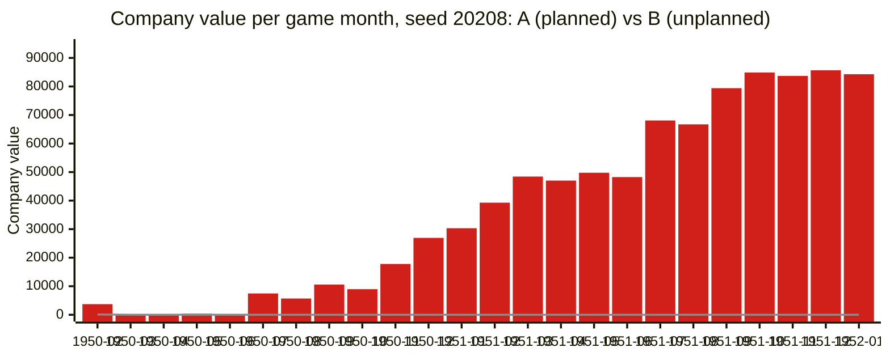
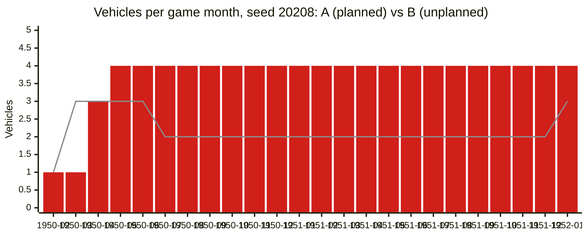

# Duel in one game: planned vs unplanned bot (seed 20208, 24 months)

Generated by `tools/research/mcp-duel` (planner v4 portfolio + fleet both ways vs the same bot unplanned, one map). One game, one map: company 1 is PrismaticAI started from
the planner's portfolio (by the panel), company 2 the same AI started without a plan right after it.
Both compete for the same towns and industries. Values come from the console's `companies` command.

- planner: passengers by rail Mefingpool - Sontburg, score 154129.0
- planner: Coal by rail Coal Mine -> Power Station, 134.0 tiles, profit 9432.0/month, score 158709.0
- planner portfolio by algoglyph knapsack-dp: 4 investment(s), total score 624766.0, 286k of 300k

What the logs show: both bots ran normally. B, the unplanned one, opened 3 bus routes and ran 3
vehicles. Since bridge d4ef4fc every route starts with one bus and grows only on the waiting
cargo bound for its next stop, and B never had more than twice its reserve to repay its starting
loan, so its company value stayed at the minimum of 1. A built its portfolio's lines with 2 trains,
repaid its loan step by step, and climbed steadily. The win is real, but against a weak baseline.
The slow growth of a bus-only start is itself a finding for the bot.

**Winner: A (planned).** Final company value: A 84290 vs B 1.

<!-- duel-charts:begin -->
<!-- generated by tools/research/mcp-duel from this record's JSON; `mcp-duel --render` rewrites it, `mcp-duel --render --check` fails while it is stale -->

<!-- duel-charts:end -->

| Month | Date | A (planned) value | B (unplanned) value |
|---|---|---|---|
| 1 | 1950-02-04 | 3718 | 118 |
| 2 | 1950-03-07 | 1 | 1 |
| 3 | 1950-04-07 | 1 | 1 |
| 4 | 1950-05-07 | 370 | 1 |
| 5 | 1950-06-07 | 1 | 1 |
| 6 | 1950-07-07 | 7470 | 1 |
| 7 | 1950-08-07 | 5698 | 1 |
| 8 | 1950-09-06 | 10575 | 1 |
| 9 | 1950-10-07 | 8966 | 1 |
| 10 | 1950-11-06 | 17806 | 1 |
| 11 | 1950-12-07 | 26937 | 1 |
| 12 | 1951-01-07 | 30317 | 1 |
| 13 | 1951-02-06 | 39277 | 1 |
| 14 | 1951-03-09 | 48430 | 1 |
| 15 | 1951-04-08 | 47020 | 1 |
| 16 | 1951-05-09 | 49763 | 1 |
| 17 | 1951-06-08 | 48242 | 1 |
| 18 | 1951-07-09 | 68076 | 1 |
| 19 | 1951-08-08 | 66722 | 1 |
| 20 | 1951-09-08 | 79403 | 1 |
| 21 | 1951-10-09 | 84899 | 1 |
| 22 | 1951-11-08 | 83693 | 1 |
| 23 | 1951-12-09 | 85663 | 1 |
| 24 | 1952-01-08 | 84290 | 1 |
