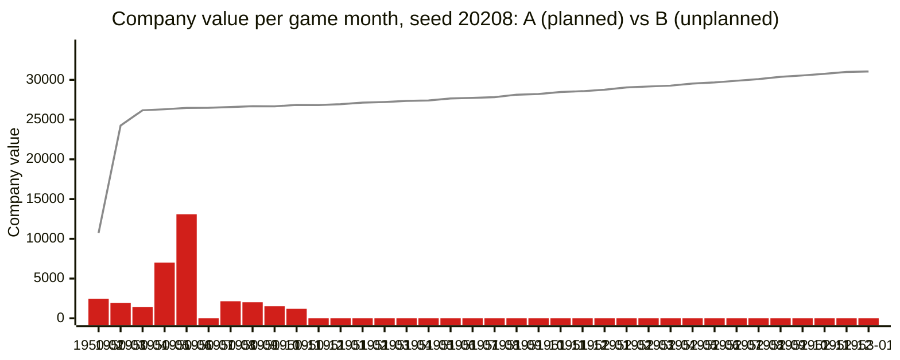
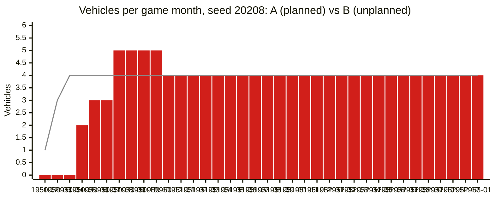

# Duel in one game: planned vs unplanned bot (seed 20208, 36 months)

Generated by `tools/research/mcp-duel` (buildable rail lines only (no bridge, tunnel or crossing)). One game, one map: company 1 is PrismaticAI started from
the planner's portfolio (by the panel), company 2 the same AI started without a plan right after it.
Both compete for the same towns and industries. Values come from the console's `companies` command.

- planner: passengers by rail Ganingbury - Sontburg, score 131045.0
- planner: the freight_rail line Coal Mine - Power Station needs 1 bridge(s), 0 tunnel(s), 0 crossing(s); the bot lays plain track only, so the next line it can build goes instead
- planner: Coal by rail Coal Mine -> Power Station, 180.0 tiles, profit 13327.0/month, score 225945.0
- planner: 6 rail line(s) priced on the map by track-planning, 4 with a route: 176 pieces 13620, 167 pieces 13063, 152 pieces 11790, 178 pieces 13903; 2 without a route dropped their rail option
- planner portfolio by algoglyph knapsack-dp: 3 investment(s), total score 615459.0, 287k of 300k

**Winner: B (unplanned).** Final company value: A 1 vs B 31055.

<!-- duel-charts:begin -->
<!-- generated by tools/research/mcp-duel from this record's JSON; `mcp-duel --render` rewrites it, `mcp-duel --render --check` fails while it is stale -->

<!-- duel-charts:end -->

| Month | Date | A (planned) value | B (unplanned) value |
|---|---|---|---|
| 1 | 1950-02-07 | 2450 | 10743 |
| 2 | 1950-03-10 | 1925 | 24245 |
| 3 | 1950-04-10 | 1400 | 26174 |
| 4 | 1950-05-10 | 7005 | 26297 |
| 5 | 1950-06-10 | 13084 | 26473 |
| 6 | 1950-07-10 | 1 | 26487 |
| 7 | 1950-08-10 | 2146 | 26581 |
| 8 | 1950-09-09 | 2020 | 26690 |
| 9 | 1950-10-10 | 1518 | 26660 |
| 10 | 1950-11-09 | 1195 | 26853 |
| 11 | 1950-12-10 | 1 | 26828 |
| 12 | 1951-01-10 | 1 | 26944 |
| 13 | 1951-02-09 | 1 | 27129 |
| 14 | 1951-03-02 | 1 | 27214 |
| 15 | 1951-04-11 | 1 | 27357 |
| 16 | 1951-05-02 | 1 | 27412 |
| 17 | 1951-06-11 | 1 | 27657 |
| 18 | 1951-07-02 | 1 | 27730 |
| 19 | 1951-08-01 | 1 | 27819 |
| 20 | 1951-09-11 | 1 | 28134 |
| 21 | 1951-10-02 | 1 | 28216 |
| 22 | 1951-11-11 | 1 | 28472 |
| 23 | 1951-12-02 | 1 | 28571 |
| 24 | 1952-01-01 | 1 | 28756 |
| 25 | 1952-02-11 | 1 | 29045 |
| 26 | 1952-03-02 | 1 | 29162 |
| 27 | 1952-04-02 | 1 | 29274 |
| 28 | 1952-05-02 | 1 | 29534 |
| 29 | 1952-06-02 | 1 | 29674 |
| 30 | 1952-07-02 | 1 | 29885 |
| 31 | 1952-08-02 | 1 | 30094 |
| 32 | 1952-09-02 | 1 | 30380 |
| 33 | 1952-10-02 | 1 | 30554 |
| 34 | 1952-11-02 | 1 | 30766 |
| 35 | 1952-12-02 | 1 | 30997 |
| 36 | 1953-01-02 | 1 | 31055 |

## Reading this result

B won because A built nothing that paid. The panel already passed over the line with a bridge, but
the next coal line, which track-planning routes with no bridge or crossing (180 tiles, 40 cleared),
failed too: "no rail path between the stations". A Python replay of the bot's A* on this map, using
the game's own slopes (`openttd://map/terrain`), showed why. The bot allowed turns on flat land
only, and the far station's exit and all its neighbours are sloped. The passenger line
(Ganingbury–Sontburg) has no path under any rule, because its exit is walled in by the town. A then
spent its money on stations it removed and on buses, and ended at value 1.

Fixed in the bridge repository (2e3f116, `rail.nut` `PieceFits`): a corner piece goes wherever the
game's `GetRailFoundation` fits it, and both exits are checked against their stations. On this
seed the bot then built the coal line, 181 tiles, with a 5-car train. The duel is rerun with the fix.
