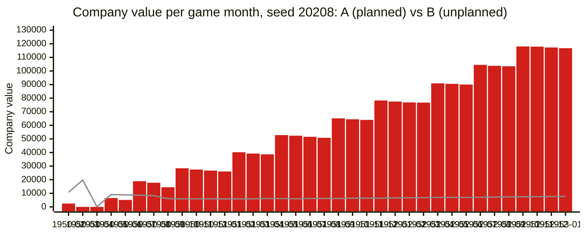
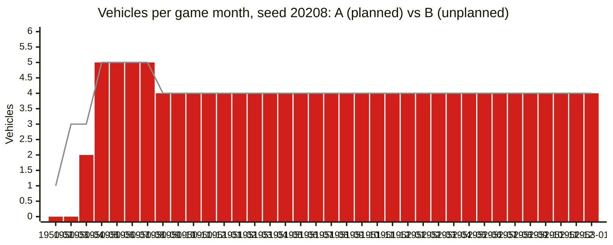

# Duel in one game: planned vs unplanned bot (seed 20208, 36 months)

Generated by `tools/research/mcp-duel` (bot rail turns by the game's GetRailFoundation rule (bridge 2e3f116)). One game, one map: company 1 is PrismaticAI started from
the planner's portfolio (by the panel), company 2 the same AI started without a plan right after it.
Both compete for the same towns and industries. Values come from the console's `companies` command.

- planner: passengers by rail Ganingbury - Sontburg, score 131045.0
- planner: the freight_rail line Coal Mine - Power Station needs 1 bridge(s), 0 tunnel(s), 0 crossing(s); the bot lays plain track only, so the next line it can build goes instead
- planner: Coal by rail Coal Mine -> Power Station, 180.0 tiles, profit 13327.0/month, score 225945.0
- planner: 6 rail line(s) priced on the map by track-planning, 4 with a route: 176 pieces 13620, 167 pieces 13063, 152 pieces 11790, 178 pieces 13903; 2 without a route dropped their rail option
- planner portfolio by algoglyph knapsack-dp: 3 investment(s), total score 615459.0, 287k of 300k

**Winner: A (planned).** Final company value: A 116768 vs B 7736.

<!-- duel-charts:begin -->
<!-- generated by tools/research/mcp-duel from this record's JSON; `mcp-duel --render` rewrites it, `mcp-duel --render --check` fails while it is stale -->

<!-- duel-charts:end -->

| Month | Date | A (planned) value | B (unplanned) value |
|---|---|---|---|
| 1 | 1950-02-06 | 2450 | 10743 |
| 2 | 1950-03-09 | 1 | 19773 |
| 3 | 1950-04-08 | 1 | 98 |
| 4 | 1950-05-09 | 6507 | 9066 |
| 5 | 1950-06-09 | 5127 | 8832 |
| 6 | 1950-07-09 | 18926 | 8585 |
| 7 | 1950-08-09 | 17774 | 8320 |
| 8 | 1950-09-08 | 14474 | 6019 |
| 9 | 1950-10-09 | 28428 | 5936 |
| 10 | 1950-11-08 | 27487 | 5926 |
| 11 | 1950-12-09 | 26715 | 5956 |
| 12 | 1951-01-08 | 26053 | 5894 |
| 13 | 1951-02-08 | 40225 | 5916 |
| 14 | 1951-03-11 | 39244 | 5932 |
| 15 | 1951-04-10 | 38658 | 6153 |
| 16 | 1951-05-11 | 52819 | 6138 |
| 17 | 1951-06-10 | 52388 | 5933 |
| 18 | 1951-07-11 | 51575 | 6200 |
| 19 | 1951-08-10 | 50829 | 6227 |
| 20 | 1951-09-10 | 65142 | 6168 |
| 21 | 1951-10-10 | 64460 | 6419 |
| 22 | 1951-11-10 | 64015 | 6424 |
| 23 | 1951-12-11 | 78298 | 6433 |
| 24 | 1952-01-10 | 77510 | 6649 |
| 25 | 1952-02-10 | 76866 | 6739 |
| 26 | 1952-03-01 | 76734 | 6751 |
| 27 | 1952-04-11 | 90892 | 7022 |
| 28 | 1952-05-01 | 90509 | 6987 |
| 29 | 1952-06-11 | 90029 | 6963 |
| 30 | 1952-07-01 | 104486 | 7033 |
| 31 | 1952-08-11 | 103789 | 7239 |
| 32 | 1952-09-11 | 103470 | 7313 |
| 33 | 1952-10-11 | 118046 | 7464 |
| 34 | 1952-11-11 | 117914 | 7550 |
| 35 | 1952-12-11 | 117286 | 7589 |
| 36 | 1953-01-11 | 116768 | 7736 |

## Reading this result

This is the first duel on this seed in which the plan was carried out. The bot runs bridge
repository 2e3f116 (`rail.nut` `PieceFits`: a corner piece goes wherever the game's
`GetRailFoundation` fits it). With it, the planner's 180-tile coal line was built with a train in
the first weeks (T1 from the start), where the two runs before had no path at all. A then grew to
116768 while B, the same bot without a plan, kept its four buses: 15 times B's value.

Runs on seed 20208, all 36 months except the first (24):

| Run | Bot | A (planned) | B (unplanned) |
|---|---|---|---|
| duel-20261116T052833 | before the track-priced plan | 84290 | 1 |
| duel-20261116T074419 | turns on flat land only | 23143 (no train) | 8033 |
| duel-20261116T082722 | same, the bridge line skipped | 1 (no train) | 31055 |
| this run | turns as the game fits them | **116768** (T1) | 7736 |

What is still open: the passenger line Ganingbury–Sontburg has no path, because its exit is walled
in by the town. The bot needs level crossings for it. A runs one train; adding trains on a busy
line is the next lever.
