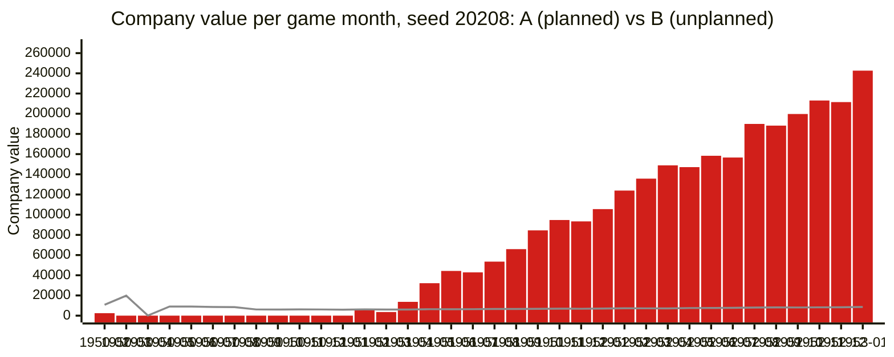
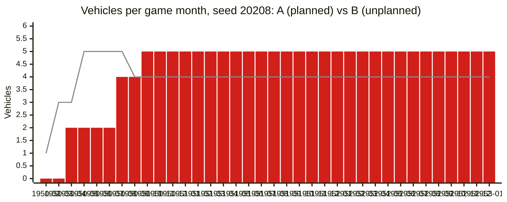

# Duel in one game: planned vs unplanned bot (seed 20208, 36 months)

Generated by `tools/research/mcp-duel` (up to four freight lines built as money allows (bridge f598ede)). One game, one map: company 1 is PrismaticAI started from
the planner's portfolio (by the panel), company 2 the same AI started without a plan right after it.
Both compete for the same towns and industries. Values come from the console's `companies` command.

- planner: Coal by rail Coal Mine -> Power Station, 155.0 tiles, profit 11502.0/month, score 183981.0 (line 3, built when the money allows)
- planner: Coal by rail Coal Mine -> Power Station, 246.0 tiles, profit 11486.0/month, score 176802.0 (line 2, built when the money allows)
- planner: the freight_rail line Coal Mine - Power Station needs 1 bridge(s) and 0 tunnel(s); the bot builds neither; the next line it can build goes instead
- planner: Coal by rail Coal Mine -> Power Station, 180.0 tiles, profit 13327.0/month, score 225945.0
- planner: 11 rail line(s) priced on the map by track-planning, 9 with a route: 176 pieces 13620, 167 pieces 13063, 152 pieces 11790, 243 pieces 18585, 232 pieces 17865, 142 pieces 11010, 178 pieces 13903, 205 pieces 16271, 241 pieces 19369; 2 without a route dropped their rail option
- planner portfolio by algoglyph knapsack-dp: 3 investment(s), total score 615324.0, 287k of 300k

**Winner: A (planned).** Final company value: A 242657 vs B 8567.

<!-- duel-charts:begin -->
<!-- generated by tools/research/mcp-duel from this record's JSON; `mcp-duel --render` rewrites it, `mcp-duel --render --check` fails while it is stale -->

<!-- duel-charts:end -->

| Month | Date | A (planned) value | B (unplanned) value |
|---|---|---|---|
| 1 | 1950-02-07 | 2450 | 10744 |
| 2 | 1950-03-10 | 1 | 19772 |
| 3 | 1950-04-09 | 1 | 92 |
| 4 | 1950-05-10 | 1 | 9092 |
| 5 | 1950-06-09 | 1 | 8972 |
| 6 | 1950-07-10 | 1 | 8631 |
| 7 | 1950-08-09 | 1 | 8495 |
| 8 | 1950-09-09 | 1 | 6130 |
| 9 | 1950-10-10 | 1 | 6076 |
| 10 | 1950-11-09 | 1 | 6156 |
| 11 | 1950-12-10 | 1 | 6128 |
| 12 | 1951-01-09 | 1 | 5868 |
| 13 | 1951-02-09 | 5342 | 6209 |
| 14 | 1951-03-01 | 3572 | 6109 |
| 15 | 1951-04-11 | 13666 | 6103 |
| 16 | 1951-05-01 | 32138 | 6396 |
| 17 | 1951-06-11 | 44287 | 6344 |
| 18 | 1951-07-02 | 42860 | 6417 |
| 19 | 1951-08-01 | 53505 | 6634 |
| 20 | 1951-09-11 | 65871 | 6601 |
| 21 | 1951-10-01 | 84459 | 6758 |
| 22 | 1951-11-11 | 94715 | 6954 |
| 23 | 1951-12-01 | 93370 | 6830 |
| 24 | 1952-01-11 | 105512 | 7039 |
| 25 | 1952-02-10 | 123877 | 7326 |
| 26 | 1952-03-02 | 135694 | 7253 |
| 27 | 1952-04-02 | 148857 | 7197 |
| 28 | 1952-05-02 | 147094 | 7524 |
| 29 | 1952-06-02 | 158342 | 7579 |
| 30 | 1952-07-02 | 156613 | 7711 |
| 31 | 1952-08-02 | 189884 | 8048 |
| 32 | 1952-09-01 | 188214 | 8158 |
| 33 | 1952-10-02 | 199715 | 8095 |
| 34 | 1952-11-01 | 213086 | 8245 |
| 35 | 1952-12-02 | 211515 | 8324 |
| 36 | 1953-01-12 | 242657 | 8567 |

## Reading this result

The bot (bridge repository f598ede) got up to four freight lines from the planner, in its order and
one per producer, and built each one as soon as money plus loan headroom reached `line_budget`.
It ran three coal trains (T3) instead of one, and A's value doubled against the run before on this
seed: 242657 vs 116768. B, the same bot without a plan, kept its four buses.

Runs on seed 20208 (36 months unless noted):

| Run | Bot | A (planned) | B (unplanned) |
|---|---|---|---|
| duel-20261116T052833 (24 months) | before the track-priced plan | 84290 | 1 |
| duel-20261116T074419 | turns on flat land only | 23143 (no train) | 8033 |
| duel-20261116T082722 | same, the bridge line skipped | 1 (no train) | 31055 |
| duel-20261116T093032 | turns as the game fits them | 116768 (T1) | 7736 |
| this run | up to four freight lines as money allows | **242657** (T3) | 8567 |

Still open: bridges and tunnels in the bot (the passenger line on this seed needs a bridge), and
capacity on one line (passing loops or signals), since a single track takes one train.
