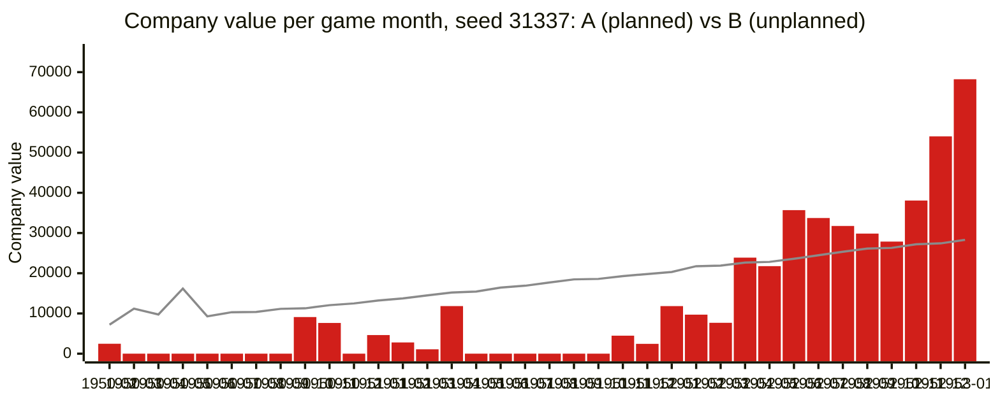
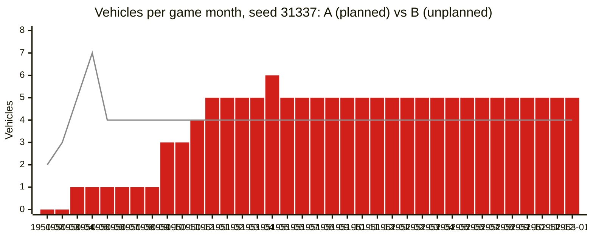

# Duel in one game: planned vs unplanned bot (seed 31337, 36 months)

Generated by `tools/research/mcp-duel` (generalisation: a second seed with the same bot (bridge f598ede)). One game, one map: company 1 is PrismaticAI started from
the planner's portfolio (by the panel), company 2 the same AI started without a plan right after it.
Both compete for the same towns and industries. Values come from the console's `companies` command.

- planner: passengers by rail Warnley - New Prunpool, score 160175.0
- planner: Coal by rail Coal Mine -> Power Station, 153.0 tiles, profit 10758.0/month, score 166533.0 (line 3, built when the money allows)
- planner: Coal by rail Coal Mine -> Power Station, 227.0 tiles, profit 14079.0/month, score 240547.0 (line 2, built when the money allows)
- planner: Coal by rail Coal Mine -> Power Station, 193.0 tiles, profit 14262.0/month, score 247688.0
- planner: the rail line Little Bonnley Market - Benfingbridge needs 1 bridge(s) and 0 tunnel(s); the bot builds neither; the next line it can build goes instead
- planner: the rail line New Prunpool - Wrindingville needs 1 bridge(s) and 0 tunnel(s); the bot builds neither; the next line it can build goes instead
- planner: the rail line New Prunpool - Little Bonnley Market needs 1 bridge(s) and 0 tunnel(s); the bot builds neither; the next line it can build goes instead
- planner: the freight_rail line Coal Mine - Power Station was not priced on the map, so it is not handed to the bot blind; the next line it can build goes instead
- planner: the freight_rail line Coal Mine - Power Station needs 2 bridge(s) and 0 tunnel(s); the bot builds neither; the next line it can build goes instead
- planner: 11 rail line(s) priced on the map by track-planning, 11 with a route: 207 pieces 16639, 189 pieces 14325, 224 pieces 17070, 182 pieces 13725, 231 pieces 18345, 150 pieces 11385, 196 pieces 15943, 234 pieces 17895, 157 pieces 12328, 175 pieces 14391, 173 pieces 13528
- planner portfolio by algoglyph knapsack-dp: 5 investment(s), total score 754437.0, 295k of 300k

**Winner: A (planned).** Final company value: A 68229 vs B 28293.

<!-- duel-charts:begin -->
<!-- generated by tools/research/mcp-duel from this record's JSON; `mcp-duel --render` rewrites it, `mcp-duel --render --check` fails while it is stale -->

<!-- duel-charts:end -->

| Month | Date | A (planned) value | B (unplanned) value |
|---|---|---|---|
| 1 | 1950-02-06 | 2465 | 7200 |
| 2 | 1950-03-08 | 1 | 11190 |
| 3 | 1950-04-08 | 1 | 9743 |
| 4 | 1950-05-08 | 1 | 16191 |
| 5 | 1950-06-08 | 1 | 9278 |
| 6 | 1950-07-08 | 1 | 10310 |
| 7 | 1950-08-08 | 1 | 10361 |
| 8 | 1950-09-08 | 1 | 11149 |
| 9 | 1950-10-08 | 9104 | 11269 |
| 10 | 1950-11-08 | 7634 | 12060 |
| 11 | 1950-12-08 | 1 | 12496 |
| 12 | 1951-01-08 | 4624 | 13225 |
| 13 | 1951-02-07 | 2790 | 13746 |
| 14 | 1951-03-10 | 1089 | 14491 |
| 15 | 1951-04-09 | 11831 | 15217 |
| 16 | 1951-05-10 | 1 | 15434 |
| 17 | 1951-06-10 | 1 | 16432 |
| 18 | 1951-07-10 | 1 | 16892 |
| 19 | 1951-08-10 | 1 | 17696 |
| 20 | 1951-09-09 | 1 | 18467 |
| 21 | 1951-10-10 | 1 | 18586 |
| 22 | 1951-11-09 | 4470 | 19294 |
| 23 | 1951-12-10 | 2442 | 19798 |
| 24 | 1952-01-09 | 11826 | 20320 |
| 25 | 1952-02-09 | 9700 | 21751 |
| 26 | 1952-03-11 | 7675 | 21907 |
| 27 | 1952-04-10 | 23876 | 22652 |
| 28 | 1952-05-11 | 21763 | 22823 |
| 29 | 1952-06-10 | 35687 | 23584 |
| 30 | 1952-07-11 | 33726 | 24472 |
| 31 | 1952-08-10 | 31751 | 25344 |
| 32 | 1952-09-10 | 29853 | 26117 |
| 33 | 1952-10-11 | 27866 | 26310 |
| 34 | 1952-11-10 | 38075 | 27202 |
| 35 | 1952-12-11 | 54023 | 27424 |
| 36 | 1953-01-10 | 68229 | 28293 |

## Reading this result

The second seed with the same bot (bridge repository f598ede). A won 68229 to 28293 (2.4 to 1),
a much narrower margin than on seed 20208 (242657 to 8567), and A trailed B for two years:

| Month | A (planned) | B (unplanned) |
|---|---|---|
| 12 | 4624 (T2) | 13225 |
| 16 | 1 (190000 of loan in three lines) | 15434 |
| 24 | 11826 | 20320 |
| 30 | 33726 | 24472 |
| 36 | **68229** (T3) | 28293 |

Company value is money minus loan plus vehicles; track and stations do not count. A borrowed to
build three coal lines within the first year and a half, so its value read 1 until the loan came
down. At the end A grew by about 5000-6000 a month and B by about 600.

What made the margin smaller here:
- The third line was built 265 tiles long for a 153-tile pair. The terrain forced a detour, so it
  earns less than the planner priced.
- Two coal lines and three passenger lines needed bridges and were passed over, which left
  weaker lines.
- The bot builds each next line as soon as money plus loan headroom reach line_budget (80000), so
  nearly all of its capital went into track early.

Next levers: bridges in the bot; refuse a line whose built length exceeds the priced route by
far, or re-price it with the built length; a line_budget that keeps the loan lower.
