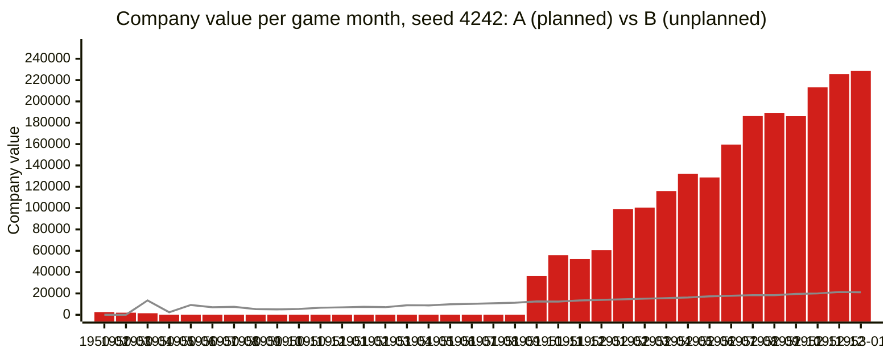
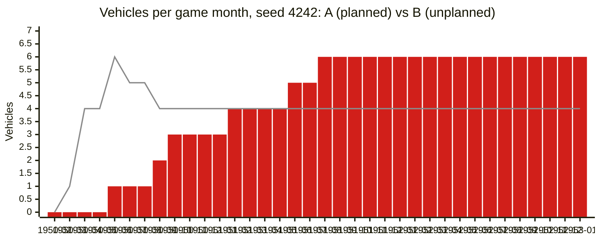

# Duel in one game: planned vs unplanned bot (seed 4242, 36 months)

Generated by `tools/research/mcp-duel` (third seed, full bot (bridge b3e7722: turns, crossings, bridges, more lines, station joins)). One game, one map: company 1 is PrismaticAI started from
the planner's portfolio (by the panel), company 2 the same AI started without a plan right after it.
Both compete for the same towns and industries. Values come from the console's `companies` command.

- planner: Wood by rail Forest -> Sawmill, 160.0 tiles, profit 8321.0/month, score 132207.0 (line 4, built when the money allows)
- planner: Grain by rail Farm -> Factory, 244.0 tiles, profit 9707.0/month, score 133624.0 (line 3, built when the money allows)
- planner: Wood by rail Forest -> Sawmill, 232.0 tiles, profit 10188.0/month, score 146478.0 (line 2, built when the money allows)
- planner: Coal by rail Coal Mine -> Power Station, 242.0 tiles, profit 9671.0/month, score 159966.0
- planner: passengers by rail Wranville - Drundstone, score 205268.0
- planner: 11 rail line(s) priced on the map by track-planning, 11 with a route: 239 pieces 18240, 229 pieces 17415, 226 pieces 17190, 245 pieces 18645, 158 pieces 13376, 152 pieces 12956, 205 pieces 15555, 221 pieces 16890, 226 pieces 17205, 246 pieces 18675, 266 pieces 20443
- planner portfolio by algoglyph knapsack-dp: 4 investment(s), total score 715657.0, 296k of 300k

**Winner: A (planned).** Final company value: A 228703 vs B 21110.

<!-- duel-charts:begin -->
<!-- generated by tools/research/mcp-duel from this record's JSON; `mcp-duel --render` rewrites it, `mcp-duel --render --check` fails while it is stale -->

<!-- duel-charts:end -->

| Month | Date | A (planned) value | B (unplanned) value |
|---|---|---|---|
| 1 | 1950-02-07 | 2480 | 1 |
| 2 | 1950-03-10 | 1955 | 1 |
| 3 | 1950-04-09 | 1430 | 13471 |
| 4 | 1950-05-10 | 1 | 2387 |
| 5 | 1950-06-09 | 1 | 9176 |
| 6 | 1950-07-10 | 1 | 7052 |
| 7 | 1950-08-10 | 1 | 7445 |
| 8 | 1950-09-09 | 1 | 5309 |
| 9 | 1950-10-10 | 1 | 5038 |
| 10 | 1950-11-09 | 1 | 5492 |
| 11 | 1950-12-10 | 1 | 6590 |
| 12 | 1951-01-09 | 1 | 6989 |
| 13 | 1951-02-09 | 1 | 7437 |
| 14 | 1951-03-01 | 1 | 7124 |
| 15 | 1951-04-11 | 1 | 8950 |
| 16 | 1951-05-02 | 1 | 8804 |
| 17 | 1951-06-11 | 1 | 9824 |
| 18 | 1951-07-02 | 1 | 10265 |
| 19 | 1951-08-11 | 1 | 10810 |
| 20 | 1951-09-11 | 1 | 11314 |
| 21 | 1951-10-11 | 36296 | 12445 |
| 22 | 1951-11-11 | 55825 | 12389 |
| 23 | 1951-12-11 | 52228 | 13439 |
| 24 | 1952-01-11 | 60627 | 13990 |
| 25 | 1952-02-11 | 98919 | 14474 |
| 26 | 1952-03-02 | 100368 | 15079 |
| 27 | 1952-04-02 | 115893 | 15621 |
| 28 | 1952-05-02 | 132054 | 16189 |
| 29 | 1952-06-02 | 128642 | 17272 |
| 30 | 1952-07-02 | 159484 | 17755 |
| 31 | 1952-08-02 | 186241 | 18413 |
| 32 | 1952-09-01 | 189277 | 18298 |
| 33 | 1952-10-02 | 186129 | 19558 |
| 34 | 1952-11-02 | 213165 | 20004 |
| 35 | 1952-12-02 | 225445 | 21312 |
| 36 | 1953-01-02 | 228703 | 21110 |

## Reading this result

A third map, the complete bot (bridge repository b3e7722: turns where the game fits them, level
crossings, bridges, up to four freight lines as money allows, a second line joining the company's
station). A won 228703 to 21110, 10.8 to 1, with five trains. As on seed 31337, A's value read 1
while its lines were being bought on loan (months 12 and 16). It led from about month 20 on.

| Month | A (planned) | B (unplanned) |
|---|---|---|
| 12 | 1 (T2) | 6989 |
| 16 | 1 (T3) | 8804 |
| 24 | 60627 (T5) | 13990 |
| 30 | 159484 | 17755 |
| 36 | **228703** (T5) | 21110 |

Across the three seeds, with the bot of each run's last version (36 months):

| Seed | A (planned) | B (unplanned) | A / B |
|---|---|---|---|
| 20208 | 242657 (T3, f598ede) | 8567 | 28 |
| 31337 | 204356 (T4, d3c39ba) | 28129 | 7.3 |
| 4242 | 228703 (T5, b3e7722) | 21110 | 10.8 |

The baseline B is the same bot without the planner's portfolio: it builds four bus routes and
never rail. A stronger opponent (another AI from BaNaNaS, or the same bot with a plan) is the next
test of the planning itself.
