# Duel in one game: planned bot vs unplanned (seed 4242, 120 months)

Generated by `tools/research/mcp-duel` (ten years, line upkeep and autorenew (bridge c9e692b), month counter by game date). One game, one map: company 1 is PrismaticAI started from
the planner's portfolio (by the panel), company 2 the same AI started without a plan right after it.
Both compete for the same towns and industries. Values come from the console's `companies` command.

- planner: Wood by rail Forest -> Sawmill, 160.0 tiles, profit 8321.0/month, score 132207.0 (line 4, built when the money allows)
- planner: Grain by rail Farm -> Factory, 244.0 tiles, profit 9707.0/month, score 133624.0 (line 3, built when the money allows)
- planner: Wood by rail Forest -> Sawmill, 232.0 tiles, profit 10188.0/month, score 146478.0 (line 2, built when the money allows)
- planner: Coal by rail Coal Mine -> Power Station, 242.0 tiles, profit 9671.0/month, score 159966.0
- planner: passengers by rail Wranville - Drundstone, score 205268.0
- planner: 11 rail line(s) priced on the map by track-planning, 11 with a route: 239 pieces 18240, 229 pieces 17415, 226 pieces 17190, 245 pieces 18645, 158 pieces 13376, 152 pieces 12956, 205 pieces 15555, 221 pieces 16890, 226 pieces 17205, 246 pieces 18675, 266 pieces 20443
- planner portfolio by algoglyph knapsack-dp: 4 investment(s), total score 715657.0, 296k of 300k

**Winner: A (planned).** Final company value: A 850300 vs B 95092.

```mermaid
---
config:
  xyChart:
    width: 900
    height: 360
  themeVariables:
    xyChart:
      plotColorPalette: "#d11f1a, #8a8a8a, #0b0b0b, #ece4d6"
---
xychart-beta
    title "Company value per game month, seed 4242: A (planned) vs B (unplanned)"
    x-axis ["1950-04", "1950-05", "1950-06", "1950-07", "1950-08", "1950-09", "1950-10", "1950-11", "1950-12", "1951-01", "1951-02", "1951-03", "1951-04", "1951-05", "1951-06", "1951-07", "1951-08", "1951-09", "1951-10", "1951-11", "1951-12", "1952-01", "1952-02", "1952-03", "1952-04", "1952-05", "1952-06", "1952-07", "1952-08", "1952-09", "1952-10", "1952-11", "1952-12", "1953-01", "1953-02", "1953-03", "1953-04", "1953-05", "1953-06", "1953-07", "1953-08", "1953-09", "1953-10", "1953-11", "1953-12", "1954-01", "1954-02", "1954-03", "1954-04", "1954-05", "1954-06", "1954-07", "1954-08", "1954-09", "1954-10", "1954-11", "1954-12", "1955-01", "1955-02", "1955-03", "1955-04", "1955-05", "1955-06", "1955-07", "1955-08", "1955-09", "1955-10", "1955-11", "1955-12", "1956-01", "1956-02", "1956-03", "1956-04", "1956-05", "1956-06", "1956-07", "1956-08", "1956-09", "1956-10", "1956-11", "1956-12", "1957-01", "1957-02", "1957-03", "1957-04", "1957-05", "1957-06", "1957-07", "1957-08", "1957-09", "1957-10", "1957-11", "1957-12", "1958-01", "1958-02", "1958-03", "1958-04", "1958-05", "1958-06", "1958-07", "1958-08", "1958-09", "1958-10", "1958-11", "1958-12", "1959-01", "1959-02", "1959-03", "1959-04", "1959-05", "1959-06", "1959-07", "1959-08", "1959-09", "1959-10", "1959-11", "1959-12", "1960-01", "1960-02", "1960-03"]
    %% series: A (planned) | B (unplanned)
    %% links: duel-20261116T230748-seed4242.md?col=Month&filter=1 | duel-20261116T230748-seed4242.md?col=Month&filter=2 | duel-20261116T230748-seed4242.md?col=Month&filter=3 | duel-20261116T230748-seed4242.md?col=Month&filter=4 | duel-20261116T230748-seed4242.md?col=Month&filter=5 | duel-20261116T230748-seed4242.md?col=Month&filter=6 | duel-20261116T230748-seed4242.md?col=Month&filter=7 | duel-20261116T230748-seed4242.md?col=Month&filter=8 | duel-20261116T230748-seed4242.md?col=Month&filter=9 | duel-20261116T230748-seed4242.md?col=Month&filter=10 | duel-20261116T230748-seed4242.md?col=Month&filter=11 | duel-20261116T230748-seed4242.md?col=Month&filter=12 | duel-20261116T230748-seed4242.md?col=Month&filter=13 | duel-20261116T230748-seed4242.md?col=Month&filter=14 | duel-20261116T230748-seed4242.md?col=Month&filter=15 | duel-20261116T230748-seed4242.md?col=Month&filter=16 | duel-20261116T230748-seed4242.md?col=Month&filter=17 | duel-20261116T230748-seed4242.md?col=Month&filter=18 | duel-20261116T230748-seed4242.md?col=Month&filter=19 | duel-20261116T230748-seed4242.md?col=Month&filter=20 | duel-20261116T230748-seed4242.md?col=Month&filter=21 | duel-20261116T230748-seed4242.md?col=Month&filter=22 | duel-20261116T230748-seed4242.md?col=Month&filter=23 | duel-20261116T230748-seed4242.md?col=Month&filter=24 | duel-20261116T230748-seed4242.md?col=Month&filter=25 | duel-20261116T230748-seed4242.md?col=Month&filter=26 | duel-20261116T230748-seed4242.md?col=Month&filter=27 | duel-20261116T230748-seed4242.md?col=Month&filter=28 | duel-20261116T230748-seed4242.md?col=Month&filter=29 | duel-20261116T230748-seed4242.md?col=Month&filter=30 | duel-20261116T230748-seed4242.md?col=Month&filter=31 | duel-20261116T230748-seed4242.md?col=Month&filter=32 | duel-20261116T230748-seed4242.md?col=Month&filter=33 | duel-20261116T230748-seed4242.md?col=Month&filter=34 | duel-20261116T230748-seed4242.md?col=Month&filter=35 | duel-20261116T230748-seed4242.md?col=Month&filter=36 | duel-20261116T230748-seed4242.md?col=Month&filter=37 | duel-20261116T230748-seed4242.md?col=Month&filter=38 | duel-20261116T230748-seed4242.md?col=Month&filter=39 | duel-20261116T230748-seed4242.md?col=Month&filter=40 | duel-20261116T230748-seed4242.md?col=Month&filter=41 | duel-20261116T230748-seed4242.md?col=Month&filter=42 | duel-20261116T230748-seed4242.md?col=Month&filter=43 | duel-20261116T230748-seed4242.md?col=Month&filter=44 | duel-20261116T230748-seed4242.md?col=Month&filter=45 | duel-20261116T230748-seed4242.md?col=Month&filter=46 | duel-20261116T230748-seed4242.md?col=Month&filter=47 | duel-20261116T230748-seed4242.md?col=Month&filter=48 | duel-20261116T230748-seed4242.md?col=Month&filter=49 | duel-20261116T230748-seed4242.md?col=Month&filter=50 | duel-20261116T230748-seed4242.md?col=Month&filter=51 | duel-20261116T230748-seed4242.md?col=Month&filter=52 | duel-20261116T230748-seed4242.md?col=Month&filter=53 | duel-20261116T230748-seed4242.md?col=Month&filter=54 | duel-20261116T230748-seed4242.md?col=Month&filter=55 | duel-20261116T230748-seed4242.md?col=Month&filter=56 | duel-20261116T230748-seed4242.md?col=Month&filter=57 | duel-20261116T230748-seed4242.md?col=Month&filter=58 | duel-20261116T230748-seed4242.md?col=Month&filter=59 | duel-20261116T230748-seed4242.md?col=Month&filter=60 | duel-20261116T230748-seed4242.md?col=Month&filter=61 | duel-20261116T230748-seed4242.md?col=Month&filter=62 | duel-20261116T230748-seed4242.md?col=Month&filter=63 | duel-20261116T230748-seed4242.md?col=Month&filter=64 | duel-20261116T230748-seed4242.md?col=Month&filter=65 | duel-20261116T230748-seed4242.md?col=Month&filter=66 | duel-20261116T230748-seed4242.md?col=Month&filter=67 | duel-20261116T230748-seed4242.md?col=Month&filter=68 | duel-20261116T230748-seed4242.md?col=Month&filter=69 | duel-20261116T230748-seed4242.md?col=Month&filter=70 | duel-20261116T230748-seed4242.md?col=Month&filter=71 | duel-20261116T230748-seed4242.md?col=Month&filter=72 | duel-20261116T230748-seed4242.md?col=Month&filter=73 | duel-20261116T230748-seed4242.md?col=Month&filter=74 | duel-20261116T230748-seed4242.md?col=Month&filter=75 | duel-20261116T230748-seed4242.md?col=Month&filter=76 | duel-20261116T230748-seed4242.md?col=Month&filter=77 | duel-20261116T230748-seed4242.md?col=Month&filter=78 | duel-20261116T230748-seed4242.md?col=Month&filter=79 | duel-20261116T230748-seed4242.md?col=Month&filter=80 | duel-20261116T230748-seed4242.md?col=Month&filter=81 | duel-20261116T230748-seed4242.md?col=Month&filter=82 | duel-20261116T230748-seed4242.md?col=Month&filter=83 | duel-20261116T230748-seed4242.md?col=Month&filter=84 | duel-20261116T230748-seed4242.md?col=Month&filter=85 | duel-20261116T230748-seed4242.md?col=Month&filter=86 | duel-20261116T230748-seed4242.md?col=Month&filter=87 | duel-20261116T230748-seed4242.md?col=Month&filter=88 | duel-20261116T230748-seed4242.md?col=Month&filter=89 | duel-20261116T230748-seed4242.md?col=Month&filter=90 | duel-20261116T230748-seed4242.md?col=Month&filter=91 | duel-20261116T230748-seed4242.md?col=Month&filter=92 | duel-20261116T230748-seed4242.md?col=Month&filter=93 | duel-20261116T230748-seed4242.md?col=Month&filter=94 | duel-20261116T230748-seed4242.md?col=Month&filter=95 | duel-20261116T230748-seed4242.md?col=Month&filter=96 | duel-20261116T230748-seed4242.md?col=Month&filter=97 | duel-20261116T230748-seed4242.md?col=Month&filter=98 | duel-20261116T230748-seed4242.md?col=Month&filter=99 | duel-20261116T230748-seed4242.md?col=Month&filter=100 | duel-20261116T230748-seed4242.md?col=Month&filter=101 | duel-20261116T230748-seed4242.md?col=Month&filter=102 | duel-20261116T230748-seed4242.md?col=Month&filter=103 | duel-20261116T230748-seed4242.md?col=Month&filter=104 | duel-20261116T230748-seed4242.md?col=Month&filter=105 | duel-20261116T230748-seed4242.md?col=Month&filter=106 | duel-20261116T230748-seed4242.md?col=Month&filter=107 | duel-20261116T230748-seed4242.md?col=Month&filter=108 | duel-20261116T230748-seed4242.md?col=Month&filter=109 | duel-20261116T230748-seed4242.md?col=Month&filter=110 | duel-20261116T230748-seed4242.md?col=Month&filter=111 | duel-20261116T230748-seed4242.md?col=Month&filter=112 | duel-20261116T230748-seed4242.md?col=Month&filter=113 | duel-20261116T230748-seed4242.md?col=Month&filter=114 | duel-20261116T230748-seed4242.md?col=Month&filter=115 | duel-20261116T230748-seed4242.md?col=Month&filter=116 | duel-20261116T230748-seed4242.md?col=Month&filter=117 | duel-20261116T230748-seed4242.md?col=Month&filter=118 | duel-20261116T230748-seed4242.md?col=Month&filter=119 | duel-20261116T230748-seed4242.md?col=Month&filter=120
    y-axis "Company value" 0 --> 936000
    bar [2480, 1955, 1430, 1, 1, 1, 1, 1, 1, 1, 1, 1, 1, 1, 1, 1, 1, 1, 1, 1, 1, 1, 1, 1, 10524, 38619, 36091, 42729, 67536, 65610, 79647, 96611, 96878, 110617, 127106, 140717, 138980, 163902, 166986, 165154, 189205, 187044, 205656, 214621, 227496, 230108, 254513, 252852, 251342, 268532, 277452, 292409, 290377, 292941, 303196, 315215, 332372, 342022, 341028, 339164, 340986, 379883, 379797, 378515, 381227, 390150, 391528, 409170, 431685, 431797, 430019, 449301, 458796, 459057, 471811, 474922, 484670, 498420, 500514, 499293, 509759, 521982, 540377, 538802, 550179, 548914, 553039, 567277, 592881, 591507, 596345, 607380, 621621, 625515, 624229, 638557, 647851, 668660, 667379, 668425, 678276, 683782, 697596, 723708, 722806, 726010, 727368, 742545, 757085, 771203, 773216, 782985, 803098, 802306, 804985, 814811, 835633, 847405, 850849, 850300]
    line [6507, 6984, 11517, 4466, 15871, 25651, 32394, 30462, 31053, 30955, 31423, 31983, 31817, 32446, 32918, 33428, 33344, 33906, 34616, 34528, 35044, 35533, 36150, 35997, 36622, 36589, 37139, 37680, 38335, 38241, 38780, 36595, 37958, 38057, 35993, 36537, 36728, 37692, 38084, 39043, 39339, 40348, 40865, 41100, 42007, 42529, 42992, 43269, 44168, 44103, 45034, 45385, 45848, 46336, 46756, 47079, 47703, 48625, 49055, 49562, 50459, 51545, 51967, 52922, 53411, 54144, 54533, 55226, 55914, 56240, 56823, 57899, 58991, 59379, 59953, 61107, 61483, 62087, 63147, 64155, 64664, 65116, 66324, 67493, 67941, 68564, 68972, 70198, 70788, 72014, 72405, 73188, 73785, 74625, 75143, 75804, 76233, 77056, 77765, 78237, 79506, 80083, 80412, 81576, 82196, 82879, 84039, 85003, 85514, 86244, 87168, 87672, 89083, 89353, 90562, 91204, 91960, 93226, 94510, 95092]
```

```mermaid
---
config:
  xyChart:
    width: 900
    height: 360
  themeVariables:
    xyChart:
      plotColorPalette: "#d11f1a, #8a8a8a, #0b0b0b, #ece4d6"
---
xychart-beta
    title "Vehicles per game month, seed 4242: A (planned) vs B (unplanned)"
    x-axis ["1950-04", "1950-05", "1950-06", "1950-07", "1950-08", "1950-09", "1950-10", "1950-11", "1950-12", "1951-01", "1951-02", "1951-03", "1951-04", "1951-05", "1951-06", "1951-07", "1951-08", "1951-09", "1951-10", "1951-11", "1951-12", "1952-01", "1952-02", "1952-03", "1952-04", "1952-05", "1952-06", "1952-07", "1952-08", "1952-09", "1952-10", "1952-11", "1952-12", "1953-01", "1953-02", "1953-03", "1953-04", "1953-05", "1953-06", "1953-07", "1953-08", "1953-09", "1953-10", "1953-11", "1953-12", "1954-01", "1954-02", "1954-03", "1954-04", "1954-05", "1954-06", "1954-07", "1954-08", "1954-09", "1954-10", "1954-11", "1954-12", "1955-01", "1955-02", "1955-03", "1955-04", "1955-05", "1955-06", "1955-07", "1955-08", "1955-09", "1955-10", "1955-11", "1955-12", "1956-01", "1956-02", "1956-03", "1956-04", "1956-05", "1956-06", "1956-07", "1956-08", "1956-09", "1956-10", "1956-11", "1956-12", "1957-01", "1957-02", "1957-03", "1957-04", "1957-05", "1957-06", "1957-07", "1957-08", "1957-09", "1957-10", "1957-11", "1957-12", "1958-01", "1958-02", "1958-03", "1958-04", "1958-05", "1958-06", "1958-07", "1958-08", "1958-09", "1958-10", "1958-11", "1958-12", "1959-01", "1959-02", "1959-03", "1959-04", "1959-05", "1959-06", "1959-07", "1959-08", "1959-09", "1959-10", "1959-11", "1959-12", "1960-01", "1960-02", "1960-03"]
    %% series: A (planned) | B (unplanned)
    %% links: duel-20261116T230748-seed4242.md?col=Month&filter=1 | duel-20261116T230748-seed4242.md?col=Month&filter=2 | duel-20261116T230748-seed4242.md?col=Month&filter=3 | duel-20261116T230748-seed4242.md?col=Month&filter=4 | duel-20261116T230748-seed4242.md?col=Month&filter=5 | duel-20261116T230748-seed4242.md?col=Month&filter=6 | duel-20261116T230748-seed4242.md?col=Month&filter=7 | duel-20261116T230748-seed4242.md?col=Month&filter=8 | duel-20261116T230748-seed4242.md?col=Month&filter=9 | duel-20261116T230748-seed4242.md?col=Month&filter=10 | duel-20261116T230748-seed4242.md?col=Month&filter=11 | duel-20261116T230748-seed4242.md?col=Month&filter=12 | duel-20261116T230748-seed4242.md?col=Month&filter=13 | duel-20261116T230748-seed4242.md?col=Month&filter=14 | duel-20261116T230748-seed4242.md?col=Month&filter=15 | duel-20261116T230748-seed4242.md?col=Month&filter=16 | duel-20261116T230748-seed4242.md?col=Month&filter=17 | duel-20261116T230748-seed4242.md?col=Month&filter=18 | duel-20261116T230748-seed4242.md?col=Month&filter=19 | duel-20261116T230748-seed4242.md?col=Month&filter=20 | duel-20261116T230748-seed4242.md?col=Month&filter=21 | duel-20261116T230748-seed4242.md?col=Month&filter=22 | duel-20261116T230748-seed4242.md?col=Month&filter=23 | duel-20261116T230748-seed4242.md?col=Month&filter=24 | duel-20261116T230748-seed4242.md?col=Month&filter=25 | duel-20261116T230748-seed4242.md?col=Month&filter=26 | duel-20261116T230748-seed4242.md?col=Month&filter=27 | duel-20261116T230748-seed4242.md?col=Month&filter=28 | duel-20261116T230748-seed4242.md?col=Month&filter=29 | duel-20261116T230748-seed4242.md?col=Month&filter=30 | duel-20261116T230748-seed4242.md?col=Month&filter=31 | duel-20261116T230748-seed4242.md?col=Month&filter=32 | duel-20261116T230748-seed4242.md?col=Month&filter=33 | duel-20261116T230748-seed4242.md?col=Month&filter=34 | duel-20261116T230748-seed4242.md?col=Month&filter=35 | duel-20261116T230748-seed4242.md?col=Month&filter=36 | duel-20261116T230748-seed4242.md?col=Month&filter=37 | duel-20261116T230748-seed4242.md?col=Month&filter=38 | duel-20261116T230748-seed4242.md?col=Month&filter=39 | duel-20261116T230748-seed4242.md?col=Month&filter=40 | duel-20261116T230748-seed4242.md?col=Month&filter=41 | duel-20261116T230748-seed4242.md?col=Month&filter=42 | duel-20261116T230748-seed4242.md?col=Month&filter=43 | duel-20261116T230748-seed4242.md?col=Month&filter=44 | duel-20261116T230748-seed4242.md?col=Month&filter=45 | duel-20261116T230748-seed4242.md?col=Month&filter=46 | duel-20261116T230748-seed4242.md?col=Month&filter=47 | duel-20261116T230748-seed4242.md?col=Month&filter=48 | duel-20261116T230748-seed4242.md?col=Month&filter=49 | duel-20261116T230748-seed4242.md?col=Month&filter=50 | duel-20261116T230748-seed4242.md?col=Month&filter=51 | duel-20261116T230748-seed4242.md?col=Month&filter=52 | duel-20261116T230748-seed4242.md?col=Month&filter=53 | duel-20261116T230748-seed4242.md?col=Month&filter=54 | duel-20261116T230748-seed4242.md?col=Month&filter=55 | duel-20261116T230748-seed4242.md?col=Month&filter=56 | duel-20261116T230748-seed4242.md?col=Month&filter=57 | duel-20261116T230748-seed4242.md?col=Month&filter=58 | duel-20261116T230748-seed4242.md?col=Month&filter=59 | duel-20261116T230748-seed4242.md?col=Month&filter=60 | duel-20261116T230748-seed4242.md?col=Month&filter=61 | duel-20261116T230748-seed4242.md?col=Month&filter=62 | duel-20261116T230748-seed4242.md?col=Month&filter=63 | duel-20261116T230748-seed4242.md?col=Month&filter=64 | duel-20261116T230748-seed4242.md?col=Month&filter=65 | duel-20261116T230748-seed4242.md?col=Month&filter=66 | duel-20261116T230748-seed4242.md?col=Month&filter=67 | duel-20261116T230748-seed4242.md?col=Month&filter=68 | duel-20261116T230748-seed4242.md?col=Month&filter=69 | duel-20261116T230748-seed4242.md?col=Month&filter=70 | duel-20261116T230748-seed4242.md?col=Month&filter=71 | duel-20261116T230748-seed4242.md?col=Month&filter=72 | duel-20261116T230748-seed4242.md?col=Month&filter=73 | duel-20261116T230748-seed4242.md?col=Month&filter=74 | duel-20261116T230748-seed4242.md?col=Month&filter=75 | duel-20261116T230748-seed4242.md?col=Month&filter=76 | duel-20261116T230748-seed4242.md?col=Month&filter=77 | duel-20261116T230748-seed4242.md?col=Month&filter=78 | duel-20261116T230748-seed4242.md?col=Month&filter=79 | duel-20261116T230748-seed4242.md?col=Month&filter=80 | duel-20261116T230748-seed4242.md?col=Month&filter=81 | duel-20261116T230748-seed4242.md?col=Month&filter=82 | duel-20261116T230748-seed4242.md?col=Month&filter=83 | duel-20261116T230748-seed4242.md?col=Month&filter=84 | duel-20261116T230748-seed4242.md?col=Month&filter=85 | duel-20261116T230748-seed4242.md?col=Month&filter=86 | duel-20261116T230748-seed4242.md?col=Month&filter=87 | duel-20261116T230748-seed4242.md?col=Month&filter=88 | duel-20261116T230748-seed4242.md?col=Month&filter=89 | duel-20261116T230748-seed4242.md?col=Month&filter=90 | duel-20261116T230748-seed4242.md?col=Month&filter=91 | duel-20261116T230748-seed4242.md?col=Month&filter=92 | duel-20261116T230748-seed4242.md?col=Month&filter=93 | duel-20261116T230748-seed4242.md?col=Month&filter=94 | duel-20261116T230748-seed4242.md?col=Month&filter=95 | duel-20261116T230748-seed4242.md?col=Month&filter=96 | duel-20261116T230748-seed4242.md?col=Month&filter=97 | duel-20261116T230748-seed4242.md?col=Month&filter=98 | duel-20261116T230748-seed4242.md?col=Month&filter=99 | duel-20261116T230748-seed4242.md?col=Month&filter=100 | duel-20261116T230748-seed4242.md?col=Month&filter=101 | duel-20261116T230748-seed4242.md?col=Month&filter=102 | duel-20261116T230748-seed4242.md?col=Month&filter=103 | duel-20261116T230748-seed4242.md?col=Month&filter=104 | duel-20261116T230748-seed4242.md?col=Month&filter=105 | duel-20261116T230748-seed4242.md?col=Month&filter=106 | duel-20261116T230748-seed4242.md?col=Month&filter=107 | duel-20261116T230748-seed4242.md?col=Month&filter=108 | duel-20261116T230748-seed4242.md?col=Month&filter=109 | duel-20261116T230748-seed4242.md?col=Month&filter=110 | duel-20261116T230748-seed4242.md?col=Month&filter=111 | duel-20261116T230748-seed4242.md?col=Month&filter=112 | duel-20261116T230748-seed4242.md?col=Month&filter=113 | duel-20261116T230748-seed4242.md?col=Month&filter=114 | duel-20261116T230748-seed4242.md?col=Month&filter=115 | duel-20261116T230748-seed4242.md?col=Month&filter=116 | duel-20261116T230748-seed4242.md?col=Month&filter=117 | duel-20261116T230748-seed4242.md?col=Month&filter=118 | duel-20261116T230748-seed4242.md?col=Month&filter=119 | duel-20261116T230748-seed4242.md?col=Month&filter=120
    y-axis "Vehicles" 0 --> 8
    bar [0, 0, 0, 0, 0, 0, 0, 3, 3, 3, 3, 3, 4, 5, 5, 5, 5, 6, 7, 6, 6, 6, 6, 6, 6, 6, 6, 6, 6, 6, 6, 6, 6, 6, 6, 6, 6, 6, 6, 6, 6, 6, 6, 6, 6, 6, 6, 6, 6, 6, 6, 6, 6, 6, 6, 6, 6, 6, 6, 6, 6, 6, 6, 6, 6, 6, 6, 6, 6, 6, 6, 6, 6, 6, 6, 6, 6, 6, 6, 6, 6, 6, 6, 6, 6, 6, 6, 6, 6, 6, 6, 6, 6, 6, 6, 6, 6, 6, 6, 6, 6, 6, 6, 6, 6, 6, 6, 6, 6, 6, 6, 6, 6, 6, 6, 6, 6, 6, 6, 6]
    line [1, 3, 4, 4, 4, 4, 4, 3, 3, 3, 3, 3, 3, 3, 3, 3, 3, 3, 3, 3, 3, 3, 3, 3, 3, 3, 3, 3, 3, 3, 3, 3, 5, 5, 4, 4, 4, 4, 4, 4, 4, 4, 4, 4, 4, 4, 4, 4, 4, 4, 4, 4, 4, 4, 4, 4, 4, 4, 4, 4, 4, 4, 4, 4, 4, 4, 4, 4, 4, 4, 4, 4, 4, 4, 4, 4, 4, 4, 4, 4, 4, 4, 4, 4, 4, 4, 4, 4, 4, 4, 4, 4, 4, 4, 4, 4, 4, 4, 4, 4, 4, 4, 4, 4, 4, 4, 4, 4, 4, 4, 4, 4, 4, 4, 4, 4, 4, 4, 4, 4]
```

<!-- duel-charts:begin -->
<!-- generated by tools/research/mcp-duel from this record's JSON; `mcp-duel --render` rewrites it, `mcp-duel --render --check` fails while it is stale -->

<!-- duel-charts:end -->

| Month | Date | A (planned) value | B (unplanned) value |
|---|---|---|---|
| 1 | 1950-04-08 | 2480 | 6507 |
| 2 | 1950-05-09 | 1955 | 6984 |
| 3 | 1950-06-08 | 1430 | 11517 |
| 4 | 1950-07-09 | 1 | 4466 |
| 5 | 1950-08-09 | 1 | 15871 |
| 6 | 1950-09-08 | 1 | 25651 |
| 7 | 1950-10-09 | 1 | 32394 |
| 8 | 1950-11-08 | 1 | 30462 |
| 9 | 1950-12-09 | 1 | 31053 |
| 10 | 1951-01-08 | 1 | 30955 |
| 11 | 1951-02-08 | 1 | 31423 |
| 12 | 1951-03-11 | 1 | 31983 |
| 13 | 1951-04-10 | 1 | 31817 |
| 14 | 1951-05-11 | 1 | 32446 |
| 15 | 1951-06-10 | 1 | 32918 |
| 16 | 1951-07-11 | 1 | 33428 |
| 17 | 1951-08-10 | 1 | 33344 |
| 18 | 1951-09-10 | 1 | 33906 |
| 19 | 1951-10-11 | 1 | 34616 |
| 20 | 1951-11-10 | 1 | 34528 |
| 21 | 1951-12-11 | 1 | 35044 |
| 22 | 1952-01-10 | 1 | 35533 |
| 23 | 1952-02-10 | 1 | 36150 |
| 24 | 1952-03-01 | 1 | 35997 |
| 25 | 1952-04-01 | 10524 | 36622 |
| 26 | 1952-05-02 | 38619 | 36589 |
| 27 | 1952-06-01 | 36091 | 37139 |
| 28 | 1952-07-02 | 42729 | 37680 |
| 29 | 1952-08-01 | 67536 | 38335 |
| 30 | 1952-09-11 | 65610 | 38241 |
| 31 | 1952-10-02 | 79647 | 38780 |
| 32 | 1952-11-01 | 96611 | 36595 |
| 33 | 1952-12-02 | 96878 | 37958 |
| 34 | 1953-01-01 | 110617 | 38057 |
| 35 | 1953-02-11 | 127106 | 35993 |
| 36 | 1953-03-03 | 140717 | 36537 |
| 37 | 1953-04-03 | 138980 | 36728 |
| 38 | 1953-05-04 | 163902 | 37692 |
| 39 | 1953-06-03 | 166986 | 38084 |
| 40 | 1953-07-04 | 165154 | 39043 |
| 41 | 1953-08-03 | 189205 | 39339 |
| 42 | 1953-09-03 | 187044 | 40348 |
| 43 | 1953-10-03 | 205656 | 40865 |
| 44 | 1953-11-03 | 214621 | 41100 |
| 45 | 1953-12-04 | 227496 | 42007 |
| 46 | 1954-01-03 | 230108 | 42529 |
| 47 | 1954-02-03 | 254513 | 42992 |
| 48 | 1954-03-05 | 252852 | 43269 |
| 49 | 1954-04-05 | 251342 | 44168 |
| 50 | 1954-05-06 | 268532 | 44103 |
| 51 | 1954-06-05 | 277452 | 45034 |
| 52 | 1954-07-06 | 292409 | 45385 |
| 53 | 1954-08-05 | 290377 | 45848 |
| 54 | 1954-09-05 | 292941 | 46336 |
| 55 | 1954-10-05 | 303196 | 46756 |
| 56 | 1954-11-05 | 315215 | 47079 |
| 57 | 1954-12-06 | 332372 | 47703 |
| 58 | 1955-01-05 | 342022 | 48625 |
| 59 | 1955-02-05 | 341028 | 49055 |
| 60 | 1955-03-07 | 339164 | 49562 |
| 61 | 1955-04-07 | 340986 | 50459 |
| 62 | 1955-05-07 | 379883 | 51545 |
| 63 | 1955-06-07 | 379797 | 51967 |
| 64 | 1955-07-08 | 378515 | 52922 |
| 65 | 1955-08-07 | 381227 | 53411 |
| 66 | 1955-09-07 | 390150 | 54144 |
| 67 | 1955-10-07 | 391528 | 54533 |
| 68 | 1955-11-07 | 409170 | 55226 |
| 69 | 1955-12-07 | 431685 | 55914 |
| 70 | 1956-01-07 | 431797 | 56240 |
| 71 | 1956-02-07 | 430019 | 56823 |
| 72 | 1956-03-08 | 449301 | 57899 |
| 73 | 1956-04-08 | 458796 | 58991 |
| 74 | 1956-05-08 | 459057 | 59379 |
| 75 | 1956-06-08 | 471811 | 59953 |
| 76 | 1956-07-08 | 474922 | 61107 |
| 77 | 1956-08-08 | 484670 | 61483 |
| 78 | 1956-09-08 | 498420 | 62087 |
| 79 | 1956-10-08 | 500514 | 63147 |
| 80 | 1956-11-08 | 499293 | 64155 |
| 81 | 1956-12-08 | 509759 | 64664 |
| 82 | 1957-01-08 | 521982 | 65116 |
| 83 | 1957-02-07 | 540377 | 66324 |
| 84 | 1957-03-10 | 538802 | 67493 |
| 85 | 1957-04-10 | 550179 | 67941 |
| 86 | 1957-05-10 | 548914 | 68564 |
| 87 | 1957-06-10 | 553039 | 68972 |
| 88 | 1957-07-10 | 567277 | 70198 |
| 89 | 1957-08-10 | 592881 | 70788 |
| 90 | 1957-09-09 | 591507 | 72014 |
| 91 | 1957-10-10 | 596345 | 72405 |
| 92 | 1957-11-10 | 607380 | 73188 |
| 93 | 1957-12-10 | 621621 | 73785 |
| 94 | 1958-01-10 | 625515 | 74625 |
| 95 | 1958-02-09 | 624229 | 75143 |
| 96 | 1958-03-02 | 638557 | 75804 |
| 97 | 1958-04-01 | 647851 | 76233 |
| 98 | 1958-05-02 | 668660 | 77056 |
| 99 | 1958-06-02 | 667379 | 77765 |
| 100 | 1958-07-02 | 668425 | 78237 |
| 101 | 1958-08-02 | 678276 | 79506 |
| 102 | 1958-09-01 | 683782 | 80083 |
| 103 | 1958-10-02 | 697596 | 80412 |
| 104 | 1958-11-01 | 723708 | 81576 |
| 105 | 1958-12-02 | 722806 | 82196 |
| 106 | 1959-01-02 | 726010 | 82879 |
| 107 | 1959-02-01 | 727368 | 84039 |
| 108 | 1959-03-04 | 742545 | 85003 |
| 109 | 1959-04-03 | 757085 | 85514 |
| 110 | 1959-05-04 | 771203 | 86244 |
| 111 | 1959-06-04 | 773216 | 87168 |
| 112 | 1959-07-04 | 782985 | 87672 |
| 113 | 1959-08-04 | 803098 | 89083 |
| 114 | 1959-09-03 | 802306 | 89353 |
| 115 | 1959-10-04 | 804985 | 90562 |
| 116 | 1959-11-03 | 814811 | 91204 |
| 117 | 1959-12-04 | 835633 | 91960 |
| 118 | 1960-01-04 | 847405 | 93226 |
| 119 | 1960-02-03 | 850849 | 94510 |
| 120 | 1960-03-05 | 850300 | 95092 |

## Reading this result

Ten game years exactly (1950-03 to 1960-03), seed 4242, with the bot that keeps every rail line
served and lets the game renew old vehicles (bridge repository c9e692b), and with mcp-duel's month
counter taken from the game's date. A (planned) 850300 vs B (unplanned) 95092: 8.9 to 1.

| Date | A (planned) | Trains | B (unplanned) |
|---|---|---|---|
| 1951-03 | 1 | 1 | 31983 |
| 1952-03 | 1 | 4 | 35997 |
| 1953-03 | 140717 | 4 | 36537 |
| 1955-03 | 339164 | 4 | 49562 |
| 1957-03 | 538802 | 4 | 67493 |
| 1959-03 | 742545 | 4 | 85003 |
| **1960-03** | **850300** | 4 | **95092** |

A held four trains for the whole decade. The run before without line upkeep
(`duel-20261116-long-seed4242.md`) lost trains, five in 1952, four by 1954 and three by 1970. A
trailed for two years while its lines were bought on loan (value 1), led from 1953 on, and grew
about 8500 a month at the end against B's 850.

This run predates the bot's eight freight lines (bridge 4cf4a62), so it built four lines at most.
The baseline is still the same bot without a plan. A duel against a strong AI (`mcp-duel
--opponent AdmiralAI`) waits for that AI to be downloaded.
