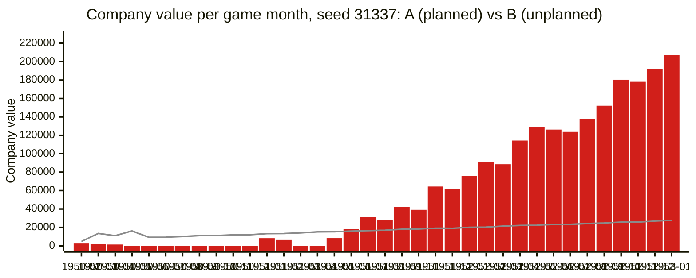
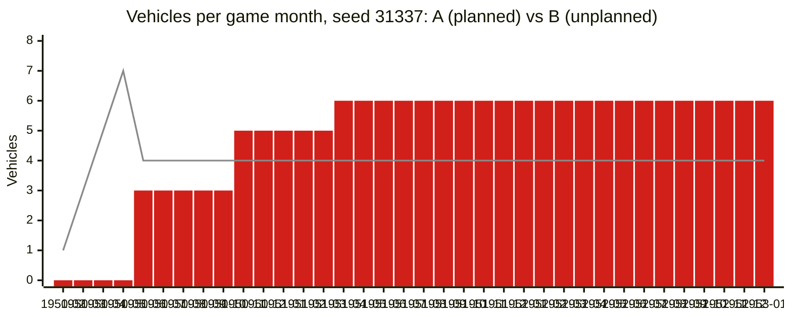

# Duel in one game: planned bot vs unplanned (seed 31337, 36 months)

Generated by `tools/research/mcp-duel` (current bot: eight freight lines, line upkeep, bridges, tunnels (bridge 4cf4a62)). One game, one map: company 1 is PrismaticAI started from
the planner's portfolio (by the panel), company 2 the same AI started without a plan right after it.
Both compete for the same towns and industries. Values come from the console's `companies` command.

- planner: Coal by rail Coal Mine -> Power Station, 153.0 tiles, profit 10758.0/month, score 166533.0 (line 4, built when the money allows)
- planner: Wood by rail Forest -> Sawmill, 238.0 tiles, profit 14187.0/month, score 215012.0 (line 3, built when the money allows)
- planner: Coal by rail Coal Mine -> Power Station, 227.0 tiles, profit 14079.0/month, score 240547.0 (line 2, built when the money allows)
- planner: passengers by rail New Prunpool - Little Bonnley Market, score 113003.0
- planner: the freight_rail line Coal Mine - Power Station was not priced on the map, so it is not handed to the bot blind; the next line it can build goes instead
- planner: Coal by rail Coal Mine -> Power Station, 212.0 tiles, profit 14568.0/month, score 252708.0
- planner: 11 rail line(s) priced on the map by track-planning, 11 with a route: 207 pieces 16639, 189 pieces 14325, 224 pieces 17070, 231 pieces 18345, 150 pieces 11385, 170 pieces 13725, 196 pieces 15943, 234 pieces 17895, 157 pieces 12328, 175 pieces 14391, 173 pieces 13528
- planner portfolio by algoglyph knapsack-dp: 5 investment(s), total score 754437.0, 295k of 300k

**Winner: A (planned).** Final company value: A 206995 vs B 27716.

<!-- duel-charts:begin -->
<!-- generated by tools/research/mcp-duel from this record's JSON; `mcp-duel --render` rewrites it, `mcp-duel --render --check` fails while it is stale -->

<!-- duel-charts:end -->

| Month | Date | A (planned) value | B (unplanned) value |
|---|---|---|---|
| 1 | 1950-02-05 | 2465 | 4720 |
| 2 | 1950-03-08 | 1940 | 13497 |
| 3 | 1950-04-07 | 1415 | 10950 |
| 4 | 1950-05-08 | 1 | 16188 |
| 5 | 1950-06-07 | 1 | 9224 |
| 6 | 1950-07-08 | 1 | 9363 |
| 7 | 1950-08-08 | 1 | 10066 |
| 8 | 1950-09-07 | 1 | 11028 |
| 9 | 1950-10-08 | 1 | 11125 |
| 10 | 1950-11-07 | 1 | 11905 |
| 11 | 1950-12-08 | 1 | 12067 |
| 12 | 1951-01-07 | 8224 | 13189 |
| 13 | 1951-02-07 | 6421 | 13359 |
| 14 | 1951-03-10 | 1 | 14066 |
| 15 | 1951-04-09 | 1 | 15156 |
| 16 | 1951-05-10 | 8269 | 15277 |
| 17 | 1951-06-09 | 18242 | 16056 |
| 18 | 1951-07-10 | 30953 | 16506 |
| 19 | 1951-08-09 | 27908 | 16917 |
| 20 | 1951-09-09 | 42006 | 18031 |
| 21 | 1951-10-10 | 39150 | 18203 |
| 22 | 1951-11-09 | 64383 | 19180 |
| 23 | 1951-12-10 | 61816 | 19062 |
| 24 | 1952-01-09 | 75897 | 20067 |
| 25 | 1952-02-09 | 91371 | 20311 |
| 26 | 1952-03-10 | 88517 | 21383 |
| 27 | 1952-04-10 | 114308 | 22120 |
| 28 | 1952-05-11 | 128773 | 22412 |
| 29 | 1952-06-10 | 126235 | 23159 |
| 30 | 1952-07-11 | 123783 | 23351 |
| 31 | 1952-08-10 | 137658 | 24188 |
| 32 | 1952-09-10 | 152166 | 24734 |
| 33 | 1952-10-11 | 180436 | 25772 |
| 34 | 1952-11-10 | 178182 | 25726 |
| 35 | 1952-12-11 | 192053 | 26880 |
| 36 | 1953-01-10 | 206995 | 27716 |

## Reading this result

A won 206995 to 27716 (7.5 to 1) with four trains, which is practically the run before on this
seed (duel-20261116T130634, bridges only: 204356 vs 28129). The label says "eight freight lines",
and the bot was bridge 4cf4a62, which takes eight. But this duel started before the Rust panel's bot
start was brought up to date (4d51c44497). So the panel still handed the bot at most four freight
lines, from ten planner candidates, with six lines priced per list. The run's own record says so
("line 4", 11 lines priced). The eight-line change is therefore not measured here. A rerun with the
current panel measures it.

| Month | A (planned) | Trains | B (unplanned) |
|---|---|---|---|
| 12 | 8224 | 2 | 13189 |
| 24 | 75897 | 4 | 20067 |
| 30 | 123783 | 4 | 23351 |
| 36 | **206995** | 4 | 27716 |
