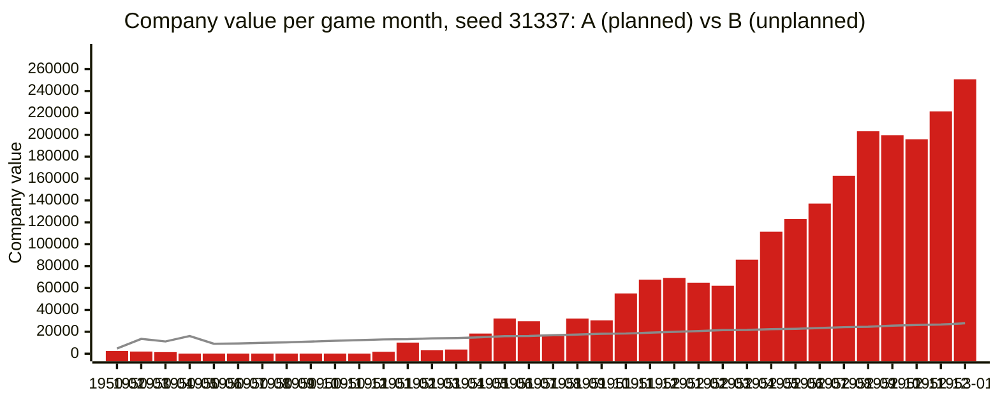
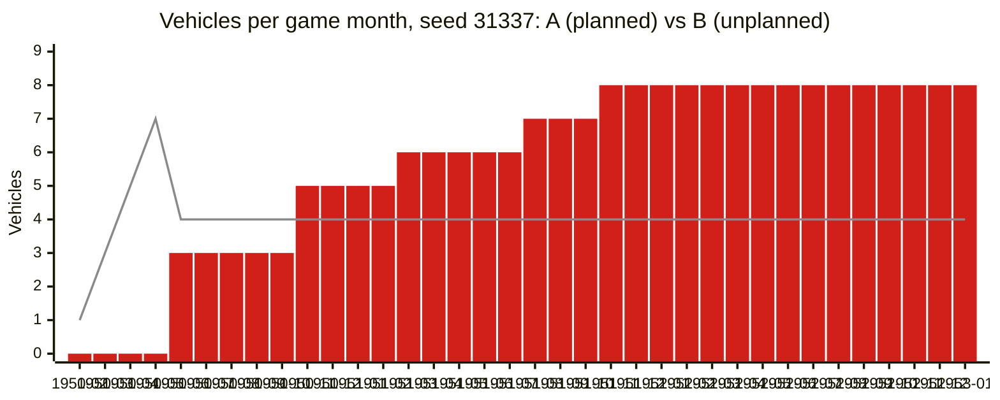

# Duel in one game: planned bot vs unplanned (seed 31337, 36 months)

Generated by `tools/research/mcp-duel` (panel bot start with eight freight lines, 30 candidates, 8 priced per list (4d51c44497), bot 4cf4a62). One game, one map: company 1 is PrismaticAI started from
the planner's portfolio (by the panel), company 2 the same AI started without a plan right after it.
Both compete for the same towns and industries. Values come from the console's `companies` command.

- planner: Wood by rail Forest -> Sawmill, 177.0 tiles, profit 10783.0/month, score 164447.0 (line 6, built when the money allows)
- planner: Coal by rail Coal Mine -> Power Station, 153.0 tiles, profit 10758.0/month, score 166533.0 (line 5, built when the money allows)
- planner: Wood by rail Forest -> Sawmill, 238.0 tiles, profit 14187.0/month, score 215012.0 (line 4, built when the money allows)
- planner: Coal by rail Coal Mine -> Power Station, 227.0 tiles, profit 14079.0/month, score 240547.0 (line 3, built when the money allows)
- planner: passengers by rail New Prunpool - Little Bonnley Market, score 113003.0
- planner: Coal by rail Coal Mine -> Power Station, 190.0 tiles, profit 9677.0/month, score 163280.0 (line 2, built when the money allows)
- planner: Coal by rail Coal Mine -> Power Station, 212.0 tiles, profit 14568.0/month, score 252708.0
- planner: 13 rail line(s) priced on the map by track-planning, 13 with a route: 207 pieces 16639, 189 pieces 14325, 224 pieces 17070, 231 pieces 18345, 150 pieces 11385, 170 pieces 13725, 187 pieces 15075, 131 pieces 11569, 196 pieces 15943, 234 pieces 17895, 157 pieces 12328, 175 pieces 14391, 173 pieces 13528
- planner portfolio by algoglyph knapsack-dp: 5 investment(s), total score 753612.0, 295k of 300k

**Winner: A (planned).** Final company value: A 250716 vs B 27768.

<!-- duel-charts:begin -->
<!-- generated by tools/research/mcp-duel from this record's JSON; `mcp-duel --render` rewrites it, `mcp-duel --render --check` fails while it is stale -->

<!-- duel-charts:end -->

| Month | Date | A (planned) value | B (unplanned) value |
|---|---|---|---|
| 1 | 1950-02-07 | 2465 | 4720 |
| 2 | 1950-03-10 | 1940 | 13497 |
| 3 | 1950-04-09 | 1415 | 11144 |
| 4 | 1950-05-10 | 1 | 16111 |
| 5 | 1950-06-09 | 1 | 9054 |
| 6 | 1950-07-10 | 1 | 9286 |
| 7 | 1950-08-10 | 1 | 9896 |
| 8 | 1950-09-09 | 1 | 10390 |
| 9 | 1950-10-10 | 1 | 11060 |
| 10 | 1950-11-09 | 1 | 11755 |
| 11 | 1950-12-10 | 1 | 12333 |
| 12 | 1951-01-09 | 1673 | 13033 |
| 13 | 1951-02-09 | 10121 | 13208 |
| 14 | 1951-03-02 | 3099 | 13967 |
| 15 | 1951-04-01 | 3789 | 14242 |
| 16 | 1951-05-02 | 18386 | 14970 |
| 17 | 1951-06-01 | 32071 | 16002 |
| 18 | 1951-07-02 | 29662 | 16135 |
| 19 | 1951-08-01 | 16172 | 16925 |
| 20 | 1951-09-01 | 32028 | 17428 |
| 21 | 1951-10-02 | 30359 | 18197 |
| 22 | 1951-11-01 | 55049 | 18417 |
| 23 | 1951-12-02 | 67661 | 19176 |
| 24 | 1952-01-01 | 69231 | 19941 |
| 25 | 1952-02-11 | 64855 | 20636 |
| 26 | 1952-03-03 | 62048 | 21506 |
| 27 | 1952-04-02 | 85892 | 21723 |
| 28 | 1952-05-03 | 111491 | 22459 |
| 29 | 1952-06-02 | 122979 | 22711 |
| 30 | 1952-07-03 | 137161 | 23445 |
| 31 | 1952-08-02 | 162598 | 24239 |
| 32 | 1952-09-02 | 203218 | 24555 |
| 33 | 1952-10-03 | 199599 | 25600 |
| 34 | 1952-11-02 | 195931 | 26140 |
| 35 | 1952-12-03 | 221362 | 26671 |
| 36 | 1953-01-02 | 250716 | 27768 |

## Reading this result

A won 250716 to 27768 (9.0 to 1) with six trains. The run before on the same map, with the panel's
older four-line bot start, ended 206995 to 27716 (7.5 to 1) with four trains
(duel-20261116T235622-seed31337). This time the panel handed the bot six freight lines, priced 13
lines on the map, and the bot built trains for six of them. The rival is unchanged (27716 vs 27768),
so the difference is the planned side's: **+21% company value from more lines**.

A was behind at month 12 (1673 vs 13033): building more lines costs more before they pay. It caught up
by month 19 and led at every month after that.

| Month | A (planned) | Trains | B (unplanned) |
|---|---|---|---|
| 12 | 1673 | 2 | 13033 |
| 24 | 69231 | 5 | 19941 |
| 30 | 137161 | 6 | 23445 |
| 36 | **250716** | 6 | 27768 |
