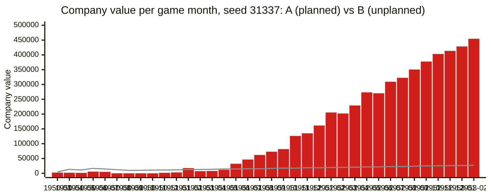
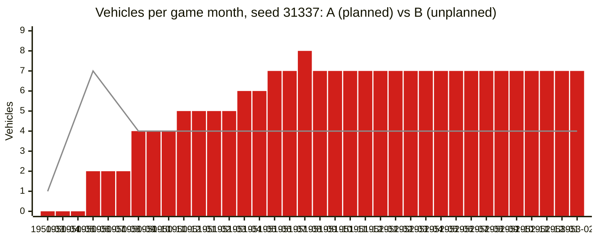

# Duel in one game: planned bot vs unplanned (seed 31337, 36 months)

Generated by `tools/research/mcp-duel` (diagonal track (a corner piece on a diagonal costs 2/3 of a straight one, heuristic 7/9) and side-by-side platforms when a line joins a station; bot 4cf4a62 + pathfinder and station changes). One game, one map: company 1 is PrismaticAI started from
the planner's portfolio (by the panel), company 2 the same AI started without a plan right after it.
Both compete for the same towns and industries. Values come from the console's `companies` command.

- planner: Wood by rail Forest -> Sawmill, 177.0 tiles, profit 10783.0/month, score 164447.0 (line 6, built when the money allows)
- planner: Coal by rail Coal Mine -> Power Station, 153.0 tiles, profit 10758.0/month, score 166533.0 (line 5, built when the money allows)
- planner: Wood by rail Forest -> Sawmill, 238.0 tiles, profit 14187.0/month, score 215012.0 (line 4, built when the money allows)
- planner: Coal by rail Coal Mine -> Power Station, 227.0 tiles, profit 14079.0/month, score 240547.0 (line 3, built when the money allows)
- planner: passengers by rail New Prunpool - Little Bonnley Market, score 113003.0
- planner: Coal by rail Coal Mine -> Power Station, 190.0 tiles, profit 9677.0/month, score 163280.0 (line 2, built when the money allows)
- planner: Coal by rail Coal Mine -> Power Station, 212.0 tiles, profit 14568.0/month, score 252708.0
- planner: 13 rail line(s) priced on the map by track-planning, 13 with a route: 207 pieces 16639, 189 pieces 14325, 224 pieces 17070, 231 pieces 18345, 150 pieces 11385, 170 pieces 13725, 187 pieces 15075, 131 pieces 11569, 196 pieces 15943, 234 pieces 17895, 157 pieces 12328, 175 pieces 14391, 173 pieces 13528
- planner portfolio by algoglyph knapsack-dp: 5 investment(s), total score 753612.0, 295k of 300k

**Winner: A (planned).** Final company value: A 454403 vs B 27228.

<!-- duel-charts:begin -->
<!-- generated by tools/research/mcp-duel from this record's JSON; `mcp-duel --render` rewrites it, `mcp-duel --render --check` fails while it is stale -->

<!-- duel-charts:end -->

| Month | Date | A (planned) value | B (unplanned) value |
|---|---|---|---|
| 1 | 1950-03-04 | 2465 | 4720 |
| 2 | 1950-04-04 | 1940 | 13498 |
| 3 | 1950-05-04 | 1415 | 11013 |
| 4 | 1950-06-04 | 5632 | 16706 |
| 5 | 1950-07-05 | 4854 | 14510 |
| 6 | 1950-08-04 | 1 | 12290 |
| 7 | 1950-09-04 | 1 | 9681 |
| 8 | 1950-10-04 | 1 | 10312 |
| 9 | 1950-11-04 | 1 | 10814 |
| 10 | 1950-12-05 | 1775 | 11171 |
| 11 | 1951-01-04 | 3056 | 11630 |
| 12 | 1951-02-04 | 17601 | 12726 |
| 13 | 1951-03-06 | 7210 | 12995 |
| 14 | 1951-04-06 | 7885 | 13501 |
| 15 | 1951-05-06 | 11739 | 14780 |
| 16 | 1951-06-06 | 32250 | 14563 |
| 17 | 1951-07-07 | 46415 | 15656 |
| 18 | 1951-08-06 | 61999 | 15396 |
| 19 | 1951-09-06 | 72952 | 16518 |
| 20 | 1951-10-06 | 81802 | 17563 |
| 21 | 1951-11-06 | 126239 | 17350 |
| 22 | 1951-12-06 | 135060 | 18745 |
| 23 | 1952-01-06 | 161353 | 18590 |
| 24 | 1952-02-06 | 205497 | 19656 |
| 25 | 1952-03-07 | 202110 | 20148 |
| 26 | 1952-04-07 | 229093 | 20602 |
| 27 | 1952-05-07 | 273445 | 21694 |
| 28 | 1952-06-07 | 270272 | 21654 |
| 29 | 1952-07-07 | 309302 | 22702 |
| 30 | 1952-08-07 | 322695 | 22615 |
| 31 | 1952-09-07 | 350595 | 23927 |
| 32 | 1952-10-07 | 377443 | 25080 |
| 33 | 1952-11-07 | 402993 | 25007 |
| 34 | 1952-12-07 | 413473 | 26065 |
| 35 | 1953-01-07 | 428427 | 26039 |
| 36 | 1953-02-06 | 454403 | 27228 |

## Reading this result

A won 454403 to 27228 (16.7 to 1) with five trains. On the same map, with the same panel and the same
plan, the bot without these changes ended 250716 to 27768 with six trains
(duel-20261117T003624-seed31337). The rival is unchanged, so the difference is the planned side's:
**+81% company value with one train fewer.**

Two changes to the bot (bridge repository, `ai/PrismaticAI/rail.nut`, on top of 4cf4a62):

1. **Diagonal track.** The pathfinder now costs track by travel. A straight piece is 16 steps of
   TILE_AXIAL_DISTANCE 192, a corner piece 8 steps of 2 × TILE_CORNER_DISTANCE (vehicle_base.h), so
   a corner piece on a diagonal costs 2/3 of a straight one. A turn is paid once, where the diagonal
   starts, and a U within two tiles is not taken. The estimate is 7 per tile left, between a diagonal
   piece (6) and a straight one (9). The first try used 6, which put every staircase toward the goal
   at the same f; the search spread out and lines failed, so that run was stopped. Corner pieces made
   up 48–76% of each line: 106 of 192, 106 of 226, 168 of 220, 98 of 142 and 114 of 176.
2. **Side-by-side platforms.** A line that joins a station now prefers a site right beside that
   station's platforms on the same axis. Here it changed nothing: both joins (Drinbourne Heights,
   Lentburg East) found no free site beside them and were logged "apart from its others".

The month-30 value was 322695, against 137161 without diagonals. A was ahead from month 12 on (17601
vs 1673 in the previous run).

What did not work:

- **The first coal line failed.** Pintborough Coal Mine to Drinbourne (212 tiles) found a path, but
  building stopped at tile 51297 with ERR_AREA_NOT_CLEAR, and the bot dropped the line. It has no
  re-plan from the failed piece; the previous run built this line.
- **The passenger pair failed at the station.** New Prunpool to Little Bonnley Market had no path
  after 1 node: the station exit has no usable neighbour. The previous run failed this pair the same
  way. The new diagnostic line says why.

| Month | A (planned) | Trains | B (unplanned) |
|---|---|---|---|
| 12 | 17601 | 2 | 12726 |
| 18 | 61999 | 5 | 15396 |
| 24 | 205497 | 5 | 19656 |
| 30 | 322695 | 5 | 22615 |
| 36 | **454403** | 5 | 27228 |

This is one seed. Repeating it on 20208 and 4242 would show whether the gain holds.
