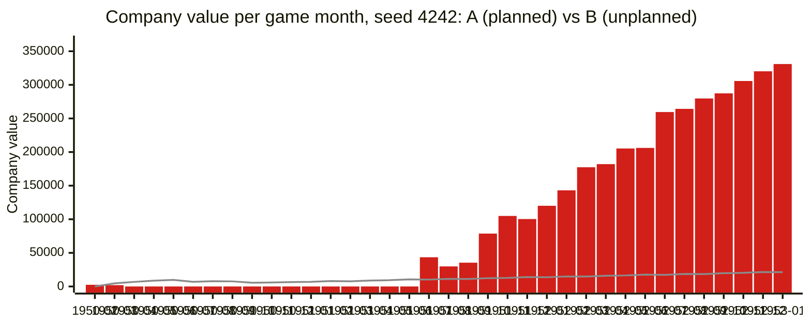
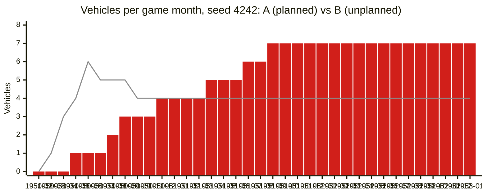

# Duel in one game: planned bot vs unplanned (seed 4242, 36 months)

Generated by `tools/research/mcp-duel` (diagonal track (bridge b4e20b5): repeat on a third seed). One game, one map: company 1 is PrismaticAI started from
the planner's portfolio (by the panel), company 2 the same AI started without a plan right after it.
Both compete for the same towns and industries. Values come from the console's `companies` command.

- planner: Wood by rail Forest -> Sawmill, 160.0 tiles, profit 8321.0/month, score 132207.0 (line 5, built when the money allows)
- planner: Iron Ore by rail Iron Ore Mine -> Steel Mill, 198.0 tiles, profit 8409.0/month, score 132646.0 (line 4, built when the money allows)
- planner: Grain by rail Farm -> Factory, 244.0 tiles, profit 9707.0/month, score 133624.0 (line 3, built when the money allows)
- planner: Wood by rail Forest -> Sawmill, 232.0 tiles, profit 10188.0/month, score 146478.0 (line 2, built when the money allows)
- planner: Coal by rail Coal Mine -> Power Station, 242.0 tiles, profit 9671.0/month, score 159966.0
- planner: passengers by rail Wranville - Drundstone, score 205283.0
- planner: 13 rail line(s) priced on the map by track-planning, 13 with a route: 239 pieces 18240, 229 pieces 17415, 226 pieces 17190, 245 pieces 18645, 158 pieces 13376, 152 pieces 12956, 197 pieces 15135, 209 pieces 15975, 205 pieces 15540, 221 pieces 16890, 226 pieces 17205, 246 pieces 18675, 266 pieces 20443
- planner portfolio by algoglyph knapsack-dp: 4 investment(s), total score 715672.0, 296k of 300k

**Winner: A (planned).** Final company value: A 330926 vs B 21331.

<!-- duel-charts:begin -->
<!-- generated by tools/research/mcp-duel from this record's JSON; `mcp-duel --render` rewrites it, `mcp-duel --render --check` fails while it is stale -->

<!-- duel-charts:end -->

| Month | Date | A (planned) value | B (unplanned) value |
|---|---|---|---|
| 1 | 1950-02-10 | 2480 | 1 |
| 2 | 1950-03-02 | 1955 | 4630 |
| 3 | 1950-04-02 | 1 | 6807 |
| 4 | 1950-05-02 | 1 | 8595 |
| 5 | 1950-06-02 | 1 | 9817 |
| 6 | 1950-07-03 | 1 | 6962 |
| 7 | 1950-08-02 | 1 | 7866 |
| 8 | 1950-09-02 | 1 | 7569 |
| 9 | 1950-10-02 | 1 | 5548 |
| 10 | 1950-11-02 | 1 | 5929 |
| 11 | 1950-12-02 | 1 | 6561 |
| 12 | 1951-01-02 | 1 | 6912 |
| 13 | 1951-02-02 | 1 | 8014 |
| 14 | 1951-03-04 | 1 | 7646 |
| 15 | 1951-04-04 | 1 | 8851 |
| 16 | 1951-05-04 | 1 | 9359 |
| 17 | 1951-06-04 | 1 | 10584 |
| 18 | 1951-07-05 | 43455 | 10284 |
| 19 | 1951-08-04 | 29865 | 11382 |
| 20 | 1951-09-04 | 35388 | 11095 |
| 21 | 1951-10-04 | 78676 | 12360 |
| 22 | 1951-11-04 | 104914 | 12766 |
| 23 | 1951-12-04 | 100328 | 13999 |
| 24 | 1952-01-04 | 120042 | 13736 |
| 25 | 1952-02-04 | 143012 | 14866 |
| 26 | 1952-03-05 | 177370 | 14749 |
| 27 | 1952-04-05 | 182021 | 15907 |
| 28 | 1952-05-05 | 205278 | 16402 |
| 29 | 1952-06-05 | 206147 | 17609 |
| 30 | 1952-07-06 | 259521 | 17314 |
| 31 | 1952-08-05 | 264245 | 18629 |
| 32 | 1952-09-05 | 279705 | 18484 |
| 33 | 1952-10-05 | 287294 | 19736 |
| 34 | 1952-11-05 | 305701 | 20277 |
| 35 | 1952-12-06 | 320137 | 21464 |
| 36 | 1953-01-05 | 330926 | 21331 |

## Reading this result

A won 330926 to 21331 (15.5 to 1) with six trains: five freight lines and the passenger pair
Wranville–Drundstone. Every line was built, with no failed piece and no missing path. Corner pieces made
up 27–78% of each line: 184/235, 110/215, 124/226, 120/242, 72/186 and 42/156. This is the third seed for
diagonal track (bridge b4e20b5).

This seed's previous 36-month result was 228703 with five trains (duel-20261116T134442, bridge b3e7722).
The bot and the panel's bot start have changed since then, so the +45% is not the diagonal alone; seed
31337 is the clean A/B.

A's value at month 12 was 1 (company value = money − loan + vehicles), because it had borrowed for
three lines and their track. A was at or behind B in months 2 to 17 and ahead in every month from
18 on.

| Month | A (planned) | Trains | B (unplanned) |
|---|---|---|---|
| 12 | 1 | 3 | 6912 |
| 24 | 120042 | 6 | 13736 |
| 30 | 259521 | 6 | 17314 |
| 36 | **330926** | 6 | 21331 |
