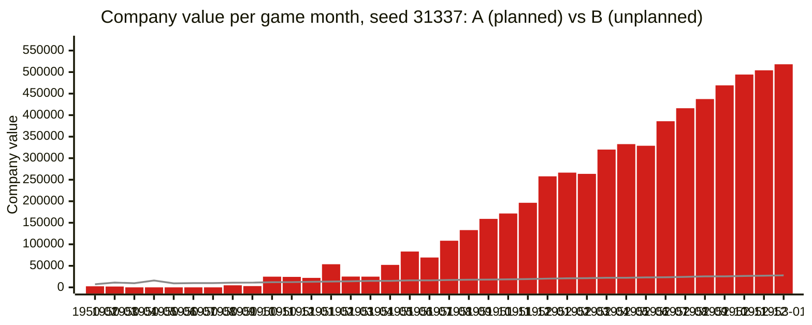
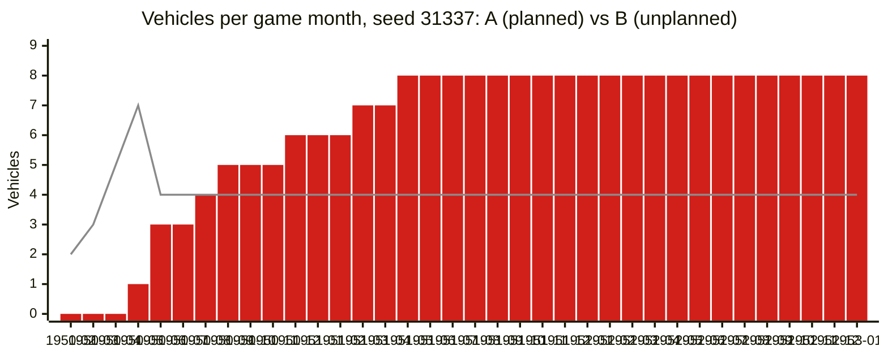

# Duel in one game: planned bot vs unplanned (seed 31337, 36 months)

Generated by `tools/research/mcp-duel` (re-plan around a refused rail piece (bridge f5f29d5) on top of diagonal track). One game, one map: company 1 is PrismaticAI started from
the planner's portfolio (by the panel), company 2 the same AI started without a plan right after it.
Both compete for the same towns and industries. Values come from the console's `companies` command.

- planner: Wood by rail Forest -> Sawmill, 177.0 tiles, profit 10783.0/month, score 164447.0 (line 6, built when the money allows)
- planner: Coal by rail Coal Mine -> Power Station, 153.0 tiles, profit 10758.0/month, score 166533.0 (line 5, built when the money allows)
- planner: Wood by rail Forest -> Sawmill, 238.0 tiles, profit 14187.0/month, score 215012.0 (line 4, built when the money allows)
- planner: Coal by rail Coal Mine -> Power Station, 227.0 tiles, profit 14079.0/month, score 240547.0 (line 3, built when the money allows)
- planner: passengers by rail New Prunpool - Little Bonnley Market, score 113003.0
- planner: Coal by rail Coal Mine -> Power Station, 190.0 tiles, profit 9677.0/month, score 163280.0 (line 2, built when the money allows)
- planner: Coal by rail Coal Mine -> Power Station, 212.0 tiles, profit 14568.0/month, score 252708.0
- planner: 13 rail line(s) priced on the map by track-planning, 13 with a route: 207 pieces 16639, 189 pieces 14325, 224 pieces 17070, 231 pieces 18345, 150 pieces 11385, 170 pieces 13725, 187 pieces 15075, 131 pieces 11569, 196 pieces 15943, 234 pieces 17895, 157 pieces 12328, 175 pieces 14391, 173 pieces 13528
- planner portfolio by algoglyph knapsack-dp: 5 investment(s), total score 753612.0, 295k of 300k

**Winner: A (planned).** Final company value: A 518138 vs B 27849.

<!-- duel-charts:begin -->
<!-- generated by tools/research/mcp-duel from this record's JSON; `mcp-duel --render` rewrites it, `mcp-duel --render --check` fails while it is stale -->

<!-- duel-charts:end -->

| Month | Date | A (planned) value | B (unplanned) value |
|---|---|---|---|
| 1 | 1950-02-06 | 2465 | 7172 |
| 2 | 1950-03-08 | 1940 | 11033 |
| 3 | 1950-04-08 | 1 | 9713 |
| 4 | 1950-05-09 | 1 | 15894 |
| 5 | 1950-06-08 | 1 | 9235 |
| 6 | 1950-07-09 | 1 | 9998 |
| 7 | 1950-08-08 | 1 | 9993 |
| 8 | 1950-09-08 | 4779 | 10832 |
| 9 | 1950-10-09 | 2980 | 10955 |
| 10 | 1950-11-08 | 24826 | 12067 |
| 11 | 1950-12-09 | 24316 | 12184 |
| 12 | 1951-01-08 | 22002 | 12885 |
| 13 | 1951-02-08 | 53693 | 13435 |
| 14 | 1951-03-11 | 25052 | 14156 |
| 15 | 1951-04-10 | 24864 | 14921 |
| 16 | 1951-05-11 | 52178 | 15029 |
| 17 | 1951-06-10 | 83201 | 16141 |
| 18 | 1951-07-11 | 69300 | 16251 |
| 19 | 1951-08-11 | 108319 | 17048 |
| 20 | 1951-09-10 | 132976 | 17804 |
| 21 | 1951-10-11 | 159066 | 18030 |
| 22 | 1951-11-10 | 171560 | 18744 |
| 23 | 1951-12-11 | 196425 | 19209 |
| 24 | 1952-01-10 | 257859 | 20267 |
| 25 | 1952-02-10 | 266471 | 21069 |
| 26 | 1952-03-02 | 263602 | 21375 |
| 27 | 1952-04-01 | 320010 | 22210 |
| 28 | 1952-05-02 | 332671 | 22360 |
| 29 | 1952-06-01 | 328882 | 23196 |
| 30 | 1952-07-02 | 385879 | 23420 |
| 31 | 1952-08-01 | 416024 | 24264 |
| 32 | 1952-09-11 | 437323 | 25556 |
| 33 | 1952-10-02 | 469140 | 25586 |
| 34 | 1952-11-01 | 494278 | 26487 |
| 35 | 1952-12-02 | 504107 | 26988 |
| 36 | 1953-01-01 | 518138 | 27849 |

## Reading this result

A won 518138 to 27849 (18.6 to 1) with six trains. This run was meant to test the re-plan around a
refused rail piece (bridge f5f29d5), and **it does not test it**. The piece that failed in the previous
run (tile 51297, ERR_AREA_NOT_CLEAR) was clear this time, so Pintborough Coal Mine to Drinbourne (212
tiles) was laid on the first try: 216 tiles, 166 corner pieces. The log has no "failed" and no
"re-planned" line. The re-plan code ran on no line and remains unmeasured.

Against the diagonal-track run on this map (duel-20261117T012840: 454403, five trains), the difference
is that sixth line. Its build failed there and succeeded here: a difference in timing, not in the bot.

The passenger pair New Prunpool to Little Bonnley Market failed as before, after 1 node: no neighbour
of the station exit was usable. The next bot change (ExitLeadsOn applies the pathfinder's slope rule
for a turn on the exit) targets that.

| Month | A (planned) | Trains | B (unplanned) |
|---|---|---|---|
| 12 | 22002 | 3 | 12885 |
| 24 | 257859 | 6 | 20267 |
| 30 | 385879 | 6 | 23420 |
| 36 | **518138** | 6 | 27849 |
