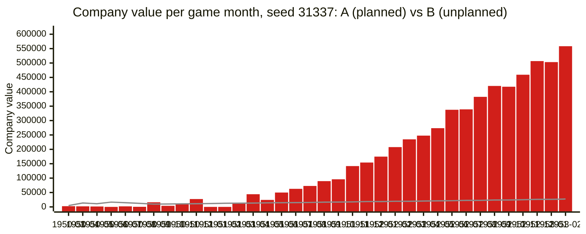
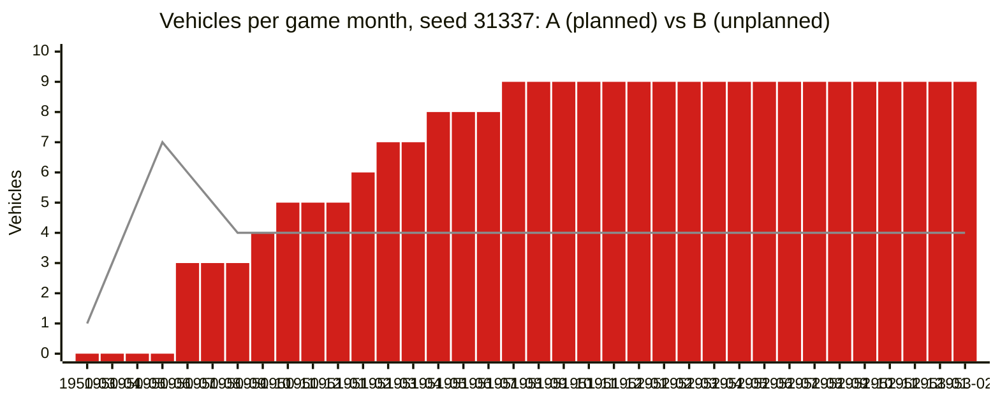

# Duel in one game: planned bot vs unplanned (seed 31337, 36 months)

Generated by `tools/research/mcp-duel` (rail lines in order of score, the passenger pair after better freight lines (rail_after; bridge 75d114e)). One game, one map: company 1 is PrismaticAI started from
the planner's portfolio (by the panel), company 2 the same AI started without a plan right after it.
Both compete for the same towns and industries. Values come from the console's `companies` command.

- planner: the passenger rail pair (score 113003) is built after 6 freight line(s) that score more
- planner: Coal by rail Coal Mine -> Power Station, 190.0 tiles, profit 9677.0/month, score 163280.0 (line 6, built when the money allows)
- planner: Wood by rail Forest -> Sawmill, 177.0 tiles, profit 10783.0/month, score 164447.0 (line 5, built when the money allows)
- planner: Coal by rail Coal Mine -> Power Station, 153.0 tiles, profit 10758.0/month, score 166533.0 (line 4, built when the money allows)
- planner: Wood by rail Forest -> Sawmill, 238.0 tiles, profit 14187.0/month, score 215012.0 (line 3, built when the money allows)
- planner: Coal by rail Coal Mine -> Power Station, 227.0 tiles, profit 14079.0/month, score 240547.0 (line 2, built when the money allows)
- planner: Coal by rail Coal Mine -> Power Station, 212.0 tiles, profit 14568.0/month, score 252708.0
- planner: passengers by rail New Prunpool - Little Bonnley Market, score 113003.0
- planner: 13 rail line(s) priced on the map by track-planning, 13 with a route: 207 pieces 16639, 189 pieces 14325, 224 pieces 17070, 231 pieces 18345, 150 pieces 11385, 170 pieces 13725, 187 pieces 15075, 131 pieces 11569, 196 pieces 15943, 234 pieces 17895, 157 pieces 12328, 175 pieces 14391, 173 pieces 13528
- planner portfolio by algoglyph knapsack-dp: 5 investment(s), total score 753612.0, 295k of 300k

**Winner: A (planned).** Final company value: A 558331 vs B 27408.

<!-- duel-charts:begin -->
<!-- generated by tools/research/mcp-duel from this record's JSON; `mcp-duel --render` rewrites it, `mcp-duel --render --check` fails while it is stale -->

<!-- duel-charts:end -->

| Month | Date | A (planned) value | B (unplanned) value |
|---|---|---|---|
| 1 | 1950-03-08 | 2465 | 4720 |
| 2 | 1950-04-07 | 1940 | 13496 |
| 3 | 1950-05-08 | 1415 | 11090 |
| 4 | 1950-06-08 | 1 | 16662 |
| 5 | 1950-07-08 | 1866 | 14446 |
| 6 | 1950-08-08 | 316 | 12257 |
| 7 | 1950-09-07 | 15989 | 9618 |
| 8 | 1950-10-08 | 3757 | 9989 |
| 9 | 1950-11-08 | 11528 | 10660 |
| 10 | 1950-12-08 | 27272 | 11117 |
| 11 | 1951-01-08 | 1 | 11559 |
| 12 | 1951-02-07 | 1 | 12584 |
| 13 | 1951-03-10 | 12335 | 12974 |
| 14 | 1951-04-10 | 44044 | 13380 |
| 15 | 1951-05-10 | 24267 | 14082 |
| 16 | 1951-06-10 | 49884 | 14518 |
| 17 | 1951-07-10 | 62784 | 14904 |
| 18 | 1951-08-10 | 72789 | 15351 |
| 19 | 1951-09-10 | 89522 | 16484 |
| 20 | 1951-10-10 | 95913 | 16904 |
| 21 | 1951-11-10 | 141829 | 17327 |
| 22 | 1951-12-10 | 154144 | 18614 |
| 23 | 1952-01-10 | 174705 | 18564 |
| 24 | 1952-02-10 | 207792 | 19577 |
| 25 | 1952-03-01 | 234726 | 19542 |
| 26 | 1952-04-11 | 247674 | 20503 |
| 27 | 1952-05-01 | 273527 | 21051 |
| 28 | 1952-06-11 | 337503 | 21535 |
| 29 | 1952-07-01 | 338953 | 22704 |
| 30 | 1952-08-01 | 382428 | 22555 |
| 31 | 1952-09-11 | 420266 | 23882 |
| 32 | 1952-10-01 | 417570 | 23853 |
| 33 | 1952-11-11 | 459281 | 24883 |
| 34 | 1952-12-01 | 506654 | 26138 |
| 35 | 1953-01-11 | 503161 | 26192 |
| 36 | 1953-02-11 | 558331 | 27408 |

## Reading this result

A won 558331 to 27408 (20.4 to 1) with seven trains, the best result on this map so far. The change
from the run before (duel-20261117T032759) is only the **order** in which the bot builds the same
seven lines. The panel now passes the freight lines in order of score, plus `rail_after`, the number
of freight lines that score above the passenger pair (bridge 75d114e). The pair scored 113003, below
all six freight lines (163280 to 252708), so `rail_after` was 6 and the pair came last. Before, it came
second.

| Month | A, by score (this run) | A, pair second (032759) | A, no pair (024703) | B (this run) |
|---|---|---|---|---|
| 12 | 1 | 12204 | 22002 | 12584 |
| 18 | 72789 | — | — | 15351 |
| 24 | 207792 | 175162 | 257859 | 19577 |
| 30 | 382428 | 339267 | 385879 | 22555 |
| 36 | **558331** | 505369 | 518138 | 27408 |

**+10.5%** against the same lines in the old order, and +7.8% against the run without the passenger
line. At month 12 A's value was 1: it had borrowed for three freight lines at once. A was at or
behind B in months 1 to 6, 8 and 11 to 13, and ahead from month 14 on. It was behind the
run without the pair until month 30 and ahead at 36. All lines were laid with no failed piece, so a
re-plan was not needed (it is still unmeasured).

One seed, one run each. The order rule is generic (score first), but the size of the gain depends on
how far a passenger pair scores below the freight lines.
