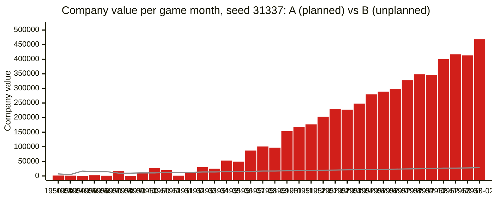
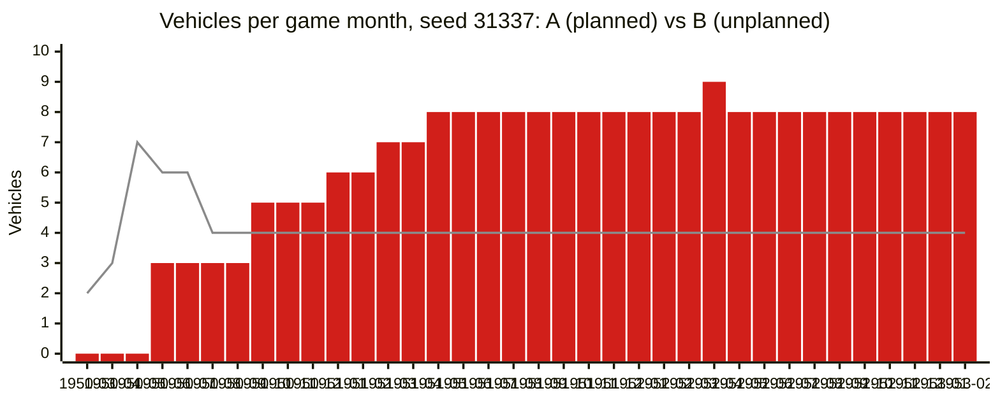

# Duel in one game: planned bot vs unplanned (seed 31337, 36 months)

Generated by `tools/research/mcp-duel` (two platforms side by side where two planned lines meet (transfer yard), on top of lines in order of score). One game, one map: company 1 is PrismaticAI started from
the planner's portfolio (by the panel), company 2 the same AI started without a plan right after it.
Both compete for the same towns and industries. Values come from the console's `companies` command.

- planner: the passenger rail pair (score 113003) is built after 6 freight line(s) that score more
- planner: Coal by rail Coal Mine -> Power Station, 190.0 tiles, profit 9677.0/month, score 163295.0 (line 6, built when the money allows)
- planner: Wood by rail Forest -> Sawmill, 177.0 tiles, profit 10783.0/month, score 164447.0 (line 5, built when the money allows)
- planner: Coal by rail Coal Mine -> Power Station, 153.0 tiles, profit 10758.0/month, score 166533.0 (line 4, built when the money allows)
- planner: Wood by rail Forest -> Sawmill, 238.0 tiles, profit 14187.0/month, score 215012.0 (line 3, built when the money allows)
- planner: Coal by rail Coal Mine -> Power Station, 227.0 tiles, profit 14079.0/month, score 240547.0 (line 2, built when the money allows)
- planner: Coal by rail Coal Mine -> Power Station, 212.0 tiles, profit 14568.0/month, score 252708.0
- planner: passengers by rail New Prunpool - Little Bonnley Market, score 113003.0
- planner: 13 rail line(s) priced on the map by track-planning, 13 with a route: 207 pieces 16639, 189 pieces 14325, 224 pieces 17070, 231 pieces 18345, 150 pieces 11385, 170 pieces 13725, 187 pieces 15060, 131 pieces 11569, 196 pieces 15943, 234 pieces 17895, 157 pieces 12328, 175 pieces 14391, 173 pieces 13528
- planner portfolio by algoglyph knapsack-dp: 5 investment(s), total score 753627.0, 295k of 300k

**Winner: A (planned).** Final company value: A 468228 vs B 28331.

<!-- duel-charts:begin -->
<!-- generated by tools/research/mcp-duel from this record's JSON; `mcp-duel --render` rewrites it, `mcp-duel --render --check` fails while it is stale -->

<!-- duel-charts:end -->

| Month | Date | A (planned) value | B (unplanned) value |
|---|---|---|---|
| 1 | 1950-03-08 | 1610 | 7089 |
| 2 | 1950-04-08 | 1085 | 4612 |
| 3 | 1950-05-08 | 1 | 16671 |
| 4 | 1950-06-08 | 2222 | 14663 |
| 5 | 1950-07-09 | 665 | 14794 |
| 6 | 1950-08-08 | 16404 | 9785 |
| 7 | 1950-09-08 | 1 | 9458 |
| 8 | 1950-10-08 | 11161 | 10536 |
| 9 | 1950-11-08 | 27242 | 10373 |
| 10 | 1950-12-09 | 19871 | 11384 |
| 11 | 1951-01-08 | 936 | 12524 |
| 12 | 1951-02-08 | 11981 | 12325 |
| 13 | 1951-03-10 | 29844 | 13625 |
| 14 | 1951-04-10 | 24805 | 13578 |
| 15 | 1951-05-10 | 52751 | 14601 |
| 16 | 1951-06-10 | 49231 | 15145 |
| 17 | 1951-07-11 | 87093 | 15594 |
| 18 | 1951-08-10 | 100901 | 16919 |
| 19 | 1951-09-10 | 97083 | 16854 |
| 20 | 1951-10-10 | 153842 | 17955 |
| 21 | 1951-11-10 | 167989 | 18552 |
| 22 | 1951-12-11 | 176789 | 19001 |
| 23 | 1952-01-10 | 202861 | 19440 |
| 24 | 1952-02-10 | 229755 | 20019 |
| 25 | 1952-03-01 | 227331 | 21180 |
| 26 | 1952-04-11 | 248056 | 21616 |
| 27 | 1952-05-01 | 279598 | 22282 |
| 28 | 1952-06-01 | 288901 | 22163 |
| 29 | 1952-07-02 | 297467 | 23343 |
| 30 | 1952-08-01 | 328055 | 24127 |
| 31 | 1952-09-11 | 348520 | 24644 |
| 32 | 1952-10-01 | 346305 | 25841 |
| 33 | 1952-11-11 | 400528 | 26952 |
| 34 | 1952-12-02 | 416893 | 26990 |
| 35 | 1953-01-01 | 413117 | 27527 |
| 36 | 1953-02-11 | 468228 | 28331 |

## Reading this result

A won 468228 to 28331 with six trains: **16% below** the run before (duel-20261117T041705: 558331, seven
trains), whose only difference was the station layout. This run tried transfer yards (bridge 3840fc6).
Where two planned freight lines go to the same industry, the first line's station there gets two
platforms side by side, and the later line takes the second one.

- **Lentburg Sawmill: it worked.** Two platforms (tiles 15895 and 16151), and the second wood line
  took the kept platform: 165 tiles, against 171 to a station of its own before.
- **Drinbourne Power Station: it failed.** Two platforms (23565 and 23566), but the second coal line
  found no route to the second platform's exit after 67571 nodes and was dropped. The first line had
  kept off only that exit and the tile beyond it; its track then turned across the next tile and walled
  the platform in. That lost line is the gap to the run before.

The fix is bridge 6f78532. The first line keeps off a corridor of four tiles straight out of the second
platform, and a line that cannot reach the kept platform builds a station of its own instead of being
dropped. The next run measures it.

| Month | A (this run) | Trains | A (041705) | B (this run) |
|---|---|---|---|---|
| 12 | 11981 | 3 | 1 | 12325 |
| 24 | 229755 | 5 | 207792 | 20019 |
| 30 | 328055 | 6 | 382428 | 24127 |
| 36 | **468228** | 6 | 558331 | 28331 |
